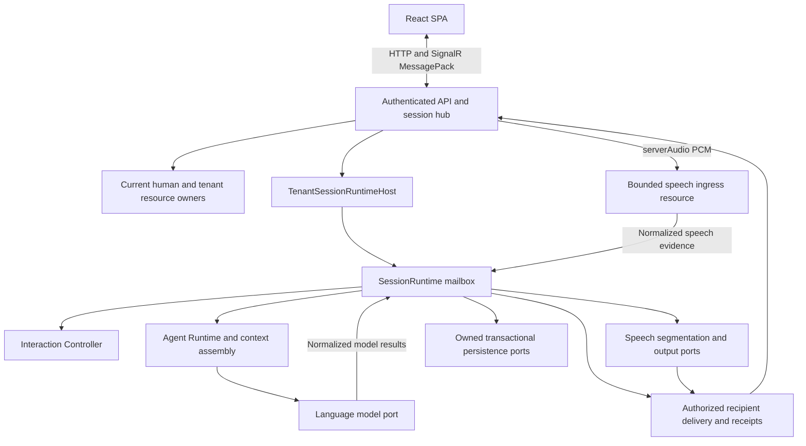
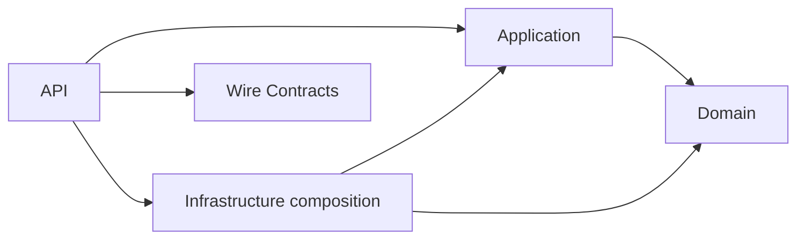

# System Architecture

Production Hardening's initial deployed posture is one direct-HTTPS API/SPA process with one local SQLite installation and private matching roots. Startup preflight and a process-held database ownership lease enforce that supported topology before workers start. No reverse-proxy/forwarded-header trust or additional scheduler is introduced. Unqualified Browser/OpenSandbox execution is refused outside Development. [Operations](17-observability-and-operations.md#controlled-single-host-deployment-preflight) owns deployment details; [the evidence ledger](reports/production-hardening-delivery-2026-10-30.md) owns qualification status.

## Formal Workflows implementation

The owner-authorized successor permits embedded Elsa solely for closed graph traversal/bookmarks while Core retains tenant catalog, Task/Run execution, IAM, Goal/Evaluation evidence and procedural decision ownership. The [architecture contract](formal-workflows-architecture.md) defines the trusted continuation and durable bridge; the [technology decision](10-technology-decisions.md#decision-bounded-embedded-formal-workflows) bounds the exception to generic workflow-engine exclusions. The bounded successor is implemented with [focused local evidence](reports/formal-workflows-delivery-2026-10-28.md); earlier Automation features retain their historical scope and their scheduler remains the occurrence owner.

Host Sandbox readiness is infrastructure reachability and mount readiness only. It does not enumerate a global profile catalog or confer authority. Each tenant Run retains its admitted profile/Instance verification, captured Space mounts, current IAM and exact approval checks. Filesystem and retirement adapters ship together at contract 5. [Cutover](clean-baseline-cutover.md).

## Dynamic model management

Model reference inspection is a current-human, read-only projection through `TenantModelManagementService` and the existing model store. It filters resource visibility before counting/paging and repeats the security revision fence; it grants no execution or mutation authority. Safe retirement retains model rows, assignments and captured Run/approval provenance. Physical model/connection deletion is not exposed. Configuration confirmation previews readable references, while the existing mutation transaction remains authoritative for default/credential references and current revisions.

The owner-authorized 25 October proposal adds tenant-owned provider connections, model offerings and explicit tenant defaults, plus shared system presets. Protected inference credentials stay in the incumbent Credential owner and cannot be Agent tool bindings. Native adapters implement the existing language-model contract; Session Runtime and canonical Run/approval/checkpoint owners retain execution ownership. The cutover removes static Real routing and global inference injection. [Delivery ledger](reports/dynamic-model-management-delivery-2026-10-25.md#final-requirement-audit) records completed local integration, focused evidence and live-provider/CI limits.

An idle human conversation's model preference changes through the existing tenant Session transaction, under the existing Runtime host's quiescent reservation. The command rechecks current human/Agent/model authority and refuses live Run or Voice ownership; both stores also refuse nonterminal Runs under their write transaction. It changes only the Session selection for future admission. Historical Run bindings and continuation identity remain immutable. Chat catalog defaults use the same inherited-choice policy as admission, scoped to the actual Agent Instance.

This document owns the current responsibility model, dependency boundaries and invariants. Detailed application contracts belong to [Backend Interfaces](04-backend-interfaces.md), browser/wire contracts to [Protocol](14-api-and-realtime-protocol.md), and durable schema/configuration to [Persistence](15-persistence-and-configuration.md). Dated reports qualify their recorded versions; they are evidence, not alternative current interfaces.

The Account/tenant successor has completed local implementation and Synthetic proposal acceptance. [Final delivery](reports/tenant-final-delivery-2026-10-24.md) and the [stabilization follow-up](reports/iam-stabilization-2026-10-24.md) distinguish that scope from deployment, live-provider/customer, physical-device and optional CI qualification.

## Space and Environment cutover (2026-10-25)

The approved successor keeps Tenant as the security boundary and Definition → Instance as the agent identity/configuration model. `AgentDefinition.ExecutionPolicy` (`DefinitionExecutionPolicy`, serialized `executionPolicy`) owns tools, harness, knowledge and template defaults. The retired definition `environment` field is rejected; it is not a Space Environment alias.

A tenant-owned Space provides situational instructions and the persistent home. Private and Shared Spaces use one model. Instance provisioning atomically creates exactly one Private Space and its protected owner membership. Shared memberships identify participating Instances and carry responsibilities/instructions, disabled inherited stable binding keys and explicit added resource references. Effective availability is computed as inherited minus disabled plus added, deduplicated by stable identity; conflicting account aliases are rejected. Availability never replaces current IAM or durable effect approval.

Session selection is a canonical owned value written through the existing mailbox/serialized commit path. Each Run captures its Space/Membership/profile identity and instructions. A live human switch affects the next Run; admitted effects and background children retain their causal Run's context. Fresh admissions compare current source revisions atomically, while existing Runs keep their interpretation pins and recheck current membership/IAM before effects. Completion-report admission captures the destination Session separately from the child's original source context. Prepared operations and direct workspace/preference effects bind their Space identity into action hashes; semantic root correlation separates distinct Spaces and Environments without treating mutable revisions as new user intent. Contextual Credential aliases use the same canonical protected consumers and independent consent/receipt owners as inherited bindings.

Space-owned immutable file resources use the closed `space:{spaceId}:{resourceId}` origin, with tenant/Space/resource/revision provenance in the immutable manifest. Registration captures bounded authorized home bytes into the existing verified content-addressed resource store; the normalized Space source row owns metadata and revisions. A membership explicitly adds that source, and `resources.read` uses its actual Space source scope. The execution Instance, display path and account alias never substitute for source ownership. Native file changes do not refresh a saved snapshot. Current binding, source revision, IAM, capability and exact consent are rechecked at protected reads, publication and the atomic output boundary. No global resource catalog, Instance copy or second approval owner is introduced.

The successor connects Space-owned homes and direct sandbox mounts, per-Session selection and immutable Run captures, protected contextual consumers, optional typed profiles, tenant Secrets, exact Automation/event pins, management/Chat UI and recovery through the existing owners. [Implementation evidence](reports/space-environment-implementation-2026-10-25.md) distinguishes observed local Synthetic/native/Docker qualification from deployment and live SDK contract-5 attestation. Existing execution/recovery/mailbox invariants continue to apply.

## Decision

Agent Core is one .NET 10 modular monolith with a React/Vite SPA using Ant Design v6 directly. The Agent Runtime owns conversational meaning; the Interaction Controller arbitrates turn-taking. One Session Runtime mailbox owns their live conversation state. Authoring, IAM, scheduling and resource operations sit beside that conversation path, with their own explicit application owners.

The composed voice path is **STT → Interaction Controller → text Agent Runtime/LLM → speech segmentation → TTS**. Text and voice are modes of the same Session. Native realtime speech-to-speech, WebRTC, microservices, a broker, generic repositories, a Task/workflow engine and multi-agent orchestration are not introduced by the existing bounded Automation/background features. [Technology Decisions](10-technology-decisions.md) and [Repository Structure](11-repository-structure.md) own technology and project references.

Raw PCM takes the bounded speech-resource path, not the normal domain mailbox. Provider work executes outside the mailbox and returns normalized, identity-tagged results. The diagram's ports are replaceable adapters, not additional domain services or policy engines.

## Responsibility model

| Concern | Current application owner | Authority and durable boundary |
| --- | --- | --- |
| Accounts and authentication | `IdentityService` and the API identity boundary | Account/server-session validity; original-human witnesses for protected reads and writes |
| Tenant membership and IAM | `TenantAccessService`, `IamAuthorizer` | Tenant principals, role assignments, exact scopes and last-owner constraints |
| Definition drafts/publications | `TenantDefinitionService` | Owned candidate/resources/evaluation state and atomic immutable publication; approved built-ins are read-only templates |
| Agent Instance configuration | `TenantAgentService`, `TenantAgentConfigurationService`, `TenantAgentDecommissionService` | Current actor, parent/child/source rights, sparse overrides, lifecycle/reference proofs, revisions and audit |
| Session metadata and human input | `TenantSessionService`, `TenantRunService` and tenant input owners | Atomic accepted input, Session/Activation/Run admission and exact replay |
| Live conversation | `TenantSessionRuntimeHost` and `SessionRuntime` | One current claimed generation and one mailbox writer for the owned Session |
| Run coordination/recovery | `TenantRunExecution`, shared `AgentRunCoordinator`, `TenantRunContinuationService` | Tenant-bound claims, attempts, checkpoints, exact continuation and retirement |
| Automation/event admission | `TenantAutomationService`, `TenantAutomationMutationService`, `TenantEventProcessor` | Current author/task/source authority, immutable accepted occurrences and owned destination admission |
| Protected operations | `TenantApprovalService`, `TenantApprovedOperationService` and typed effect owners | Exact preparation, current human decision, narrow grants, effect fencing and durable receipts |
| Learned Memory and continuity | `TenantMemoryService`, `TenantMemoryManagementService`, `TenantContinuityReadService`, `TenantExperienceOperationService` | Actual tenant/Agent/user/source ownership; independent read/manage and policy checks |
| Private files, accounts and native resources | Their tenant resource/read/effect services | Current raw permissions, source/target witnesses and appropriate human or Runtime frame; adapter possession is insufficient |
| Physical persistence/providers | Infrastructure adapters behind application ports | Transaction, serialization and I/O mechanics; they do not confer actor authority |

Shared pure configuration composers, native serializers and reference/lifecycle coordination may retain historical names. They do not replace the current tenant owners or authorize a caller. Do not infer authority or delete a required primitive from a class name.

The dependency direction remains:

Domain is BCL-only. Application owns ports and normalized values, without ASP.NET/EF/provider DTOs. Infrastructure implements those ports. Contracts contains wire records rather than provider or persistence objects. The API authenticates, maps and composes these layers; browser affordances do not authorize backend actions.

## Per-session execution

### Ownership

An owned Session can have at most one current conversational Runtime. Its mailbox owns conversation/controller mutation, response state, transcript assembly, application sequencing and playback estimates. Network enumeration, model/TTS/classifier work and persistence I/O are supervised outside that reader. Results return with the current Session epoch, response/utterance/operation identity and Run generation as applicable. Cancellation alone does not authorize a callback.

Canonical stores own atomic input/admission and durable Run transitions. Detached/quiescent mutations use their existing ownership, revision and host-reservation protocols; they do not become a concurrent conversational writer. `SessionRuntimeFactory.CreateTenant` requires the tenant storage, execution, continuation and private-source owners. It has no global Profile or unowned Run-store fallback.

The Interaction Controller keeps observing input while model work runs. Speech activity can produce Continue instead of Interrupt; initiative may choose StaySilent. The controller's detailed transitions and timing belong to [Interaction Controller](05-interaction-controller.md). No handler holds a lock across a provider stream or waits for an entire generation to complete inside the mailbox.

### Canonical runtime registry and process lifetime

`TenantSessionRuntimeHost` is the singleton registry used by tenant Run dispatch, human input, foreground, cancellation, receipts and Runtime-state controls. `TenantRuntimeCapacity` bounds live process resources independently of authorization. A durable inactive record does not itself create a Runtime; capacity or a subscription cannot grant access.

A replacement claimed attempt waits for its retiring Runtime, then reloads current claim, authority and checkpoint before dispatch. Another Run in the same Session similarly waits for a terminal predecessor's resource retirement; an active predecessor refuses conflicting dispatch. Waiting holds no registry lock and does not manufacture a claim or repeat an effect.

An accepted Run can outlive a browser subscription. Disconnect, voice-resource retirement and reconnect follow their lease/protocol owners. Reconnect reads current stored state and delivery receipts; it does not resume an old provider stream. Shutdown closes admission, supervises cancellation/retirement and shares one idempotent drain. See [Runtime registration evidence](reports/runtime-registry-cutover-verification-2026-10-21.md) and [Protocol](14-api-and-realtime-protocol.md).

## Invariants

- One Session Runtime mailbox owns a Session's live conversation and controller state.
- Raw audio does not enter the normal domain mailbox or persisted conversation state.
- Provider DTOs never cross Infrastructure into Domain, Application or Contracts; STT, LLM and TTS remain independently replaceable.
- Superseded responses never become visible again. Retained interrupted text cannot be extended by late text, audio, completion or playback events.
- Supersession marks identity retirement before cancellation, stops new speech segments and drops queued output before a replacement response becomes visible.
- Identity/generation checks apply at mailbox admission, delivery, browser reduction and playback. The microphone remains active during serverAudio agent speech, subject to explicit mute/end/disconnect.
- One live response, historical responses and a current user utterance can coexist. Session continuity is independent of its text/voice mode.
- Future conversation context respects received/heard prefixes. Unseen or unheard generated tails cannot silently enter it; display/speech/blocks belong to response delivery, not persona configuration.
- Definitions contain no mutable Session state, transient audio, provider handles or cancellation sources.
- Compaction runs outside the mailbox; only the mailbox commits a still-current result. Raw history is not rewritten by compaction or learned Memory.
- Tenant, executor, original-human and resource ownership are server-derived. A source ID, model argument, descriptor, digest, saved view or capacity reservation grants no authority.
- Current permissions and source-specific restrictions can narrow an admitted Run; later configuration cannot silently widen its pinned authority.
- Synthetic execution needs no AI credentials or external provider calls. Hosted/native acceptance is reported separately from deterministic local evidence.

## Accounts, tenant IAM and approvals

A global Account can join multiple Tenants through distinct TenantUser principals. An Agent is a tenant-local SystemIdentity/Principal bound to one Instance; it does not inherit its creator's roles. Current membership in one Tenant grants nothing in another. Owner is a human tenant role, not an Agent rank or implicit global capability. Membership/role/lifecycle mutations enforce their current last-owner/operator protections.

System administration is a separate permission plane. Platform Operator permissions alone do not read tenant-private resources; the same Account may separately use an authorized tenant membership. Cookie-authenticated HTTP mutations use CSRF protection. Hub controls, private downloads and original-human operations reauthorize their actual caller and target through the current tenant boundary. Webhook/OAuth ingress uses its dedicated bound proof, not a caller-supplied human principal.

### Runtime authorization

Definition capabilities, Instance choices, delegated management, model support and execution budgets constrain what can be offered. Execution additionally resolves actual stored Session/Run/executor ownership and the live Running, uncancelled, unexpired claim generation. `TenantToolAuthorization` supplies the common boundary; typed read/effect owners recheck their own current permissions, consent and source/target witnesses. Native/Runtime commands cannot borrow the generic IAM parser or a global provider fallback.

The Agent's own IAM authorizes actions. Requester rights influence requester-aware review, not an intersection or union of executable roles. A genuinely admitted no-human Automation/event has no fictitious requester. ReadOnly, Mutation and Sensitive Core minimums remain None, WhenRequesterLacksPermission and Always; tenant governance may tighten them. Human-only/system-only and nondelegatable reserves remain separate hard gates. The [current permission/default inventory](reports/tenant-approval-defaults-audit-2026-10-24.md) owns exact keys, flags, roles and qualification.

### Durable approval ownership

Review consents to an exact operation for which the Agent already has authority. ExceptionalGrant supplies only an eligible exact missing primary permission; it cannot supply source reads, secondary actions, another Agent or a whole Run. Preparation binds target, canonical arguments/hash and revision/source witnesses. A decision rechecks the current human's underlying and approval/delegation rights, plus independence when required.

Request/decision/grant/receipt and Run transition facts use the existing tenant transaction and processed-signal machinery. Waiting releases execution resources; an authorized outcome resumes only the exact saved operation. Current revocation, drift, expiry and grantor qualification still apply at effect time. Unknown effects are reconciled or reported, never blindly replayed.

Root-level fingerprint correlation suppresses pending or terminal duplicate requests across continuations/children. A genuinely new independent input has a new root. No Task entity, ambient grant or live modal supplies this lifetime. [Approval contracts](04-backend-interfaces.md#account-and-scoped-iam-ports-identity-foundation) own the detailed decision/continuation rules.

## Definitions and effective configuration

Definitions/publications are immutable versioned configuration, with separately authorized draft/resource/evaluation operations. New publication or deprecation does not rewrite an existing Session/Run. Built-ins are approved immutable global templates; tenant publications and child content resolve through their actual owning bindings. A composite/global catalogue is not a private tenant fallback.

An Instance selects a Definition version and stores persona, sparse field choices, Skill/Resource choices and execution controls. Missing override fields inherit current selected defaults; explicit choices and freeze remain meaningful. `TenantRunConfigurationResolver` freezes effective configuration, source map, model and complete Skill/capability catalog at each new Run. An existing Session can therefore use newly saved configuration on its next Run while its active Run remains pinned. Trusted bounded configuration continuation uses its existing fresh-Run/receipt protocol rather than mutating an active instruction set.

Pure shared resolution primitives are reused across views and admission; there is no universal mutable configuration object. Admin projections, candidate evaluation and conversational execution compose only the data authorized for their use case. [Instance contracts](04-backend-interfaces.md#tenant-instance-configuration-ports) own field/source/constraint and version-adoption behavior.

### Self-management and contextual Harness

Self-management belongs to ordinary Agent Instances. There is no built-in Admin Assistant identity, facade or separate lifecycle. Existing tools are own-Instance only; a future user-configured administrative helper needs both IAM and supported target-aware tools for broader operations. The canonical resolver reads sparse overrides only; the [one-time persistence cutover](15-persistence-and-configuration.md#self-management-migration-and-recovery) handles installed full policies before traffic.

Disabled/Assisted/Managed mode, independent delegated areas, permitted auto-apply choices and freeze constrain configuration authoring. Definition capability maxima, current/pinned policy, raw parent/child/source reads and operation policy remain mandatory. A model cannot enable/unfreeze itself or publish a shared Definition through these commands. Supported Managed low-risk changes keep their explicit exceptions; other protected changes use exact canonical consent.

Canonical Harness commands compile into existing settings/Resource planners and effects. Their semantic witness is retained without a second candidate/refinement executor. Retained preparation/approval serialization is private hash-bound history, not consent. Policy/freeze/assessment fields remain current configuration. No field erasure, consent rehash or database reset follows from this distinction. [Retained-history qualification](reports/tenant-harness-history-verification-2026-10-24.md) and [self-management owners](04-backend-interfaces.md#unified-self-management-application-owners) own details.

## Three-layer context authority

`ContextAssembler` projects exactly **Core → Runtime → Evidence**. Core is the platform-authored operating contract. Runtime contains authorized effective configuration and trusted execution facts. Evidence contains actual task intent and bounded observations. Provider `developer` is a wire role for Runtime, not a fourth authority layer.

Only selected platform procedures/registered Core built-ins construct Core. Definition/Instance instructions and authorized procedures remain below Core. Summaries, Profile, Memory, Experience, Composer references, Attachments and tool/external content remain source-framed Evidence; a typed selector or an instruction-looking string cannot promote them. Current user input is included once. Rebuilding a prompt/checkpoint retains typed identity and source/phase facts rather than appending old instruction prefixes.

Each Run pins its complete enabled Skill catalogue. Always procedures start active; OnDemand activation uses `skills.load` with current private-source controls and the pin. Loading changes no permission. Composer references are Evidence; a Skill reference does not activate its procedure. The [context contracts](04-backend-interfaces.md#typed-context-projection) and [Composer specification](13-frontend-implementation-spec.md) own projections and limits.

Application progress uses the existing mailbox only after substantive work in a prior model generation of an eligible current human conversation. It is not spoken, does not enter future prompt/compaction/completion context and cannot select another destination. Current authority/source checks, dedupe and budgets precede admission. Background/report outputs keep their own contracts. [Qualification](reports/tenant-application-messages-verification-2026-10-24.md).

## Session, Activation and AgentRun

The execution model is **Session → Activation → AgentRun**. A Session is one durable owned conversation. An immutable Activation freezes the accepted ordered input and causation. Its Run owns attempts, claims, checkpoints, waits/approval state, effect fencing and outcome. Retry keeps logical Run/Activation/response identity; a conversational or approval continuation follows its declared new-Activation/new-Run contract. An explicit timed suspension can resume the same Run/attempt under a fresh claim generation.

Independent messages/occurrences/events start a new root. Immediate children, approved continuations and completion reports inherit the actual stored root and parent witnesses. Lineage is attribution and anti-loop correlation, never a permission. Admission validates it against actual owners/rows, not arbitrary client IDs.

Background work is a normal Session with immutable creation origin and a distinct initial task Run. Completing that Run does not complete the conversation. Chat/Background visibility and title are presentation state; foregrounding keeps the same Session identity. Activity resolves the original/successor task chain and factual receipts, not a copied result. A subsequent human turn has its own attribution and current configuration. [Runtime/admission contracts](04-backend-interfaces.md#activation-and-agentrun-admission-foundation) own exact transitions.

A model result normalizes to a terminal Agent Step before delivery. Continue/Wait/Complete/Blocked disposition is distinct from its optional chat.respond action and does not itself authorize another generation or durable transition. Malformed results fail closed. Eligible terminal presentation repair is bounded, tool-free and cannot replay work; background work completes through work.complete and its existing truthful outcome rules. [Terminal contract](04-backend-interfaces.md#terminal-agent-step).

## Automation and event admission

`TenantAutomationService` and the existing scheduler own due admission; `TenantEventProcessor` owns tenant event processing. Current human or admitted-task intent, executor IAM, source/destination rights, capability/model/timing limits and exact parent/child CAS constrain authoring. Model mutations use the existing semantic authorization and typed owners; provenance cannot become ambient authority.

Each accepted firing binds its exact frozen Automation/trigger/occurrence and admits an owned Session/Activation/Run or an explicitly authorized existing-conversation destination. Schedule/Core/Webhook sources retain actual no-human attribution; manual invocation retains its real human. Approval successors retain the original source/task. Email watches and webhook/event ingress enter these same tenant ownership/admission boundaries rather than a global Profile/live-event mailbox.

### Tenant Automation recipe ownership

Recipes are explicit Definition-owned presets over the existing Automation model. Expansion uses current settings/source revisions and ordinary authoring/consent; it creates no workflow engine, new task entity or privileged scheduler route. [Recipe qualification](reports/tenant-automation-presets-verification-2026-10-22.md).

## Automation destinations and completion obligations

Destination, report creation, source reads and recipient delivery have separate authority. A saved Automation may use only its exact allowed destination; current Session/Agent/source/creation rights still apply. Existing-conversation work joins the same conversation writer with actual Automation attribution, not a fake human message.

### Independent child task and completion ownership

Independent Automation/Event/Manual work remains rooted in its authentic occurrence, with its configured destination and separately authorized report source/creation/delivery. It acquires no parent by pretending to be immediate child work.

Canonical delegation uses durable Task metadata and a distinct worker Session/Run under the selected Agent principal. It preserves the actual source Run/root and nullable original requester. Exact Task notifications and acknowledgment are separate from independent Automation completion accounting. Task waits release provider/claim resources and resume the same saved Run; they neither acknowledge nor cancel work. See [Task coordination](04-backend-interfaces.md#initiative-9--task-delegation-and-communication).

## Files, private sources and publication

Definition resources, Instance Resources, Skills, home/working files, Attachments and Artifacts retain separate owners and stores. Parent read, child read, source read, mutation, publication and recipient download are independent checks. Private inventories filter authorization before exposed counts/paging. A digest or metadata projection does not authorize blob access.

### Tenant workspace read ownership

The virtual filesystem exposes bounded canonical paths. The active Space owns `/home`; `/private` aliases the executing Instance’s protected Private Space home. The Session owns `/working`. A closed tenant-qualified owner distinguishes SpaceHome from SessionWorking; callers cannot supply an Instance/home combination. Pinned Definition/Instance sources and bound Attachments use their existing read-only namespaces. Raw host paths, arbitrary owner IDs and stale views cannot select a different root. Human/model reads repeat current permissions, isolation/capability and any exact read consent around source I/O.

Human home access requires current Space read plus the requested workspace permission. Shared home access resolves the Space directly and requires no arbitrary member Instance. Run effects resolve both home aliases from immutable captured context; current membership, original-human/executor IAM and consent still repeat at protected boundaries. Private retirement tombstones its context and removes memberships atomically; physical cleanup retains the exact retired owner and waits for confirmed lease retirement. Shared files and remaining members survive another Instance’s retirement.

Ordinary mutable Workspace observations retain their current-read semantics; exact Composer/Resource/Attachment witnesses retain their specific continuity rules. Do not invent blanket file immutability or treat source-read consent as publication authority. [Workspace read contracts](04-backend-interfaces.md#tenant-workspace-read-boundary).

### Human tenant workspace mutations

Human mutations preserve the original authenticated Account/server-session/TenantUser and exact current Space/Session owner and lifecycle witnesses through the store boundary. Model mutations additionally require their claimed Runtime frame and applicable consent. Both use the existing canonical primitives and truthful partial/unknown effect records; neither bypasses current Home/working isolation. [Mutation contracts](04-backend-interfaces.md#human-tenant-workspace-mutation-boundary).

### Workspace source evidence for Artifact publication

Publication/export binds actual owned verified source bytes and independent current reads, creation/consent and recipient access. Browser/Office/Attachment outputs keep factual source provenance; rendering a file or selecting a Composer reference is not publication or future access authority. Artifacts remain Session-owned, with optional producing-Run provenance. [Source/publication contracts](04-backend-interfaces.md#tenant-workspace-artifact-source-boundary).

### Tenant Artifact deletion cleanup

Logical deletion, visibility and physical cleanup are distinct. Cleanup uses the saved exact tenant/Session/Artifact ownership proof and current reference/lifetime predicates; absence from a legacy/unowned lookup is not proof that a resource is abandoned. Generic global lifecycle deletion is retired. [Cleanup contract](04-backend-interfaces.md#tenant-artifact-cleanup-worker-port).

## Native effect ownership

Metadata readers and privileged Browser/Sandbox/account/HTTP effect owners remain separate. Current raw permissions, declared capability, exact consent, source/target witnesses, lease/generation and factual dispatch/receipt boundaries constrain native I/O. Arbitrary native completion is not proof of application success, verification or Artifact publication. Unknown protected effects are not automatically replayed.

### Tenant Browser ownership and scoped state

Browser handles, persistent profiles and state belong to actual tenant/Agent/Session scopes. A handle, stored profile, credential alias or old capture grants no use. Protected filling keeps secrets in the trusted owner/provider boundary. Account Email/Drive reads and actions similarly use current owned bindings, authorization epoch and exact compound source/target consent. [Browser](04-backend-interfaces.md#tenant-browser-ownership-and-state-ports) and [account operations](04-backend-interfaces.md#tenant-account-action-execution-owner) own details.

### Tenant Browser exact command targets

Core prepares exact normalized arguments and target witnesses before reviewed dispatch. Current reads, reservations and post-dispatch factual outcomes stay in existing owners. A recovered stored observation is not permission to reopen/replay an unknown native action. [Command contract](04-backend-interfaces.md#tenant-browser-command-target-port).

### Tenant Browser human profile reset ownership

Explicit human profile reset and system privacy administration have their own current actor/scope/confirmation/reference checks. They neither grant task execution nor replace reviewed model commands. [Reset contract](04-backend-interfaces.md#tenant-browser-persistent-profile-reset).

### Sandbox execution and cleanup

`TenantSandboxControlService`, verification/read services and the protected SDK owner constrain selected verified profile/image, Session environment, lease/generation, process and workspace proofs. Setup verification, command completion, process completion and cleanup are separate facts. The server chooses workload identity and materializes only eligible owned files. Retirement waits for the appropriate quiescent/reference proof; uncertainty cannot be called successful cleanup. [Sandbox contracts](04-backend-interfaces.md#tenant-approved-sandbox-command-ports) and [Operations](17-observability-and-operations.md) own deployment/readiness requirements.

## State evidence and isolation

User Profile preferences, learned Memory, historical continuity, Experience and live Runtime observations are distinct from Definition/Instance instructions. Their tenant/Agent/user/source scopes, opt-ins, current reads and operation-specific consent remain independent. Profile/Memory writes do not rewrite persona or raw conversation history. Evidence remains below Core/Runtime instruction authority.

Each Run pins its state/isolation policy. Later opt-out or narrower current policy can remove source sections or refresh eligible evidence; later opt-in cannot broaden the pin. Within-Session transcript continuity remains independent of cross-Session learned state. Isolation configuration uses the coordinated owner/source revisions rather than unrelated page patches.

Strict request-isolation settlement runs after generation retirement under the host's quiescent reservation. It rechecks no pending input, nonterminal/uncertain work, causal child accounting and exact native/file ownership before settlement. Independent input into a used strict Session is refused; exact replay and trusted causal continuations retain their source protocols. [State/isolation contracts](04-backend-interfaces.md#state-observation-and-coordinated-isolation-configuration).

## Provider and transport boundaries

STT, LLM and TTS are independently replaceable ports. Adapter names and wire transports are separate choices. serverAudio uses backend speech ports and PCM; clientTranscript/clientSpeech use browser speech transports without pretending to be backend recognizer/synthesizer adapters. Browser STT is currently half-duplex during agent output and does not guarantee on-device recognition. The serverAudio composed path retains full-duplex input during output.

Infrastructure owns endpoint/model mapping, HTTP/SSE/native DTOs and provider failures. Application receives normalized capability/results and enforces response identity, budgets, fallback/repair limits and source authority. Synthetic adapters exercise the same owners without hosted credentials. Hosted or native readiness/effect acceptance must be reported from actual bounded execution, not inferred from a configured adapter or screenshot. [Voice](06-realtime-voice.md), [provider ports](04-backend-interfaces.md#independent-speech-ports) and [operations evidence](17-observability-and-operations.md) own the detailed contracts.

## Current cutover and acceptance evidence

The authenticated tenant API/Hub, current runtime registry and resource/effect owners replace owner-capability/global actor entry paths. The shared Definition catalog reads immutable built-ins only; owned publications resolve through the current tenant service/store. Built-in inherited Resources exclude colliding retained unowned publications, including same-path Knowledge. Global scheduling, model-admission and isolation lookup helpers are retired; their remaining predicates consume already resolved configuration. Private storage serializers and retained hash-bound historical rows are not alternative authorization engines. The [HTTP manifest](../tests/AgentCore.Api.Tests/Fixtures/retired-http-routes.json), [tool-owner checkpoint](reports/tenant-model-tool-authority-verification-2026-10-24.md) and dated family reports document their measured scopes.

This architecture does not turn those scoped results into full proposal acceptance. Remaining concrete store/effect inventory, integration combinations, safe consolidation and final security/isolation/UI qualification are tracked in the [delivery ledger](reports/multitenant-iam-delivery-2026-10-16.md). [Testing](16-testing-strategy.md) owns focused verification and acceptance requirements; CI and live-provider runs are opt-in. [Implementation Plan](18-implementation-plan.md) owns milestone status.

## Message execution and Chat retention

Session → Activation → AgentRun remains the only execution architecture. ConversationEntry is a durable message and Response is presentation/delivery identity; no persistent Turn entity is introduced. SessionRuntime remains the live writer. Human End uses the existing authorized completion mutation. The bound foreground Agent may request `session.complete` only under current claim/IAM and an explicitly Allowed Session completion policy. Acceptance records intent; final assistant history must be durable before Completed is published. Background `work.complete` does not close its conversation.

Human Chats have immutable Saved or Temporary retention. Saved pins tenant `savedChatRetentionDays` (null or 1..3650) at creation and becomes due terminal time plus that value. Temporary expires exactly 24 hours after creation, never enters saved catalogs or cross-session learned Memory/Experience/Continuity. Authoritative time checks deny expired access independently of maintenance. The existing maintenance and Session deletion owners settle work, redact content/retire grants and retry physical cleanup. External explicit effects can outlive the Chat. Settled Run transcript copies and mutable narrative output are minimized by the same Session deletion transaction. The existing retained-owner cleanup pass repairs older tombstones and retries deferred report bodies; no additional scheduler or deletion ledger is introduced. Uncertain effects retain exact recovery evidence and defer successful retirement. Immutable admission, lineage and approval/receipt evidence remains factual history.

## Decision Intelligence ownership

Initiative 6 permits one optional host-operated Kev inference sidecar. It is an advisory adapter behind Application's `IDecisionEngine`, never a tenant model offering, Agent Instance, execution engine, authorization service, or state owner. Existing owners filter authorized candidates, validate results, repeat current authority checks, and pin the concrete answer at Run admission. Fixed selections bypass inference. Auto intent and immutable effective Run bindings have separate meanings. Disabled/unavailable inference cannot substitute a model silently; only an explicitly enabled eligible configured-default policy may recover an Auto request.

Local inference can serve pre-admission decisions. The existing-LLM adapter requires a current admitted Run `ModelInvocation`; it cannot use ambient credentials to route unadmitted work. Transport projections omit scope identities, credentials, transcripts and private source bytes. Synthetic is deterministic and key-free. Existing Session, Run, approval, event-recovery and context owners retain authority.

The optional Decision Engine does not own or require a GPU runtime. A native Apple Silicon MLX process may serve the pinned Kev artifact, including to an application container through the explicitly configured Docker host bridge. The external-service Compose overlay adds no inference service/device reservation. Hardware-specific service lifecycle remains an operator concern; IAM, eligible candidates, immutable Run pins, bounded deadlines and explicit fallback policy remain unchanged.

## Unified Scripts and Evaluation

Tenant evaluation has one catalog and attempt owner, `ITenantEvaluationStore`, composed by the existing IAM stores. `TenantEvaluationService` authorizes catalog, subject and result access; immutable Suite/Script versions and committed attempts carry exact source witnesses. Draft-associated Suites advance with the Definition draft in the same transaction. Publication checks current required evidence inside its canonical transaction. Global non-tenant Synthetic fixtures remain separate test/authoring facilities and cannot write tenant evidence.

Hooks are closed to BeforeRun, AfterRun, OnFailure and Manual. The existing Session → Activation → AgentRun path remains authoritative. A Run pins its bindings in its Definition configuration. Verification is a separate evidence projection; it never changes a factual Run outcome, grants IAM permission or replaces exact operation Review. Agent judgments and human attestations retain their different trust levels; neither overrides a failed required deterministic check. No hooks is the default.

Scripts use a closed deterministic predicate catalog or the existing authorized Sandbox operation owner. Evaluation records confer no execution authority. Unsafe or unavailable native isolation/dispatch returns Inconclusive, never a host shell fallback. Source bodies are not copied into attempts; current source authorization and retention govern every read. Attempts are idempotent, revision fenced and bounded; interrupted effects are never replayed.

Agent judging is a bounded, tool-free model capability admitted by the durable EvaluationAttempt. `ModelInvocation` distinguishes its fresh evaluation admission from a Run context; it never fabricates a Session/Activation/Run or reuses terminal execution consent. Admission pins an explicitly selected eligible tenant offering, current credential epoch, subject witness, original human and bounded output. The existing route authority and provider factory recheck these witnesses before secret access and inference. No configured route or unavailable provider yields Inconclusive; Synthetic fixtures never stand in for real provider judgments.

## Executable evaluation Scripts

Native evaluation dispatch is a separate admission owned by the existing evaluation store, not authority borrowed from the evaluated Run. It binds one attempt/check, immutable Script/Suite, exact terminal source revision, permitted input digest, actor and optional original human session, saved Sandbox profile, exact existing Sandbox Review request, bounded dispatch claim and provider host identity. Run/Session IDs on that request identify the read subject only; approval must never wait/resume or mutate that historical Run. The existing approvals owner handles Review decisions and the existing OpenSandbox adapter handles disposable provisioning, command execution and retirement. Durable reservation precedes effects; an accepted dispatch claim is never replayed after interruption.

Supported native boundaries are Manual, AfterRun and OnFailure on readable terminal Runs. BeforeRun/Publication Sandbox bindings are rejected. Native inputs are a bounded immutable Run-evidence JSON snapshot mounted read-only at `/home/input.json`; `/working` is disposable scratch. No original workspace, Space, attachment, credential or mutable historical filesystem is mounted. Default egress is denied. Missing historical evidence is Inconclusive. Exact approval and current executor/source authority remain independent from evaluator or human assessment permissions. Profile setup verification remains a separate facility and is never used as the evaluator.

## Session Goals

Initiative 8 introduces optional tenant → Session → Goal → ordered checkpoints. Goals pin their creating Space; Environment remains the Session's variable profile. One `FocusedGoalId` in the Session snapshot selects future deliberate Goal work. Ordinary text/voice input stays unbound. A Run pins its Goal/checkpoint and accepted plan witness at atomic admission; later focus, plan or Space changes never retarget it.

The Goal aggregate has Proposed/Active/Paused/Completed/Cancelled lifecycle independent of Session lifecycle. Only Core verifies checkpoints from exact current-authorized Evaluation, source receipt or authenticated human acceptance. Reported progress, a completed Run and Session termination cannot imply Goal success. Material plan changes require human acceptance and preserve verified history. Goals inherit Session retention and deletion, including access cutoff before cleanup.

`TenantSessionGoalService` and `ITenantSessionGoalStore` compose existing IAM, Session, Space, Run and Evaluation owners. Both existing IAM stores own atomic CAS and activity writes. Focus uses the incumbent serialized Session writer. Optional bounded continuation uses the same Activation/AgentRun admission and coordinator, with fresh authority, one successor and durable aggregate limits; it introduces no scheduler or execution engine. Goal text is bounded task data, never privileged instructions.

## Initiative 9 — Task delegation and communication

A DelegatedTask is coordination metadata owned by the existing tenant IAM/persistence transaction. The source actor requests an assignment; the target principal owns a distinct ordinary worker Session/Activation/Run, its own pinned Definition/model and independently authorized Space. Same-Agent assignments use this identical path. Task settlement reads actual final Run facts; parent reports belong to the parent principal. Messages are inert bounded evidence in a separate exactly-two-role task thread or exactly-two-Agent direct thread. Direct wake is off by default and uses incumbent Run admission. The historical same-owner immediate-child contract is superseded only by the new Task cutover; independent Automation destinations remain occurrence-owned. No second mailbox writer or execution engine is authorized.

See the [adopted proposal](proposals/initiative-9-task-delegation-communication.md), [removal audit](reports/initiative-9-source-audit-2026-10-27.md) and [local delivery evidence and limits](reports/initiative-9-local-verification-2026-10-27.md). The implementation has focused local verification; the report distinguishes exercised behavior from unrun deployment, provider and device qualification.

## Built-in managed General Assistant

The accepted default-assistant successor uses the global immutable `general-assistant` Definition and exactly one tenant-owned managed Instance. A durable SystemIdentity managed marker, unique per tenant, governs lifecycle and automatic adoption; ordinary clones remain ordinary. Provisioning uses the existing atomic tenant-agent/private-Space transaction with system-origin audit and explicit minimal execution grants. `ShowInChat` is Instance presentation only. Canonical instructions remain mandatory and Instance instructions are supplementary for managed Instances. Release adoption and non-destructive configuration reset use existing Instance configuration/Automation transactions; incompatible release policy prevents new admission while admitted Runs retain their immutable pins. [Design brief](reports/general-assistant-design-2026-10-28.md).
