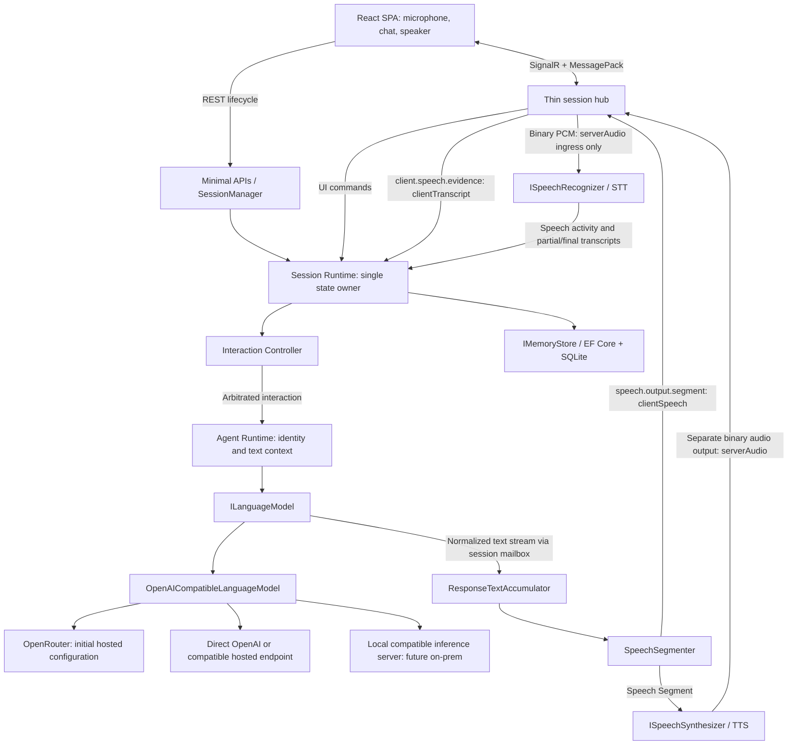
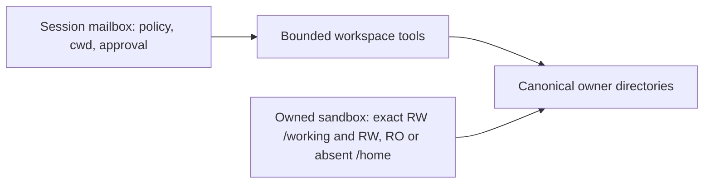

# System Architecture

## Model-requested tenant Sandbox commands

The existing tenant authorization tool now offers `run_sandbox_command` only for explicit Sandbox capability and exact admitted eligible profiles. It is independent of Settings self-management. The model supplies a bounded command proposal and exact profile, never tenant, Run, grant, source or mutable witnesses. The existing Runtime saves the exact pending tool call, prepares nondelegatable Sensitive Review, releases capacity and resumes through the existing durable successor and shared SDK executor. The checkpoint command must still match before external work; no legacy command path is opened.

Continuation consumes the immutable operation result and reads only its exact owned execution under current Run/requester/executor, Session, profile and current policy checks. Stored output does not require provider readiness or SDK contact. Revoked scope withholds output without rewriting the known effect. Bounded stdout/stderr, exit, process/cleanup and truncation facts enter the same durable tool transcript once; provider IDs, paths and protected source data remain private. Shell semantics are coarse: `applied:null` avoids treating arbitrary command completion as semantic success. Unknown effects receive display-only continuation and retain the existing indeterminate terminal outcome. [Focused evidence](reports/tenant-sandbox-model-command-verification-2026-10-18.md).

## Tenant Session profile switching

Explicit human Session profile switching reuses `TenantSandboxControlService`, the existing owned lease/security/audit transaction and the existing SDK retirement worker. Independent Session read/manage, agent Sandbox read/manage and old/target profile read are required; the original login and exact Session/generation/lease/execution, Instance and profile revisions are rechecked at commit. The target must be currently allowed, enabled and fully verified for the current host and protected source epochs. Selection itself performs no provider create, initialization or command.

The old generation retains its own profile and provider ownership while the existing selected/transition fields identify the pending target. A compact witness pins current Instance/source/host and the actual audit request. Active execution or unconfirmed cleanup blocks switching; failed initialization requires explicit reset. The worker may retire the accepted old target after logout, preserving canonical files. Only confirmed retirement enables fresh exact command Review and reservation for the pinned target. Changed pins require explicit reselection/reset; there is no fallback to the old profile. The saved Run admission remains a ceiling. [Focused evidence](reports/tenant-sandbox-profile-switch-verification-2026-10-18.md).

## Exact human tenant process Stop

Human Sandbox reset and process Stop share `TenantSandboxControlService` and the existing scoped human/lease/security/audit transaction. Stop binds the active Core execution and exact Session, lease, generation and execution revisions. Its durable `SandboxProcessStop` consent is embedded in the existing execution receipt, linked to the actual human audit. Factual writes and new command reservations cannot mint or replace this evidence.

A separate atomic technical start on that same receipt permits one interrupt attempt for an acknowledged active background launch. The existing SDK worker, per-Session gate, metadata checks, interruption/status/log handling and generic quiescence proof remain the lifecycle owners. A confirmed safe generation may return Ready after Stop; residual writers require exact whole-container retirement. A saved dispatch marker after restart or lost acknowledgement cannot authorize another interrupt. Foreground/provisioning, revoked execution authority or uncertain work retires the exact generation without replaying a command or initialization. Accepted Stop itself promises neither stopped writers nor an effect rollback. Files and the original immutable command/launch outcome remain retained. Technical cleanup continues after the initiating login ends; concurrent reset consent remains preserved.

## Explicit human tenant Sandbox reset

An authenticated human may request reset of one exact owned Session generation under independent Session read/manage, agent Sandbox read/manage and exact profile read authority. The existing lease/security/audit transaction repeats current permissions and original-login validation and checks Session revision, lease revision, generation and nullable active-or-latest execution identity. Factual recovery cannot manufacture or clear reset consent or change a selected profile.

Reset records `Terminating` intent on that existing generation and clears selection/switch targets; it never starts an environment, initializes a script or dispatches a command. Existing worker/CAS/provider ownership and original-host retirement proof complete teardown after request authority ends. Uncertain/foreign/mismatched-host retirement remains pending and blocks another generation. Already confirmed Terminated generations may record explicit reset to release a failed-initialization recovery gate. Initialization evidence, canonical files, Artifacts, Attachments and immutable original command/launch outcomes remain retained. In-flight process facts can become Canceled while possible file effects remain explicit. Another command requires a fresh exact Review. Human profile switching is documented above; model-requested Stop/reset remains separate work.

## Tenant Sandbox recovery ownership

The existing OpenSandbox worker also consumes a bounded technical cursor over actual retained tenant Session/lease roots. The cursor grants no human inventory, command, initialization, claim renewal or IAM authority. It uses the same per-Session SDK gate, factual CAS and existing immutable operation result settlement. Stranded foreground/provisioning work is retired without replay; idle reuse and background observation require current original requester/executor/grantor, source, policy, Session and generation authority. A previously acknowledged background launch may be observed after its originating Run completes, within its fixed deadline. Launch initiation alone is not an acknowledgement.

Each new owned lease also pins the trusted provider configuration scope (private endpoint, Core/daemon workspace mapping and compatibility contract). Factual CAS cannot add or change that binding. SDK effects and retirement must match it; a different mapping cannot confirm an old provider's absence with an unrelated 404. Unknown older scope remains unbound and cannot be implicitly adopted.

The pinned Docker provider creates in a background thread that can outlive a lost Core HTTP reply. A filtered empty list therefore cannot prove that creation has stopped. The existing trusted-server adapter keeps a durable negative generation fence in its existing private provider state volume. The fence binds exact tenant/Session/executor/generation, prevents later provisioning, waits for any active provisioning call and retires only exact matching containers through the existing provider service. Core accepts its bounded scope-matching retirement proof; errors/pending/foreign responses retain reconciliation. This provider fence cannot grant access, reserve a Core effect or replay an action; it is not a second IAM/approval/Run engine.

[Focused recovery evidence](reports/tenant-sandbox-recovery-verification-2026-10-18.md) distinguishes controlled SDK/provider proof from live Docker qualification. Full proposal acceptance, model-requested Stop/reset, model inspection/discovery, tenant UI and final schema/authority consolidation remain separate gates.

## Disposable tenant verification retirement

Tenant reusable-profile and Instance verification use the same SDK and trusted provider fence owner. Their exact scope is tenant plus the existing durable verification attempt, without fabricated Session/executor identities. RW/RO/Disabled Home probes run sequentially under that attempt. The adapter verifies metadata before using or deleting each returned handle, then seals the whole attempt after success or failure. Cleanup/promotion requires a bounded exact provider proof that excludes all late creates and retires its remaining containers. An empty list alone never supplies this proof.

Verification checks current original-human/source/Instance authority throughout SDK work. Cancellation or revocation stops the work and prevents captured output from promoting compatibility. Technical retry uses only the existing cleanup claim and exact original host scope; it rechecks that claim after provider I/O before purging only the disposable attempt directory. Unsupported servers fail before tenant filesystem/create effects; pending, changed-host or unproven cleanup retains files and the existing pending receipt. [Focused evidence](reports/tenant-sandbox-verification-retirement-verification-2026-10-18.md) records controlled SDK/provider proof and remaining live Docker qualification.

## Tenant approved Sandbox SDK execution

The existing `OpenSandboxService` now implements the trusted tenant command executor over an existing owned Ready generation or a freshly reserved owned generation. The existing approved reservation is the one dispatch fence; repeat observers cannot send another SDK command. The command comes only from the saved typed Review. `TenantSandboxExecutionAuthority` rechecks current Run/requester/executor/grantor, exact Session/profile/source/setup/home and receipt ownership before SDK work and throughout the existing storage watcher. Provider metadata must match the exact tenant, Session, executor and generation.

Tenant facts use the canonical owned store; no legacy Profile or global storage fallback is introduced. The SDK command/output/finalization mechanics are shared with the existing adapter. Exact remote cleanup works after initiating authority retires and verifies ownership before deletion; uncertainty remains non-replayable. An immutable operation receipt, the matching live Run effect state and safe audit settle under the existing owning transaction/gates. Background launch completion is distinct from process completion. First provisioning binds the exact reviewed setup to one atomic generation/receipt/Run reservation. The shared workspace owner seeds only admitted immutable template resources, with no global live-publication fallback or overwrite of differing retained bytes. The shared SDK create/mount/readiness/init path rechecks current authority throughout. A second typed atomic fence starts the command deadline only after ordered initialization succeeds. Human Stop/reset/profile switching and technical recovery are documented above; model controls/inspection and tenant Sandbox UI remain open. [Provisioning evidence](reports/tenant-sandbox-provisioning-verification-2026-10-18.md). [Verification and limits](reports/tenant-sandbox-sdk-execution-verification-2026-10-18.md).

## Tenant exact Sandbox command review and reservation

The trusted tenant approval owner can now prepare an exact typed Sandbox command against an admitted Run and save a nondelegatable Sensitive Review. Command arguments, Session/profile identity, effective home access and mutable source/generation witnesses are captured separately from the safe human review snapshot. A wait releases the matching claimed Run; approval records consent without claiming an effect. Current executor, requester, independent reviewer, Session, profile, policy and registry epochs are checked again before a new reservation.

`TenantSandboxApprovedOperationService` consumes only saved command parameters. The existing store transaction/shared gates atomically bind the approved request/decision/hash to one existing Ready or new Provisioning generation, execution receipt, Run InFlight fence, lease pointers and safe audit. A duplicate observes that receipt and cannot own dispatch again. Raw metadata reservations and global writers cannot manufacture approval markers. Reservation remains distinct from effect completion. The shared SDK integration above performs provisioning/dispatch and factual settlement; full process/reset/cleanup workers and tenant Sandbox UI remain open. [Focused evidence](reports/tenant-sandbox-command-approval-verification-2026-10-18.md).

## Current tenant execution policy and Sandbox reservations

`TenantRunExecutionAuthority` now resolves the actual current owned/shipped publication and sparse Instance policy between fresh Run/requester/security checks. Its current Definition result constrains effects; the admitted Run remains the immutable source of instructions, persona, selected capabilities and setup. No current policy lookup rereads resource bytes, credential bindings or image availability. A policy relaxation never substitutes a larger Run admission.

Sandbox lease/receipt reservation also resolves current publication and Instance policy inside its existing owning transaction/shared gates. Removed execution capability or allowed profile, tighter resource ceilings, changed Instance setup script and incompatible admitted/current home access reject a new reservation even with refreshed security witnesses. Existing lease facts and historical receipts remain available for exact retirement. Returning policy to a compatible state can permit the saved admission again; it cannot enlarge it. [Focused evidence](reports/tenant-current-execution-policy-verification-2026-10-18.md) includes actual Synthetic Runtime execution without rewriting its admitted instructions. SDK dispatch, exact command approval consumption, mounts/process/reset/cleanup and Sandbox UI remain open.

## Tenant Session Sandbox ownership prerequisite

Canonical Session Sandbox storage reuses the existing lease and execution receipt tables. `ITenantSandboxRuntimeStore` resolves actual tenant Session, Instance, executor and Run roots; new reservations require the current claimed Run generation, Run/security revisions, active owners, exact admitted setup and central IAM agent `sandbox.execute`, profile `sandbox.read` and independent private-source `credentials.use`. A Run pins readable exact effective profiles and compatibility/source observations at admission. Later verification cannot expand that saved admission. A reservation owns a durable record; it is insufficient to dispatch an SDK effect.

Execution reservation atomically advances the matching lease and creates one Session/Run/tool-call receipt. CAS factual settlement preserves the original generation/action/owner after cancellation or logical Session deletion, without reviving a generation or repeating initialization. Legacy stores hide/reject actual tenant Session/Instance records even when input markers are stripped. Protected human inspection checks independent Session, agent and profile reads and fences original login/security/Session witnesses after storage I/O. Its result explicitly reports stored facts with `liveAuthorityConfirmed=false`.

The [ownership evidence](reports/tenant-sandbox-runtime-ownership-verification-2026-10-18.md) advances this storage/admission/inspection prerequisite. Tenant SDK dispatch, current-definition and typed approval integration, physical mounts, process/reset/cleanup workers and Sandbox UI remain open. This does not establish production multi-tenant Sandbox acceptance.

## Tenant effective Instance Sandbox verification

Effective setup verification extends the existing disposable `SandboxVerificationAttempt` with actual tenant-owned Instance identity/revision. `TenantSandboxSetupResolver` binds only the exact owned or immutable shipped Definition, current Instance sparse settings and an exact owned allowed profile. `TenantSandboxInstanceVerificationService` checks the original live human, independent agent read/Sandbox read/manage, exact profile read and protected Credential read/bind/use. It reserves the exact resolved setup before the existing SDK adapter checks mounts and Profile/Instance initialization in a disposable owner. It adds no job engine, Session environment or execution grant.

Reusable profile and Instance receipt/evidence scopes are distinct. An Instance check cannot replace reusable compatibility or appear in profile-only history; sibling Instances cannot read its attempt. Current Instance observations additionally match Instance revision, source epochs and host mapping. A stale/retired/malformed result retains only bounded factual or cleanup evidence and cannot promote setup. Active ownership is one check per reusable profile, or one per Instance across chosen profiles/revisions. Technical recovery checks the saved Instance scope too and never reruns initialization. [Focused evidence](reports/tenant-instance-sandbox-verification-2026-10-18.md) covers both stores, actual HTTP, retained migration, relational constraints and loopback SDK recovery. Live Docker compatibility, tenant runtime effects and the UI remain unaccepted.

## Tenant Instance Sandbox configuration boundary

Canonical Instance Sandbox reads and sparse settings writes reuse `TenantAgentReadService` and `TenantAgentConfigurationService`. Original-human/security/Instance read fences surround actual tenant profile and source observations. Instance `sandbox.read/manage` and `agents.read/update` remain independent from exact profile `sandbox.read`; selecting a profile grants no execution or Credential authority. Definition allowed IDs never resolve through the global catalog. Partial readers receive only their readable profile metadata and no hidden selected defaults; a narrowed readable setup remains inspectable with inherited choices redacted.

Changes keep the existing atomic Instance settings/security/audit transaction and original-human commit fence. Every effective allowed profile caps shared overrides; selecting/adding a profile or resetting to a different default requires current full compatibility and server readiness. Removing an unavailable choice or narrowing limits remains possible. Profile/verification/Credential changes advance the existing tenant security witness and invalidate captured writes. This configuration boundary does not execute or verify Instance scripts. Effective setup verification now has the receipt boundary above; tenant Session mounts/commands/cleanup and the UI remain separate work. [Focused evidence](reports/tenant-instance-sandbox-selection-verification-2026-10-18.md).

## Tenant Sandbox profile catalog boundary

Reusable Sandbox profiles now have authoritative tenant ownership over the existing append-only profile rows. The canonical human catalog and disposable verification are separate from Instance selection, runtime mounts and command execution. `sandbox.read` and `sandbox.manage` apply to exact `sandbox-profile` scopes as well as their existing agent scopes; `sandbox.execute` remains agent-scoped and catalog access grants no execution authority. The permission catalog exposes supported `resourceTypes` alongside its primary `resourceType`.

`TenantSandboxProfileService` resolves the original live Account/session/tenant Principal, filters metadata before search/count/paging and fences captured reads after I/O. The specialized store commits the profile, security revision and audit atomically with original-session and registry-credential epoch checks. Owned revisions cannot be read, overwritten or verified through global Sandbox store methods. No global profile is implicitly adopted into a tenant.

Private image preparation requires trusted human/session/security evidence at the existing image authority port. A tenant ID on a profile is insufficient to release registry authorization; current `sandbox.read/manage` and independently scoped Credential read/bind/use are rechecked before protected tag dispatch. Exact immutable digest and Credential epochs are saved; protected values remain inside Infrastructure. The disposable verification boundary below extends this catalog. Instance selection and effective setup verification now have the boundaries above; Session execution/cleanup, UI and final global-authority removal remain separate cutover work. This is a catalog prerequisite, not production multi-tenant Sandbox acceptance.


Original Chat approval status reuses existing durable approval, Run and effect stores through `TenantConversationApprovalService`. Current conversation-recipient authority permits only a minimal status projection; full previews and decisions retain independent approval/action/resource authorization. The Runtime emits a normalized saved-wait output, and recipient-aware transport sends only request/Run identifiers. Status polling and an authorized inbox badge are read projections, not new conversation owners or execution authority. A saved wait releases the exact live response while independent work remains usable; decisions resume only the recorded durable continuation. [Evidence](reports/tenant-chat-approvals-verification-2026-10-17.md) supersedes the earlier approval-transport-pending notes for this supported path.

Tenant Chat reuses the existing frontend Store, realtime service, transcript and composer; it introduces no second conversation owner or transport engine. A document binds one immutable tenant ID, all protected HTTP calls stay under that tenant, and entry/exit/organization switches replace the document. Retirement aborts scoped requests, drops connections/media and clears private projections; stale command acknowledgements cannot affect a replacement connection. Tenant Chat never issues or falls back to owner capability. The Runtime mailbox and canonical admission/cancellation/receipt services retain authority. [Implementation evidence](reports/tenant-chat-ui-verification-2026-10-17.md).

`TenantChatService` supplies public communication discovery separately from administrative agent configuration. It derives the actual human/session, selects active tenant executors with exact current `agents.chat`, searches only public name/role labels and supplies the eligible IDs to the existing owned store before count/offset. Returned public persona/version/language and revision hints contain no private settings, role snapshots or reusable authorization. Human/security revalidation after reads rejects stale pages. Existing Session creation and Hub admission still independently authorize every action. [Verification](reports/tenant-chat-discovery-verification-2026-10-17.md).

Tenant text receipts use attachment-local evidence of successfully published display prefixes. `ResponseReceived` rechecks the actual human/Session/Chat, derives trusted entry references from that evidence, and sends the receipt through the existing tenant host. An active Runtime queues it through its mailbox and ordered persist writer; received credit is adopted only after the store commits under the current human session and security witness. Rejected receipts cannot contaminate later checkpoints or stop the Run. Once the Runtime retires, the host reserves the Session for a partial receipt update. An admission epoch detects snapshots loaded across that reservation and forces fresh admission rather than allowing an obsolete writer. No new conversation owner or durable schema is introduced. [Verification](reports/tenant-delivery-receipts-verification-2026-10-17.md).

Tenant Hub SendText and CancelResponse now adapt a server-bound subscription into the existing Application use cases; they do not add another admission engine or command scheduler. Actual human/session and tenant references come from authenticated attach. Revision witnesses remain concurrency inputs, not authority. Commands use a separate connection gate from publication so a cancellation can await its owning mailbox while interruption output is delivered. Changed attachments cannot reparent an admitted command or its durable Run. Ephemeral replay state contains only fingerprints and safe acknowledgements; current human/Session/Chat and target Run cancellation permissions are rechecked before cached results. [Verification](reports/tenant-hub-commands-verification-2026-10-17.md).

`TenantSessionLiveDelivery` is recipient transport state for the existing tenant Runtime, not another conversation owner. A generation-bound `ISessionOutput` source registers while the tenant host owns its Runtime; legacy connection/control lookups remain separate. Authenticated `AttachTenant` on the existing Hub resolves the actual Account/session and tenant User, validates exact origin and transport policy, and installs one tenant/Session subscription per connection. Each text lifecycle event rechecks current human/IAM; missing/replaced/expired generations and cancelled late text drop. The transient published prefix is used only for a fresh authorized ready projection, with original received/heard offsets. Switching/disconnect releases the subscription without stopping work. Parallel recipient sends have bounded egress; source ordering and each connection attachment serialize publication. Resource/approval/voice payloads require later recipient-aware conversion. [Verification](reports/tenant-live-text-delivery-verification-2026-10-17.md).

Tenant conversation history now has a separate human-recipient read boundary over the same existing Session/Entry rows. It does not impersonate a Run claim or use the legacy memory port. `TenantConversationService` checks the actual human/session, exact Session read and Instance Chat before content access, projects only public fields with independent resource-reference checks, then revalidates human, security and Session witnesses before returning. Reads do not mutate the mailbox, Run, Session or delivery evidence. Authenticated text output now has the live-delivery successor above; richer transport and frontend integration remain pending. Least-privilege agent roles and restricted Chat audiences remain necessary: no universal natural-language disclosure filter is claimed. [Verification](reports/tenant-conversation-history-verification-2026-10-17.md).

Tenant Run cancellation keeps the Session Runtime as the single mutable conversation owner. `TenantRunCancellationService` derives trusted human/owner/Run/generation references under current IAM; `ITenantRunControl` sends an urgent command to the matching live mailbox. That mailbox revalidates and issues one atomic terminal store write before superseding local work. If no matching owner exists, the tenant host serializes the trusted commit against Runtime admission. Worker/provider cancellation callbacks run outside the host registry lock. Pending approvals close and unused grants revoke; claimed effect fences remain evidence and may settle without reviving the cancelled Run. No new scheduler, Task entity or transport authority is introduced. [Verification](reports/tenant-active-run-cancellation-verification-2026-10-17.md).

The trusted tenant credential-check execution boundary now reuses durable exact approvals, current IAM and the existing Run side-effect model. A tenant-owned dispatch fence claims one operation/grant and reserves the credential before provider I/O; it supplies no general permission. Only normalized protected grant/health results cross Infrastructure. Known completion is bookkeeping of that already-authorized dispatch: it preserves a valid rotation after later cancellation or authority loss without restoring roles, beginning another call or reviving a terminal Run. Newer credential authorization wins over a late result. Unknown outcomes produce a stable Indeterminate receipt and reconnect-required health when the original witness still matches; recovery never repeats the provider call. The existing hosted worker closes abandoned fences, including retained ownership after Session deletion. No additional scheduler, Task entity or authorization engine is introduced. The reference-only model intent now uses the same durable wait and exact Run-A-to-B handoff. The shared-capacity tenant host performs provider work before mailbox dispatch; Runtime consumes only the saved receipt for this external kind. A recorded uncertain result permits at most a factual response when current authority and budget allow, and leaves the Run failed without browser observation/retry semantics. [Backend fence evidence](reports/tenant-credential-runtime-check-verification-2026-10-17.md), [hosted model/continuation evidence](reports/tenant-model-credential-check-verification-2026-10-17.md).

The tenant binding of the existing Session Runtime now resolves a fresh least-privilege requester projection before initial reasoning and each agent model generation/tool round. Its existing execution authority resolves the actual current Run/claim and original User/Account, never a Session creator or deciding approver substituted for the requester. Core defines independent principal authority and agent judgment; bounded Runtime facts carry verified identity, relevant scoped role labels and admitted communication, while user/history/tool claims remain Evidence. These observations are neither effect authority nor durable role snapshots. [Both-store/hosted verification](reports/tenant-requester-context-verification-2026-10-17.md).

## Tenant disposable Sandbox verification

`TenantSandboxVerificationService` reserves one exact tenant/profile-revision attempt under the current original Account/session/Principal and security witness before using the existing OpenSandbox SDK verifier. The receipt is ownership of a disposable check, not a generic job or execution grant. Full checks and image-only checks remain distinct; only an authorized, settled full result can update compatibility evidence. Profile/source/credential epochs, host mount mapping and original human authority are fenced before protected dispatch and acceptance. Authority loss retains bounded facts without promoting compatibility or releasing output to the retired caller.

An active reusable-profile attempt blocks another reusable check across its revisions; Instance attempts have the separate per-Instance guard above. Expired or uncertain attempts expose only typed technical cleanup claims to an independent hosted worker. Each claim binds tenant, profile, optional Instance, attempt, current receipt revision, host fingerprint and nonce; settlement also checks the live claim lease. Recovery may confirm retirement and purge only that disposable owner directory. It never repeats scripts, adopts a Session environment, deletes canonical Session files or promotes a late result. [Focused evidence](reports/tenant-sandbox-verification-2026-10-18.md) covers both stores, HTTP and loopback SDK cleanup; live Docker compatibility and the remaining tenant execution cutover remain unaccepted.

## Exact approval continuation across Runs

Canonical model approval waits resume through a dedicated ApprovalContinuation Activation when the processed decision carries a pending authorization checkpoint. The same transaction marks source Run A Completed with a Continued outcome linking Run B, admits B with the same executor/Session/requester/root and exact request/operation/hash reference, and acknowledges the decision signal. A owns its original input entries; B carries validated read references, the same response/transcript identity and frozen configuration, remaining budget, attempts and capability accounting. It receives no fresh budget or general permission. Pre-execution management requests without a model checkpoint may still requeue their original Run.

At claim and effect commit, Core resolves the actual stored source and requires its exact handoff link plus matching parent/root, Session, executor, requester, request and operation. A generic sibling, new user root, changed action or other agent cannot consume the grant. The original source is no longer executable, while stable continuation identity and the existing exact receipt fence duplicate dispatch/recovery. The existing coordinator, Session Runtime, request/decision store and worker remain the execution machinery; this adds no scheduler, broker or Task entity. Known pre-admission capacity refusal uses a generation-fenced deferral that retains the checkpoint and paused budget. A Core-only awaiting-runtime-admission marker distinguishes those retries from failures/recovery, so attempts are neither refunded nor spent again. Dispatch attempts for one Run/generation join; a stale dispatcher never cancels a newer live generation.

Model-initiated persona authorization now uses the existing tool loop, Session persistence queue and durable approval transaction. The context-only `approvals.request_authorization` accepts an exact typed persona, never an identity, target, permission or grant. Runtime verifies the offered capability, drains prior Session saves through a barrier and supervises preparation off-mailbox; normalized results return through its mailbox. A saved wait clears the actual claim, suppresses later stale Session writes and releases the Runtime. After a decision, the worker validates the pending call against the saved operation before any effect and closes that checkpoint with the recorded result. [Model approval evidence](reports/tenant-model-approval-verification-2026-10-17.md) includes real SQLite host recreation. Direct Allowed execution and exact Run-B consumption now have successor evidence; other operation families remain pending.

The tenant worker now consumes decided exact persona operations before original-Run model execution. The existing coordinator claims the requeued Run; its Session Runtime resolves only the saved bound request through `TenantRunContinuationService` and the existing approved-effect service. Pending/mismatched requests cannot be claimed. Effect receipt, target mutation, grant consumption/revocation, Run side effect and audit retain the existing atomic boundary. A replacement claim reuses the receipt. Outcome references are scoped data in the Evidence layer, never transferable authority; pinned configuration remains immutable. [Worker evidence](reports/tenant-approval-worker-verification-2026-10-17.md) supersedes the prior temporary approval exclusion for this typed original-Run path. Other model operation families and cross-Run continuation remain open.

Canonical tenant text execution now binds the existing `AgentRunCoordinator` and `SessionRuntime` to tenant-scoped adapters. The existing hosted worker invokes that coordinator binding; it adds no reasoning engine, timer or task entity. Each Runtime holds immutable tenant/Session/Run/generation references and no global Profile. An isolated host registry keeps it outside legacy connection/control lookups; its text output now uses the authenticated recipient boundary above. Capacity is shared with legacy runtimes. Current executor/requester IAM gates model work; tenant IAM inspection and eligible persona authorization requests are offered. New input during an active Run is rejected until mailbox ingress is integrated. [Runtime evidence and limitations](reports/tenant-runtime-execution-verification-2026-10-17.md) supersede earlier worker-pending checkpoints below without claiming live Chat or the complete cutover.

## Accepted Account, tenant IAM and durable approval replacement (2026-10-16)

The approved persona successor now applies the saved exact operation through a trusted internal effect service. A live actual Run generation, current tenant/executor/requester, qualified current human grantor, current review/independence policy, pinned/current Settings management eligibility and exact target witnesses gate the effect. Instance mutation, operation receipt, grant consume/revoke, Run effect checkpoint, tenant revision and audit commit together; duplicate/concurrent callers return the saved receipt. Local transactionality supplies at-most-once mutation without claiming external-provider exactly-once behavior. This service is not a public execution endpoint or a model-offered tool. Original-Run persona worker/Runtime resumption is now implemented above; other model operation families, cross-Run continuation and remaining effect families are still required. See [approved persona effect verification](reports/tenant-approved-persona-effect-verification-2026-10-17.md).

First-class durable approval now has an implemented typed Instance-persona preparation path over actual tenant Runs. Core derives the exact action, permission, target, revision witnesses and hash; saving the request and releasing the Run into `WaitingForApproval` is atomic. Human decisions commit status CAS, decision audit, an exact exceptional grant when required and a dispatchable processed signal together. The existing Run worker drains expiry/signals and requeues the same Run once; it introduces no scheduler, broker or Task entity. Decisions use current human IAM/session and stored identity independently of a chat connection or response epoch. Root correlation suppresses pending and terminal repetitions; independent roots can request again. The canonical backend read/decision/cancel surface is implemented. Cross-Run consumption, other operation types and approval UI remain required; an approved record does not bypass the shared effect fence. See [durable approval verification](reports/tenant-durable-approval-verification-2026-10-17.md).

Agent-operation decisions now compose the existing `IamAuthorizer` with actual saved tenant Run/Session/executor/requester references. Permission checks stay in that one IAM engine; requester permissions determine review rather than executor authority. Core permission metadata classifies read-only, mutation and sensitive operations with minimum None, WhenRequesterLacksPermission and Always review respectively. Tenant governance can configure an equally strict or stronger mode and independent review; it cannot edit Core human-only/delegatable meaning. Qualified review needs current active human action plus approve authority; exceptional eligibility additionally needs grant-exception. Independent review excludes the original requester. This is current eligibility, not a durable decision or transferable grant.

The shared tool executor resolves the retained owning Session root before legacy service access. Owned Sessions require the matching server frame and saved Run. Narrow IAM inspection and Runtime-mediated persona authorization are implemented at this boundary; other tenant effects fail closed pending their typed owning-service/approval cutover. Conditional IAM tool offers require trusted tenant Session context. The successor Runtime now injects trusted context and consumes decided persona operations; other model operation families and the remaining effects stay open. [Evidence](reports/tenant-operation-authorization-verification-2026-10-17.md).

Canonical tenant text admission now appends the input and initial queued Activation/AgentRun under current human/session, Session-read and exact agent-chat authority. `TrustedExecutionContext` pins tenant, actual executor Principal, original per-message requester, Session/Run/Activation/root and origin. The tenant Run owner has no global profile. Actual Instance configuration, persona/model, Skills, resource manifest and Credential binding references are pinned independently of human authority. Both stores commit security/Session/Instance witnesses and safe audit with the graph; no login credential or permission snapshot is propagated. Metadata and Run cancellation use current scoped IAM; active Run cancellation now uses the owning mailbox as described above. Legacy workers/recovery exclude these rows; other live Session lifecycle coordination and remaining tenant effect families remain pending. [Admission evidence](reports/tenant-run-admission-verification-2026-10-17.md).

Canonical interactive Session ownership now uses the existing Session/snapshot rows plus immutable `TenantSessions` references to the actual tenant Instance, its executor Principal and the creating tenant User. Creation commits with current human/session authority, security/Instance witnesses and audit; it creates no global local-user profile and grants no agent role. The creator is attribution, not the requester of every future Run. Existing unscoped Session reads/recovery and Run admission exclude these rows. [Ownership evidence](reports/tenant-session-ownership-verification-2026-10-17.md) is a prerequisite for pending tenant-aware Hub messaging, live runtime state/effects and durable approvals; it does not establish interactive execution or full isolation.

The owner requests a complete replacement of trusted-local owner capabilities with global Accounts, tenant Users and agent SystemIdentities under scoped Principal IAM. System platform privileges never imply tenant-private access; each agent executes under its own current roles. Requester authority influences review policy, not the agent's permission set. Human-only permissions cannot be delegated. Durable first-class approvals distinguish Review from an exact ExceptionalGrant, preserve causal root lineage and revalidate authority before effects.

This accepted successor supersedes original single-owner/authentication exclusions and incompatible live-only approval design. Canonical tenant routes and the complete interaction contract are specified in [Accounts and access UX](19-multi-tenant-iam-ux.md). The [delivery ledger](reports/multitenant-iam-delivery-2026-10-16.md) distinguishes implemented gates from the target. Until the cutover is complete, the previous application is not a multi-tenant deployment. Existing user data is never silently converted, reset or deleted.

The canonical tenant-agent slice uses the existing Agent Instance as the backing resource, with ownership normalized through its globally unique SystemIdentity foreign key. `ITenantAgentStore` commits Instance creation, initial Skill state, SystemIdentity/Principal, tenant security revision and audit together. Archive/restore commits Instance lifecycle and identity status together while retaining IDs and grants. This is an intermediate boundary: tenant Sandbox/decommission, other resource families, old owner routes, Session/Run/Hub execution and durable approvals still require the full cutover.


Tenant Definition ownership now lives in the definition aggregate's `TenantAgentDefinitions` root, while drafts, immutable publications, resource bindings and evaluation evidence keep their existing stores. Canonical definition mutations commit with tenant security CAS and audit and recheck the current Account. IAM resolves definition scopes from that actual owning root. Global/unscoped authoring stores exclude these owned rows; they are not an alternate route to tenant content. Exact active tenant publications can create owned Instances. Canonical resource binding, downloads and offline evaluation authoring/execution now use that same root with atomic security/draft witnesses. Definition mutation responses that expose saved content also require definition read authority. Draft/logical deletion commits child removal, direct Definition-grant removal, security revision and audit together. A deleted logical root retains an immutable ownership marker, excluded from current access/inventory while continuing to fence global ID reuse. Any backing Instance, live Session or retained Run/Activation blocks logical deletion. Shipped-template forks use only immutable builtin definitions plus approved knowledge/template files and atomically create a new owned draft/manifest; source identity/version is provenance, never authority. Canonical tenant Definition authoring UI is locally verified; complete editor/runtime resolution and the remaining full cutover are still pending.

## Canonical tenant Credential ownership

`TenantCredentials` is the actual owning root for an existing protected Credential row. Its globally unique credential ID, Tenant foreign key and retained deletion marker prevent cross-tenant lookup, legacy mutation and retired-ID reuse. It is not a generic resource registry or a second secret inventory. The specialized tenant transaction commits owner/value, security revision and redacted audit together; deletion retires direct credential assignments and refuses retained bindings. The same IAM engine proves actual ownership for `credential` scopes and keeps metadata read, management and secret-use permissions separate.

Current canonical management supports General, typed Custom email, disconnected Gmail/Drive and Container Registry credentials. It grants no browser, email, Drive or Sandbox effect authority. Canonical binding configuration is implemented separately below; secret use and credential UI remain pending; legacy stores hide/reject owned values rather than offering fallback authority. [Local evidence](reports/tenant-credential-lifecycle-verification-2026-10-17.md) does not establish full tenant runtime isolation.

## Canonical tenant OAuth persistence

The separate OAuth persistence foundation binds an attempt to an actual owned Credential, original human Account/authentication session and current tenant User/Principal. Both stores check that live identity at start, one-use claim and grant/disconnect commit. Tenant security, Credential revisions/AuthEpoch, protected grant and redacted audit commit together; a newer attempt supersedes an older in-flight exchange. It stores no permission decision or bearer session material. `TenantCredentialOAuthService` now checks current read/manage authority and the original session before preparation/claim and after provider I/O, with a final transaction recheck. Purpose-specific callback authentication uses a separate correlation cookie and durable proof, including when the Strict Account cookie is absent; an available different Account is rejected. Shared-client Google transport is purpose-restricted and Synthetic stays offline. [Flow evidence](reports/tenant-oauth-flow-verification-2026-10-17.md) qualifies backend orchestration and offline provider behavior; browser credential UI, live Google and runtime consumption remain separate gates.

## Canonical tenant Credential bindings

Owned association rows carry the server-derived Tenant and restrictive composite foreign keys to the Instance SystemIdentity and Credential owner. The existing binding row remains the association; no implicit IAM inheritance or secret-use grant is introduced. Both owners must be proven in the same Tenant. Configuration requires Instance read/update and exact Credential bind; metadata exposure additionally requires Credential read. Agent writers remain bounded by the current Connections self-management area/freeze, independently of their IAM grants.

Bind/unbind advances Instance and tenant security revisions with redacted audit in one transaction, preserves the Credential value, and invalidates stale configuration witnesses. Archived Instances retain readable associations and reject mutation. Credential disable blocks new binding while retaining removable existing configuration. Registry credentials remain host-side authority and cannot be bound to an agent. [Binding evidence](reports/tenant-credential-binding-verification-2026-10-17.md) qualifies configuration only; typed runtime secret use and downstream effect authorization remain pending.

## Canonical Definition resource IAM

Definition file bindings now have exact `resource` scopes qualified by actual Definition plus draft or publication version and resource ID. Reads require parent Definition read and typed resource read; existing-item writes use resource manage/delete, independently of Definition configuration editing. Creating/copying bindings requires tenant destination resource read/manage, and offline evaluation requires read on every captured file. Both stores resolve the actual owned root/context/binding and retire consumed/deleted draft or publication grants with the existing security/draft/audit transaction. Forks/publications do not copy those grants. Filtered resource views and per-item UI eligibility distinguish limited access from an empty manifest. [Verification](reports/tenant-definition-resource-iam-verification-2026-10-17.md) covers HTTP, both stores, current-grant/binding checks after byte I/O and the Synthetic browser fallback; runtime/resource families outside these bindings remain pending.

## Canonical tenant Instance configuration

Canonical tenant Instance configuration now resolves an owned exact publication and resource manifest through the owning Definition root, or an exact shipped builtin, without global durable fallback. `TenantAgentConfigurationService` authorizes current scoped Instance reads and persona/version changes. The specialized tenant-agent transaction commits Instance/persona revisions, new inherited Skill states, observed Automation policy reconciliation, tenant security revision and audit together. Owned publication adoption separately requires Definition read access and current active publication metadata. This is configuration authoring/inspection, not tenant Session/Run admission: requester/executor lineage, Hub/tools, remaining resource IAM and durable approvals still require conversion. [Configuration evidence](reports/tenant-agent-configuration-verification-2026-10-16.md) records the tested boundary.

Canonical tenant Instance settings extend that same transaction with sparse field set/clear, bounded execution budgets, unattended model selection and self-management policy/freeze. Existing inheritance, constraints, provider/model validation and policy preparation are shared with the incumbent services. Current server principal kind controls agent-only restrictions: an agent cannot enable or unfreeze its management policy, while an authorized agent may stop its active management independently of the policy-editing area. Management configuration grants no IAM authority. InMemory snapshots isolate nested management collections as well as sparse settings. Tenant Sandbox sparse configuration now uses the canonical boundary above; effective setup verification has the receipt boundary above, while runtime effects remain unavailable pending their own integration. [Settings evidence](reports/tenant-instance-settings-verification-2026-10-16.md) records the exact implemented boundary.

Canonical tenant Instance Skills/resources extend that owned snapshot and transaction. Current exact-parent `agents.read` is combined with separate item-scoped or inherited tenant `skills.read/manage` or `resources.read/manage/delete`; parent update authority alone cannot read or mutate child content. Agent writers additionally need the current Skills/Resources management area. Shared preparation and store staging retain dependency rules, immutable source provenance and actual verified bytes. Child/parent/security revisions and audit commit together. Global Instance inventory/find and child read/write ports exclude or reject tenant-owned data; trusted canonical helpers reuse the existing records. Owner-qualified item grants resolve through the actual current Instance/source/manifest; filtering precedes child totals/pages, and deletion/adoption retires removed-child grants in the same transaction. Other resource scopes, tenant-aware tool execution and final global authority removal remain required. [Child evidence](reports/tenant-instance-children-verification-2026-10-16.md) records the implemented boundary.

[Instance child IAM evidence](reports/tenant-instance-child-iam-verification-2026-10-17.md) covers local, owned-publication and shipped-source targets, exact-grant I/O revocation, grant/delete serialization and SQLite recovery. These grants are individual Resource scopes under Tenant; the encoded parent is an identity qualifier, not another inherited IAM level.

## Semantic Automation authorization cutover (2026-10-16)

Automation natural-language interpretation belongs to the agent and an independent semantic verifier. Core never recognizes command vocabulary, language, referents or confirmation words to grant Automation authority. For a trusted current user turn, the verifier compares that request plus explicitly marked historical context with the exact structured mutation and the owned current target. Owner, revision, capability, schedule completeness and execution policy remain deterministic gates. Reads do not grant mutation authority. Historical, Memory, initiative, environment and occurrence inputs cannot independently authorize a mutation.

Semantic Allow applies only to the proposed action fingerprint in its current execution. Deny and Ambiguous cause clarification without effects. A verifier infrastructure/output failure may use the existing durable Run approval flow: the owner inspects the exact action and explicitly approves through UI. The approval is bound to tool, arguments, Session/Run and action hash; rejection, expiry, supersession, changed arguments or changed target revision cannot authorize execution. Resume/reconnect uses the existing retained approval rather than a natural-language yes/no matcher. This adds no second approval store or execution service. Future Automation effects remain independently authorized at execution.

## Three-layer context authority

The production context path has exactly three layers: **Core**, the platform-authored operating contract; **Runtime**, authorized effective configuration and trusted execution facts; and **Evidence**, current task intent plus bounded observations. Core governs Runtime and Evidence. Provider `developer` is a wire role for Runtime, not another context layer. Tool access, scopes, approval, credentials and effect fencing remain server-enforced.

`ContextAssembler` is the single projector. Only a selected platform procedure or registered Core built-in can construct Core content. Definition/Instance instructions and procedures cannot enter Core. Summary, profile, memory, Experience, references, attachments and external/tool output cannot enter Runtime. Evidence is source-framed before the native interaction transcript; actual current user content is included once. Core is first (`system`), Runtime follows (`developer`), then Evidence uses user/assistant/tool roles.

New Run admission freezes effective configuration and a field-source map through the existing Definition → sparse Instance resolver. New saved values affect the next new Run, including one in an existing Session. Live revocations continue to apply. `RoleEnvironment` remains Definition-owned configuration; the optional typed Runtime environment scope is absent today. This cutover creates no active Environment entity, RBAC engine or second Session lifecycle.

Each generation reconstructs applicable clauses and updates Runtime sections by typed identity. Durable format-2 checkpoints retain interaction receipts and explicit phase/repair/activation state, not instruction prefixes. Startup and resume reject incompatible active state. [Persistence](15-persistence-and-configuration.md#three-layer-context-cutover) and [Operations](17-observability-and-operations.md#three-layer-context-maintenance) own conversion and deployment; the [verification ledger](reports/three-layer-context-cutover-verification-2026-10-15.md) separates implemented behavior from observed acceptance.

## Accepted Activation and AgentRun cutover

`Activation.RootActivationId` is immutable execution causation. Independent admitted messages, occurrences and events own their Activation ID as root; immediate background, configuration continuation and completion-report Activations inherit the stored source Run’s root and name its Activation as parent. Retries retain the same Activation. Admission validates actual parent ownership/identity and root at the store transaction, and completion batches share one root. Relational keys enforce root existence and parent/Run agreement. This is lineage only, never an IAM grant. Canonical human/approval execution attribution and fresh requester context have successor evidence above; other trusted origins remain pending. [Verification](reports/activation-root-lineage-verification-2026-10-17.md).

The approved execution target is `Session → Activation → AgentRun`. A Session remains the durable conversation owned by one Agent Instance. Canonical tenant Sessions pin their actual Tenant/executor and exclude a global Profile fallback. An immutable Activation admits one effective agent turn and freezes its ordered input batch. Exactly one AgentRun owns that Activation's attempts, claim, checkpoint, approvals, effect fence, frozen execution configuration and outcome. Retrying retains run, activation and response identity; conversational continuation creates a new Activation and run in the same Session.

Background work is a normal Session with immutable creation origin and separate mutable surface flags. Immediate work links its originating Session/run; Automation work links its occurrence and creates a distinct Session for each accepted firing. Completing the initial run does not complete the Session. Continue in chat adds ChatList visibility to that same identity. Background Work resolves only the immutable initial Run, preserving its task/result while Chat evolves. New origins retain their original title separately from mutable conversation presentation. Artifacts remain Session-owned, with optional trusted producing AgentRun identity for original-task filtering; no copied result snapshot or new execution path is introduced. Completion delivery stays dynamic against the initial Run. Only an explicitly eligible initial immediate child completion may activate its parent, through a trusted bounded completion receipt. Mentions and cross-Session context attachments are outside this cutover.

`SessionOriginKind.SourceOccurrence` records a native source-owned occurrence that needs detached execution without an authored Automation. It requires an immutable occurrence link and forbids an Automation link or parent report-back. It starts in BackgroundWork with the same Session continuity rules. This distinguishes the path from manual maintenance without changing native live routing.

One SessionRuntime mailbox remains the conversation writer. Live, initiative, native event and detached execution share one claim/approval/retry/effect state machine; the previous production execution engines are removed. There is no legacy adapter, dual writing or endpoint alias in the approved target.

**Implementation status:** Production conversation and detached execution now use the registered SessionRuntime/SessionHost AgentRun path. Durable accepted-input intent is repaired after restart; occurrence intake admits real targeted Sessions; the shared tool loop persists checkpoints and fences dispatch, and background.start returns a committed independent child. Atomic background outcomes and same-Session user continuation are exercised. Report-back, Session-first APIs/UI and approved legacy/schema retirement are implemented. Closed/frozen on final behavior `8cec78c5d47a43e0236a5c38f2e312f4e36ce283` (2026-10-08), with all five required hosted Synthetic/Compose jobs [green](https://github.com/trannamtrung1st/agent-core/actions/runs/37756244306). The [verification report](reports/activation-agent-run-background-sessions-verification.md) records local/runtime evidence and prior failed gates. P10/P11 remain unopened.

## Capability authority and projection

Capability-aware Definitions pin `environment.capabilities` (`mode: Selected|All`, exact `resolvedCapabilities`, SHA-256 `authorizationFingerprint`) separately from `environment.projection.alwaysCapabilities`. All resolves the current trusted registry when a draft is saved and again at publication, excluding workspace interfaces incompatible with its explicit workspace policy. Runtime never resolves All again. Future registrations require a new reviewed publication. Legacy `toolAllowlist` remains supported with historical runtime offers; no Definition authorization count ceiling remains.

`ToolProjectionService` evolves `ToolCatalog.For`; the existing eligibility flow and execution-time `ToolPolicy` stay authoritative. New-mode projection unions authorized bootstrap, always, deterministic context, active Skill requirements and execution-loaded names, then filters configuration, model support and execution eligibility. The existing Browser v2 bootstrap includes `browser.navigate`, `browser.snapshot`, `browser.find`, `browser.click`, `browser.type`, `browser.wait_for` and `browser.close` whenever authorized and eligible, independently of explicit Always selections. This is a Core-managed initial-context exception, not an extra grant. Skills and projection never grant authority. Trusted registry metadata distinguishes discoverable ordinary tools from context-only tools. No user-text keyword capability router or provider authorization logic exists.

Live capability loads pass response/epoch/cancellation and execution revision/claim checks through the Session mailbox. Their exact IDs and invocation count are saved before continuation. Durable work checkpoints explicit loaded IDs/count alongside tool messages; retry/reclaim reconstructs loaded IDs from that bounded execution state and rechecks eligibility. A new AgentRun starts clean. The same execution retains loaded exact interfaces. Discovery is permitted for live UserTurn and trusted connected occurrences (live or detached); unconnected occurrences, continuity-only and unconnected Automation cannot use it. Harness capabilities remain context-only under existing authority.

Accepted live occurrences keep their existing non-replayable receipt and own bounded load state in the Session mailbox, isolated by response/epoch from completed user turns and other occurrences. Their admission rechecks the current connection. Persisted recovery boundaries remain those in [Persistence and Configuration](15-persistence-and-configuration.md).


## Managed workspace refinement

Every Session belongs to a real active Agent Instance at creation. Each Agent Instance owns durable `/home`; each Session owns temporary `/working`. New Sessions and reconstructed runtimes start with cwd `/home`, or `/working` when home access is disabled. Definition identity is configuration, never an alternative Session owner. Unsupported historical built-ins remain in Git history, outside the runtime catalog.

The Session Runtime mailbox owns a transient cwd, initially `/home` or `/working` when home is disabled. Off-mailbox tool execution receives a fenced snapshot; a successful typed `workspace.cwd` effect returns through the mailbox with response/epoch checks before the next tool uses it. Reconnect keeps that runtime's cwd. Runtime reconstruction and a new Session initialize the policy-authorized default; cwd is not durable identity state or a workspace file. Setting cwd validates an existing authorized directory. Moving/deleting cwd or its ancestors is rejected until cwd changes.

`AgentInstanceWorkspaceService` orchestrates present-path writes/patches and streamed cross-scope copies through existing lifecycle exclusion and the shared descriptor-relative filesystem. Copies preserve ordinary binaries, empty directories, modes and safe same-root links; they never merge directories and can leave partial effects. Existing file replacement uses current bytes without a revision/hash requirement. Cross-scope move is forbidden and structural batches stay single-scope. No provider DTO, physical path, caller-selected owner, alternate storage truth or new runtime crosses the boundary.


## Decision

Agent Core is one .NET 10 modular monolith with a React SPA. Its purpose remains to make an AI agent feel present in a live conversation. The Agent Runtime owns conversational meaning; the Interaction Controller arbitrates turn-taking. Both execute under one Session Runtime's state ownership.

The pipeline in this section is the live conversation path. Authoring and Operations sit beside that path. The [responsibility model](#responsibility-model) names the current owner of each durable concept. It does not add projects, services, or a second runtime.

The canonical MVP is a composed, text-first voice pipeline: STT → Interaction Controller → Agent Runtime / text Language Model → speech segmentation → TTS. `serverAudio` keeps processing microphone input during generated speech; full-duplex there describes the user's experience, not a requirement for audio reasoning. Browser STT (`clientTranscript`) is currently half-duplex during agent output; see [Voice](06-realtime-voice.md). Native speech-to-speech is future-only and does not participate in MVP startup, routing or provider selection.



The adapter's outgoing edges are deployment choices, not three simultaneous requests. The selected endpoint's normalized response returns through ILanguageModel. STT and TTS each independently select hosted, local or synthetic adapters. **Adapter names are not transports:** Session Runtime sees optional backend `ISpeechRecognizer`/`ISpeechSynthesizer` plus provider-neutral input/output transports (`serverAudio`, `clientTranscript`, `clientSpeech`). Browser speech is a client transport with no backend port; it is not a fake `ISpeechRecognizer`. PCM hub ingress exists only for `serverAudio`. `clientTranscript` never opens a backend recognizer; `clientSpeech` never opens a backend synthesizer. OpenRouter model IDs and provider payloads stay in Infrastructure configuration/mapping. [Technology Decisions](10-technology-decisions.md) explains hosted/on-prem choices; [Voice](06-realtime-voice.md) owns streaming, segmentation, and Browser privacy limits.


[Repository Structure](11-repository-structure.md) specifies project references. [Backend Interfaces](04-backend-interfaces.md) owns C# ports. [Protocol](14-api-and-realtime-protocol.md) owns browser DTOs; no universal event bus DTO bridges every layer.

## Responsibility model

Authoring, Runtime, and Operations are responsibilities inside the existing modular monolith. Effective configuration is a projection of trusted server state. Use-case authorization stays at the caller. Persistence and providers store or adapt; they do not become the product owner. Observability records identifiers, state, reason, and timing. It does not own lifecycle.

```text
                         Agent Core
                             │
          ┌──────────────────┼──────────────────┐
          │                  │                  │
      Authoring            Runtime           Operations
          │                  │                  │
  Definition drafts     Agent instances     Triggers
  Resources             Sessions            Occurrences
  Validation/evals      Session execution   AgentRuns
  Publication           Tools               Approvals
  Version history       Memory              Admin history
```

**Authoring** prepares immutable configuration. `AgentDefinitionLifecycleService` creates, updates, and deletes drafts and deprecates publications through `IAgentDefinitionAdminStore`. `AgentDefinitionDraftPublishService` runs validation, evaluation evidence, and diff, then asks the lifecycle service to commit the publication. Optional `skills` publish with that Definition version and stay immutable. A missing `skills` list is an empty set. A Skill requires capabilities and Definition resources; it does not add tools, credentials, approval, or owner scope. `AgentDefinitionLifecycleService.CreateNewDraftAsync` stores a server starter (`SourceKind.New`); the browser sends only the definition id. `AgentDefinitionResourceService` mutates draft resource bytes, including one-revision batch bind; publish freezes those bytes. Knowledge retrieval uses `KnowledgeSourcePaths.ResolveBackingPath` (explicit `resourcePath`, otherwise `knowledge/{identity}`). Built-in definition files stay immutable seeds. Publishing or deprecating does not rewrite stored session snapshots.

**Runtime** executes one conversation per session. `SessionManager` activates a session. That session's `SessionRuntime` mailbox is the only writer of live conversational state. Learned memory is `StructuredMemoryService` over `IStructuredMemoryStore`. Session snapshots stay on `IMemoryStore`. Session tools mutate the session workspace and create artifacts under session authorization. The chat catalog lists active managed instances through `AgentInstanceService.ListChatEligibleAsync`. Session creation requires an explicit eligible Agent Instance; no identity is created or backfilled implicitly.

**Operations** uses one Automation authoring owner and the existing TriggerScheduler → TriggerOccurrenceRouter → BackgroundOccurrenceIntake → AgentRunCoordinator → SessionHost/SessionRuntime substrate. Authored runs always execute durably with frozen instructions/model and current authority checks. Internal native environment occurrences can still dispatch to a live runtime. Admin history is append-only evidence, not a policy engine.

`AdminReadService` and `AdminEffectiveConfigurationResolver` project configuration for Admin. They do not own definitions, instances, persona, tools, or policy, and they do not execute tools. Session Runtime files do not call Admin lifecycle services. Admin services do not dispatch conversation turns.

Infrastructure stores persist the rows named below. API routes map commands and results. A route that only checks the trusted-local owner and forwards to an application service is not a second owner.

### Ownership

| Concept | Primary lifecycle owner | Mutation authority | Durable source | Readers / references | Category |
| --- | --- | --- | --- | --- | --- |
| AgentDefinitionDraft | `AgentDefinitionLifecycleService` | draft create, fork, update, delete | `IAgentDefinitionAdminStore` (InMemory or SQLite) | Admin HTTP, validation, diff, evaluation | configuration |
| AgentDefinitionVersion / publication | `AgentDefinitionDraftPublishService` commits through the lifecycle service; deprecate stays on the lifecycle service | publish freezes bytes; deprecate changes metadata only | built-in files plus durable publications via `IAgentDefinitionStore` | sessions, instances, work provenance, Admin reads | configuration |
| DefinitionResource | `AgentDefinitionResourceService` | draft resource bytes; publish freezes them in the publication transaction | definition-resource stores | evaluation manifest, published knowledge reads | configuration |
| AgentInstance, managed | `AdminAgentInstanceService` | create, reassociate/rollback, persona revision, archive/unarchive, and archived hard delete when unreferenced, each with an `AdminEvent` | `IAgentInstanceStore` | sessions pin `agentInstanceId`; chat catalog `GET /api/v2/agent-instances` through `AgentInstanceService.ListChatEligibleAsync`; triggers; work owner; Admin reads | runtime identity |
| PersonaRevision | `AdminAgentInstanceService.UpdatePersonaAsync` | typed persona revision on the managed instance, with history | instance row | prompt context, work provenance | trusted identity |
| Session | `SessionManager` activates; `SessionRuntime` mailbox owns live mutation | mailbox only | `IMemoryStore` snapshots | hub, catalog, history | runtime |
| Activation / AgentRun | Session mailbox atomically admits the effective input batch | shared coordinator claims/retries; mailbox owns execution, checkpoint, approval and terminal outcome | `IAgentRunStore` | Session history, Background Work, Admin Runs | execution |
| Learned memory | `StructuredMemoryService` | admit agent or application proposals; retrieve and reset under memory policy | `IStructuredMemoryStore` | prompt via `SessionMemoryPrompt`; Admin memory operations | learned state. The agent proposes; Core admits. Policy enables scope and does not guarantee every proposal is stored. |
| Admin memory operations | `AdminMemoryHistoryService` for delete/reset; `AdminMemoryService` for list and the allow check | HTTP delete/reset builds an `AdminEvent` and calls `IAdminP7eHistoryMutator`. The mutator calls `EnsureDeleteAllowedAsync` or `EnsureResetAllowedAsync`. InMemory then calls `AdminMemoryService` delete/reset. SQLite tombstones or resets the same scopes inside the history transaction | `IStructuredMemoryStore` plus `IAdminEventStore`. Session lookup for a session-scoped operation uses `IMemoryStore` | Admin UI | learned-state operation |
| Automation | `AdminAutomationAuthoringService` and current-turn authorized commands | create/update/disable/delete and manual admission with CAS and safe history | `ITriggerStore` | scheduler, ingress, Chat and Admin | owner-scoped future behavior |

Known boundaries that stay separate:

- All Agent Instances share `IAgentInstanceStore`. Product HTTP for create, persona, lifecycle, and active-version changes calls `AdminAgentInstanceService` and writes an `AdminEvent`. `AgentInstanceService` still exposes history-free `CreateAsync`, `UpgradeAsync`, `UpdatePersonaAsync`, and `SetLifecycleAsync`. Production HTTP and `SessionManager` do not call those four methods. They remain on `IAgentInstanceService` for existing tests. They are not the Admin owner and are not a second product policy.
- Automation mutation uses current owner or current-turn authorization and the same revisioned domain/store rules; provenance is immutable across later owner edits.

### Effective configuration

Effective configuration is shared authoritative resolution primitives plus use-case-specific composition. It is not one runtime configuration object, and `EffectiveConfigurationComposer` is not that object.

`ComposeAdmin` builds the secret-safe Admin projection. `AdminEffectiveConfigurationResolver` returns it. `MemoryPolicyOf` owns the shared default `definition.MemoryPolicy ?? MemoryPolicy.Disabled`. Session bind, background Session admission, and draft evaluation do not call `ComposeAdmin`.

| Primitive | Rule | Where it is applied |
| --- | --- | --- |
| `MemoryPolicyOf` | A missing policy is `Disabled` | Admin projection, Admin memory allow checks, memory admission |
| `SessionModelBinder.PinDefault` | Catalog default for the definition | Admin projection, durable-work intake, session snapshot default, initiative |
| Session model `Bind` | A live session may select a catalog key and reasoning effort | Live session only |
| `ToolCatalog.For` | Offered tool names from the definition and context | Admin projection, prompt construction |
| `ToolPolicy.EvaluateExecution` | Execution decision, including the action-specific approval grant and detached denial of session-scoped tools | Live tools, detached work, draft evaluation |
| `OccurrenceCompatibility.Allows` | Trigger source eligibility | Admin durable-work eligibility, scheduler, routing, session delivery |
| `RoleEnvironments` | Harness references, knowledge sources, workspace template, tool allowlist | Admin projection, prompt, tool policy, workspace |

Definition-resource bytes stay on `AgentDefinitionResourceService` and `DefinitionPublicationResourceReader`. Admin reads project those bindings. They do not authorize a tool call. A stale Admin projection cannot grant execution, because approval and ownership are checked again at the execution site.

The closure audit found no contradictory model, tool, resource, memory, or trigger default across those callers. No second composer was added.

### Consolidation audit

The file audit below does not move code. Line count is not a reason to split.

| File | Decision | Evidence |
| --- | --- | --- |
| `SessionHost` (`src/AgentCore.Api/Realtime/SessionHost.cs`, plus `AgentRuns` and `Occurrences` partials) | Defer | The host owns the live connection table, command admission, wire `Map`, audio ingress, and detach grace. On attach, when no conversation execution is open, a newer durable revision or `NeedsDurableConversationConvergence` calls `ApplyTransportResumedSnapshotAsync`. When executions are still open, `ConvergeAttachedConversationAsync` waits until they drain and then calls `RefreshDurableConversationProjectionAsync`. That refresh does not use the comparison. `ListCompatible` filters runtimes this host already holds. Those are adapter steps, not a second conversation owner. |
| `AdminEndpoints` | Defer | Routes parse HTTP and call Admin application services. Required-field, confirm, and revision checks are request mapping. `AdminDefinitionResourceHttp` stops an unbounded upload at `AgentResourceLimits.MaxItemBytes`; `DefinitionResourcePolicies.ValidateContentSize` checks the same limit once the bytes exist. `ParseResourceKind` maps the wire string onto `AgentDefinitionResourceKind`. |
| `PromptContextBuilder` | Defer | Methods in the builder assemble prompt sections. `DefaultAgentBrain` starts at the same file and chooses speak or stay-silent by calling the builder. Moving the brain to another file would not remove a duplicated rule. |
| `SessionToolExecutor` | Defer | `ExecuteAsync` is the one execution policy. Workspace and trigger handlers already live in partials. Email, web, sandbox, attachment, and artifact handlers stay behind that dispatch. `LooksLikeHostPath` rejects rooted tool arguments. It does not store a host path. |
| `TriggerScheduleCommands` | Retained command parser | Current-turn authorization and timing parsing delegate to the unified Automation authoring owner. |

Justified non-merges: do not merge attachment, artifact, definition-resource, and workspace stores; do not add a project per box in the diagram above; do not fold Admin into Session Runtime.

## Per-session execution

```text
SessionManager (singleton, atomically get/create per sessionId)
  +-- SessionRuntime A (one logical async event loop)
  |     +-- bounded Channel<SessionInput>, single reader
  |     +-- current mode Text|Voice (may transition; one conversation)
  |     +-- Agent Runtime, Interaction Controller, owned mutable state
  |     +-- session lifetime CancellationTokenSource
  |     +-- current response CancellationTokenSource and responseId
  |     +-- active speech recognition session + bounded audio ingress
  |     +-- tracked model/TTS/classifier/persistence tasks
  +-- SessionRuntime B (independent state and event loop)
```

Only the single mailbox reader mutates conversational state, controller state, response status, transcript assembly, application sequence counters, timers' logical generations, and playback estimates. Agent Runtime and Interaction Controller are ordinary application objects invoked by this reader, not additional concurrent state writers. The controller keeps observing inputs while LLM work runs because network enumeration never blocks the reader.

A contract-bearing model result is normalized in Application to one terminal Agent Step before Chat delivery. Disposition (`Continue`, `Wait`, `Complete`, `Blocked`) is separate from requested actions. The strict provider schema carries that disposition and one `action` (`chat.respond` or null). Omitted step fields, including the plain-text compatibility channel, still map to `Complete` and one `chat.respond`. `Continue` does not start another generation. `IAgentBrain` remains the pre-generation decision and is not that step. A model disposition does not itself mutate Session, AgentRun, approval, trigger, or memory. Unknown or malformed steps fail closed as `InvalidResponse` and execute nothing. A terminal presentation or format defect classified `Repairable` may receive one controlled correction as plain text, with no tools and no response contract; Application wraps non-empty text as `chat.respond` and does not replay completed work. The allowlist covers missing display text, invalid blocks, malformed JSON, invalid response-function arguments, incomplete marker envelopes and feasible generation-output truncation. Initial `BackgroundOutcome` Work and Cleanup have no conversational response envelope; `work.complete` owns completion. Their format recovery offers only `work.complete` and reports `NeedsAttention` using existing evidence, including truthful lack of verification. The consumed allowance, reason, strategy and outcome are checkpointed before generation and survive retry/restart. Unsafe authority, policy, cancellation, deadline, pending-call and uncertain-effect cases stay terminal. Normalized speech defects are not failures; a second invalid response fails closed. Chat delivery maps the admitted `ChatRespondAction` through `SemanticResponseMapper`, bound to the runtime Session. Definition Skills are immutable reusable procedures. Each instance stores enabled choices by stable Definition Skill id and owns independent mutable Instance Skills. Skill IDs are unique within one Definition or Agent Instance; different owners may reuse an ID. New Instance Skills accept readable IDs or generate them from their name, and retain that identity through later edits. One resolver combines enabled Skills into an origin-qualified catalog. Every accepted turn and durable Work execution pins its complete catalog: enabled Always procedures start active; OnDemand procedures require `skills.load`. Recovery, prompt rebuilding and required-capability projection use only that snapshot. Skill writes affect future executions, including later turns in an existing Session; each new Run resolves the current Instance-selected Definition. `app.message.send` appends a completed `applicationMessage` for the bound session and does not speak it or put it in prompt history. Always projection applies to unattended executions too. Requirements do not grant tools. See [Backend Interfaces](04-backend-interfaces.md#terminal-agent-step) and [Definition Skills](04-backend-interfaces.md#definition-skills).

Mailbox handlers perform short deterministic transitions, take immutable snapshots for external work, and launch supervised tasks. Provider tasks publish normalized results tagged with session epoch, responseId or utteranceId, and operation ID. No provider callback mutates runtime state. Persistence completion and classifier decisions also return through the mailbox. Do not hold locks over network calls or await entire model/TTS streams inside handlers.

The manager uses atomic creation/removal and an asynchronous lifecycle gate so concurrent REST/attach operations cannot create two owners. A runtime has a random epoch for its in-process lifetime. Recovery creates a new epoch; old work cannot target it. Hub instances are transient and never own a runtime. DI scopes for persistence are per operation, not a shared DbContext for an entire call.

## Ordering and bounded work

Use `Channel<T>` with capacity 256, `SingleReader=true`, `FullMode=Wait` for normalized session inputs. Producers admit with `TryWrite`: a full mailbox fails immediately so the caller can report a recoverable busy error; they do not block on `WriteAsync`. Admission establishes ordering; client timestamps do not. The reader assigns increasing internal sequence numbers. Provider pumps that use `WriteAsync` await channel capacity outside the loop. Audio is a separate bounded stream (see [Voice](06-realtime-voice.md)); raw frames never occupy this mailbox. Coalesce partial transcripts and playback progress before admission to the newest revision, but never discard finals, interruption confirmations, terminal results, or lifecycle commands.

An ingress enqueue deadline of 250 ms prevents an overloaded connection from waiting forever: reject new commands as recoverable `SessionBusy`; do not report success for unaccepted input. Provider/lifecycle producers remain cancellable and supervised; shutdown cancels them before disposal. Use a separate bounded output sender so the mailbox never waits on a slow browser. Control output has reserved capacity (32 items); text output is bounded at 256 items and audio at 2 seconds. The sender prioritizes stop/error/lifecycle controls, honors response start/terminal ordering fences, and rechecks response validity before every send. It alone owns wire-send sequence counters; the media coordinator alone owns audio frame counters, neither of which mutates conversational state. Audio exhaustion fails the voice response rather than silently dropping PCM; control exhaustion detaches the unresponsive connection and cancels its response. See protocol sequence rules for priority delivery.

Responses have one linked cancellation source for LLM, TTS and response-specific classifier/decision work. STT links to session/voice lifetime, not response lifetime: cancelling output must not cancel listening. Token sources are cancelled promptly and disposed only after their tasks finish. Every task is tracked and faults are observed; shutdown has a 5-second join budget, then quarantines late results by epoch. Adapters must honor cancellation and dispose network streams.

## Lifecycle

A created session is inactive until attached. One connection owns a session at a time. One logical Session is one conversation: interaction mode is `text` or `voice` and may transition; starting voice does not create a second unrelated session or copy-less history fork. Disconnect supersedes active output and suspends audio and initiative. Retain the idle runtime for a 60-second reconnect grace period; then persist a paused snapshot and evict it. A later attach reconstructs the session from SQLite with the same history and current mode. Clean end is terminal and idempotent. Process restart pauses recoverable sessions and marks unfinished responses interrupted; it never resumes an old provider stream. [Protocol](14-api-and-realtime-protocol.md#connection-lifecycle) defines ownership, mode transitions and resynchronization. Additive semantic `lifecycleStatus` is observed beside protocol-v1 `status` via Application `LifecycleTransition`; it does not replace this attach/pause/end model. RequestComplete evaluation remains planned.

`MaxActiveSessions` counts **in-memory Session Runtimes** (attached or in reconnect-grace). Creating a durable inactive session record does not consume a live slot. Attach or other activation that would exceed the limit fails with recoverable `SessionCapacityExceeded` and `RetryAfter` defaulting to 5 seconds; it must not evict another user's runtime.

## Invariants

- One Session Runtime owns mutation of one session's conversational state.
- Provider objects never mutate Agent Runtime state directly; provider-specific DTOs stay in Infrastructure.
- A superseded response never becomes visible again. Already-rendered text may remain marked interrupted; queued or late text/audio/completion cannot extend it.
- Superseding a Response stops new Speech Segments, cancels pending TTS/LLM work and drops queued audio before R2 can start. Late provider and browser playback events cannot affect the current turn.
- Cancellation plus identity checks are mandatory at mailbox acceptance, output send, browser reduction and audio playback.
- Agent output and user input coexist; the microphone remains active during playback except explicit mute/end/disconnect.
- Speech activity may produce Continue rather than Interrupt.
- Raw microphone frames are neither normal domain events nor persisted data. Browser STT does not send PCM to backend STT; that is not a guarantee that the browser vendor keeps recognition on-device.
- Initiative policy gates spontaneous proactive responses; StaySilent is valid. Explicit scheduled conversation responses and requested completion reports have their own authorization contract.
- Synthetic mode requires no network or AI credentials; the entire composed pipeline is testable offline without a microphone, speaker or GPU.
- One response is live per session, but historical responses and an in-progress user utterance may coexist.
- Conversation continuity is per Session, independent of the current text/voice mode. Delivery metadata on each assistant entry selects heard vs received prefix for future context; unseen/unheard tails never enter the model. Phase C stores an optional response envelope (speech + blocks) with those receipts. `displayText` / `speechText` / blocks are session response capabilities owned by the runtime and provider contract, not Agent Definition persona fields. Compatibility `[[speech:]]` markers exist only inside Infrastructure unstructured parsing; SessionRuntime consumes validated `speech.mode` (`same`/`custom`/`none`).
- No mutable state, transient audio, provider handles or CancellationTokenSource is stored in an Agent Definition.
- Semantic compaction runs outside the mailbox after a durable completed turn. Only the mailbox may commit a still-current summary. Compaction does not rewrite raw conversation rows.
- Structured session memory is a separate store from the session snapshot. Learned items do not rewrite trusted profile or persona records, and one session cannot address another session's items.

## Follow-on P1 observed and frozen

Observed mailbox ownership and protocol-v1 attach/pause/end stay as above. Follow-on P1 does not add a second Session Runtime or put raw audio on the domain mailbox. Observed: bounded `IMemoryStore` restore plus durable `LastEntrySequence`; additive `lifecycleStatus` beside protocol-v1 `status` with `LifecycleTransition`; Application effective speech locale outside SessionRuntime vendor branches; Browser/hosted adapter locale/voice selection; Speech locale Select. Real Chrome `fr-FR` Browser STT/TTS smoke is observed (unedited `p1-repair-fr-smoke-r2`; earlier `p1-final-fr-smoke-r2` on `5764010` stays as written). **P1 freeze:** `dceaccbad9a4db8908af147b5353805a2b1af288` (`dceaccb`). Owners: [Technology Decisions](10-technology-decisions.md#decision-provider-neutral-effective-speech-locale).

## Post-MVP planned until verified

Observed A–H behavior; Historical Phase I WorkItems were not-applicable until the future trigger in [Technology Decisions](10-technology-decisions.md#post-mvp-planned-until-verified).

- Durable **Session** (catalog row, pin, history, workspace ownership, attachments/artifacts) versus ephemeral **SessionRuntime** (mailbox, epoch, providers, voice). Reopen allocates a new epoch that rejects prior-epoch work.
- One writable workspace per SessionId; physical directory is lazy (`Persistence:WorkspaceRoot/agent-<instanceN>/sessions/session-<sessionN>/working`). Domain/Contracts never receive host paths. Archive, reopen, unload, and deactivate keep the same workspace; durable delete removes it.
- Trusted-local owner capability authorizes catalog, lifecycle, and hub attach; SessionId is not a credential. Connection-lease `attachmentId` is not a user-uploaded Attachment.
- Attachments are session-owned immutable blobs (`IAttachmentStore`) with off-mailbox processors (`IAttachmentProcessor`); Artifacts are a distinct generated/materialized type (`IArtifactStore`). Runtime deactivation, archive, and durable delete remain three operations.
- Typed tools execute through scoped session capabilities (not host paths or `IMemoryStore`); Session Runtime owns the bounded loop. Historical Phase H used `ISandboxExecutor` / `DockerSandboxExecutor` behind `sandbox.run`; the current [OpenSandbox cutover](#session-owned-opensandbox-execution) replaces that backend. Generic host `process`/`shell` remain forbidden. Historical Phase I WorkItems were not-applicable until a later accepted workflow must survive runtime deactivation.

## P5 durable triggers (observed)

Durable schedules and one allowlisted application event are not Session Runtime timers or learned memory. `ITriggerStore` owns registrations and occurrences; accepted execution receipts reference Sessions and AgentRuns. A hosted scheduler outside the runtime scans due rows with `TimeProvider`. Every authored occurrence enters `AwaitingDurableWork`, including while Chat is attached. Intake atomically resolves its frozen explicit destination. The scheduler never keeps a runtime alive waiting for a future fire. Configured Instructions express an authorized task; trigger payload is bounded untrusted evidence. Native source-owned live routing remains separate. See [event model](07-event-model.md).

## P7A Admin read boundary (observed)

P7 adds a distinct Admin product area in the same React SPA and owner-protected read APIs under `/api/v2/admin/...`. Application `AdminReadService` resolves built-in definition inventory, durable instance inventory, and secret-safe effective configuration (resolved catalog model, offered tools, harness references, workspace template id, memory/trigger policy, and durable-work eligibility) from exact pinned definition version and current persona. Admin UI navigation suspends the live SignalR hub and releases capture/playback resources before entering `/admin`; returning to Chat reconnects the remembered session without automatically resuming microphone capture. Authorization reuses trusted-local caller checks plus `OwnerCapabilityFilter`; hiding Admin navigation is not security. Resources, persona edits, memory and automation, the publish gate, and deprecation/rollback are the later observed slices below. See [Protocol](14-api-and-realtime-protocol.md#http) and [P7A report](reports/p7a-admin-shell-effective-config.md).

## P7B definition lifecycle (observed)

P7B adds durable Admin draft and publication storage (`IAgentDefinitionAdminStore`) alongside immutable file built-ins. Runtime `IAgentDefinitionStore` is a composite catalog: exact lookup resolves built-in or durable versions; default lookup prefers the highest eligible non-deprecated version across both sources. Application `AgentDefinitionLifecycleService` owns fork/create/update/publish/deprecate with draft revision and publication metadata concurrency. Admin HTTP exposes owner-protected draft and publication routes; Session Runtime and stored session snapshots are not rewritten when new versions publish or deprecate. See [Backend Interfaces](04-backend-interfaces.md#p7b-definition-lifecycle-observed), [Persistence](15-persistence-and-configuration.md#p7b-definition-lifecycle-store-observed), and [P7B report](reports/p7b-definition-lifecycle.md).

## P7C harness resources and workspace boundary (observed)

P7C adds application-owned definition resources bound to drafts and frozen into publications, resolved at runtime through `DefinitionPublicationResourceReader` into the existing read-only `/agent` virtual tree while Session `/working` stays mutable and Session-owned. Admin edits instructions, typed `RoleEnvironment` capabilities, and draft resources; publish copies immutable bindings into the publication transaction. A minimal managed-instance seam creates Agent Instances from exact publications and opens User chat through v2 `agentInstanceId` session create. `/agent` writes remain denied (`FileSessionWorkspace`); publication template bytes may seed `/working` once without write-back. See [Backend Interfaces](04-backend-interfaces.md#p7c-definition-resources-observed), [Persistence](15-persistence-and-configuration.md#p7c-definition-resource-store-observed), [Protocol](14-api-and-realtime-protocol.md#http), and [P7C report](reports/p7c-harness-resources-workspace.md).

## P7D–P7G Admin lifecycle completion (observed)

**P7D** adds durable managed instances with revision-protected persona, explicit active-version reassociation/rollback, archive/unarchive, and session pinning by `agentInstanceId` without rewriting historical sessions. **P7E** exposes scoped learned-memory delete/reset and automation registration cancel through existing P4/P5 boundaries with owner-protected Admin HTTP. **P7F** separates domain validation, Synthetic evaluation evidence bound to exact draft revision, configuration fingerprint (draft candidate plus sorted draft resource bindings), and scenario version, safe human-readable diff, and transactional publish against that revision. **P7G** adds append-only `AdminEvents` recorded atomically with durable harness mutations (draft create/delete, publish, deprecate, instance lifecycle, memory, trigger revoke) plus owner-protected history list; deprecation and rollback change metadata and future eligibility only. Session Runtime ownership, pinned snapshots, and P3/P6 authorization boundaries stay unchanged. Whole-phase verification: Playwright `admin-lifecycle` on disposable SQLite. See slice reports [P7D](reports/p7d-managed-instance-identity.md) through [P7G](reports/p7g-history-rollback-final-gate.md).

P7 **owns Harness Admin W01–W08 only**; it is not a run-control or Workflow orchestration console. **`ConversationTurnExecution`** observer durability is a **post-freeze session-runtime correction** recorded in the [P7 closure report](reports/p7-freeze-candidate.md#bookkeeping-appendix--post-freeze-session-runtime-correction-not-p7-contract) for bookkeeping — not part of the P7 Admin contract.

## P6 durable work (observed)

`BackgroundOccurrenceIntake` atomically accepts waiting occurrences into child Session/Activation/AgentRun graphs. `AgentRunCoordinator` dispatches the shared bounded Session tool loop with current capabilities, model pins, approval and effect fences. Outcomes belong to that child Session. Headless transport does not create a second runtime owner.

## P3 tools and integrations (observed)

P3B–P3F extend the same single Session Runtime mailbox model—no second orchestrator. **Registry/policy (P3B):** `ToolRegistry`, `ToolEffect`, and execution-time allowlist rechecks; workspace list/patch/search/move and artifact-from-workspace tools sit on observed `ISessionWorkspace`/`IArtifactStore`. **Public web (P3C):** Application `IWebSearchProvider` and `IPublicWebFetcher`; Infrastructure performs SSRF-safe fetch/search with profile-selected Synthetic or Brave adapters; `web.search`/`web.fetch` outputs are not durable history. **Approval (P3D-1):** sensitive tools emit live `agent.approval.requested` and resume only after hub `agent.approval.respond` on the owning response id. Human approval wait uses `ToolApprovalLimits.Lifetime` and does not consume the per-tool and overall machine-execution tool timers; response cancel, detach, supersession, and epoch changes still abort the wait. Execution policy is evaluated before any Gmail draft preview. **Email (P3D-2):** historical exact-draft approval/Gmail MIME contracts remain tested. Current execution uses the [account-scoped authority](#account-scoped-email-authority), Gmail OAuth/API and Custom IMAP/SMTP transports, Core drafts and durable immutable-draft dispatch fences; Gmail REST is account-scoped behind owner OAuth authorization. **Capability closure (P3F):** `workspace.search` and `workspace.move`, plus approval-gated `http.request` for public unauthenticated APIs. Shipped `general-assistant` v7 remains the pre-schedule demo allowlist. v8 adds the five schedule tools and an enabled trigger policy. `demo.sensitive_action` stays on `approval-demo` for the approval harness. Workspace tools resolve bare filenames and relative paths from the current `/home` or `/working` cwd, collapsing `.` and `..` segments without treating `..` inside a file name as traversal. Public fetch tries every permitted address and reports connection failure as `transport_error`. Sandbox networking remains deferred outside P3. See [Backend Interfaces](04-backend-interfaces.md#post-mvp), [Protocol](14-api-and-realtime-protocol.md), and [Implementation Plan](18-implementation-plan.md#p3bp3f--tools-web-approval-email-assistant-capability-closure).

## P9 visible browser (observed)

Application owns `IBrowser`, browser lease and secure password-sink ports plus `BrowserTargetPolicy`; Infrastructure owns Playwright and its fixture. PersistentAgent mode keeps one profile per AgentInstanceId and Session-owned pages and direct semantic targets. No connection resource is needed. Tools require host readiness, explicit provider feature support, Definition authorization and contextual projection. Native semantic Locators resolve each action directly; optional discovery is independent of snapshots. The closed BrowserCommand operation family replaces the optional request union. No element-ref registry exists. Optional current frame inventory IDs select native iframe-root observations on the same typed `BrowserObserve` path. Frame generation, owned-page membership and all ancestor frame policies are rechecked; native snapshots do not traverse unauthorized frame interiors. Bounded native ARIA excerpts provide optional observation without an index, parser or custom caption scanner. Application projects successful observations into the remaining UTF-8 byte budget without changing provider Locator ownership. Scoped provider reads avoid full-page enumeration; exact authorized eligible bootstrap projection includes closure, with advanced discovery and load state still owned by the AgentRun. The single native browser registry owns schemas, groups and effect metadata. Navigation, interaction and subresource policy remain independent host settings. Credentials are reusable protected system resources with explicit AgentCredentialBindings; they never authorize capabilities. Safe metadata is contextual, while secure values move internally to a supported sink. Browser environment inspection and origin-scoped geolocation use the same negotiated port/registry. Context creation emulation stays in Infrastructure; runtime controls retain the owner gate and approvals. Service workers are blocked, and WebSocket resource origins are checked before connection. No page-provided tools, CDP commands or arbitrary code acquire Core authority. See [ports](04-backend-interfaces.md#system-credentials-and-browser-profiles) and [storage](15-persistence-and-configuration.md#system-credentials-and-protection-storage).

## P9.5 connection and attention (closed)

The same Session Runtime and AgentRun owners cover generic browser execution and owner attention. Ordinary loops retain 24 steps/180 seconds, direct authorized browser UserTurns use 48 steps/300 seconds, and detached work holding the active owner's persistent-browser lease uses 32 steps/240 seconds. Core selects the budget. A saved login may be reused; detached password injection is denied and an expired login requires owner attention. The P9.5 nopCommerce Application Connection was a bounded proving slice and is retired by System Credentials. Historical P9.5/P9.6 freeze evidence remains unchanged; current behavior uses explicit credential grants, generic capabilities, and Agent-Instance-owned browser profiles.

## Post-P9.5 bounded browser settle

The browser provider owns a short bounded settle after navigation and after click, press, select, check, and uncheck, and it owns an explicit `browser.wait_for` request with `condition` `stable`. The agent may ask for one settled re-observation of an incomplete page. A successful navigation or browser action clears the observation-repeat streak. Newly discovered semantic matches can also clear that streak; repeated search results alone cannot. The first `browser.snapshot` records page evidence from the URL, visible text, settled flag, and each observed match's role, name, actions and control state, independently of snapshot identity. Two further observations with that same evidence stop the tool loop so the turn answers from the evidence already collected, including uncertain parts. The 48-step ceiling remains the final safety net. `stable` means the visible page stayed quiet for a short interval inside a hard deadline. A wait stays on the current authorized page. Empty `browser.snapshot` stays a fast capture. This enhancement does not move the P9 freeze SHA `bba1de4` or the P9.5 closure SHA `1012653`.

## P9.7 Authoring ownership

Harness Authoring is contextual Agent-Instance authority, never a Definition allowlist grant. Trusted-local single-owner, attached UserTurn Chat is the current authority seam; detached, occurrence and background execution do not receive it. The normal model/tool loop invokes Application capabilities calling existing Authoring owners off the mailbox. Offering intersects enabled instance policy, scope, execution context and model tools support. Execution reloads live instance policy and checks expected active version/policy revision and exact approval. User text expresses intent, not authority.

Source access remains ordinary authorized web/browser/workspace/attachment/knowledge/HTTP tool access. Successful content-bearing results create execution-local provenance receipts; unread or failed sources cannot be retained. Current owner-provided material uses `conversation:user`. External content stays untrusted. No required second Admin URL catalog or backdoor HTTP client exists.

`HarnessManagementService` orchestrates existing draft/resource/validation/evaluation/diff/publication/adoption owners. Managed knowledge uses Instance resource mutations with source evidence and required checks. Explicit selected shared promotion uses reviewed candidates before immutable publication and atomic adoption. Assisted mutations, instructions and all tool changes require action-bound Chat approval. Agent assessment is partial; Core owns actual knowledge readback and structural checks. Production outcomes remain external evidence. Publication and adoption history attribute automatic changes to Agent. Failed adoption may leave an unused immutable publication, but never changes the instance's active version.

Published versions and Session creation provenance remain immutable. Instance improvements apply to the next new Run, including in an existing Session; admitted Runs retain their configuration. The Session Runtime remains the sole mailbox owner of conversation state and does not own draft persistence. Admin governs policy, inspection and freeze. The separate `HarnessPreparationExecution` reasoning loop and HTTP `/continue` were retired. Legacy owner candidate endpoints remain advanced lifecycle operations. P11A replaces trusted-local context with authenticated/delegated authority only when required.

## Unified Automation and Experience execution

An owned Automation contains Name (120 characters), Instructions (2000), a discriminated Schedule/Event trigger, lifecycle and revision, optional tool-capable model selection, and immutable creation provenance. `AdminAutomationAuthoringService` validates current owner/policy/model and writes through `ITriggerStore.SaveAutomationAsync`. Chat's current-turn tools use the same authoring owner after `TriggerAuthorization`; historical text and event payload never grant authority.

Schedule admission snapshots configured Name/Instructions, Automation revision, trigger summary/context and model pin. A shared Event is a webhook resource with a stable internal ID, immutable unique key, editable name and independently hashed bearer secret. An Automation subscribes by Event ID; any bounded JSON data object can provide untrusted trigger evidence. `ExternalEventIngress` authenticates, normalizes and deduplicates each Event/delivery identifier, snapshots active subscribers across Instances, and admits occurrences through the existing Activation/Session/AgentRun substrate. Current active Event/Automation and Definition policy checks apply before pending delivery completion. Event records have no synthetic schedule. Optional rootAgentRunId/triggerDepth are paired; depth above four is rejected with a bounded reason.

All authored Schedule, Event and manual activations route to durable intake even while Chat is attached. The existing bounded tool loop, checkpoint/lease, effect fence, exact approval and recovery owners apply. Accepted instructions/model pins survive later edits; future admissions use the new revision. Busy/nonterminal runs prevent overlapping manual admission; missed intervals coalesce. Internal native environment occurrences retain their interaction-controller transport path.

Authored occurrences treat selected conversation history as bounded historical evidence, not as replacement instructions. The persisted admitted Automation task is the current task even when newer chat text contradicts it. Owner edits/cancellation still go through the existing authorized Automation path; history itself does not mutate task, lifecycle or authority. This changes prompt composition, not Session ownership or the execution substrate.

Every background Run finishes with `work.complete`: Response, NoAction or NeedsAttention, bounded summary, and attention classification validated by Core. NoAction rejects accepted state-changing effects and leaves no fabricated assistant bubble. Failure, retry, cancellation and approval are ordinary AgentRun states.

Experience stays separate from learned Memory and raw history. `experience.source` inspects owned stable Session/terminal substantive AgentRun evidence and returns a bounded cursor; `experience.record` records validated evidence-backed observations against that unchanged cursor. Suppressed/deleted/superseded observations do not re-enter recall. Manual review convenience admits a generic manual background Session/AgentRun with no Automation; deterministic reconciliation repairs missing request-to-background-Session/AgentRun admission only. No hosted model-driven cadence or lifecycle synthesis remains. Recurring review, consolidation and Harness refinement are ordinary Automation instructions, with current policy/authority checked before offering and again at execution or approval resume.

Continuity search/get remains a read projection over separate Memory, Experience and history stores, with same-instance ownership, secret filtering, bounded lexical ranking and untrusted evidence labels. Retrieval never changes the current task or grants capabilities.

## P9.10 identity maintenance (accepted implementation)

Semantic maintenance extends the existing structured Memory and Experience stores with atomic multi-source supersession and bounded lineage. Memory scope/kind/ownership cannot change; Experience stays separate from Memory. Permission is a default-off revisioned instance setting, independent of Automation activation. Existing tool policy and exact approvals govern guarded operations; historical content remains untrusted. Superseded sources remain inspectable and are excluded from normal recall. No second scheduler, runtime, generic mutation surface, or automatic Experience-to-Memory promotion is introduced.

## Bounded Agent Instance workspace

Every Session belongs to a real Agent Instance. Each Instance owns an ordinary durable `/home`; each Session owns an ordinary private `/working`. Infrastructure resolves these from trusted owner metadata under one canonical workspace root. SQLite stores ownership, policies, leases and receipts; file names, bytes, links, modes and directories belong to the filesystem. Archive preserves inspection and denies new mutation. Logical owner deletion and its durable cleanup receipt precede physical purge, which waits for confirmed process retirement and never purges a live owner.

## Bounded workspace virtual filesystem

The sole Session Runtime mailbox owns cwd, initially `/home`, or `/working` when home is disabled. Workspace tools and default sandbox execution share it. An explicit shell cwd changes one call. Cwd is not inherited by another Session or persisted as a file.

`FileAgentInstanceWorkspaceStore` and `FileSessionWorkspace` are thin ownership adapters over `CanonicalWorkspaceFilesystem`. Descriptor-relative no-follow traversal pins trusted roots; requested links are resolved explicitly within the authorized logical scope. Cross-scope links that cannot be proved safe return `unsafe_link_target`. Hardlinks within a root are ordinary files; host-created aliases across owner or policy roots fail closed. Workload mounts contain only the exact Session working directory and permitted Instance home directory, never their parent, secrets or the Docker socket.

File operations act on present bytes without revisions, hashes or a tree index. Concurrent home writers follow ordinary filesystem semantics. Bounded ordered structural batches validate all syntax/scopes/protected roots before effects, then stop at the first execution failure and retain earlier changes. Copy streams trees, safe links, modes and empty directories; it is not a consistent tree snapshot. Move remains within one scope. Exact destructive approval binds paths and recursive intent, not an immutable subtree.



## Unified Automation cutover (accepted implementation target)

The post-P9.10 convergence replaces separate behavioral registrations with one owner-scoped `Automation`: name, instructions, a canonical child-trigger collection, revisioned lifecycle, model override and provenance. Exactly one Schedule child or 1–32 independent Event children select the mode. Event matching is OR; each child owns its source, filter, dispatch, enabled state and semantic revision. Instructions and structured untrusted evidence determine the task; current Agent Instance policy determines authority. Trigger → Occurrence → targeted Session/Activation/AgentRun remains the sole durable substrate. Manual invocation uses that path without selecting or fabricating an Event child. Global Connections → Events combines safe immutable Built-in definitions with managed Webhook resources; subscriptions and private activity remain Instance owned. The current child cutover preserves existing, historical and in-flight data through a forward migration; no runtime compatibility reader or database reset is used. Historical freeze reports remain unchanged.

### Unified Automation execution routing

Every authored Automation occurrence snapshots an execution target and completion-delivery policy. `ExistingSession(exact SessionId)` admits a zero-user-entry Activation/AgentRun into that owned Session, preserving its explicit model/reasoning preferences and using current Instance defaults for a default-derived model selection. The admitted Run pins that selection and uses normal conversational output. A detached resumable Session is reconstructed by SessionHost and commits text through its sole mailbox. `BackgroundSession` creates one child and finishes through `work.complete`. Only explicit `ToSession` requests create a separate bounded, tool-free completion report. Manual invocation follows the saved destination. Native source-owned routing retains its compatible-live heuristic and quiet evaluation.

## Automation destinations and completion obligations

Initial background Runs retain the explicit `work.complete` contract. A normal model finish without that call enters one checkpointed completion-only phase in the same Run. Only `work.complete` is available; substantive work stops, verified receipts and artifacts remain, and recovery cannot replay effects. An invalid completion envelope receives field-specific feedback and at most one corrected `work.complete` while the original time, step, output and checkpoint budgets permit. A typed checkpoint flag retains that correction allowance across retries/restarts; substantive effects never reopen. Exhausted invalid-envelope recovery is `completion-invalid`; absence of a completion call remains `completion-required`. Provider failures and the hard deadline retain their own causes. The phase has a bounded reserve inside the admitted budget; it does not extend that budget. Completion-report Runs format already admitted, bounded terminal evidence deterministically through the parent mailbox, without a new provider generation. Existing receipt, ownership, pending-turn and generation fences continue to govern single delivery.

Trigger answers when, execution target answers where, and completion delivery answers whether a background result returns to another conversation. Authorship provenance never selects a destination. Existing-Session jobs require no separate completion delivery; background jobs default to None. Chat binds current Session IDs in Core, while Admin selects eligible same-instance/profile Sessions.

Admission freezes `AgentRunOutputContract`: ConversationResponse, BackgroundOutcome or CompletionReport. Runtime policy and prompt construction use that value rather than guessing from trigger kind or Session origin. Scheduled responses insert no fabricated user turn. Requested reporting is independent of spontaneous Initiative, including General Assistant v17 with Initiative disabled; current owner, model, lifecycle, policy and effect fences still apply. An unavailable destination never falls back to a new child.

Session claims serialize scheduled, conversational and completion work. Unstarted mailbox refusal defers the same Run for five seconds without consuming a provider attempt. Unique per-Session active execution and oldest-runnable-per-Session selection prevent concurrent mutation and claim starvation. Results and reporting receipts remain separately inspectable. [Verification](reports/automation-targets-background-reportback-verification.md) owns enhancement evidence; earlier frozen reports retain their original SHAs.

## Durable completion inbox and execution waits

A reportable initial child terminal outcome publishes one parent-Session-owned completion inbox item in the existing AgentRun store transaction. The child Run remains the result authority; the inbox stores identities and accounting only. Pending, Claimed, Handled, DeliveryQueued, Delivered and Skipped are mutually exclusive states. Read does not consume. An exact active parent Run and claim generation may take an expiring token and stage an acknowledgment. Only a successful durable parent outcome commits Handled atomically with its assistant entry and Run result; cancellation, failure and expired claims release uncommitted consumption. Automatic reporting reserves only Pending items after the parent execution drains, gives pending user input priority, and retains requested delivery across detach/restart/capacity refusal.

`execution.wait` persists a typed duration or owned-background condition and the pending tool checkpoint on the same Run. WaitingForSignal releases the execution lease and worker while retaining exclusive Session execution ownership. The existing coordinator wakes by CAS, appends exactly one result, and resumes the same Activation, Run, response and logical attempt with a new generation. Timeout is a tool result. Cancellation fences wakeup. Waits cannot grant access to child workspaces, tools, credentials or artifact bytes.

## Configurable execution budgets

Execution budgets are resource policy, independently inherited for Standard, Interactive Browser and Unattended Bound Browser. Definition defaults and revision-checked Instance overrides resolve beneath host ceilings. Admission pins the effective class, numeric limits and source in the existing immutable AgentRun admission payload; active/reclaimed Runs never reread mutable budget settings. Missing historical pins retain their original class defaults and checkpoint accounting. Budget changes apply to the next Run, including an existing Session's next user batch. Authorization, origin and credential grants remain independent.

Requested browser cleanup shares the total Run budget. Derived step, time and checkpoint headroom protect the model-guided cleanup phase and bounded final response. Core cannot invent sign-out, infer sign-out from close, replay uncertain effects or admit new effects after exhaustion. Read-only observation compaction preserves pending exact arguments, action confirmation distinctions and recovery evidence.

Cleanup reservation intent is a bounded deterministic hint from frozen task input, with separate logout/closure requests. Obvious negations, conditionals and conflicting instructions preserve ordinary bounded capacity; these hints never authorize effects. Durable ordered receipts determine current operational blockers, clearing a failed operation after its later success or SDK-confirmed alternate interaction while preserving history. Closure requires an authoritative close receipt. Generic verification, clicks and model claims cannot prove application sign-out; without a sign-out-specific Core proof it remains unverified. A confirmed close-only request can complete; requested logout plus confirmed closure is partial while logout remains unverified.

## Core Event Automation routing

Committed terminal Run/Session transitions and guarded effective Instance writes stage trusted Core Event outbox receipts in the source transaction. `CoreEventDispatcher` freezes owner-eligible subscriptions on first fan-out, evaluates the shared read-only event filter and admits ordinary TriggerOccurrences. Routing, target selection, mailbox ownership, model pins, approvals, claims and background Session execution use the existing Automation path. Raw audio and runtime checkpoint/token events never enter this catalog. Core fan-out requires the exact originating Instance/Profile pair; webhook resources retain their separate multi-subscriber behavior.

Presets expand into editable normal Automations with immutable template provenance. They install disabled, require current prerequisites to enable/run, and introduce no maintenance execution engine. See [event catalog](07-event-model.md#automation-core-events) and [durability](15-persistence-and-configuration.md#core-event-outbox-and-filter-snapshots).

Native browser connections use an Infrastructure-only destination transport guard beneath Playwright. It pins validated DNS answers to actual socket endpoints without decrypting HTTPS or exposing a new agent execution API. Both OpenWeb and Restricted enforce metadata/link-local denial at connection time; other private networks remain host-authorized. Origin/credential/approval checks, typed tools and the Session/AgentRun owners remain independent. Host browser operational budgets are immutable startup configuration, distinct from cumulative Run admission budgets.

## Scoped Instance configuration and Run lifetime

An immutable Definition publication is the exact baseline selected by `AgentInstance.ActiveVersion`; there is no automatic follow-latest policy. Each Instance owns sparse typed settings, independent resource metadata/content and nullable inherited Skill/resource enablement choices. Absence inherits; explicit null, false and zero remain values. Settings may narrow published authority, never grant it. Local resource paths cannot shadow Definition paths.

`AgentRunConfigurationResolver` reads one consistent Instance revision, exact publication, persona revision, Skills and resource manifest before each new Activation. Admission freezes effective configuration, persona, model, Skill catalog, resource hashes and the existing execution-budget/cleanup pin in the Run. A later turn in a Session created on v1 can admit v2 after explicit adoption, retaining history and explicit Session preferences. Retry, wait and restart continue the admitted Run's frozen configuration. Current capability, lifecycle, binding and revocation checks remain live.

Session creation Definition/persona fields are historical provenance and public descriptors, not future execution authority. The mailbox still owns conversation state. Raw audio stays outside the domain mailbox. Definition resources mount at `/agent/resources/<path>`; Instance resources at `/agent/instance/resources/<path>`, identified by `definition:<uuid>` and `instance:<uuid>`.

Chat self-management writes only its own Instance through existing source receipts, policy, exact approvals and CAS. Durable Instance change evidence records expected/observed behavior and limitations. Explicit selected promotion forks a shared draft, validates and evaluates it, then uses the existing reviewed publication/adoption gate. Other Instances retain their selected versions. Adoption atomically validates preserved settings/Skills/resources and commits owner revision, new inherited Skill states, Automation reconciliation and audit history.


Browser screenshot privacy is global owner-administered configuration beneath immutable deployment ceilings. The saved policy/audit uses existing persistence; the native host pins one effective revision at startup and exposes retirement cancellation to capture publication. Admin visibly requires restart for activation, consistent with other native host settings. Exact main-document Unmasked exceptions retain independent semantic, child-frame, origin, approval and Session ownership boundaries. Existing evidence-progress guidance and cleanup reserves own semantic recovery and independent logout/close requests; no orchestration subsystem is added. [Policy details](15-persistence-and-configuration.md#browser-screenshot-privacy-administration).

## Unified Event subscriptions

`UnifiedEventCatalog` projects code-owned Built-in definitions and safe durable Webhook metadata through one discovery boundary. Definition reads expose illustrative fixtures, never private occurrences or credentials. Trusted Built-in fan-out requires the originating Instance/Profile; authenticated Webhooks can fan out to separately authorized owned subscriptions. Parent/child edits commit atomically under parent CAS with retained-child revision checks. Per-child dedupe, decisions, buckets and coverage preserve sibling independence. Admission reloads current authority and resource state; frozen filters/configuration retain the semantics accepted at receipt. See [protocol](14-api-and-realtime-protocol.md#canonical-child-trigger-http-contract) and [migration](15-persistence-and-configuration.md#automation-child-trigger-upgrade).

## Unified composer input ownership

Structured user parts belong to the durable user entry and the existing source-event fingerprint. The Session mailbox admits them before acknowledgement. A user-turn AgentRun unions explicit Skill keys only from its ordered source entries, pins the fresh eligible catalog and preactivates the entire set with Always Skills before generation. Explicit invocation neither grants capabilities nor consumes model skills.load calls. Prior history never reactivates Skills.

One or multiple valid Skill invocations constitute a user task without additional text. Semantic projections preserve ordered explicit invocation names and canonical keys in the current model request; old turns identify prior invocation as historical, not activated. Human-readable titles and compaction use stored server metadata without rewriting canonical entry text or adding procedures. Core alone derives activation from the original Run's source parts, never prompt text, titles or summaries.

Typed reference resolution uses native workspace, Session, artifact, Skill and AgentRun owners. Same-instance/profile scope is reauthorized at admission. Bounded current-file evidence (Instance/path for home) and independent immutable-source revision/hash evidence are pinned with Run admission and supplied as lower-trust evidence, never privileged system policy. Referencing a background Session has no Continue, resume, read-accounting or reporting side effect.

## Agent self-management successor (approved implementation target)

Admin and expressly enabled Chat share the existing Instance Settings, Skill, Resource, Harness and credential owners. One effective `HarnessManagementPolicy` now represents self-management areas, Assisted/Managed mode, Core-bounded auto-apply choices and built-in procedure choices. Definition defaults and sparse Instance overrides resolve through `ManagementPolicyResolver`; the Instance-local Frozen lock wins across adoption. Historical non-null Harness policy records retain their exact scopes and do not gain Settings, Skills, Resources or Connections authority. Fresh Instances inherit Off unless their selected published Definition expressly provides defaults.

Management offering, discovery, procedure projection and execution intersect this policy with independent capability authority and trusted execution origin. Off/Frozen exposes no management-specific model content. Management writes use existing revisions, exact action approvals and atomic owner mutations; new configuration applies only at fresh Run admission. Ordinary `skills.load`, Automation task tools and normal assistant capabilities retain independent authorization. Secrets and host administration remain owner-only. The approved implementation order and acceptance status are recorded in the Implementation Plan and successor verification report; this target does not establish completed acceptance or open P10/P11.

A diagnosed configuration change can continue unfinished work through one mailbox-admitted fresh Run. Its durable task receipt lives in the existing checkpoint and its Activation references the completed source Run; no parallel queue or scheduler is added. The new Run restricts discovery and execution to ordinary reads plus the diagnosed task tool, with new exact approvals for writes. Uncertain or unrelated prior effects, cancellation, changed owner state and later user work suppress automatic handoff. [Execution details](12-backend-implementation-spec.md#self-management-execution-and-remediation) own the safety and recovery rules.

## Account-scoped Email authority

Email execution resolves an active System Credential with immutable `EmailAccount` purpose through admitted Agent Instance bindings. Gmail uses Token + GoogleOAuth2 and an owner-connected, protected offline grant; Custom uses Password + verified-TLS IMAP/SMTP. Account ID remains Credential ID. Infrastructure alone resolves authentication; no provider-global mailbox fallback exists. The Session mailbox owns trusted account selection and at most one fresh continuation after explicit binding. Connecting never grants tools or authorizes sending. Revocation fences all agents; unbinding affects only one Instance. A durable immutable draft claim precedes external dispatch, and uncertainty prevents replay independently of Run/approval identity. See [ports](04-backend-interfaces.md#account-scoped-email-ports), [storage](15-persistence-and-configuration.md#email-storage-and-host-policy) and [verification](reports/gmail-oauth-verification-2026-10-12.md).

## Account-owned Email monitoring

Approved bounded successor: an independent watch aggregate belongs to each Email Account/Credential. One central API hosted worker scans due watches and uses Infrastructure Gmail History or read-only IMAP UID feeds. Persisted leases, runtime CAS, generations and current authorization fence stale scans. Cursor progress, owner-scoped `email.message.received` Core Event receipts and their existing child subscription snapshots commit in the same transaction; the existing dispatcher and Automation/Session execution path consume them. Monitoring never grants bindings/tools, calls a model, or approves a send. This is a single-host mailbox observer, not a horizontally scaled ingestion service. Implementation gates are tracked in [the plan](18-implementation-plan.md#email-monitoring-follow-up).


## Office files and source-owned preview

File preview is a read-only browser composition over the existing owner-protected Attachment, Artifact, Agent Workspace, Resource and explicitly bound Drive routes. A closed `FileRef` identifies one source; no shared file registry, persisted preview copy or model grant is introduced. The shell owns cancellation and temporary Blob URLs.

`IOfficeProcessor` is an Application port for semantic DOCX/XLSX processing. Open XML SDK and ClosedXML remain in Infrastructure. The existing SessionToolExecutor dispatches Office and Drive tools; `AgentInstanceWorkspaceService.CommitBinaryAsync` rechecks Session/Instance lifecycle under existing exclusion and writes current home/working paths through the canonical filesystem after Office validation. Mutable workspace files have no revision/hash precondition; immutable Artifact/Drive source checks remain.

Drive uses a separate Google Drive Account purpose in the current credential aggregate, independent OAuth grant and explicit Instance alias bindings. `DriveService` resolves live/pinned grants and intersects host/profile/epoch policy. Infrastructure alone resolves protected tokens and direct Google HTTP. Backend operation receipts precede remote dispatch, retain generated IDs and reconcile uncertain creates without another write. Receipts are execution metadata, not a second file or Run authority. Synthetic remote fixtures live in the existing SQLite/InMemory provider. No sync daemon, mailbox, job scheduler, new service or new binary root is introduced.

## Session-owned OpenSandbox execution

The approved P10 cutover targets trusted single-user local development/demo. Core uses Application `ISandboxService` and `ISandboxStore`; Infrastructure alone uses the pinned C# SDK. One trusted OpenSandbox server uses the existing local Docker daemon. Only that server mounts the Docker socket. Core and workloads have no daemon socket. Workloads receive only exact authorized canonical owner-directory binds. One server per daemon is required because upstream sidecar reconciliation is daemon-wide.

Each Session owns at most one durable generation. A Background Session owns its own generation, never its parent's environment. Runs pin every effective authorized profile revision, Instance setup/ceilings, source epochs and budgets. Profile selection belongs to the Session lease, not mutable Instance configuration. A new Run adopts saved configuration; an incompatible active setup is replaced only through the serialized, safe generation transition. Disabling a profile fences execution immediately and schedules cleanup. Idle transport disconnection/shutdown retains the environment until TTL; explicit deactivation, end, archive or deletion requests termination. Uncertain effects are never automatically repeated.

Core tools and workloads address the same canonical files. Each generation binds its Session `/working` read/write and its Instance `/home` read/write, read-only or absent according to current authority. Mount verification checks bytes both ways, root identity and compatible non-root UID/GID. Foreground/background writes are immediately observable and remain after nonzero exit, cancellation, timeout, setup failure or reset. Process supervision reconciles uncertain termination and retains exact receipts without file import or command replay. Saved restrictive policy blocks dispatch and retires stale RW generations; until termination is confirmed the UI reports EnforcementPending. See [backend behavior](12-backend-implementation-spec.md#opensandbox-command-and-recovery-behavior) and [deployment scope](17-observability-and-operations.md#trusted-local-opensandbox).

Own-container execd loopback is reachable by design upstream. This local demo does not provide public/multi-tenant isolation or an OCI writable-layer disk quota. Production hardening is deferred. The former direct Docker/BusyBox executor is retired; historical Phase H descriptions below are evidence of that earlier implementation, not a parallel current backend.

### Instance setup and local deployment enhancement

Global Profile, Definition authorization and sparse Instance settings retain their existing owners. The Instance Sandbox destination resolves an optional supplement script and reduced CPU/memory/command/idle/lifetime/storage ceilings; a Run and its Session generation pin the effective setup. Profile initialization precedes Instance initialization after direct mounts are verified. Both must succeed before ordinary commands; writes from a failed setup remain canonical. Durable bounded setup evidence is owner-visible execution metadata, never agent instructions or conversation context. Explicit reset is required after failed or uncertain initialization, including a generation already cleaned up.

The standalone infrastructure-only Sandbox Compose file manages the same pinned trusted server on the existing daemon. Native Real API/Vite use that server by default; container Core opts in through a separate app overlay. The native launcher never starts an application container. Only the server mounts the Docker socket; the authenticated internal `http://opensandbox:8080` exception is opt-in and exact. Existing supervision owns cleanup and restart reconciliation; no additional scheduler or execution backend is introduced.

### OCI catalog and protected image supply

The local owner manages one versioned profile catalog, with multiple immutable image choices and one workload per Session generation. Definition allowlists and Instance reductions remain separate authority. Infrastructure resolves a profile's host-side registry credential immediately before verification/provisioning; agent credential bindings never authorize pulls. Current-contract exact verification and credential epochs gate new admissions. Server readiness remains independent of eligibility, and no default profile or legacy executor is synthesized. Canonical scratch, once-only initialization, receipt-before-effect, cleanup and generation pins retain their existing owners. See [OCI decision](10-technology-decisions.md#oci-only-profile-catalog-decision-2026-10-14).

## Ordinary Linux sandbox images (owner-authorized 2026-10-15)

Ordinary Linux images require `/bin/sh`, Linux `/proc`, Git and basic Unix filesystem utilities. The trusted server selects the deployment’s non-root execution identity before starting the unchanged selected image, retaining dropped capabilities and no-new-privileges. Core prepares exact owned roots through no-follow descriptors; it never recursively repairs host trees. Verification contract 4 proves authenticated daemon/image/mount provenance, bidirectional bytes, RW/RO/disabled home, private modes, links and Git before initialization. Native Linux retains strict root ownership; only positively identified Docker Desktop translation of root metadata to `0:0` can use validated command-local exact Git directory exceptions. Unsupported images, foreign owners and unproven topology fail `MountIncompatible`. See [mount configuration](15-persistence-and-configuration.md#ordinary-image-mount-configuration).

### Authorized Session profile selection and recovery

Definition `SandboxPolicy` retains its exact 1–16 allowed IDs and default. Sparse Instance `allowedProfileIds` inherits when unset and can only narrow; `profileId` overrides only the default and must belong to the effective subset. Discovery uses the existing capability registry and reports safe informational metadata. A verified alternate can be chosen independently of an unavailable default. No Admin/Harness mutation is needed for an already authorized choice.

One execution gate serializes selection, termination, provisioning, commands and synchronization. Target authority, immutable revision/epochs and source availability are checked before retiring the old environment. Active background work, pending cleanup, failed/uncertain setup and unresolved canonical commits fence switching. Durable transition intent survives interruption; reconciliation may finish a known-completed validated import under current authority, resolves existing journal evidence, and never replays a command or setup. Selection survives Run boundaries, reconnects, restarts and TTL; an explicit reset clears selection to the next Run's effective default. Canonical `/working`, durable `/home` and Artifacts retain their owners.

Known clean cancellation and genuinely unknown effects are distinct. Receipts retain phase/category, Run/execution diagnostic correlation, cancellation evidence, termination confirmation and independent file-commit status. Existing finalization/checkpoint handling stops further tools after `recovery_required`; historical Memory/Experience cannot override current profile/execution evidence. This is an extension of existing owners, not another lifecycle or execution engine.

## Opaque Linux execution lifecycle

A compatible OCI image owns its installed software; Core owns authorization, receipts, generation identity and canonical owner directories. OpenSandbox owns provisioning and authoritative container termination. Quiescent generations can be reused. Residual or uncertain processes require retirement of the exact owned generation. Files already contain complete or partial writes and are never imported, rolled back or replayed. Selection and files survive recycle; container-only state does not.

## Runtime observation and state isolation

`RuntimeStateService` reads existing Session, AgentRun, SessionHost, Browser and Sandbox owners. Its bounded observation is not persisted and never authorizes an effect. Durable open/paused/terminal Sessions are distinct from hosted runtimes and attached connections. Run buckets count Runs once, including retrying and suspended work; they do not count tool attempts. Provider failures preserve successful contributors and return unknown counts with bounded issue codes.

Definition `StateIsolationPolicy` and sparse Instance field overrides configure conversation scope, Home access, working retention, browser sharing, agent visibility and continuity eligibility. Persistent, Session-isolated and Stateless are editable Admin presets, not persisted runtime modes. There is still one Session mailbox and one Activation → AgentRun path. Isolation does not grant capabilities or isolate shared external accounts.

Definition `agentStateVisibility` is the inherited default; optional `maxAgentStateVisibility` is its independently authored ceiling. Instances can override the default in either direction within that ceiling. Omission retains the historical ceiling equal to the default, preserving existing publications and pins. Persistent authoring sets both values to InstanceSummary; isolated recipes set both to CurrentSession. Capabilities, trusted ownership, immutable admission and live revocation remain independent checks. Custom is an always-selectable local editing choice that retains current fields, without persisting a runtime mode.

Admitted Run configuration remains immutable. Live restrictions intersect that pin before unsafe new effects and continuity access; relaxing configuration waits for the next Run. Browser host policy is an additional ceiling. `/home` bytes, profiles, Memory, Experience, history, artifacts and receipts survive preset changes. CurrentRequest uses an ordinary text Session, retains same-Run retries and trusted configuration/background-completion continuations, and requires a fresh Session for another request. It completes through the existing terminal transition only after durable terminal work, child completion accounting and resource safety are established. Existing atomic source/receipt fences still govern continuation admission.

The optional `agent.state.inspect` tool requires the frozen Definition grant, current Instance selection, visibility ceiling and trusted active Run ownership. It defaults to the current Session; authorized Instance summary contains aggregates only. A one-second refresh limit and 4096-byte result budget bound agent polling. The fixed Core observation rule contains no sampled values. Fresh trusted observations replace `ExecutionFacts` within Runtime before each applicable model call; tool receipts remain Evidence. Visibility Off omits the tool and its conditional Core rule; enforcement remains active.

An already-used request-isolated Session retains its fresh-request boundary if the Instance later relaxes conversation scope. The new authored policy can govern a fresh Session; it cannot admit a second independent request into the old strict Session while child work is settling.

Stored profile Evidence can be omitted independently of explicit Session speech locale. Initial and between-call continuity projection intersects live restrictions with admitted policy; revoked Profile/Experience/Continuity sections are removed, and narrowed Memory scopes are refreshed through their existing reader. This preserves ordinary within-Session transcript history and does not erase historical learned data.
