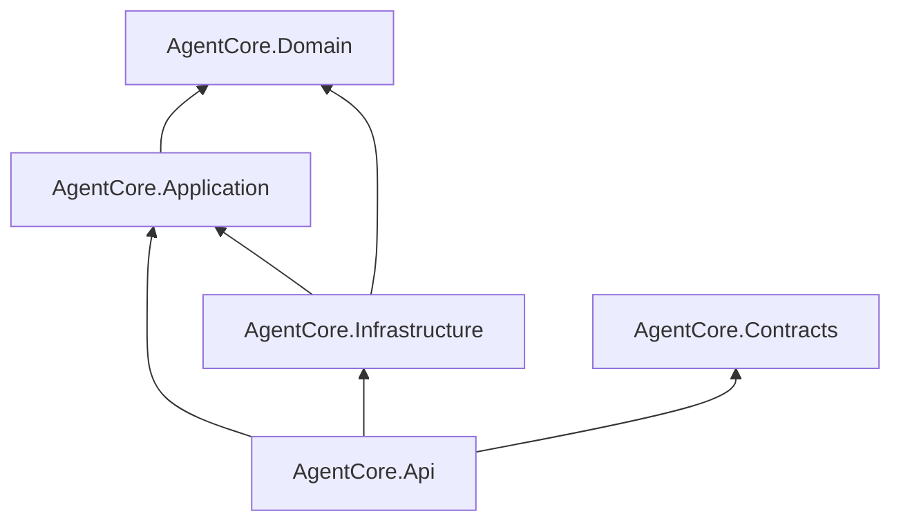

# Repository Structure

Space/Membership domain values live in `src/AgentCore.Domain/Spaces`; the targeted `ITenantSpaceStore` port and `TenantSpaceService` live in Application. Existing Infrastructure `InMemoryIamStore` / `SqliteIamStore` partials own Space/security/audit transactions, with normalized membership binding tables configured by `TenantSpaceRecords`. `TenantSpaceEndpoints` maps the canonical tenant Space administration API. Definition execution policy lives in `Domain/Definitions/DefinitionExecutionPolicy.cs`; it is separate from Space Environments. [Cutover status](reports/space-environment-implementation-2026-10-25.md) identifies integration work still pending.

The repository contains the Milestone 1 solution (`AgentCore.sln`), versioned demo definitions under `agents/` (examiner, customer-support, compliance, general-assistant, secretary, plus `agents/knowledge/` citation bodies), the React/Vite application in `web/`, a `Dockerfile` with `docker-compose.yml` (Synthetic), `docker-compose.real.yml` (hosted overlay), and `docker-compose.nopcommerce.yml` (separate nopCommerce demo project), README, docs, shared agent instructions in [AGENTS.md](../AGENTS.md), and twelve skills in [.agents/skills](../.agents/skills) used by both Codex and Cursor. The two composition skills, develop and document, load the relevant specialist playbooks. Impeccable is a UI-design skill, not a composition entry; its product/visual adapters live in [.agents/context](../.agents/context) and are not canonical product specification. `.agents/` contains development-agent instructions and tooling context; `agents/` holds product Agent Definitions. Existing editor-specific files configure Playwright MCP and Impeccable hooks. `npx impeccable install` may also write a Cursor-local copy under `.cursor/skills/impeccable` and `.cursor/agents/`; those paths are gitignored. The committed skill is `.agents/skills/impeccable`. Hooks in `.cursor/hooks.json` and `.codex/hooks.json` call that shared launcher so both editors stay in sync without duplicated skill trees.

The application layout matches the project boundaries below. Root `local/` is a gitignored personal scratch folder (notes, temp files); it is not an application project, not a configuration source, and is never committed. [Typed configuration](15-persistence-and-configuration.md#strongly-typed-options) owns host and independent speech settings; [protected credential storage](15-persistence-and-configuration.md#system-credentials-and-protection-storage) owns tenant inference keys. Do not place secrets in personal notes or tracked files.

```text
src/
  AgentCore.Domain/          # definitions, policies, conversation values
  AgentCore.Application/     # runtime, controller, ports, normalized events
  AgentCore.Contracts/       # HTTP and SignalR DTOs only
  AgentCore.Infrastructure/  # HTTP adapters, synthetic adapters, EF/SQLite, JSON store
  AgentCore.Api/             # composition root, endpoints, hub, startup
tests/
  AgentCore.Domain.Tests/
  AgentCore.Application.Tests/
  AgentCore.Infrastructure.Tests/
  AgentCore.Api.Tests/
web/                        # React/Vite SPA (Ant Design v6, minimal app.css) and its frontend tests
agents/                     # immutable shipped product definitions and approved resources
.agents/skills/             # shared agent skills (develop, document, specialists, impeccable)
.agents/context/            # Impeccable PRODUCT.md and DESIGN.md; /docs remains canonical
docs/                       # current navigation/contracts; reports/ holds dated evidence
local/                      # gitignored personal workspace; never committed
Dockerfile                  # one application container (API + SignalR + built SPA)
docker-compose.yml          # default key-free Synthetic Compose
docker-compose.real.yml     # Real/hosted overlay; interpolates gitignored .env
.env.example                # Compose key template; copy to gitignored .env
```

Arrows below mean “references,” not data flow:



| Project | Allowed dependencies and responsibility |
| --- | --- |
| Domain | BCL only; immutable Agent Definition, policy and conversation value records |
| Application | Domain and Microsoft logging abstractions; Agent Runtime, Interaction Controller, Session Runtime/manager, ports including IEnvironmentEventIngress, text context builder, ResponseTextAccumulator/SpeechSegmenter, TimeProvider, Channels |
| Contracts | BCL and MessagePack serialization annotations only; wire records, no Domain/Application/provider references |
| Infrastructure | Application, Domain, EF Core 10/SQLite, HttpClient factory/resilience and concrete adapters; never Contracts |
| Api | Application, Infrastructure, Contracts; ASP.NET Core 10, SignalR, serialization, OpenAPI, health, DI and boundary mapping |
| Tests | Corresponding subject project; Application.Tests may use Infrastructure synthetic adapters for conversation suites; Api.Tests uses WebApplicationFactory |
| web | Consumes wire specification, no backend assembly dependencies |

Namespace folders follow features: Application/Sessions, Interaction, Agents, Ports, Events; Infrastructure/Providers/OpenAICompatible, Providers/Synthetic, Persistence, Definitions; Api/Endpoints, Realtime. Do not add a shared catch-all “Common” project.

Use ordinary services and DI. No MediatR, generic repository per entity, actor framework or internal message broker. The API maps wire DTOs to application commands and application outputs back to DTOs. An application `ISessionOutput` boundary is implemented in Api; it exposes normalized application output, never hub objects. ASP.NET concerns do not travel inward.

Singletons: TenantSessionRuntimeHost registry, tenant Session services, TimeProvider.System, ID generator, immutable validated definition cache and provider factories. Per runtime: Agent Runtime, controller and cancellation/state. Per operation: EF DbContext via factory. HttpClient lifetime is managed by IHttpClientFactory; no per-frame client creation. Provider adapters must either be stateless/thread-safe or instantiated per provider session.

OpenAICompatibleLanguageModel lives in Infrastructure and accepts OpenRouter/direct-hosted/local-server configuration. There is no OpenRouter core project or interface. STT and TTS adapters are separate capability implementations, including synthetic and local variants. Intended CI is GitHub Actions (`.github/workflows/synthetic.yml`) after project scripts exist. Native realtime remains documentation-only future design, not an MVP project or startup dependency.

## Post-MVP observed layout

Infrastructure-only workspace layout is `data/workspaces/tenant-<tenantN>/spaces/space-<spaceN>/home/` and `data/workspaces/agent-<instanceN>/sessions/session-<sessionN>/working/`, with ordinary file names/bytes. Attachments and Artifacts use separate roots. Domain/Contracts never receive host paths. `Workspaces/CanonicalWorkspaceFilesystem*.cs` owns descriptor-relative access; `FileSpaceWorkspaceStore` resolves tenant-qualified Space/Session owners and `FileSessionWorkspace` owns working preparation/lifecycle. Application services retain current IAM and consent. `Sandbox/CanonicalSandboxMountResolver.cs` builds exact binds and `OpenSandboxService*.cs` owns process lifecycle. `deploy/sandbox/` and the launchers own explicit host/daemon topology, identity-compatible optional Workbench and private server credentials. No transfer planner, file row or scratch journal remains.

## P9.8-P9.9 ownership locations

- Domain: `Experience/` owns immutable observation/provenance records; `Triggers/` owns Automation/occurrence values and `Conversation/` owns Activation/AgentRun identities.
- Application: `Security/TenantExperience*`, `Tools/TenantExperienceToolContract`, `Security/TenantAutomation*`, `Execution/` and shared Session runtime/tool/prompt owners. Application references Domain, never Infrastructure or wire DTOs. Global Experience/Automation authoring and local-Profile catalog services are retired.
- Infrastructure: tenant-qualified `Security/*IamStore.Experience*` and Automation/Run transactions, retained physical stores/EF mappings and offline Synthetic adapters. Provider DTOs remain local to adapters.
- API/Contracts: canonical tenant Session/Run/Experience/continuity endpoints and safe scoped execution/source/model/outcome contracts.
- Web: the existing tenant Admin shell, Experience/Automation destinations and shared exact-action inspectors. No second component kit or timer service.

## Credential modules

`Domain/Credentials` defines resources, grants and bounded validation; `Application/Credentials` and `Application/Ports/Credentials.cs` own safe lifecycle and resolution. `Infrastructure/Credentials` owns local protection, while the existing persistence adapters store ciphertext/grants. Contracts HTTP and thin Admin endpoints expose safe DTOs. `web/src/features/admin/CredentialsSection.tsx` reuses Ant Design and Admin collections. The local key ring is runtime data (`Persistence:CredentialProtectionKeyRoot`), never a repository resource or browser profile. Historical connection migrations stay in persistence; production connection services and UI are retired.

Current execution ownership is `Domain/Conversation` (Activation/AgentRun/origin), `Application/Execution` (admission, coordination and recovery), and `Application/Sessions/SessionRuntime.*` (one mailbox). Infrastructure persists the owned graph through tenant Run/runtime contracts. `TenantRunExecution` binds shared coordination through its scoped adapter; `TenantSessionRuntimeHost` implements tenant dispatch for attached and headless work. Legacy WorkItem and ConversationTurnExecution production modules are retired. Historical migrations remain under Persistence/Migrations.

## Automation destination owners

Domain/Triggers/AutomationDestination.cs owns validated execution/delivery values; Domain/Conversation/AgentRunAdmission.cs owns the explicit output contract. Application/Triggers/AutomationDestinationPolicy.cs owns eligible exact-Session/model validation; Application/Execution/CompletionDeliveryProjection.cs owns truthful receipt projection. Existing intake, stores, SessionRuntime, coordinator and reporter retain their execution responsibilities. web/src/features/chat/AutomationDestination.tsx supplies shared Ant Design destination/report presentation; wire types stay in services/api.ts. No new runner or application service boundary is introduced.


## Admin workspace composition

`web/src/features/admin/AdminApp.tsx` composes page-scoped reads and the unified `AdminShell`. `adminNavigation.ts` owns typed destinations/search metadata; `app/appRoute.ts` owns parsing, legacy replacement and guarded history. `AdminGlobalPages`, `DefinitionDetail`, `DefinitionDraftWorkspace`, `InstanceDetail`, `InstanceProfile`, `InstanceOverview` and `EffectiveConfigView` separate inventory, owner lifecycle, singular candidate state and read-only inspection. `adminPresentation` contains shared presentation helpers; `AdminRecordSummaries` retains immutable resources and identity summaries. Existing feature editors/API services retain command ownership. `/docs/13` owns behavior and `.agents/context/DESIGN.md` owns presentation.


## Office and file preview modules

Application/Ports/Office.cs owns processor records; Application/Office owns closed schemas; Canonical Office reads/mutations use the tenant owning services and protected-operation target. Infrastructure/Office contains package guards and vendor adapters. Application/Drive and Ports/Drive*.cs own authorization, effects, receipts and safe provider contracts. Infrastructure/Drive owns direct REST/OAuth and Synthetic adapters; Infrastructure/Credentials/GoogleOAuthProof.cs shares stateless identity/PKCE primitives with Gmail, without sharing account authorization. Persistence/DriveRecords and DriveStore adapters use the existing DbContext and one additive migration.

web/src/features/filePreview owns the shared dialog, source adapters, limits, renderers and cancellable workers. Chat/Admin source actions consume it. Admin's DriveAccountDialog, DriveConnectionPanel and DriveFiles extend existing Credentials pages; services/drive.ts owns protected requests. App CSS owns preview sizing/overflow; AntD tokens own presentation. web/public/notices and Infrastructure/Notices retain exact dependency notices. No project or second UI kit is added.


<a id="initiative-9--adopted-successor-implementation-in-progress"></a>

## Initiative 9 — Task delegation and communication

Keep task/communication value models in Domain, narrow ports/admission/authority/coordination services in Application, atomic implementations and EF records/migration in the existing Infrastructure IAM/persistence owner, thin authenticated endpoints/DTO mapping in Api/Contracts, and Task drawer/Agent communication compositions in existing web features. No additional project, host, broker or engine. The source-audit report records former contract owners and required removal dispositions.

See the [adopted proposal](proposals/initiative-9-task-delegation-communication.md), [removal audit](reports/initiative-9-source-audit-2026-10-27.md) and [local delivery evidence and limits](reports/initiative-9-local-verification-2026-10-27.md). The implementation has focused local verification; the report distinguishes exercised behavior from unrun deployment, provider and device qualification.

## Formal Workflow ownership

Formal Workflows extends the existing projects. `AgentCore.Domain/Workflows` owns Core graph/input/proof/source records and pure validation. `AgentCore.Application/Workflows` owns catalog, execution, evidence and source authority; its facets live under `Ports` and measurements under `Observability`. `AgentCore.Infrastructure/Workflows` contains the embedded Elsa materializer/runtime, persistence registration and stopped-writer cutover. Existing `Security` store partials own transactional Workflow/Task/Automation integration; `Persistence/WorkflowPersistence.cs` and the tracked migrations own Core rows and guards. Vendor references remain confined to Infrastructure; no new production .NET project or public vendor server is introduced.

`AgentCore.Api/Security/TenantWorkflowEndpoints.cs` exposes only the Core HTTP boundary. `web/src/features/workflows` owns the tenant designer, outline, launcher, inspector and compact Chat discovery; `services/tenantWorkflows.ts` owns typed client contracts. React Flow stays inside `WorkflowDiagram`. Automation destination editing extends the existing Automation drawer. Domain, Application, Infrastructure, API and frontend tests remain in their incumbent test projects. Ignored `local/` spike/qualification tools are evidence aids, not runtime modules.

## Refactoring ownership (2026-10-29)

API `Hosting/` groups hosted workers, shutdown and scheduler readiness; `Configuration/` contains host-only File Preview options. Public API namespaces, DI order and option keys are preserved. Application `Admin/EffectiveConfigurationComposer` owns only the Admin projection and its memory default; the reference audit found no non-Admin caller of that helper. Session/Run configuration keeps its existing owners. [Design and move map](proposals/project-refactoring-architecture-stabilization.md) records targeted pure extraction seams and the persistence assembly NO-GO. The existing five production projects, migration/resources, shipped Definition directory and stable script entrypoints remain. [Documentation map](README.md), [reports](reports/README.md), [shipped sources](../agents/README.md) and [script inventory](../scripts/README.md) distinguish current ownership from historical evidence.
