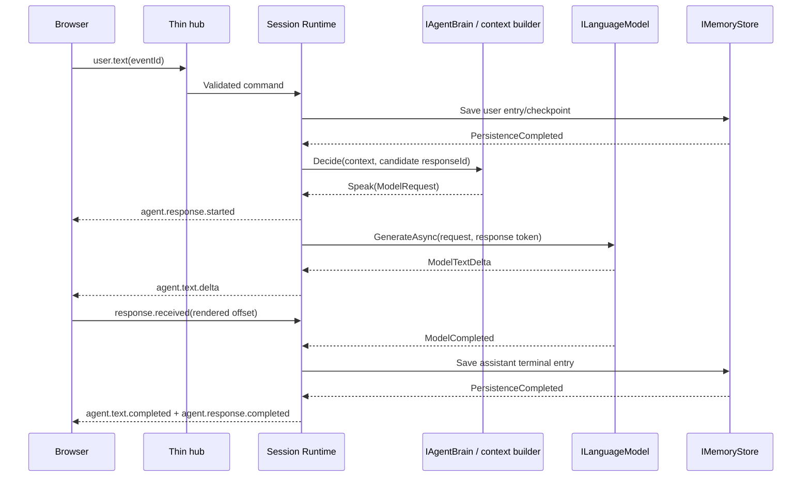
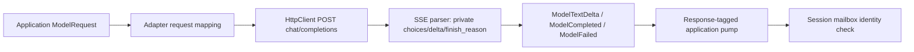

# Backend Implementation Specification

Current IAM implementation and local Synthetic proposal acceptance are complete in [final delivery](reports/tenant-final-delivery-2026-10-24.md); [repository stabilization](reports/iam-stabilization-2026-10-24.md) owns subsequent launcher/test and typed review-owner changes. Earlier checkpoint paragraphs describe their dated partial scope; their pending statements do not reopen completed successors or establish deployment/live-provider/CI acceptance.

Canonical model Resource authoring shares the human Resource planner and the existing consent/local-effect owner. The four commands retain independent primary and source reads, actual root/checkpoint provenance, complete exact plans and immutable body-free receipts. New explicitly delegated Managed text creation shares the direct command transaction with Skill changes; other Resource effects keep exact consent. Exact own-effect receipt chains can retain original Run bytes without substituting future content. [Contract and scoped evidence](04-backend-interfaces.md#canonical-model-resource-authoring).

## Tenant runtime host composition checkpoint

Startup registers a single `TenantSessionRuntimeHost` and maps tenant dispatcher/control ports to that instance. Shared capacity lives in `TenantRuntimeCapacity`; old SessionHost/owner connection, occurrence, profile notifier and unowned Run dispatch components are removed. Canonical shutdown stops admission and awaits a cached generation/Voice drain. Hosted Run, Automation/event and email-watch work uses tenant services exclusively. Retained-content cleanup uses the existing canonical ownership-checked cleanup services; duplicate old Attachment TTL and owner Session/working cleanup hosted paths are removed.

This is a composition/lifecycle cutover. It does not add canonical Runtime-state, coordinated State Isolation, Harness, Experience or maintenance parity and does not yet remove the old owner capability store/schema or all internal Runtime branches. [Verification and limitations](reports/runtime-registry-cutover-verification-2026-10-21.md).


Independent Schedule/manual protected tasks now have [focused backend qualification](reports/tenant-independent-task-verification-2026-10-20.md): exact file/Office, Browser/Sandbox and connected-account owners; current accepted-occurrence lineage; absent scheduled versus actual manual requester; Review/primary-only grants; immutable native facts; SQLite consent recovery and strict no-human account guards. This supersedes protected-autonomous-task-pending notes below for the exercised paths only. Independent typed waits additionally have [same-Run runtime and recovery qualification](reports/tenant-independent-wait-verification-2026-10-20.md) with 116 focused passing cases. Independent child creation, completion inbox consumption and same-parent reports additionally have [focused backend qualification](reports/tenant-independent-child-verification-2026-10-20.md), preserving exact causal ownership, separate creation/read consent and atomic factual output. Admission Review, event/webhook/watch ingress, existing-Session and arbitrary report destinations, tenant Automation UI, remaining proposal families and final authority/schema audit remain open. The full original goal stays active.

Tenant Schedule and explicit manual Automation now have an [owned backend foundation](reports/tenant-automation-foundation-verification-2026-10-20.md): canonical human CRUD, fresh independently attributed roots, atomic occurrence/Session/Run admission, actual mailbox completion, policy adoption, bounded due traversal, strict source/creator guards and SQLite host recreation. This supersedes ownership/admission-pending notes below only for one Schedule trigger, a new Background Session and no completion destination. Admission Review, autonomous protected/native tools, event/webhook/watch ingress, reporting/destinations and tenant Automation UI remain open, together with the remaining proposal families and final authority/schema audit. The full original goal stays active.

## Compound management inspection execution

`TenantManagementInspectionProjection` uses the canonical owned Instance/publication, shared Skill/resource views and protected credential metadata owner. Existing management reads carry optional child witnesses and revalidate them inside current checkpoint/outcome transactions. Child Review and reviewer policies compose with Agent read; source-scoped visibility applies before paging. Diagnosis classification is shared with incumbent authoring and semantic read correlation. The shared inspector receives labeled escaped facts rather than one opaque JSON inventory. [Authoritative port/authority details](04-backend-interfaces.md#compound-harness-and-configuration-observations) and [qualification](reports/tenant-management-inspection-verification-2026-10-22.md).

The same projection and consent owner implement the four canonical Skill/Resource reads. Procedure witnesses bind exact private text separately from metadata; immutable resource bytes use the existing content-store port and hash/length verification. Complete procedures and explicit resource text excerpts remain untrusted observations, with no activation or write. [Child authority and bounds](04-backend-interfaces.md#canonical-skill-and-resource-observations) and [runtime evidence](reports/tenant-management-child-read-verification-2026-10-22.md).

## Tenant management command execution

Canonical model writes use `TenantManagementOperationTarget` and the same `TenantAgentConfigurationService` planning as human settings. The Runtime routes these local operations directly to their durable preference/approved-operation owner, avoiding a second generic side-effect fence. General writes prepare exact saved `mutate_management` consent and apply only through the incumbent atomic local-effect transaction; three safe conversation preferences retain their existing explicit direct-policy exception. Strict schemas include the five existing State & Isolation enum types. [Ports and effect boundaries](04-backend-interfaces.md#tenant-model-management-commands) own the detailed contract; [focused evidence](reports/tenant-management-mutation-verification-2026-10-22.md) records qualification and remaining conversions.

## Model Automation observation execution

The tenant tool boundary routes `automation.list`/`automation.inspect` to `TenantAutomationReadService` under the actual claimed Run. The admitted and current Definitions must both offer the capability. Strict arguments, permission-filtered paging, bounded excerpts and independent source permissions govern the returned observation. Exact `inspect_automations` consent reuses the existing approval preparation, read-only local receipt and continuation path. The same store transaction rechecks source ownership/configuration and qualified reviewer authority. Runtime checkpoints retain source references through compaction; later generation, report and outcome owners validate them through `TenantRunSourceAuthority`. Output truncation returns no adopted witness.

## Tenant Drive operation reconciliation

Extend `drive.get` account-read intent with exclusive `operationId` selection. `TenantAccountRuntimeReadService` freezes a same-Agent/account canonical action request/receipt, original effect Run/Session and bounded immutable native intent references in optional `PreparedAccountRead.Source`. Reuse current exact account-read approval/receipt/checkpoint owners. Current executor and reviewer require independent raw original Session and Run reads; prior write/delete authority is unnecessary. Verify source identity again for inspection, consent decisions, read commits, retained checkpoint use and atomic final answer persistence.

The existing Drive inspector uses a live canonical scoped read callback. Only uncertain/dispatched native rows cause metadata GET verification. Existing success/failure is explicitly retained evidence. Upload never resumes; batch iterates deterministic existing child IDs without calling the batch write path. Missing native rows and unattempted suffixes remain unknown. A download returns only its original recorded outcome, with no claim about local bytes. Never alter the original canonical effect receipt, resolve a legacy ID or coalesce another root's native effect.

## Tenant account-family metadata execution

`email.accounts` and `drive.accounts` use the current tenant metadata read owner, never the unscoped native account resolver. The direct tool derives its family; exact Review carries the same discriminator in canonical existing metadata arguments. Admitted/current purpose capability, current raw Session read and independent per-Credential metadata/family reads precede filtered pagination and repeat on delivery and reuse. Saved connection status/auth epoch are non-secret metadata and confer no account use. Current human compound read scope filters approval totals/details in both stores.

Metadata provenance retains the one extra record used for `hasMore`. Both IAM adapters recheck source/binding/configuration and policy or exact consent/reviewer provenance within the existing atomic outcome transaction. Ordinary conversational metadata answers now select the same protected final-save path as account read/action output; a source loss saves no completed answer and fails the Run as `protected-output-unavailable`. Immediate-background direct/Review flows keep child ownership and finish through `work.complete`. [Focused verification](reports/tenant-account-discovery-verification-2026-10-20.md) includes actual SQLite application-host recreation while family Review is pending. No provider I/O, secret resolution, new state owner or table is added.

## Internal tenant account-action pipeline

Exact bound-account actions now have typed preparation, current compound inspection/decision checks and a reserved effect owner through `TenantRunContinuationService`. Draft creation is a local transaction over the existing durable draft and tenant receipt owners. External send and Drive effects use the existing worker before mailbox dispatch; mailbox continuation consumes receipts only. Consent distinguishes creating a draft from sending its exact saved content. The canonical Drive service receives an operation-local tenant authority callback and exact operation identity; it never resolves a legacy Credential or adopts another root's matching pending native write.

Saved Drive targets, expected versions and parent membership are rechecked before mutation. Upload verifies its captured SHA/length; download verifies original remote bytes and commits only a new owned workspace path. Ordered trash batches retain the completed prefix, first refusal/uncertainty and unattempted suffix. Explicit native rejection and uncertain acknowledgement remain distinct. Gmail's acknowledged send remains factual if authority is revoked afterward; private result release may still be withheld. A Drive acknowledgement that still requires unreadable metadata verification remains uncertain. Neither case authorizes another attempt.

Normalized OAuth refresh changes secret revision without invalidating previously retrieved observations of the same logical OAuth source. New I/O still pins its current secret and accepts only its own committed refresh rotation; password replacements and logical binding/Credential/auth-epoch changes remain source changes. Core draft snapshots are immutable in memory and SQLite. The [model/UI qualification](reports/tenant-account-action-model-ui-verification-2026-10-20.md) now covers exact model actions and shared consent presentation, and [account-family discovery](reports/tenant-account-discovery-verification-2026-10-20.md) qualifies the existing metadata owner. Read-only operation reconciliation, abandoned-dispatch cold-host qualification, autonomous origins and the full proposal remain open.


[Focused internal-owner evidence](reports/tenant-account-action-owner-verification-2026-10-20.md) distinguishes this checkpoint from remaining module acceptance.

## Tenant Agent account-read execution

`TenantAccountRuntimeReadService` prepares exact read consent, resolves only the current owned bound alias and repeats admitted/current tool capability, original-human lineage, current executor, raw compound reads and qualified reviewer around provider I/O. The shared Infrastructure reader keeps token resolution local and commits only normalized protected rotation/reconnect facts through the owning store transaction. Consent settles through existing approval/signal/receipt and successor owners; a consumed exceptional grant substitutes only for the primary use permission. Results enter the same durable tool checkpoint with exact account-source fingerprints. Current sources fence reuse before provider context and inside `CommitTenantOutcomeAsync`; ordinary conversational answers with account-read references use that atomic outcome path too. A final source refusal records a typed eligibility denial and fails the owned Run as `protected-output-unavailable`, superseding its response without saving a completed protected answer. The microphone lifecycle remains unchanged. [Focused qualification](reports/tenant-agent-account-read-verification-2026-10-20.md) covers all five bounded read methods and final-save revocation.

## Tenant connected-account read execution

The canonical bound-account human read facade uses ITenantCredentialBindingStore and original-human session authority instead of unscoped Instance/Credential lookups. Its Infrastructure transport reuses the existing Gmail/IMAP/Drive adapters with explicit scoped recheck/token callbacks. Refresh rotations preserve current owner/binding/configuration witnesses and never overwrite a newer secret or disconnected grant. An exact read audit rechecks live owner, human and raw IAM in the owning store before data release. This module does not enable remote writes, send or unconverted agent tools. [Focused qualification](reports/tenant-connected-account-read-verification-2026-10-20.md) covers the human read facade. Agent exact query consent is qualified separately above; Agent discovery and exact binary transfer/remote actions have separate qualification above. Unconverted origins and final authority/schema cutover remain pending. Gmail/Drive retry dispatch repeats current authority. Adapter failure normalization cannot override a current original-human/source denial. SQLite audit replay compares persisted millisecond time.

## Tenant background native execution

The shared task execution shape covers human conversation and immediate-background/approval-successor Runs. Background tool projection includes native stored/live read tools and exact Browser/Sandbox command/read/control consent schemas through the incumbent owners. It excludes unrelated management and protected password fill. Native owners repeat the current task/background capability check so internal calls and resumed receipts cannot bypass projection. Native results enter the same durable tool checkpoint; uncertainty is factual and never replayed, while only a terminal task successor reports to the original parent. [Focused qualification](reports/tenant-background-native-verification-2026-10-20.md) distinguishes native Chromium/application evidence, controlled SDK peer facts and unrun live Docker background execution.

## Automatic report source-read execution

The existing completion coordinator prepares `ReportSourceRead` ordinary Review before independent report-Run creation. Its exact terminal source is never suspended or mutated. The incumbent approval signal transaction records a read receipt and processed signal without admitting a Run; negative, expired or stale consent records no data/report and closes only the outstanding report intent. The unchanged approved source may proceed to separate creation authorization. Current raw Session/initial/source Run reads, original-human lineage, pinned/current capability, configuration and current reviewing-human authority are repeated at use boundaries. Same-task conversational completion-read receipts and report-source receipts cannot substitute for one another. Pending consent is excluded before the bounded coordinator result limit. [Focused qualification](reports/tenant-report-source-read-verification-2026-10-20.md) covers positive/refused/restarted consent, exact approval-successor sources and current use-boundary authority.

## Completion read consent execution

The predecessor completion-read model operation, payload decoder and child claim/acknowledgment pipeline are retired. Current `tasks.inspect` applies Task read policy and independently filters worker/source links and result evidence. Required model read Review fails closed; no former receipt or tool is an alias.

`TenantReportReadRules` and the separate `PreparedReportSourceRead` owner continue to fence independent Automation destination reporting. Source-read consent never grants report creation or recipient file access.

## Tenant completion consumption execution

`TenantTaskToolService` uses the existing Runtime tool boundary for `tasks.list`, `tasks.inspect`, correspondence, cancellation and exact notification acknowledgment. The saved claimed Run and current scope/policy are rechecked before returning metadata or mutating facts. Acknowledgment is idempotent handling metadata; it does not establish a successful parent answer, report delivery or Goal verification. There is no take token or provisional Handled stage for Tasks. Independent Automation completion receipts remain internal to their incumbent reporter.

## Tenant wait execution

`ExecutionWaitContract` accepts duration or exact Task conditions. `TaskWaitRules` binds currently readable related Task revision/message witnesses; `TenantWaitRules` compares the saved pending call and checkpoint. Both IAM stores save and wake through the incumbent `AgentRunWaitExecution`. Current Task/message policy repeats at wake; exact worker approval successor chains determine completion.

Durable suspension releases the live claim/provider worker. Completion, message and timeout races append at most one result and resume the same Run/Activation/Response under a fresh generation without another provider attempt. Existing pending Runtime admission flags, cumulative wait limits, cancellation and queued human input retain their existing owners. [Contract](04-backend-interfaces.md#tenant-typed-wait-ownership).

## Completion-report consent execution

`TenantBackgroundCompletionService` prepares policy-required or exceptional report-Run creation through the incumbent `TenantApprovalService`, using only actual retained terminal-child completion intent. `TenantBackgroundReportTarget` resolves current owned source, destination, model and effective configuration; the closed typed operation binds exact source revision/evidence, parent revision/input boundary and generated report identities. Same-source/destination semantic correlation excludes generated witnesses. There is no public/model report-initiation API.

A report request does not suspend or mutate the terminal source. The shared decision/expiry signal routes to the existing completion-inbox admission facet, which repeats current source/root/executor/reviewer/grant authority and atomically records the report graph, inbox disposition, receipt, grant disposition, security revision/audit and processed signal. The ordinary direct report path cannot bypass an existing report request. Busy parents defer; stale saved actions refuse without adapting evidence or IDs. Negative decisions account only the requested delivery. Factual receipt replay and final delivery retain their incumbent owners. [Contract](04-backend-interfaces.md#tenant-completion-report-creation-consent), [persistence](15-persistence-and-configuration.md#tenant-report-creation-approval-persistence). [Focused qualification](reports/tenant-background-report-creation-verification-2026-10-20.md) records this bounded implementation. The full proposal stays active.


## Tenant background creation consent

The child-only creation operation is retired. `TenantTaskDelegationTarget`, `TenantTaskConsentRules` and the existing approval owner freeze one exact canonical Task assignment. Both stores atomically commit Task/worker graph, source effect, receipt and any exact primary grant consumption after current source/reviewer/target checks. A grant never supplies the worker's independent creation or file authority. Human commands use their authenticated command with no source Run; their admission outcome is a Task-owned fact. See [exact Task consent](14-api-and-realtime-protocol.md#exact-task-consent-and-creation-receipts--initiative-9).

## Tenant background file mutation and publication

The approved tenant conversion extends the incumbent Workspace/Office mutation and Artifact publication owners to human-attributed immediate-background tasks and exact same-task approval successors. Admitted/current capabilities, current independent executor and source permissions, state isolation, exact file witnesses, primary-only exceptional grants, one-time dispatch/publication receipts and original-human/root authority remain mandatory. Direct Allowed operations and reviewed operations use the same existing file stores and operation owners; no background effect executor or new approval authority is introduced.

Every later operation is independently authorized. A mutation grant cannot grant source reads, secondary batch permissions, another mutation, Artifact creation or file download. Pending/rejected/changed actions retain root suppression and exact no-replay recovery; only the terminal task successor reports saved facts. Published files belong to the actual child Session. Neither a publication receipt nor a factual parent report grants recipient file access. Office content remains untrusted and immutable export preserves the observed original bytes.

`TenantExecutionLineage.RequireRequesterAsync` resolves the actual saved root and repeats current original-human root-Session read and Agent chat. The operation facade and the direct/approved file transaction owners use the same check. Provenance grants no read on a private child Session. Independent executor reads on the actual child and every source remain mandatory; Core policy floors still apply to primary and compound targets.

`TenantApprovalService` uses the immutable context root when preparing Artifact requests, including a second approval in a task successor. The existing Workspace external-effect fence records at most one dispatch and factual settlement, including indeterminate outcomes after acknowledgement loss; Artifact publication retains its atomic bytes/metadata/receipt transaction. Current admitted/current capability and state-isolation checks repeat at actual mutation/publication. Allowed policy responses without `applied=true` remain decisions, not effects. Background work continues through work.complete; files stay owned by the child Session and parent reports contain factual outcomes without transferring file authority.

This module does not open Browser/Sandbox execution, Credentials/configuration changes, child fanout, autonomous origins or report-generated effects. The original full proposal remains active. [Focused backend qualification](reports/tenant-background-file-effects-verification-2026-10-20.md) records integrated workflows, current-scope refusal, host recreation and regression limits.

## Canonical tenant queued human input

`TenantRunService` prepares the current original-human references and frozen configuration/source witnesses. `TenantSessionRuntimeHost` routes them to the actual claimed Session generation or reserves its existing quiescent write barrier. `TenantInputReceived` reserves an opaque entry sequence in the mailbox before asynchronous I/O, and the existing persistence worker invokes `ITenantRuntimeInputWriter`. No user body or file reference is appended to the active task's input window.

`ITenantRuntimeInputStore` rechecks current original-human authentication, Session read/Agent chat, active executor/Instance, security/configuration/source witnesses and the exact live frame. Its existing human admission transaction atomically stages current Runtime progress, immutable user entry, bound files, fresh UserTurn Activation/Run, security revision and canonical audit. Refusal creates no graph, binding or success audit and does not fail independent work. The Runtime carries the committed sequence and last-user-activity high-water marks into later saves; an idempotent no-write replay cannot replace newer streaming state. A refused reserved slot may leave a sequence gap. Existing input-boundary filtering keeps future human entries out of current prompt/history assembly.

Runnable filtering excludes blocked same-Session inputs before the global batch limit, then repeats that fence at claim. Human Runs dispatch in saved creation/source-entry/ID order; earlier retries retain their position and approval waits release the slot. Queued completion reports yield to nonterminal human work, and reports order among themselves without circular waiting. Already-running factual reports and terminal/suspended Runtime generations finish before the host rebases only the Session witness and retries intake; current human/security/configuration/source checks still apply. Accepted input survives current-task cancellation and uses the same durable graph after restart.

Null/queue remains the default. Explicit Interrupt/Steer uses the exact cancellation/admission extension below; voice arbitration remains separate proposal work. No new queue table, competing mutable Session owner, protocol event or raw-audio mailbox path is introduced.

## Tenant immediate-background file observation

`TenantTaskExecutionContract` centralizes eligible human-task execution shape and the closed background file/native-operation schema; it is not an authority token. `TenantToolAuthorization` repeats the family gate on actual saved Runs and rejects unrelated management/credential/fanout intents before their adapters. The existing Workspace, resource, Attachment and Artifact read owners still enforce current independent IAM, exact source/window, state isolation, claim and retained-checkpoint fences. Current background capability is checked on both initial Runs and approval successors.

`TenantApprovalContinuationRules` preserves BackgroundOutcome and uses a background signal; `PromptContextBuilder` derives Core background/task semantics from the output contract as well as occurrence triggers. Successors therefore retain the original objective and finish through work.complete. No separate Runtime or file-effect executor is introduced.

`TenantBackgroundLineage` validates persisted same-task handoffs. Both stores create the existing completion receipt only for the terminal non-Continued task Run; their report source carries the immutable initial child alongside that terminal Run. Report admission resolves current root authority and the original parent. Activity follows the same task chain only while every successor remains independently readable, withholding unknown completion facts. [Contract](04-backend-interfaces.md#tenant-immediate-background-file-observation) and [focused qualification](reports/tenant-background-file-observation-verification-2026-10-20.md). The queued-input successor above converts active human binding and qualifies actual bound-original background observations with an explicitly capable published definition. The mutation/publication conversion above now uses those same task owners; native adapters remain pending.

## Tenant Background Activity and foreground implementation

Canonical human Activity queries use the existing scoped Session/Run owners. Both stores filter exact Agent ownership, allowed read IDs and optional BackgroundWork before count/paging. Session rows include archived and zero-run contexts, ordered by updated time descending then ID; Runs order by creation time descending then ID. Exact reads independently validate tenant/Agent/Session. The service rechecks the original live human/current security revision after awaited reads. Initial task/result and completion accounting are independently gated by Run read; parent target references require their own current Session read.

Explicit Continue uses the incumbent Runtime mailbox and serialized persistence worker when work is live. The specialized save rechecks the original human authentication session, current raw Session read/manage and Agent chat, active executor/Instance, security/configuration witnesses and exact live claim. It adds only ChatList to BackgroundWork, atomically with existing security/audit. Successful visibility carries forward into already queued snapshots; a refused human surface write cannot leak optimistic state or fail independent child execution. Ordinary Runtime writes cannot change surface flags.

Quiescent writes reserve through the tenant host's existing Session write epoch/barrier, also used for delivered-prefix receipts. They recheck current authority and exact Session revision and refuse a live claimed Run. Later dispatch loads the same foregrounded Session. No Session or Run is cloned, no old root is reused for a new human turn, and the initial background origin/result remains unchanged. A completed child can receive a new human turn on that exact Session with a fresh root. No new table/migration or competing mutable owner is introduced. [Focused active/quiescent, HTTP and recovery evidence](reports/tenant-background-activity-verification-2026-10-20.md). The [tenant Activity UI](reports/tenant-background-activity-ui-verification-2026-10-20.md) adds bounded exact-Agent Run/background pages, actual model/mode/diagnostic/cancellation projections and already-visible chat availability. Both stores intersect independent allowed Session/Run IDs before Agent-wide Run totals/paging. Remaining autonomous/effect families stay open.

## Tenant immediate-background admission storage

The former immediate-child admission factory and store facets are removed. `TenantTaskService` and `ITenantTaskStore` own canonical coordination metadata and one atomic worker Session/Activation/Run admission in both existing stores. Dependencies reserve metadata/budget without a worker until exact readiness. Same-key/same-body replay returns the original Task; changed input conflicts. Only the existing coordinator dispatches saved Runs. Independent Automation admission and configured reports retain their own occurrence owners.

## Tenant Agent decommission implementation

`TenantAgentDecommissionService` supplies original-human preflight and an exact revision/operation command under the incumbent Instance lifecycle gate. The coherent lifecycle projection includes independent current raw update and deletion hints; a final original-human/security revision fence follows both hint reads. The existing IAM store transaction repeats authority and reference checks, marks the SystemIdentity/Principal Removed, advances Instance/security revisions, removes executor/target/home/child assignments and local child configuration/bindings, and commits one canonical audit receipt. The archived backing Instance remains as the identity-use tombstone; ordinary read/configuration/Chat/role resource discovery excludes it. Both central continuity checks and SQLite triggers prevent revival. A retired Instance marker no longer acts as a live Definition reference; genuine Instance, Session and execution references still block Definition retirement.

`TenantAgentDecommissionCleanup` runs immediately after commit and through the incumbent supervised resource sweep. A bounded rotating scan uses the exact retained owner/receipt, repeats that mandate under existing native reset close/path/lock/absence gates and uses no-follow canonical workspace purge. Workspace clearance reads the canonical Sandbox lease store, including leases hidden by legacy enumeration; any live or uncertain mount retains bytes. No callback grants a new Run, native command or user read. Committed logical retirement remains factual when physical cleanup fails, caller cancellation occurs or the login later expires. [Contract](04-backend-interfaces.md#tenant-agent-decommission), [qualification](reports/tenant-agent-decommission-verification-2026-10-20.md).

The unused global `IAdminLifecycleDeletion` port, LocalOwner delete commands, both global transaction executors and old deletion-receipt workspace sweep are retired. Canonical decommission and Definition retirement retain their own IAM/store transactions. `TenantDeletionReferenceQueries` contains only the shared read-only SQLite blocker queries; Instance queries require an explicit tenant. Pure Definition revision witnesses and blocker-count records remain unchanged. There is no generic physical delete/restore entry on the in-memory Instance store. [Retirement and native recovery qualification](reports/global-lifecycle-deletion-retirement-verification-2026-10-24.md).

## System Browser privacy implementation

`SystemBrowserPrivacyService` checks the original global human before/after reads and creates a body-free canonical audit on saves. InMemory and SQLite IAM stores repeat actual live Account/session/stamp, global User Principal, raw system permission, frozen deployment ceilings and command validation inside the existing policy/audit transaction. The runtime privacy store is read-only; unscoped save/Admin-history authority is removed. Compare-and-swap changes saved state only, and native hosts retain their startup policy. The central Authorizer accepts the already-validated Account for this owning transaction; other callers retain normal Account reads. [Canonical contract](04-backend-interfaces.md#system-browser-privacy-administration), [qualification](reports/system-browser-privacy-verification-2026-10-20.md).

## Tenant Browser profile reset implementation

The human `TenantBrowserProfileService` derives the actual Agent/executor and original Account/login/Principal through canonical IAM. It requires independent raw parent/Browser read and Browser manage; model permissions or approval grants cannot substitute. Exact security/Instance/native witnesses are compared before start. Both stores commit pending reset on the existing Instance with security/Instance revision increments and start audit before native close/deletion; stale prepared operations therefore lose their source witness.

`NativePlaywrightBrowser` serializes reset with incumbent owner/profile gates, closes only the actual persistent context and requires its Close event. After closure it repeats safe path checks, takes the reusable `.lock` inode exclusively and invokes a current-human/revision check immediately before deletion. Linked profile components/lock paths are refused. Verified directory absence is the sole success fact; private I/O errors, uncertain native close, lost human authority or unproven deletion settle unknown. Ephemeral contexts and other Agents are untouched. No reset path launches a Browser. Profile data remains guarded by pending/unknown Instance state until a new deliberate confirmed reset.

Factual settlement uses a separate bounded token so caller cancellation or logout does not erase an attempted operation. Native completion retains only the latest process-local normalized result. A later authorized GET can settle the exact pending operation from that result, or record unknown after process loss, without native replay. A busy read never declares abandonment. The start audit's unique operation ID prevents reuse of an older completed ID. Current-operation retries return facts only. [Ports](04-backend-interfaces.md#tenant-browser-persistent-profile-reset), [verification](reports/tenant-browser-profile-reset-verification-2026-10-20.md).

## Tenant Browser capture/download implementation

`TenantBrowserArtifactRules` closes publication intent, privacy witnesses, byte/task limits and body-free publication results. `TenantBrowserEffectService` freezes accepted native bytes, then passes that batch to its incumbent settlement owner. Both stores repeat compound current authority and publish owned immutable metadata plus factual receipt/checkpoint atomically. Whole-batch capacity is checked before private blob writes. The receipt distinguishes successful native execution from unavailable or partial file publication; lookup/recovery cannot repeat SDK work. Publication staging is charged to the existing checkpoint clock, and expired claims cannot seal observation delivery.

Native capture shares the interactive hold already owned by tenant execution, preventing nested gate acquisition. Privacy remains the startup-pinned host policy; exact capture consent binds its mode/hash, without creating a tenant privacy override. `TenantBrowserEffectService.Images` resolves actual receipt-proven capture bytes for each model generation under independent current file read/policy and verifies them again at the provider boundary, including provider image-role projections. The existing Attachment and execution-source checks share an unchanged security revision during that boundary check. The normal Artifact reference preflight and recipient readback still decide rich file visibility. [Contract](04-backend-interfaces.md#tenant-browser-capture-and-download-publication). Artifact-backed drops use the adjacent canonical file-source adapter. Lifecycle/privacy administration, autonomous origins and full cutover remain open.


## Tenant Browser retirement implementation

Canonical Session lifecycle and Agent archive/restore call `TenantBrowserRetirementService` after committing their existing IAM/lifecycle transaction. The existing `WorkspaceCleanupHostedService` also supervises its bounded retry pass. A five-second TimeProvider budget limits each pass/reconciliation, and a timed-out owner advances the retry cursor while retaining its original pending context. Only native tenant-owned resources are candidates; current actual scoped roots, status and executor identity decide eligibility. A metadata acknowledgement never claims native closure when cleanup remains pending. Deleted Session rows and inactive Agent/tenant identity are cleanup facts, not user authority.

Native retirement uses nonblocking existing owner/Session/view gates. Persistent root and view can share the same semaphore; retirement acquires that gate once. It closes only owned pages when siblings remain, or the final actual context otherwise, checking actual close events. Per-page and whole-context unknown outcomes retain the original process-local context reference. A later restore cannot redirect that cleanup to a new context or erase an unfinished old close. Profile data, owner binding and mode remain for a fresh authorized reopen. No filesystem profile reset or alternative cleanup worker is added. [Contract](04-backend-interfaces.md#tenant-browser-technical-retirement), [evidence](reports/tenant-browser-retirement-verification-2026-10-20.md).


## Tenant Browser Artifact drop implementation

Artifact-backed `BrowserDrop` extends the incumbent immutable source rules, source target, reviewer/inbox composition and native protected file callback. It takes exactly one canonical Artifact ID; text/MIME overrides are rejected. `BrowserDescription` shows current-readable exact source facts, destination frame origin and the limited drop consequence using the existing saved-parameter composition. Native file transmission repeats origin/page generation and authority after source resolution, with the existing attempted/SDK-confirmed effect classification and no replay. Original binary bytes travel only through the private callback and native in-memory File construction. Both stores and retained checkpoints reuse their existing actual-source checks; no effect engine or unscoped source resolver is added. [Contract](04-backend-interfaces.md#tenant-browser-artifact-drop-contract), [verification](reports/tenant-browser-drop-verification-2026-10-20.md).


## Tenant Browser Artifact upload implementation

`TenantBrowserUploadTarget` reads metadata from `ITenantArtifactStore` only after independent raw source permission checks, and resolves hash-verified immutable bytes only for the native sink callback. Its closed ordered witnesses extend the incumbent Browser prepared command and canonical hash. Both IAM stores repeat actual same-Session source facts inside their existing Browser operation transactions; inbox queries apply all source visibility before counts and paging. The model authorization schema now includes the converted upload command.

Native upload requires the actual tenant owner, exact physical witness, current-authority callback and private file resolver. A cached target-frame origin joins the physical witness and saved consent. Source resolution yields no authority: current claim/IAM checks repeat after it, and native page generation, frame URL and file-input semantics repeat before transmission. Known pre-dispatch refusals remain denied without an attempted effect. Existing Browser receipts, uncertain recovery, checkpoint projection and historical source revalidation remain the only dispatch/result owners. [Contract](04-backend-interfaces.md#tenant-browser-artifact-upload-contract).


## Tenant conversational Office mutations

Route the four existing Office create/edit names through the tenant mutation boundary before any legacy Office dispatcher. Close nested arguments against the incumbent schema and derive path ownership, ordinary source reads and primary write authority independently. Use the existing saved mutation consent and dispatch/settlement/recovery owners. Canonical byte transformation exclusively creates a new name or compares edit source bytes immediately before replacement, with current owner/claim/IAM/HomeAccess fences. Do not calculate formulas or publish an Artifact. [Port contract](04-backend-interfaces.md#tenant-model-office-mutation-contract), [evidence](reports/tenant-office-mutation-verification-2026-10-19.md).

## Tenant Office read processing

Tenant `office.document.inspect` and `office.spreadsheet.inspect` dispatch through `TenantWorkspaceRuntimeReadService`, never the unscoped Session tool adapter. Core derives the actual home/working owner from the claimed Run, validates tool-specific closed arguments and checks current independent read authority before metadata/bytes. Metadata bounds allocation to the existing 10 MiB package ceiling. The incumbent `IOfficeProcessor` and `OfficeReadResults` retain package, relationship, sparse/range, formula-cache and whole-element/cell output safeguards. Current authority/owner/claim checks repeat after semantic projection. Exact Review, private full-source fingerprints and retained observation validation use the existing workspace read-consent/checkpoint owner. [Contract](04-backend-interfaces.md#tenant-model-office-inspection). No Office write or source publication is implied.

## Tenant protected Browser Credential execution

`TenantBrowserCredentialTarget` resolves only current tenant-owned admitted General Password bindings and validates the persisted same-Session human UserTurn root through the existing approval continuation lineage. Its pure rules repeat inside both stores' existing Browser operation transactions. The prepared optional witness adds no secret and omits null for ordinary Browser operations. Primary Credential use composes with independent Credential read, Browser read/use and Session read; the existing Credential FK and exact approval/grant/receipt owners are reused. Only primary Credential use can receive an exact ExceptionalGrant. Both stores atomically claim Available with the Run fence, then write Consumed, Revoked or Indeterminate with factual settlement. Current qualified grantor authority repeats before unprotecting and at the final native callback. Historical completed observations use only matching consumed-grant/receipt proof plus current independent scope/source checks. SQLite recovery selects the typed Browser payload, including primary Credential-use rows. No schema is added. [Grant evidence](reports/tenant-browser-credential-grant-verification-2026-10-18.md).

The native physical witness includes the target frame's cached exact origin. A typed tenant password request requires nonserialized resolver and authority callbacks; no direct model mutation is opened. `FillCredentialCoreAsync` is shared with the incumbent protected sink, retains semantic target/intervention/origin/redaction checks and repeats Core authority immediately before fill. The effect owner rechecks current source/claim/consent/binding before unprotecting, and stores only the incumbent bounded redacted result. Unknown attempts remain nonreplayable. `TenantCredentialRuntimeReadService` separately implements safe alias discovery and historical scope/policy fencing. It evaluates independent Session-read policy before binding reads, during post-I/O revalidation and before reuse of retained metadata. A raced security snapshot is discarded without retrying the tool. The authorization tool description permits explicitly offered protected fills while retaining the no-sign-in guarantee. [Contract](04-backend-interfaces.md#tenant-protected-browser-credentials), [verification](reports/tenant-browser-credential-verification-2026-10-18.md).

## Tenant Credential metadata Review execution

The existing reader's Review partial prepares an exact cursor/limit page and validates the same eligibility rules used by direct reads and both transactional adapters. `TenantCredentialReadOperationRules` owns compound raw scope, source, reviewer and effect-shape checks. The closed `inspect_credential_metadata` intent accepts discovery arguments only and is offered from admitted binding presence/current purpose capability independently of Settings management. Preparation stores labels/revisions, never metadata values or protected bytes. Empty pages retain Session authority.

The ordinary local-effect transaction records consent with Run/security/audit and the immutable receipt. The continuation then resolves only that unchanged saved page and saves a bounded completed authorization result in its existing checkpoint; these are separate existing transactions. A lost checkpoint may reconstruct only the same exact revision-bound page under current authority, not rediscover current bindings. `TenantCredentialReadContinuationProjection` records `applied=false`, read authorization and separate metadata availability; it falls back to facts when a complete record/result cannot fit. Direct and approved historical metadata use distinct provenance checks: an approval cannot retroactively authorize older direct-read output. [Contract](04-backend-interfaces.md#tenant-credential-metadata-page-review), [evidence](reports/tenant-credential-metadata-review-verification-2026-10-18.md).

## Tenant Browser saved-result handoff

`TenantBrowserContinuationProjection.Save` seals the exact completed authorization result and pauses its Run for mailbox admission in the existing receipt/security/audit transaction. Domain recovery recognizes only the matching tenant approval-resume/external origin with a factual Succeeded, DefinitelyFailed or Indeterminate disposition. It retains the original attempt and paused counters through capacity deferral or another expired claim. The dispatcher still runs the existing preparation owner, whose immutable receipt lookup cannot execute the command again. `ResumeAsync` clears the pending-admission marker through the existing checkpoint command only after validating current delivery. The clock then runs from actual admission. Unknown factual results retain the generic operation-uncertain terminal summary and cannot be completed as success. [Contract](04-backend-interfaces.md#tenant-browser-sealed-result-admission), [restart evidence](reports/tenant-browser-restart-verification-2026-10-18.md).

## Tenant Browser direct read implementation

`TenantBrowserInspectionContract` supplies the shared closed typed read classifier and tenant-only read schemas/projection. `TenantToolAuthorization` routes those calls through `TenantBrowserReadService`, which resolves actual current ownership/source, raw compound reads and policy before binding/target work. A native-gate callback and post-I/O fences repeat authority. Internal `TenantReadOnly` rejects mutations before consuming the physical witness. Reads cannot provision, navigate, close or transition a view and do not use the external-effect fence.

The existing tool loop preserves native result shape and bounded current checkpoint delivery. Browser snapshot/discovery compaction retains read command provenance; `TenantRunExecutionAuthority` rechecks every retained direct observation/excerpt without provider I/O before generation. A current Review policy directs the exact same command to `approvals.request_authorization`. [Port contract](04-backend-interfaces.md#tenant-browser-direct-reads-under-current-policy), [verification](reports/tenant-browser-read-verification-2026-10-18.md). This supersedes direct Allowed-read-pending statements below for converted reads. Unconverted resources and Browser lifecycle/autonomous work remain open.

## Tenant Browser model execution

`TenantBrowserAuthorizationContract` derives the shared authorization branch from incumbent native command schemas and admitted Definition capabilities. `TenantToolAuthorization` calls canonical Browser preparation with safe cold registration. `TenantRunContinuationService.PrepareExternalEffectAsync` routes approved Browser work through the off-mailbox effect owner; `ResumeAsync` consumes existing exact results or receipt-only unavailable evidence without repeating the command. `TenantBrowserContinuationProjection` bounds normalized content and excludes bytes/downloads. Store settlement appends the exact tool result atomically when the original live frame is eligible; `TenantRunExecutionAuthority` rechecks all retained Browser observation scopes, across approval hops, before each generation. No UI/HTTP preparation or dispatch endpoint is added. [Contract and limits](04-backend-interfaces.md#tenant-browser-model-authorization-and-result-continuation), [verification](reports/tenant-browser-model-verification-2026-10-18.md). This supersedes model-offering/result-pending statements below for the reviewed converted command family only. Direct Allowed reads use their independent owner above; unconverted resource adapters remain open.

## Tenant Browser reviewed effect implementation

`TenantBrowserEffectService` now implements internal exact Review dispatch and factual settlement through the existing Run/operation-receipt store. Both stores atomically save start and settlement with security/audit; retained original claim metadata makes abandoned/deleted-Session recovery factual and provider-free. Native execution holds incumbent gates while the Core callback checks current claim/consent/source/authority, then compares and consumes the physical target. Claim, consent and admitted execution budgets bound the attempt. Transient output requires current authority and the same uncancelled claim after I/O; repeats return saved facts without output or dispatch. Unknown attempts never replay. [Ports](04-backend-interfaces.md#tenant-browser-effect-owner-and-store-boundary), [persistence](15-persistence-and-configuration.md#tenant-browser-attempt-persistence-and-recovery) and [focused evidence](reports/tenant-browser-effect-verification-2026-10-18.md) own details. This supersedes dispatch/recovery-pending statements below for the internal owner. Model offering and durable delivery use the adapters above; unconverted resources and Browser lifecycle/autonomous work remain open.

## Tenant Browser target comparison and dispatch

The native provider's tenant entry acquires its existing interactive Session/owner hold, copies mutable command data, compares the physical witness and advances the shared command revision before invoking native work. Private navigation/close/general paths reuse that hold without reacquiring it. Unscoped consumers retain their existing provider path. No mutable conversation state moves outside the Session mailbox.

Preparation reads cached handle identity/generation and hashes the current location; it does not launch a context or inspect DOM/profile bytes. Persistent siblings share a command revision; ephemeral Sessions retain separate revisions. Isolation changes, a replaced/released view, another command, a replacement dialog or provider restart invalidate the old witness. Dialog controls are allowed through a pending dialog action while unrelated target preparation remains busy. Resolution compares the saved dialog identity again when capturing the exact SDK dialog reference, so a page event between target consumption and dispatch cannot retarget the command. Preparation timeout/cancellation does not close the native operation holding the gate. A physical target may be consumed without confirmed effect; that is not permission to create a fresh grant or retry an uncertain operation. Durable Browser model preparation/Review/dispatch and result recovery remain pending.

## Tenant Browser physical ownership and read behavior

`NativePlaywrightBrowser` reuses its existing context, page, target, proxy, profile and isolation owners. Immutable tenant bindings seal Session and Instance identity under a shared registration lock. Internal requests require an exact tenant owner; unscoped access to those bindings rejects before native work. Binding a Session previously reserved by an unscoped command or agent fails rather than adopting it. Same-agent tenant Sessions may share persistent cookies/storage while tabs and targets stay Session-owned. Other tenant/agent contexts and the unscoped profile namespace remain separate. Unscoped profile reset, credential filling and unattended methods cannot enter a tenant binding.

Tenant technical release closes only its owned view and preserves the saved owner/isolation selection; it cannot turn a later request into a global or default-mode context. Stored profile bytes survive ordinary release and restart. Native initialization refuses linked tenant profile path components. The scoped HTTP state owner performs only existing-handle observation with current original-human IAM and post-I/O fences; no read can initialize or claim a Browser. Canonical tenant model Browser tools remain closed; internal typed Review and the reviewed effect owner above now have current-authority integration.

## Tenant model Sandbox reads

The tenant tool boundary recognizes the three existing read names while preserving the legacy boundary. Model offering requires exact saved capability, valid tenant execution context, tools support and matching owned Session. It does not require `sandbox.exec`, execution configuration, eligible execution profiles or provider readiness. An explicitly authorized status read can inspect retained facts after execution configuration is removed; discovery then returns no current allowed choices. Current active claim, saved/current capability and independent read scopes are repeated at execution. There is no fallback to global Session/Profile storage. Stronger current read-review policy blocks rather than inheriting command consent or manufacturing a grant.

The shared Sandbox read facade resolves actual owned Session and lease/receipt roots. Profile discovery returns only saved snapshots still permitted by current allowed IDs and exact profile reads. It inspects source/verification metadata only after filtering, derives safe availability and keeps NotAdmitted after later verification. It redacts unread defaults and selection IDs, including pending targets, and fences current Run/security/Session/Instance after I/O. A safe current-policy denial never copies captured profile metadata.

Environment status omits initialization evidence and command/output contents while naming initialization state separately. Exact receipt inspection returns bounded stored stdout/stderr and factual exit/process/cleanup fields, never command text, provider IDs, physical paths or source epochs. UTF-8 clipping respects the actual remaining tool budget; status retains `observationOnly:true` and `liveAuthorityConfirmed:false`. It performs no SDK refresh or lifecycle transition, so a stopped provider does not prevent authorized stored inspection. Existing worker observations may advance later facts independently.

## Tenant model Sandbox command and output integration

`TenantApprovalToolContract` composes the existing authorization schema with an exact Sandbox branch when the admitted Definition permits `sandbox.exec` and has eligible saved profiles. Settings self-management and Credential-check branches remain independent. Unknown/duplicate/mixed fields, caller identity/witnesses, null or non-integral timeout, non-Boolean flags, unsafe cwd and simultaneous shell/argv reject. The model must choose a listed profile and explicit command units. Tenant direct `sandbox.exec` remains fenced; only the trusted exact authorization preparation reaches Review.

Runtime persistence/suspension and shared-capacity external preparation remain the existing owners. Before SDK work, continuation matches the pending command against the saved operation, including argv/text, profile, cwd, timeout and background. Approval alone does not execute; rejection/cancellation dispatch nothing. The SDK executor reserves and settles once. Ordinary continuation appends the exact saved result through the existing checkpoint CAS and does not replay on repeat observation.

Result projection uses current active Runtime/requester/executor, Session, exact profile permissions and current capability/policy; metadata-only stored reads have no SDK/readiness dependency. Output loss of authority produces `resultUnavailable` and a safe reason while retaining immutable effect status. Each stream starts at a 16 KiB UTF-8 prefix and shrinks until the actual serialized checkpoint plus terminal reserve fits. Stored canonical receipts keep their independently bounded evidence. Background combined logs and process status remain distinct from launch outcome; stdout is untrusted tool evidence. Indeterminate results offer only the existing response envelope for explanation and retain `side-effect-indeterminate` termination.

## Tenant Session profile switching

The shared human control facade resolves the exact current allowed target through `TenantSandboxSetupResolver` and metadata-only image eligibility. Current original-human/security fences surround preparation. Both owning stores repeat actual Session, executor, current Definition/Instance setup, profile/source metadata and reusable full-verification checks with the existing lease/security/audit write. Ready idle or already Terminated generations are eligible; active executions, pending reconciliation and failed initialization without explicit reset reject.

Selection preserves old generation ownership while recording target identity and Instance/source/host pins. The existing worker only retires the old generation; foreign ownership or changed host leaves the target pending. Fresh exact Review and atomic reservation reject target/setup/source/host drift and consume the witness once. Existing canonical directories remain; a retired mount observation does not override the new command's current restricted home policy. The shared SDK then creates the selected image and runs its reviewed initialization before one command dispatch. Reset can supersede a pending switch without target-profile read and retains failed-initialization evidence. No selection action performs setup or shell work.

## Tenant human process Stop

The shared human control facade resolves the actual owned active execution and commits Stop consent through existing lease/receipt/security/audit owners. A technical one-time receipt CAS fences interrupt dispatch; new commands and factual writers cannot create or rewrite that consent. Original human login and independent exact scopes are rechecked at commit, with complete generation/Session/lease/execution witnesses.

The existing SDK worker first checks current execution/source/mount authority. An acknowledged background launch with an unclaimed Stop uses the shared SDK interruption, bounded status/log path and generic process quiescence. Confirmed safe generations return Ready, including after the originating Run completes; residual writers recycle through exact container retirement. A previous dispatch claim after restart, a foreground/unacknowledged launch or lost authority uses exact retirement without another interrupt or original-command/setup replay. The active foreground watcher treats Stop as revoked dispatch authority and cancels its request. Finalization reads the latest retained consent, including a reset that supersedes Stop, and preserves files and immutable original effect outcomes.

## Tenant Sandbox SDK execution and outcome integration

`OpenSandboxService.CommandExecution` supplies command streaming, bounded output, storage monitoring and finalization for canonical tenant callers. The raw Profile-based command/provisioning entry, global process controls and global Run-authority implementation/registration are retired. Tenant storage branches explicitly use `ITenantSandboxRuntimeStore` with exact receipt/lease revisions; they do not supply a legacy Profile. Before dispatch and in the existing watcher, `TenantSandboxExecutionAuthority` checks the fresh claimed Run, original requester, raw scoped executor authority, saved qualified human decision, admitted/current policy and exact source epochs. The saved deadline remains fixed while current claim renewal is checked dynamically.

Before connection, actual canonical root identities and cwd are validated. SDK provider metadata binds tenant, Session, executor and generation. A new command fence alone owns dispatch; repeated observations settle existing terminal facts without network replay. Cleanup uses bounded exact provider identity plus metadata verification or confirmed absence, independently of retired human/Run authority. Factual reads/writes and result settlement remain possible after logical deletion; public reads remain closed. No new scheduler, execution engine or durable dispatch table is added. First-generation provisioning, human controls and technical recovery have their respective boundaries above. Model Stop/reset, typed read-review and tenant Sandbox UI remain open. [Focused evidence](reports/tenant-sandbox-sdk-execution-verification-2026-10-18.md).

Remaining unowned Sandbox leases are cleanup-only. Every nonterminal lease is retired without command refresh, log/status inspection, policy reauthorization or generation adoption. Linked deletion checks exact remote generation metadata; an unowned row cannot delete a tenant-tagged generation. Unlinked cleanup validates each returned item before deletion and preserves pending evidence for mismatches. Canonical files and original receipt facts remain. [Retirement qualification](reports/global-sandbox-authority-retirement-verification-2026-10-23.md).

Tenant disposable verification uses separate tenant/attempt metadata labels, each 32 characters, because the pinned server rejects the former 65-character combined value. Verification scope version 2 is required before effects; exact cleanup retains the same provider fence table and can retire old combined-label evidence without adopting it for creation. The current container regression executes actual verification, consent, initialization, command/effect dedupe and exact retirement in both stores.

## Tenant typed Sandbox review boundary

The approval owner now persists canonical exact Sandbox commands through the existing durable wait, root suppression, review, decision and wakeup path. `TenantSandboxOperationTarget` resolves actual current owned Session/Instance/profile sources, the immutable admitted setup and current policy/readiness/source epochs. Changed generation, expired environment, incompatible setup or rotated registry source invalidates the saved review. Cancellation remains available without reauthorizing a stale effect.

Both adapters implement approved reservation under their existing transaction/gates: current raw executor permissions, exact qualified human decision and original requester access must still hold. Request/decision/action hash, source Run continuation, exact Ready generation, receipt, Run InFlight fence, lease pointers and a bounded audit commit together. No exceptional grant or role assignment is created. Repeated/concurrent consumers cannot acquire another dispatch fence. Approval inventories independently filter exact agent execution, profile read and Session read scopes before count/paging. This is a reservation prerequisite; no model tool offering, production SDK command path, provisioning or completed-effect settlement is enabled. [Focused evidence](reports/tenant-sandbox-command-approval-verification-2026-10-18.md).

## Tenant current-policy enforcement

The tenant Runtime authority now reads actual current publication/Instance policy rather than returning the Run's admitted Definition as its current authority. Fresh exact Run/requester/security checks surround source lookup. A raced security revision discards that source and allows one fresh policy read; the second change fails closed. Every attempt checks the same actual Run/claim and current requester/executor, and cancellation propagates. This bounded read recovery never repeats model generation, a tool effect or a saved approval. Context and model execution still use immutable admitted instructions and payload. The existing per-tool current Definition checks therefore see later capability removal without expanding the original admission.

Sandbox reservations perform current publication, allowed-profile, setup ceiling/script and home-policy checks in the same SQLite transaction or shared InMemory ownership gates as receipt/lease reservation. They reject refreshed witnesses that still describe an incompatible saved setup. Compatible policy recovery permits the original bounded admission, while technical factual settlement stays separate from new reservation. [Evidence](reports/tenant-current-execution-policy-verification-2026-10-18.md). No tenant SDK dispatch, exact command review consumption, physical mount or cleanup loop is enabled by this correction.

## Tenant Session Sandbox ownership implementation

Both IAM adapters now implement `ITenantSandboxRuntimeStore` over their actual Session/Run/Instance/profile backing. The SQLite implementation uses per-operation transactions, ownership FKs, JSON scope checks and lease/receipt revision CAS. InMemory shares the same backing and guards; legacy exclusion reads retained immutable Session ownership without reversing backing-store locks. New reservations revalidate claim/security/Run witnesses and central scoped IAM; execution receipt creation and lease pointers commit together. Factual retirement remains possible after initiating authority ends without a new effect.

Run configuration pins executor-readable exact effective profiles, observed compatibility/readiness and source epochs. Human stored-fact inspection has independent Session/agent/profile authority and original-login post-I/O fences. Thin GET handlers expose bounded projections without provider IDs or mount authority. No tenant command dispatch or cleanup loop is enabled by these metadata ports. The remaining SDK/current-policy/typed-approval/mount/reset/cleanup/UI integration is open. [Evidence](reports/tenant-sandbox-runtime-ownership-verification-2026-10-18.md).

## Tenant Sandbox profile catalog

`TenantSandboxProfileService` owns human catalog reads and explicit saves through `ITenantSandboxProfileStore`. Generated stable IDs use `p-` plus a lowercase 32-hex identifier. Creation requires tenant-wide `sandbox.read/manage`; updates and historical inspection use the exact owned profile scope. Item grants cannot create sibling profiles, and profile access never authorizes `sandbox.execute` on an agent. Authorized metadata filters precede search/count/paging; exact read and write preparation recheck original human/session and current security witnesses after I/O. Current command permissions are checked before reporting stale revisions.

Save preserves immutable prior revisions and resolves tag/short-name sources through the existing host allowlist and bounded registry adapter. Private sources additionally require exact Credential read/bind/use; actual ownership, purpose, active status, repository scope and revision/secret epoch must still match at commit. The adapter requires trusted original-human evidence before releasing protected registry authorization. A disabled revision with an unchanged source can retain its old epoch references even after credential revocation/deletion, so safe disabling remains possible. Enabling or changing its source requires fresh authority. Saved verification/admission/tenant/actor fields are not accepted from the request.

The InMemory store shares its IAM/credential/profile locks; SQLite commits ownership, profile row, security CAS and audit in one transaction and rechecks the original session there. Failed writes leave profile/history/security/audit unchanged. Global catalog/write/verification adapters cannot consume owned rows. The verification boundary below extends this catalog. Instance selection now has the configuration boundary below. Effective Instance setup verification now has its own boundary below. Runtime command/mount operations and the frontend Settings workflow remain unavailable until their owning integration is complete.


## Tenant effective Instance Sandbox verification composition

The explicit verify command reads only the saved exact allowed setup through `TenantSandboxSetupResolver`: actual Instance/Definition source, tenant profile, bounded sparse limits and Instance initialization text. Current original-human identity, exact agent read/Sandbox read/manage, profile read and independent protected Credential read/bind/use precede stale request witnesses. Profile management and agent configuration update are not required. The command refreshes source epochs, atomically reserves receipt/security/audit with exact Instance/profile pins, then reuses the existing off-transaction disposable SDK runner. SDK checks compare semantic human IDs and re-resolve current saved setup before protected auth, allocation, initialization and acceptance.

Completion validates Instance pins as well as existing tenant/profile/source/host/mode/contract/stream bounds. The actual store checks current Instance revision/lifecycle/identity and original human/security/source/lease before accepting full facts. Instance evidence stays on its exact receipt and never overwrites reusable profile compatibility. Unknown/foreign evidence is sanitized into cleanup-pending ownership. One active check per Instance spans profiles and configuration revisions; cleanup carries that exact optional Instance scope and can retire its technical owner after logout without executing scripts. Existing reusable-profile checks retain their own separate active guard.

Exact/latest reads can retain historical facts under current independent agent/profile reads. Current observations additionally require exact current Instance/profile/source/host pins. `canVerify` is independent from settings `canManage`; archived/inactive, unconfigured, denied-source or pending cases suppress the action. All protected read I/O is followed by original-human/security/Instance checks. Profile-only history and sibling scope lookups cannot recover Instance logs. [Executed evidence](reports/tenant-instance-sandbox-verification-2026-10-18.md) includes actual disabled-adapter HTTP, controlled successful setup, SQLite upgrade/constraints and real SDK loopback failure/cleanup; live Docker and tenant runtime effects remain open.

## Tenant Instance Sandbox configuration composition

The separate canonical setup read derives an exact owned Instance/Definition and permission-filters its allowed profile IDs through the tenant catalog. It uses the existing shared section resolver for sparse overrides, per-field sources, defaults and constraints, binding only the actual owned selected profile. If an effective choice is inaccessible, the section is absent. A readable narrowed setup is inspectable while unreadable inherited choices/default are removed from its projection. Profile metadata includes safe image/availability only; there are no registry epochs, scripts from the reusable profile or verification logs. The original-human facade repeats human/security/Instance checks after all profile/source I/O.

Sandbox settings mutation checks current agent Sandbox read/manage before stale witnesses, then existing agent read/update and Instance lifecycle/revisions. Strict sparse patching retains Definition subset/default rules. Every effective allowed profile must be owned/readable and caps every explicit shared ceiling. Newly added choices and explicit/changed defaults require current exact full verification and Ready host; resetting to a different inherited default is also selection. Narrowing/removing an unavailable choice can succeed without provisioning. The existing original-human transaction saves only settings overrides with security CAS and audit; concurrent profile/evidence changes make that write stale. No migration, grant, script dispatch or new execution service is introduced. Effective setup verification now has the boundary above; runtime conversion remains open. [Evidence](reports/tenant-instance-sandbox-selection-verification-2026-10-18.md).

## Tenant disposable Sandbox verification composition

Canonical full and image-only commands require current exact `sandbox.read/manage`, original live human and profile/security CAS witnesses. Private sources independently require Credential read/bind/use. The service refreshes current source epochs, reserves a ten-minute Running receipt/security/audit transaction and dispatches through the existing SDK adapter outside the store transaction. The adapter requires the saved receipt, original human, current source/profile and host fingerprint before allocating private disposable mounts, releasing protected auth, provisioning and running initialization. Image-only never runs initialization. The existing bounded streams, mount contract and SDK cleanup rules remain in force.

Completion validates tenant/profile/revision, source epochs, mode, host, contract and bounded evidence before saving facts. Unknown/malformed adapter output is replaced with safe cleanup-pending evidence. Settlement runs with a bounded token independent of a cancelled HTTP request. Lost session/authority, a changed saved profile or expired lease retires factual completion; it cannot promote compatibility. Only authorized settled full results update the existing observation row, without changing profile configuration revision. Current availability considers active cleanup, exact full observation, host mapping, source epochs and private-server readiness separately.

`TenantSandboxVerificationCleanupWorker` runs independent bounded passes every 15 seconds, including when the global catalog is ineligible. Forty-five-second nonce/revision claims can be renewed after expiry. The adapter checks exact saved claim/host, queries combined tenant/attempt metadata, validates returned ownership before killing and purges only the known disposable directory after confirmed bounded inventory. Wrong or expired claims cannot settle. Unknown outcomes retain ownership for a later cleanup pass; initialization is never replayed. [Verification](reports/tenant-sandbox-verification-2026-10-18.md) records actual HTTP, both-store and loopback SDK checks and live Docker limits.

## Tenant Instance resource preview composition

Exact resource detail reuses the same private authorized catalog and typed hints as the paged editor. `TenantAgentReadService.ProjectResourceContentAsync<T>` surrounds fresh metadata, bounded verified byte I/O and trusted projection with the existing original-human/final parent-security fence. The preview content limit is evaluated against current authorized metadata before blob allocation. Ordinary downloads keep their existing behavior. Office projection reuses `OfficePreviewMapping.Project` and `IOfficeProcessor`, with the same effective host policy, bounded XLSX windows, DOCX validation proof and safe malformed-package errors. DOCX source bytes still require a separate authorized content read; the preview response contains no base64 source.

Canonical tenant routes use cookie authentication and exact parent/resource reads without owner capability, IAM-inspector access or a global source fallback. The synchronous tenant preview-policy read exposes only effective host limits to an authenticated organization member. Parsing completes before the facade's final original-session/Instance/security validation. Existing stores, DI lifetimes, resource mutation ownership and wire projection types remain unchanged. Tenant resource frontend/rich-file adapters and bulk import are separate successor work.

## Tenant Instance child editor composition

The original-human read facade adds bounded Skill/resource editor entry points and exact Skill/resource detail reads independent of collection filters/pages over shared private catalogs in `TenantAgentConfigurationService`. Existing raw child reads and the editor compositions use the same snapshot, permission filtering, effective fields and readable dependency redaction. Editor search/count/paging runs after that filtering; exact item action hints use the captured security state and actual child addresses. Active lifecycle, tenant typed read/manage for new destinations and independent resource delete remain explicit. No store schema, new DI lifetime, authority engine or mutation adapter is introduced.

The HTTP layer maps the Instance safely and shares the existing `AgentInstanceSkillResponse` mapper with the administrative consumer, retaining string origin/projection/author labels for the new Skill editor. Original-human and final parent/security checks surround every protected read, including permission-hint lookups. Commands continue through existing child preparation/validation and original-human atomic stores with exact witnesses. The [Skills/Resources interaction contract](19-multi-tenant-iam-ux.md#instance-skills-and-resources-interaction-contract) precedes frontend implementation; these backend reads do not establish browser acceptance.

## Tenant version catalog and adoption preview

The existing singleton agent read facade now owns canonical version-list and exact-target preview entry points. Configuration uses tenant-owned publication summaries for GUID sources and immutable built-ins for shipped sources, filtering by the exact current Definition before sorting/paging. Owned Definition read is independent of Instance read/update. Both endpoints retain original-session and final security/Instance freshness checks; no new DI lifetime, table or resolver is introduced.

`PrepareVersionAsync` is shared by canonical preview and adoption. It validates the exact active source publication, retained settings/model selection, merged Skill/resource compatibility and the bounded Automation reconciliation plan. Preview never commits that plan or any new Skill states. Adoption retains its existing lifecycle gate, original-human store fence, tenant/Instance/publication/Automation witnesses and atomic write. Compatible persona, settings, local content and choices survive adoption; current Runs remain pinned.

`InstanceVersionPreviewFactory` is a pure diff projection reused by the existing administrative owner and the tenant owner. It covers typed defaults, class budgets, identity/goals/environment/metadata and management defaults, plus preserved Instance choices and inherited-item changes. Tenant projection filters Skill and resource keys independently before constructing item diffs, so scoped readers receive only current readable child keys, without hidden counts. No preview or returned revision is reusable authority.

## Tenant Instance execution controls composition

`ReadControlsAsync` uses the existing original-human facade to compose budgets and management with the exact safe Instance. It compares each child Instance/security witness against the captured parent before the common final human/security/identity fence. No alternate resolver, authority snapshot or storage schema is added. The API maps this no-store composition only after success. Budget, management/freeze and unattended-model commands retain their existing service/store ownership and original-human atomic commit fences.

## Atomic original-human agent writes

Agent HTTP creation (template/publication), lifecycle, persona/version, settings/budgets/unattended-model, self-management/freeze and Skill/resource mutation endpoints derive the original human from cookie/tenant context and pass it through existing services. The configuration Commit helper puts the reference into the typed transaction command; child save helpers retain it. Existing service authorization, policy preparation, revision checks and audit actions remain unchanged. A no-op inherited Skill reset performs an explicit current-human check even though it creates no transaction. InMemory checks the original human under its existing IAM/Instance locks just before mutation; SQLite checks immediately before SaveChanges inside the existing write transaction. The check uses the existing Account/session/stamp/expiry/User/Principal validation and exposes safe `initiator_unavailable` on rejected references. No failed human check advances tenant/Instance/child state or appends an allowed audit.

## Original-human agent reads

Canonical agent GETs use singleton `TenantAgentReadService`, extending the former editor-only fence across directory, configuration and child-resource reads. Its private helper captures current original-human security plus optional exact Instance identity, delegates to the typed existing owner, then reads current identity and revalidates the same authentication session before returning a payload. A new login cannot replace the request’s original session. Current membership/account/session/read checks take precedence over stale-result release; matching revisions are required after I/O. The API maps no response until this completes, including materialized resource bytes. This leaves existing write services, per-item scope decisions and wire shapes intact; it adds no storage table or alternate IAM engine.

## Tenant Profile and Settings read composition

The singleton `TenantAgentReadService` composes `IIamStore`, `ITenantAgentStore`, `TenantAgentConfigurationService`, `IdentityService` and `IamAuthorizer`. The API supplies the authenticated Account/session/Principal as `TenantSessionInitiator`; clients cannot choose the human identity. The service repeats current-human/read checks after configuration and agent I/O, rejects changed security/Instance/Principal witnesses, and returns no resource bytes, credentials or child inventories. It uses the existing settings resolver and excludes only the unavailable `sandboxPolicy`. No new authority, Runtime, storage schema or provider path is introduced. Settings PATCH returns the committed security revision alongside the existing safe agent root, allowing explicit sequential saves to carry both witnesses.

The canonical Agent Access view is an authorized read composition, not another IAM engine. Exact agent read/IAM-read protects the selected identity; execution assignments are separately filtered by the viewer's access to each actual source scope, while applicable chat inheritance stays visible at the target agent. Principal selectors require exact-agent assignment permission and expose only current safe labels; candidate agent names require their own agent read. Effective decisions use Core for the agent's own Principal at the explicitly selected scope. The final actual human/session, tenant revision and Instance witness fence stale reads. Existing assignment/lifecycle mutations remain authoritative. [Verification](reports/tenant-agent-access-ui-verification-2026-10-17.md).

Original Chat approvals use a separate minimal recipient projection over existing approval/Run/effect stores. Current human/session, exact Session read and agent Chat are checked around I/O; exact Session filtering precedes paging in both stores. Full action inspection remains behind the existing independent approval/action/resource boundary. After actual wait persistence, the Runtime releases its live response and publishes a normalized request/Run notification; transport checks the saved wait before delivery and retires the generation. Neither the event nor the status query performs a decision, continuation or effect. [Protocol contract](14-api-and-realtime-protocol.md#canonical-original-chat-approvals), [focused verification](reports/tenant-chat-approvals-verification-2026-10-17.md).

The tenant Chat header view is separate from metadata administration: current human Session-read plus exact agent Chat are required, and only public pinned identity/lifecycle/model fields cross the boundary. Public catalog models reuse the existing safe HTTP mapper after tenant membership validation. Session catalog metadata supplies exact management hints and optional pre-pagination archive filtering; Run reads supply exact current cancellation hints. Human-requested explicit Session model choices record User origin, while the existing binder retains its default rules. Hints confer no mutation authority. [Verification](reports/tenant-chat-ui-verification-2026-10-17.md).

The canonical Chat directory is a public communication projection over existing owned Instances, not the administrative Instance projection. Current actual human/session and scoped `agents.chat` select active executors before public-label search/count/paging. It resolves an exact owned/shipped definition for language and emits no tone, settings, management policy, credentials, role snapshots or execution grants. Final human/security checks prevent stale inventory after logout, role change or archive. Returned revision and create hints feed the existing Session creation boundary, which still reauthorizes. Canonical voice availability is false while only the tenant text transport is supported. [Verification](reports/tenant-chat-discovery-verification-2026-10-17.md).

## Tenant Hub text and cancellation commands

SendText and CancelResponse select the canonical adapter when the connection belongs to the tenant registry. They require its current exact Session/attachment and sequential client commands, beginning at 1 independently of server event sequence. The adapter revalidates the actual human/session and Session/Chat authority. Text accepts current security/Session witnesses and plain text, deriving message correlation from eventId and all execution identity/configuration from existing admission. Rich parts/attachments/behavior controls remain outside this canonical command checkpoint. A successful Ack carries the safe admission receipt.

CancelResponse binds responseId to a trusted Run observed in that attachment’s response-start/active-ready publication, then separately requires current Run read/cancel and current witnesses. It uses the existing owning-mailbox cancellation service and safe terminal metadata; it does not accept a client Run, requester or grant. The command serialization gate is separate from the publication gate and is never held as that publication lock while awaiting the Runtime. Unknown responses, old attachments, changed event payloads and sequence gaps fail without protected mutation.

The latest 128 command IDs retain fingerprints and safe outcome acknowledgements. Same-event/sequence/payload retries within the attachment recheck current human/Session/Chat and, for cancellation, the exact cached Run permissions before returning the saved Ack. Changed payloads reject. New commands reaching operation handling consume their sequence whether the operation succeeds or returns a business validation/conflict response; earlier protocol/binding/authority rejection does not consume it. Across reattach, a fresh-witness text replay with the original event UUID uses the existing durable human-message dedupe. Cancellation replay after losing that ephemeral window requires reading actual Run state; no effect is repeated. Durable receipts and frontend integration remain pending. [Verification](reports/tenant-hub-commands-verification-2026-10-17.md).


## Authenticated tenant text subscription

`SessionHub.AttachTenant` uses the existing protocol envelope and MessagePack/WebSocket endpoint. It requires Account authentication, exact same/configured Origin and HTTPS (or the explicit trusted loopback exception), then derives the actual tenant User and authentication-session reference. It retires any former legacy attachment and replaces the tenant subscription; denied switches retire prior tenant delivery too. No owner capability or caller-selected Principal supplies tenant authority.

The existing tenant host creates a generation-bound text output source for its Runtime. Recipient registry state is ephemeral and contains only trusted references, attachment/sequence and a published text prefix. Source and connection gates serialize ready projection with events; changing source during attach retries the read rather than crossing generations. A ready response uses protected persisted history plus the live source’s already-published contiguous display prefix, without advancing durable delivery offsets. Only an actual current Running, unexpired, uncancelled source may appear active. A fresh attach issues a new attachment ID and sequence 1; there is no event/audio replay.

Each allowlisted text lifecycle event repeats current human/Account, Session-read and owning Instance Chat checks. Unauthorized, stale or timed-out recipients detach from delivery; one slow recipient does not serialize the other recipients. Egress is bounded to five seconds per event/recipient. Generation replacement/expiry, cancellation and removed sources suppress late output. Resource cards, raw ready/history, legacy approval payloads and voice data are not forwarded through this conversion. Whole-Run HTTP cancellation publishes interruption and preserves its already-dispatched effect evidence. HTTP admission remains independent of socket lifetime, so switching/disconnect/logout cannot erase or reparent durable work. Tenant Hub message/cancellation now have the successor above; receipt commands, richer output and the frontend remain pending. [Verification](reports/tenant-live-text-delivery-verification-2026-10-17.md).


## Protected tenant conversation history

`TenantConversationService` is the human-recipient read use case over existing owned Entry rows. Require the current human/session, exact Session read and owning Instance Chat before storage; revalidate those facts and security/Session revisions after the bounded page and resource checks. Metadata-read authority alone cannot read conversation content. The content store uses a separate typed port from claim-bound Runtime history; terminal or waiting work needs no fabricated live claim. InMemory reads under existing shared locks; SQLite reads owner, Session revision and at most limit+1 rows in one transaction. Deleted/foreign roots stay unavailable, including after reopen.

Public projection reuses the existing terminal-versus-interrupted/streaming text rules. Completed/failed generated text is readable without manufacturing received/heard offsets; interrupted/streaming tails stay received-clamped. Artifact/attachment cards and metadata need independently owned recipient-readable targets; source-event references and memory receipts use their own permissions. Canonical ingress admits text, normalized typed parts and qualified exact Attachment IDs. Current tenant reference reads preserve independently readable structured labels/locators and replace inaccessible parts with Resource unavailable; untyped effect receipts remain omitted. This is field-level resource gating, not a universal free-text disclosure filter. Reads have no Session/Run/security/audit write and cannot revive superseded output. Authenticated live text subscription now has the successor above; Hub receipts, voice delivery and actual recipient acknowledgements remain pending. [Verification](reports/tenant-conversation-history-verification-2026-10-17.md).


## Canonical tenant Run cancellation

The current human must hold exact Run cancel/read, owning Session read and Instance chat. Preparation records only the actual owner/Session/Run/generation and current security/Run witnesses. The host routes a matching live execution to its urgent mailbox; that handler repeats current authority and reference checks and commits before cancelling local workers. An absent owner is handled under an admission reservation. Logout, revoked permission, changed revision or forged generation/owner fails before terminal mutation.

The transaction uses the Domain cancellation transitions and closes Streaming Assistant entries for the exact response with `Interrupted`/`userStop`. The owning mailbox may also supply its current not-yet-checkpointed response as trusted internal evidence. The transaction merges that row without overwriting an unrelated entry, regressing saved text/receipt prefixes or changing a terminal row, and advances the durable entry sequence if necessary. It preserves actual received/heard offsets; no transport receipt is invented. Session revision advances only if saved entries change; attached/lifecycle state is retained. Pending approval closes as Cancelled (or Expired at deadline), recording the actual stopper without granting approval/effect authority. Available grants revoke. Approved decisions and Claimed/Consumed/Indeterminate dispatch evidence remain immutable or retained. Whole-Run stop creates no continuation signal. Standalone approval cancellation still follows its existing resume behavior. A dispatched external effect may settle afterward; cancellation cannot undo it or authorize replay.

After durable commit the Runtime supersedes before worker cancellation, disables queued suffix dispatch and ignores pending/stale saves. The host stops provider/Runtime lifetimes outside its registry lock and releases shared capacity even if the model is noncooperative. HTTP disconnect after mailbox admission does not abandon that command. Live tenant Hub/voice/UI control is separate. [Verification](reports/tenant-active-run-cancellation-verification-2026-10-17.md).


## Trusted tenant credential connection checks

`TenantCredentialCheckService` validates the saved exact operation, live Run generation and current executor/requester/grantor authority before the store atomically records a new dispatch fence, claims the exact exceptional grant when present and marks the Run in flight. Concurrent exact callers cannot acquire provider authority, and another approved runtime check cannot refresh the same reserved credential. Provider work is explicitly off-mailbox and bounded to 30 seconds or the remaining claim lease minus a safety margin. Remaining time is recomputed after the fence commit, so slow persistence cannot start I/O on an expired claim. The existing Google adapter retains protected refresh/access values internally and makes no automatic retry.

Completion has an independent bounded persistence attempt even after cancellation; only metadata/normalized protected result persistence is retried. Exact credential logical/secret/auth-epoch witnesses prevent overwriting a later grant. Known rotation/reconnect results are factual completion of the prior dispatch, while fault, timeout, invalid result or stale target produces an immutable Indeterminate outcome. A failure in the final provider-configuration recheck discards the candidate success and rotation before settlement. An unchanged uncertain connection is marked reconnect-required; a newer grant is retained. The Run marker is updated only when the same nonterminal generation still owns it; no lease is renewed and terminal or replacement execution is never revived. The existing hosted pass invokes recovery before tenant dispatch, closes expired/terminal unfinished fences without provider I/O and retains their receipt/idempotency proof. The model tool now accepts only a bound reference for this kind. Pinned bindings plus Email/Drive capability can offer it with Settings disabled; persona/preferences retain their separate pinned/current Settings gate. The host invokes `PrepareExternalEffectAsync` after reserving existing shared capacity and before mailbox dispatch. Both service and transaction validate the actual source Run for a successor. Runtime then consumes only the saved receipt. Provider time is bounded by remaining active execution budget as well as the existing lease/30-second deadline, and checkpoint completion subtracts elapsed active time. Known pre-dispatch checkpoint/authority/budget failures terminate the current claim instead of leaving an idle Runtime claim. Indeterminate results carry `applied: null`, suppress operation tools, preserve their unsafe effect marker, and leave the Run failed. A factual final response is allowed only while current authority and execution budget permit it. They do not gain browser observation/recovery semantics. [Backend fence verification](reports/tenant-credential-runtime-check-verification-2026-10-17.md), [hosted model verification](reports/tenant-model-credential-check-verification-2026-10-17.md).

Tenant initial brain context and every agent generation/tool round now receive fresh requester facts from the existing Run execution authority. `PromptContextBuilder.WithRequesterContext` requires a matching projection for tenant execution and emits `CoreTenantAuthority` (platform instruction) plus `TenantRequester` (AgentRun-sourced Runtime TrustedFact). A mismatched or absent projection fails closed. The role/identity labels are quoted JSON data under Core rules: communication does not imply obedience or protected-data access, role hints are partial observations, and executor/requester permissions never merge. Reprojection replaces prior hints; optional evidence pressure cannot omit this essential Runtime section. Model history, tool arguments and the reviewing human cannot override the original requester. Legacy non-tenant construction does not receive these tenant facts. This adds no reasoning engine, cache, mailbox state owner or authority fallback. [Verification](reports/tenant-requester-context-verification-2026-10-17.md).

## Atomic approval handoff to an exact successor Run

For model-originated approval decisions, the canonical adapter retires the waiting source with a Continued result, admits one ApprovalContinuation Run and acknowledges the processed signal in one transaction. It copies the existing checkpoint/accounting and immutable pins, preserves response identity and records source input references without adding ActivationSourceEntries ownership. Signal replay, identity collision, cancellation and invalid intent cannot partially retire the source. A safe append-only continuation audit shares this transaction. No new scheduler or runtime is added. `TenantSessionRuntimeHost` joins concurrent dispatch attempts, reloads the actual claim and cancels only proven stale live state. A known pre-admission slot refusal uses `DeferApprovalDispatch`; its checkpoint marker permits the next admission on the same attempt, while active/ambiguous failures retain ordinary recovery semantics. Waiting for capacity does not consume model execution budget.

`TenantApprovalContinuationRules.Require` checks the actual stored parent and its successor link at claim and effect commit, together with exact request/operation/hash, owner/Session, original requester and root. The Runtime uses the same scoped store and saved transcript; fresh effects require a matching pending authorization checkpoint, while receipts prevent repeated application after recovery. Scoped history excludes later independent input and output and fails closed when original input references cannot be resolved; scoped saves preserve those unseen entries. [Hosted restart and both-store evidence](reports/tenant-cross-run-approval-verification-2026-10-17.md).

## Direct Allowed tenant conversation preferences

The context-only `settings.update_preferences` tool runs through the existing model/tool loop, shared `TenantToolAuthorization` and canonical preference service. Eligibility requires pinned and current Managed Settings with explicit ConversationPreferences auto-apply, plus current executor read/update and requester-aware Allowed IAM/review. Scope is only response length, language and one-question preference; no execution, model, trigger, credential, persona or management-policy field is admitted. Review-required results report the decision without creating a request or applying a change. Persona review and Assisted mutation gates remain intact.

Eligible tenant descriptors bypass legacy management discovery after their context eligibility check; they are neither Definition-authorizable nor discoverable capabilities. Runtime supplies its bound claim generation to normal policy/preparation/execution admissions. The local atomic store records an `operation:{id}` succeeded marker and per-Run/call receipt; the ordinary loop then saves the normalized tool result and completes through the same Runtime. Replay reaches the exact receipt check rather than a generic recovered-success result. Current policy/configuration changes invalidate prepared security/target witnesses, and Account status is checked inside the transaction. No mailbox-side persistence, second execution host, fake approval, Profile or legacy configuration event is introduced. [Executed evidence](reports/tenant-direct-preferences-verification-2026-10-17.md).

## Model-requested exact local authorization suspension

`approvals.request_authorization` is projected only for the typed operations eligible under the actual tenant Run, admitted/current capabilities, family policy and source authority. Settings eligibility governs management branches; it is not a prerequisite for unrelated Browser, file, account or Automation consent. Model arguments cannot supply tenant/principal identity, permission, grant, arbitrary action JSON or another operation's target.

Runtime accepts one offered authorization call with sufficient output/checkpoint reserve. `SessionRuntime.TenantApproval` saves a persistence barrier, blocks stale Session writes and supervises preparation outside the mailbox. Request/epoch/generation guards admit its normalized result. A committed wait releases the response worker and host capacity; shutdown awaits preparation. Direct executor calls cannot create an orphaned wait.

`TenantApprovalService`, `TenantApprovalRules` and `ITenantApprovalStore` own typed preparation and durable request/decision state. `PreparedTenantOperation` validates exactly one payload. Core canonicalization binds the operation, actual target and material witnesses before computing the exact action hash; the stable operation ID and same-root semantic fingerprint remain distinct. Both stores atomically save Run wait, request and security/audit. Running preparation requires the current generation and unexpired claim; queued preparation fabricates no lease. The retired embedded approval state machine cannot admit unowned waits.

Human decisions recheck the current login, requester/reviewer qualification, witnesses, request/security revisions and expiry. Approved ExceptionalGrant decisions alone create an exact one-operation grant. Terminal request, immutable decision, optional grant, safe audit and processed signal commit together. Cancellation can release a stale wait under its own request permission. Core expiry creates a terminal signal without inventing a human decision. The existing worker drains expiry/signals; acknowledgement and requeue are atomic. Pending/rejected/expired/cancelled same-root suppression remains independent of exact effect hashing.

## Canonical approved worker continuation

`TenantSessionRuntimeHost` uses the existing shared worker/coordinator and Session Runtime mailbox. It reserves capacity, verifies current execution authority, loads an owned claim-bound snapshot and supervises settlement/disposal. The factory exposes tenant-bound construction with required canonical source owners; unowned Profile/global service fallback is unavailable. Initial and rebuilt context/tool admission carry the trusted Run references.

`TenantRunContinuationService` verifies the actual claim, request lineage and pending call before consuming a decision. External Browser, HTTP, account and Sandbox commands execute through their existing off-mailbox reserved effect owners; continuation consumes exact receipts and never repeats uncertain I/O. Local effects use `TenantApprovedOperationService`. Stable rejection, expiry and cancellation results contain no adopted private observation.

The approved-operation owner also performs post-consent readback through its existing twelve family readers: management, Automation, Experience source, historical continuity, learned Memory, workspace/Resource, Attachment, completion, Artifact metadata, connected account, Credential metadata and Sandbox. Current source/receipt checks, per-family output bounds and unavailable-result handling remain with those readers. Continuation has no duplicate reader dependencies. It refreshes the Run after account inspection that may rotate source state, preserves the checkpoint/budget owner, and uses the existing family projections. Browser/HTTP body delivery and other external effect owners remain separate.

`AgentRunToolCallCheckpoint.CompleteTenantAuthorization` appends the exact result without dropping transcript metadata, accounting or finalization state. The Runtime adopts mutable state through its mailbox and checks current source authority before generation. `PromptContextBuilder` emits bounded `ApprovalOutcome` evidence after checking tenant/Run/root/Instance identity; that evidence contains no executable arguments or grant authority. Existing immutable receipts suppress repeated effects across lease recovery and restart.

The dated [durable approval](reports/tenant-durable-approval-verification-2026-10-17.md), [model suspension](reports/tenant-model-approval-verification-2026-10-17.md), [worker](reports/tenant-approval-worker-verification-2026-10-17.md), [persona effect](reports/tenant-approved-persona-effect-verification-2026-10-17.md), [preference](reports/tenant-preference-approval-verification-2026-10-17.md) and [initial Runtime](reports/tenant-runtime-execution-verification-2026-10-17.md) reports qualify their own versions. Current family conversions and remaining proposal-wide acceptance are tracked in the [delivery ledger](reports/multitenant-iam-delivery-2026-10-16.md).

## Tenant operation eligibility and shared tool boundary

`TenantOperationAuthorizer` derives identity from persisted Run context and the owning Session. It rechecks active executor/Instance and applicable original-requester communication rights, then uses the shared IAM evaluator for the exact resource permission. Requester roles never replace executor authority. Human-only and missing nondelegatable authority deny. A delegatable missing action can qualify only for exact ExceptionalGrant with a human who has underlying action, approve and grant-exception authority. Ordinary Review requires action plus approve; independence excludes the original requester.

The explicit permission risk class supplies the Core floor: ReadOnly → None, Mutation → WhenRequesterLacksPermission, Sensitive → Always. An independently admitted task has no fabricated human requester; existing action authority proceeds under requester-based policy, while Always still requires Review. Tenant governance may strengthen policy/independence but cannot weaken Core floors. ToolPolicy, action-specific safety, source reads, capability ceilings and host restrictions remain independent gates.

Local effects load the saved request/decision/grant and current Run/target; callers cannot replace parameters or select another grantor. Both stores recheck current authority, material witnesses, lease, expiry and global Account state at commit. Success atomically applies the typed local change, revisions, Run marker, exact grant consumption, immutable receipt and security/audit. Denial retains a factual receipt and revokes an available grant without an unrelated mutation. Read/list projections independently authorize current human access after metadata I/O.

`SessionToolExecutor` checks `TenantToolAuthorization` before dispatch. Owned roots remain discoverable after logical deletion so a missing frame cannot trigger a global fallback. IAM inspection uses bounded strict arguments and safe decision/key/reference projections. Registry offers require trusted matching tenant execution context; unsupported operations remain unavailable. Caller-created grants, local preview facades, generic Email/HTTP send callbacks, response-local send ledger and the synthetic approval demo are removed. Current typed boundaries are owned by [Backend Interfaces](04-backend-interfaces.md#tenant-model-management-observations).

## Canonical tenant text and Run admission

`TenantRunService` derives the per-message requester from the authenticated Account session and tenant User, independently of immutable Session creator attribution. Current exact Session read and agent chat admit a message; this communication path does not require manual-job `agent-runs.create` or merge requester roles into the executor. `TenantRunConfigurationResolver` reads actual owned publication/Instance/Skills/resources/bindings, reusing the existing inherited resource catalog only for shipped definitions. It pins effective configuration, persona/model and budgets with the security/Instance witness. No GUID-owned source falls back to a global Definition.

The owning transaction derives the new Session revision, stores the text entry and one queued Activation/Run, and appends safe audit. A client message ID is correlation only: fresh-witness identical replay returns the original graph; changed text conflicts. A new message gets a new root. Canonical metadata requires Run/Session read; Run cancellation also requires cancel and current chat, coordinates with a matching live mailbox and commits the saved Domain cancellation as specified above. Session deletion retires direct Run grants and redacts retained input. Tenant Runs have explicit immutable execution context and no global profile; legacy execution/recovery cannot adopt them. The [initial admission evidence](reports/tenant-run-admission-verification-2026-10-17.md) is historical; the delivery ledger tracks the subsequent worker, native effect and autonomous integrations and their remaining acceptance boundaries.

## Execution-root propagation

Every independent accepted user batch, manual invocation, scheduled occurrence or external/Core event starts a new Activation root. Immediate background children, verified configuration continuations and completion reports carry the authoritative source root and parent Activation; retries keep their original admission. Runtime completion batching selects only children with a common root, while stores reject mixed-root batches atomically. Prompt text and evidence cannot supply these references. Tenant-owned Sessions remain excluded from legacy Run admission. The [initial lineage evidence](reports/activation-root-lineage-verification-2026-10-17.md) is historical; current admission, worker and autonomous qualification is tracked in the delivery ledger.

## Canonical tenant Session ownership

Quiescent Session management now supports typed rename, archive/restore, pause/resume, complete/cancel and logical delete. The Application service checks independent exact read/manage or delete authority and never accepts a replacement snapshot or caller-selected lifecycle source. Resume also requires exact agent chat and current active Instance/executor. Stored completion/cancellation policy remains authoritative; terminal Sessions cannot resume and archive restoration does not resurrect them. Safe metadata reports transport status, lifecycle status and archive time separately.

Both stores derive the mutation under original human/session liveness, security/Session CAS and audit. Attached/ending Sessions, pending input and nonterminal Runs reject mutation with `session_in_use`; future live coordination must use the Runtime mailbox. Logical delete removes direct Session grants, marks the row unavailable and redacts entry bodies, structured parts, envelopes, failure/attachment references and content-related provenance into retained entry identities. Activation/source-entry foreign keys remain valid; the root still prevents ID adoption or legacy access. This does not delete external workspace/artifact/attachment bytes or implement automatic recovery. [Verified scope](reports/tenant-session-lifecycle-verification-2026-10-17.md).

Interactive Session creation derives the tenant User from the authenticated Account/session and resolves the actual owned Instance. Tenant-wide `sessions.create/read` and independent `agents.chat` at that Instance are required; neither creation nor binding delegates the human's roles to the executor. Active Instance and active SystemIdentity/Principal are separate gates. The owned pinned publication or shipped template, effective settings, persona revision and resolved model initialize the existing Session/snapshot rows. Canonical Session snapshots have no global ProfileId. The creating User is immutable attribution; future turn admission must resolve its own trusted requester.

`ITenantSessionStore` atomically commits the Session, owning references, tenant security revision and safe audit. Original human/session/stamp, expected security/Instance generation and exact owner/executor/source identity are checked at commit. Scope reads and assignments resolve the actual Session root; foreign, fabricated and unowned IDs cannot be granted. Scoped filtering precedes totals and paging. Read APIs expose safe metadata, never the stored Definition, prompt or conversation body.

Global Session inventory, metadata/history, crash recovery and legacy writes/admission exclude tenant-owned rows; a fabricated global Session for an owned Instance also fails closed. InMemory uses the actual shared Session/Instance backing and immutable ownership markers; SQLite reuses the existing Session record mapping inside the security transaction. Session Instance identity cannot be reparented through either store. [Local evidence](reports/tenant-session-ownership-verification-2026-10-17.md) covers this management boundary; tenant-aware runtime persistence/recovery, Hub messaging, Run requester/root lineage, tools and durable approvals remain pending.

## Canonical tenant Credential management

The canonical Google connection check uses fresh human Account/session authority and separate read/manage/use permissions. It serializes same-Credential checks before refresh, rejects overlapping calls, and bounds provider work to 30 seconds, including a post-I/O deadline fence for uncooperative completion. The provider requires the shared client stamp, matching Synthetic mode, narrow purpose scopes, a valid bounded token response and the saved account email; bearer tokens never leave Infrastructure. Only explicit permanent grant rejection, missing required scopes or mismatched account identity marks reconnect required. Temporary/invalid responses retain the saved grant. Rotation and rejection commit under current security/logical/secret witnesses and audit, with no legacy fallback or schema addition. [Connection-check evidence](reports/tenant-oauth-check-verification-2026-10-17.md) does not establish tenant-aware runtime use.

OAuth persistence now supports one-use correlated attempts and atomic protected connection/disconnection under the existing security transaction. Ordinary create/update/value APIs cannot forge verified profiles or grant payloads. Ordinary status changes preserve the grant and advance AuthEpoch; connect/disconnect advance logical, secret and authorization generations together. Reconnect failure preserves an earlier grant. Both stores reject an inactive original human/session, mixed ownership, replay, stale witnesses, expiry and superseded exchange commits. Connection validates purpose-specific closed scopes, stable subject identity and unchanged ordinary configuration. External identity uniqueness is per Tenant and purpose; legacy unowned rows have a separate index. [Persistence evidence](reports/tenant-oauth-store-verification-2026-10-17.md) is supplemented by [backend flow evidence](reports/tenant-oauth-flow-verification-2026-10-17.md): shared-client Google exchange, separate private proof protection, live scoped-IAM/original-session orchestration, purpose-specific callbacks and bounded expiry scheduling are now wired. Runtime use and live Google acceptance remain pending; the [canonical Credential UI](reports/tenant-credential-ui-verification-2026-10-17.md) has separate Synthetic browser evidence.

`TenantCredentialService` resolves actual ownership before item IAM, checks permissions before stale witnesses or secret preparation and returns safe metadata only. General, Custom email and registry values use the existing credential-ID/version-bound protector; Gmail/Drive starts disconnected and rejects ordinary value replacement. Profile/kind/authentication method validation precedes protection. `credentials.read/manage` remain independent from binding/use and browser/email/Drive/Sandbox gates. The exact-resource access snapshot returns safe current permission keys and the security revision after ownership/read checks; it exposes no protected value and does not replace write-time authorization.

InMemory IAM composes the same registered `InMemoryCredentialStore` and Instance lock as legacy credential bindings; missing explicit backing fails closed rather than constructing another inventory. SQLite uses the same Credential/profile tables and per-operation transaction as tenant/security/audit changes. Both compare security, logical and secret revisions, enforce current actor/Account status, freeze snapshots, reject global-row adoption and retain retired ownership IDs. Legacy reads/OAuth rotation/bindings cannot consume owned values. This is management API progress; binding configuration is implemented below, while secret use and runtime integration remain pending; browser management evidence is recorded above. [Verification](reports/tenant-credential-lifecycle-verification-2026-10-17.md).

## Canonical tenant Credential binding configuration

`TenantCredentialBindingService` resolves both real owners and current IAM. Parent read/update and Credential read/bind are separate gates; hidden associations are omitted before counts/pages. Unlink can remove an already-known binding with bind permission while withholding unreadable metadata. Active Instance/Credential, normalized reference, unique reference/credential, revisions and current Connections policy/freeze remain independent constraints. Registry authority is never bindable. Disconnected OAuth may be configured but cannot be consumed through a legacy sink.

InMemory prepares the association change under the same Instance lock and applies it with the existing Instance revision owner, tenant security and audit. SQLite uses the existing binding row with Tenant/composite owner foreign keys, tracked Instance mutation and one security transaction. Removal preserves the Credential and its independent grants; bound Credential deletion remains blocked. Legacy list/mutation/cleanup paths exclude tenant bindings and owned Credential targets. Shared malformed HTTP request handling preserves client 4xx status and emits a generic safe problem without logging/echoing the rejected value or adding a server diagnostic ID. [Verification](reports/tenant-credential-binding-verification-2026-10-17.md) is the historical binding backend checkpoint; the Connections UI successor below supplies binding UI evidence, while remaining runtime/effect families stay open; Credential management UI and backend OAuth flow evidence are recorded separately above.

Binding inventory uses a final parent/security recheck after the owned snapshot and Credential visibility filter. Canonical human reads carry the server-derived original human/session and revalidate it on both sides of I/O. Changed security rejects the captured page rather than attaching a new revision to old metadata; retired authentication rejects without returning the page. [Read freshness verification](reports/tenant-credential-binding-read-verification-2026-10-17.md) covers both stores and the authenticated HTTP route. The [Instance Connections UI](reports/tenant-agent-connections-ui-verification-2026-10-17.md) now consumes these safe current hints; the full Instance configuration editor remains open.

## Canonical tenant Instance configuration

Canonical settings now support `set`/`clear` patches over the existing allowlisted sections, execution-budget overrides/reset, unattended-model selection/reset and self-management overrides/freeze. Read/update authority remains at the owned Instance; security and Instance revisions serialize every write with audit. Existing Definition ceilings, model/provider choices, secret-token checks, browser host restrictions and sparse inheritance rules are reused. Unknown/conflicting fields and attempts to expand Definition authority fail without saved changes. Settings changes carry observed Automation policy witnesses and reconcile them in the same transaction. Management update derives agent status from the security aggregate: agents cannot enable/unfreeze management, and their policy edits additionally require the current management area; freeze retains the independent authorized stop path. Freeze and policy changes cancel unpublished preparation/pending decisions while preserving saved independent choices. InMemory copies nested management collections at storage/read boundaries. Sandbox patches now use the separate canonical configuration boundary above, including exact owned-profile/source checks; effective verification now has its own boundary above, while runtime effects remain a separate prerequisite. [Observed settings evidence](reports/tenant-instance-settings-verification-2026-10-16.md) records the implemented slice and remaining paths.

`TenantAgentConfigurationService` reads the actual owned Instance plus coherent Skill/resource state, resolves its pinned owned publication/resources (or immutable shipped builtin) and reuses effective configuration/Skill/resource projection. It never substitutes the global durable publication catalog. Scoped Instance read authority permits configuration inspection; it does not grant tool execution or resource download authority. Current read is rechecked after dependent reads.

Persona changes require current Instance read/update, security and Instance revisions and the exact persona revision. Missing/null/blank identity fields return validation failure rather than an internal error. Version adoption also requires read on the owned Definition, an exact active version, compatible existing overrides/model/Skills/resources, and an observed Automation reconciliation plan. Store commit rechecks owned publication metadata/status and all revisions, revalidates Account status, initializes new inherited Skill states and atomically updates observed Automation policy with security/audit. Persona and Definition identity remain independent. Archived Instances stay inspectable and reject mutation. Existing Runs are not repinned by these configuration writes.

Global parent-revision, direct active-version, persona/version-history and child writes reject owned Instances; global find/list/maintenance and child reads exclude or reject their data. The [initial configuration verification](reports/tenant-agent-configuration-verification-2026-10-16.md) is historical. Subsequent canonical native/resource/decommission/Runtime conversions and remaining proposal-wide acceptance are tracked in the delivery ledger.

Canonical child reads require current parent read and separate item-scoped or inherited tenant `skills.read`/`resources.read`. Child writes use `skills.manage`, `resources.manage` or `resources.delete`, not parent update permission. Server principal kind additionally gates agent writers on their current Skills/Resources self-management area. Shared Skill/resource preparation preserves inheritance, independent copies/provenance, bounded content, immutable Built-ins and dependency validation. Byte uploads bind real verified bytes, metadata-only local edits preserve omitted enabled choices, and downloads recheck authority after I/O. Effective configuration exposes explicit child-access flags and redacts denied procedures/manifests/knowledge sources. Existing store transactions commit child/parent/security revisions and audit together; malformed/stale/cancelled changes leave no partial graph. Existing-item writes accept their exact typed scope; creating a sibling/customized copy still requires tenant-wide destination read/manage. Item filtering precedes counts/pages, dependency projections omit unreadable Skills and effective configuration distinguishes item subsets from full access. Both stores resolve source existence from current publication/approved shipped catalogs, not dormant enabled-state rows. Delete/adoption removes unavailable child assignments with the same security CAS/audit and refuses raw writes that retain them. Other resource IAM and runtime tool integration remain pending. [Item-scope evidence](reports/tenant-instance-child-iam-verification-2026-10-17.md). [Child evidence](reports/tenant-instance-children-verification-2026-10-16.md).

Definition draft/publication file operations now require parent Definition read and independent typed resource read/manage/delete on the actual binding or inherited tenant scope. Existing-file editors can act without Definition configuration update; parent update alone cannot act on files. New bindings, publication/fork copies and approved-template file copies require tenant-wide destination read/manage. Resource views/mutation projections filter unreadable rows and return explicit per-item/current-operation eligibility. The shared authorizer projection also owns Instance child filtering. Exact typed permission checks precede stale-witness checks and byte preparation; authorized stale attempts still return conflicts. Evaluation requires every captured file to be readable. Protected download rechecks exact permission and current draft revision after byte I/O.

Both stores resolve Definition/context/binding ownership and require removal of consumed/deleted binding grants in the same security/draft/audit write. Fork and publication addresses are distinct, so no direct draft/file grant propagates. Template catalog and publication fork eligibility drive current UI affordances, without granting lasting authority. [Definition resource IAM evidence](reports/tenant-definition-resource-iam-verification-2026-10-17.md) records the implemented scope and remaining full resource/runtime cutover.

## Account / tenant access foundation

The accepted replacement uses `IdentityService` for bootstrap/login/session validation/password rotation and invitation-bound Account registration. Every Account has a global human Principal for Account/system attribution, with **no system roles by default**. Tenant membership has a separate User and Principal per tenant. Only explicit System-scoped role assignments confer platform authority; neither a global login nor a tenant Owner role grants it. `TenantAccessService` derives builtin roles, custom roles, member invitations/status and scoped assignments through one tenant revision. Canonical `SystemAdministrationService` and `SystemOperatorService` require the original live Account/session/Principal and independent explicit System authority. The unused global Account administration service is removed from production; original-human read/commit fencing for tenant IAM and authenticated Account operations is specified in [Backend Interfaces](04-backend-interfaces.md).

`IamAuthorizer` resolves current Account, tenant, principal and assignments for each check. System permissions cannot target tenant data. Agent principals cannot exercise human-only permissions or receive human-only roles, including custom roles containing reserved permissions. Agent creation grants no roles automatically. Tenant roles inherit to owned resources; resource assignments match exact type/id. Owners are explicit tenant-wide builtin assignments. Store transactions reject changes that leave no active human Owner, including the race between global Account suspension and tenant membership changes. Password rotation changes the security stamp and invalidates all previous sessions.

Resource-scoped checks and assignments require a real target in the same tenant: member, role or registered agent identity in security state, or a definition/current Instance child in its actual owning/source store. Permission catalog resource types prevent an ordinary operation grant from authorizing another resource family; scoped access inspection/assignment and approval qualification govern the target itself. Unknown, nonexistent and foreign targets deny with `resource_unavailable`; a known target with an incompatible operation permission denies with `resource_type_mismatch`. Direct service/store writes obey the same ownership rule. One Agent Instance ID cannot acquire registered identities in two tenants. Other store families, tool admission and Hub resource access are still pending; this slice does not claim their cutover.

`TenantAgentService` now creates an actual tenant-owned Instance from an exact immutable shipped template, with no default agent roles. Instance, initial Skill state, identity, security revision and audit commit atomically. Tenant inventory applies resource permission filtering before pagination and totals; unauthorized resource IDs never appear in that inventory. Archive suspends both agent identity and Principal in the same transaction as the Instance lifecycle update; restore retains their IDs and saved grants. Both security and Instance revisions must match. The store rechecks active actor/global Account status at commit, so a suspended creator cannot complete a prepared write. Existing identity backing/tenant ownership cannot change or disappear through security updates.

The canonical lifecycle service uses existing Instance lifecycle exclusion, then existing Automation policy reconciliation and Sandbox enforcement after commit. Cleanup failures can surface after the durable lifecycle/status change; they do not roll back or authorize the old identity. Current tenant Session/Run admission and permanent decommission use their independent owners described above. The old unscoped Instance lifecycle/delete actors are retired; physical stores retain owned-row guards and the immutable retirement marker. The delivery ledger owns current family qualification and the remaining isolation/deployment/UI acceptance boundary.

`TenantDefinitionService` provides canonical create/edit/publish/fork/read/deprecate/delete operations on tenant-owned definitions. Opaque generated IDs establish root ownership; user names remain ordinary Definition identity content. The server starter and candidate/publish validators are reused. Scoped root inventory filters before count/page; direct draft/publication access resolves the tenant-owned root. Security and draft/metadata witnesses fence mutations, and Account suspension is rechecked at commit. Publication validates current resource requirements, actual immutable content bytes and required revision/fingerprint/Suite/check evidence; it consumes draft state atomically with audit. Earlier payloads remain unchanged and fork copies resource bindings. Resource authoring and the common evaluation UI preserve those gates; the unified evaluation section below owns the current cutover.

Shipped-template discovery/fork uses Definition create authority at tenant scope. `ForkTemplateAsync` selects an exact builtin ID/version, never the global durable publication store, and generates a new canonical owning ID. It snapshots approved knowledge and workspace-template bytes, applies ordinary resource policies/dependency validation, stages immutable content privately, then atomically commits root/draft/manifest/security/audit. No source files are rewritten and template configuration grants no runtime roles. Missing/linked/invalid/oversized content fails before creating owned rows; stale security, Account suspension or cancellation during preparation prevents commit. Lost CAS may retain private unbound blobs under the existing conservative retention policy. Draft provenance records `SourceDefinitionId`/version/kind and cannot be edited through later saves. Publication binds the captured bytes rather than rereading mutable shipped files. This authoring flow does not implement tenant runtime asset resolution.

Definition deletion uses current read plus delete authority and a security CAS. Draft deletion also matches the exact draft revision; whole-definition deletion compares every reviewed draft and publication metadata revision. The last unpublished draft retires its root automatically. Retirement removes only target Definition resource grants and content/evidence bindings, preserves a non-readable ownership marker, and appends one audit with the security revision. A live or archived Instance, a live Session or retained Run/Activation prevents logical deletion (`definition_in_use`). Stale/foreign/suspended/cancelled changes leave the stored graph intact. Content-addressed bytes remain retained because other owners or admitted work may reference them. Instance decommission has its separate mandate above; current frontend qualification and remaining acceptance stay in the delivery ledger.

Unscoped authoring stores exclude owned definition/draft/publication/resource/evaluation records. InMemory performs equivalent guards and canonical operations use the same underlying records. The new Instance creation-from-publication path requires both `agents.create` and exact definition read access, rejects foreign/deprecated versions, and pins the selected tenant publication. Existing Session/Run/tool code has not yet acquired tenant-aware definition resolution; this authoring/creation evidence is not execution acceptance.

Definition resource batch writes accept bytes or a resource already bound to that owned draft. A supplied hash never authorizes borrowing another tenant's staged content. File/path/media/secret policy, 8 MiB per item, 64 items / 64 MiB per draft and 16 MiB incoming-byte batches remain server enforced. New resource IDs are generated by Core. Metadata-only rename/reclassification revalidates owned immutable content. Batches, removals and associated Suite edits update draft revision and commit with security CAS/audit; path swaps are atomic in SQLite and InMemory. Failed or stale writes leave the saved manifest unchanged. Private unbound content staged before a losing CAS is not readable through a hash API.

Evaluation Suites are bounded to 100 checks per immutable version. The existing Synthetic offline evaluator uses only the captured candidate/owned resources and executes no real tools or hosted provider calls. It runs outside persistence locks. Changed source or authority and Account suspension prevent accepting a pass. Cancellation stores explicit Inconclusive findings for unfinished checks. Current attempts carry a store-assigned tenant commit sequence; newer failed or uncertain evidence supersedes an older pass even at the same timestamp. Draft views retain the latest trusted witnesses for current checks; paged Results retain history. Publication errors distinguish missing, stale, failed evidence and invalid resource requirements.

Saved-content mutations require explicit read permission as well as their write permission. This closes publication/update/deprecation and Instance lifecycle responses as alternative read paths for mutation-only roles. Child downloads recheck read authority after verifying content bytes. Canonical HTTP applies endpoint body limits before binding, including a 24 MiB encoded batch request limit. Complete tenant child UI/access/preview panels, other resource IAM families and runtime resource resolution remain unfinished.

This section describes the implemented identity/access foundation and its canonical new HTTP namespaces. Existing resource/tool/Hub integration and durable approval replacement remain pending in the [delivery ledger](reports/multitenant-iam-delivery-2026-10-16.md). Do not interpret foundation tests as full tenant isolation or approval acceptance.


Automation admission freezes the bounded owner-authored task in `AgentRunAdmission.TaskIntent` with Automation identity/revision. Immediate/manual background admission pins its accepted objective with AgentRun provenance. The builder consumes this typed pin as Runtime `RunTask`; it never parses trigger display text into instructions. Raw event/trigger JSON remains Evidence. Native events without an authored Automation do not fabricate a Runtime task.

`ILanguageModel.PrepareRequest` exposes selected platform semantic-output context before SessionRuntime records the manifest. The semantic adapter selects the same Core section by identity during forwarding, so retries cannot duplicate it or append it after tool receipts.

Recovered canonical conversation dispatch uses the same `TenantSessionRuntimeHost` registry as current tenant Run execution. Dispatch reloads the current claim, authority and exact runtime snapshot, checks cancellation/write exclusion and shared capacity, then delivers through the sole `SessionRuntime` mailbox. Runtime registration acknowledges ownership before model completion. Live delivery is separately recipient-authenticated; cleanup releases only its own registered runtime. Historical global attach/occurrence dispatch is retired.

## Capability authorization, projection and discovery

New-mode environment stores `capabilities: {mode,resolvedCapabilities,authorizationFingerprint}` and `projection: {alwaysCapabilities}`. The legacy `toolAllowlist` cannot simultaneously carry grants. Domain validates exact syntax/duplicates and projection subset; Application validates registration and context-only projection restrictions with structured findings. All draft/publication resolution is trusted, deterministic and snapshot-based. New-mode configuration absence is eligibility, not invalid authority. Persisted candidate documents are bounded to 1 MiB; this document-size guard does not impose a capability count limit.

`ToolCatalog.For` delegates projection to `ToolProjectionService` using the existing ToolPolicy-checked eligibility catalog. Legacy definitions keep their broad historical offers; capability-aware definitions project bootstrap + always + trusted context + active Skill required + execution-loaded tools, deduped by exact name. Browser start guidance and response-specific narrowing still apply. Unlike the legacy immutable initial request tool upper bound, new-mode continuations rebuild from pinned authority and current trusted context after a load or Skill activation.

`capabilities.load` ranks exact registered names even when embedded in a longer query (case-insensitive, ignoring surrounding sentence periods), then category/tag/name/summary matches with deterministic ordinal ties. It searches only authorized, discoverable, currently eligible names.

`capabilities.load` returns compact metadata and updates fenced execution state before real schemas appear on the next generation. It never executes a matched capability, changes authority, bypasses approval or reveals unauthorized/unconfigured tools. Loaded interfaces reset each AgentRun and survive retry/reclaim of that same execution. Both user and background turns persist explicit loaded IDs/count in their AgentRun checkpoint payload. Ordinary execution still rechecks registry, authority, configuration, scope, owner, lifecycle, occurrence/trust, approval and replay policy even for an unprojected or previously loaded name.

Initialize empty response/epoch-owned load state for each accepted live occurrence. Recheck the current connection before admitting its load, preserve IDs/count through continuation, and never read a completed user turn's load state for another response. Accepted live receipts remain non-replayable; see [Persistence and Configuration](15-persistence-and-configuration.md).


## Agent Workspace v2 tools and policy

Every Session belongs to a real active Agent Instance at creation. Each Agent Instance has one protected Private Space; the captured active Space owns durable `/home`, `/private` names the own-Private home, and each Session owns temporary `/working`. New Sessions and reconstructed runtimes start with cwd `/home`. Definition identity is configuration, never an alternative Session owner. Unsupported historical built-ins remain in Git history, outside the runtime catalog. `executionPolicy.workspace` may name a template only. General Assistant v35 includes workspace tools, native Browser capabilities and the explicitly authorized canonical Task/message family. Retired General Assistant v21–v34 files are archived as test fixtures and cannot be installed. The canonical registry supplies incumbent workspace descriptions. Converted tenant `workspace.read`/`workspace.list` use closed contextual schemas for exact owned home/working paths through `TenantWorkspaceRuntimeReadService`; current IAM, policy, HomeAccess and post-I/O/checkpoint fences apply. Relative cwd and converted mutation/Office/Artifact tools retain their existing exact source/effect boundaries. [Current contract](04-backend-interfaces.md#tenant-model-workspace-observations).

`workspace.cwd({operation:"get"})` returns `{cwd:"/home"}` initially. Set accepts `{operation:"set",path:"/home/projects/a"}` or an existing `/working` directory. A target must exist, be a directory and remain authorized. Relative read/list/search/write/patch/structure/artifact paths resolve from the current cwd. Omitted list/search path means cwd. The retired adapter prefix is rejected rather than becoming a public alias. Paths cannot escape a root, select another Session/owner or expose host/blob paths. Move/delete/batch affecting cwd or an ancestor fails Conflict.

Ordinary write replaces present file bytes without file CAS. Patch applies strict UTF-8 edits with exactly one occurrence of each oldText. List/read/search are bounded observations. Individual copy streams current files/trees across `/home` and `/working`, preserving empty directories, modes and safe links without merging an existing directory. Move/batch remain single-scope. Batches validate their complete syntax/scope before effects, then report ordered partial execution. No file revision, hash or tree token is accepted.

Publish user downloads with `artifacts.create_from_workspace` from either root. Normal model guidance describes durable work directly in home and explicit scratch processing/copy for sandbox. Tool policy and execution both check the pinned policy and actual managed eligibility; background work does not receive Session cwd.

Canonical legacy allowlist validation distinguishes `duplicate_tool` and `invalid_tool_name`; candidate validation retains unregistered_tool and unconfigured_tool. Findings name `executionPolicy.toolAllowlist`; authoring Problem Details retains `code:ValidationError` and adds `field`/`validationCode` plus useful detail. The former 32 limit has been removed by the capability enhancement above.


[Interfaces](04-backend-interfaces.md) owns ports, [Architecture](03-system-architecture.md) owns concurrency, and [Controller](05-interaction-controller.md) owns turn-taking. This document owns Agent Definition, text-first context construction and the initial HTTP model adapter. The canonical MVP composes STT → Interaction Controller → text Agent Runtime / LLM → Speech Segmenter → TTS; it requires no multimodal audio-reasoning model.

## Agent Definition

JSON only, UTF-8, files loaded through IAgentDefinitionStore from a configured agents directory. A file contains one definition; shipped names include `agents/examiner.json`, `agents/customer-support.json`, `agents/compliance.json`, versioned `general-assistant` files, and `agents/secretary-v1.json`. Approved knowledge bodies live beside them under `agents/knowledge/{identity}.md` and are not copied into session workspaces. Store published older versions in version subdirectories if needed; recursively index by (id, version), fail startup on duplicate keys. Versions are immutable positive integers. schemaVersion=2 identifies the current format; version identifies that agent's revision. Optional `skills` remain omitted when null, with an empty effective Skill set. Retained schema-1 files/snapshots require the explicit one-way context conversion. Reject unknown schema versions and unknown fields to catch spelling mistakes. A session pins and persists the validated definition so editing files cannot alter an existing identity. `FileAgentDefinitionStore` validates field rules and that `ProviderPreferences` speech aliases resolve (when Voice.Enabled, `primary-stt` / `primary-tts` in Synthetic); inference selection belongs to tenant model offerings. Missing versions return null from `GetAsync`.

Concrete Domain records (camelCase JSON via System.Text.Json):

```csharp
public sealed record AgentDefinition(int SchemaVersion, string Id, int Version,
    AgentIdentity Identity, IReadOnlyList<string> Goals, string AgentInstructions,
    BehaviorPolicy BehaviorPolicy, ConversationPolicy ConversationPolicy,
    InitiativePolicy InitiativePolicy, VoiceConfiguration Voice,
    ProviderPreferences ProviderPreferences, IReadOnlyDictionary<string, string> Metadata);
public sealed record AgentIdentity(string Name, string Role, string Description,
    string Tone);
public sealed record BehaviorPolicy(string InterruptionStyle, bool AcknowledgeInterruption,
    bool AvoidUnsupportedClaims);
public sealed record ConversationPolicy(string ResponseLength, bool AskOneQuestionAtATime,
    string Language, int MaxOutputTokens);
public sealed record InitiativePolicy(bool Enabled, int SilenceThresholdMs,
    int CooldownMs, int MaxPerSilencePeriod, IReadOnlyList<string> Triggers,
    int? MaxConsecutiveProactiveTurns = null, int? MaxSilentEvaluations = null,
    int? MaxInactivityMs = null);
public sealed record VoiceConfiguration(bool Enabled, string VoiceId, double SpeakingRate);
public sealed record ProviderPreferences(string? SpeechRecognizer,
    string? SpeechSynthesizer, string InterruptionClassifier = "heuristic");
public sealed record DefinitionExecutionPolicy(
    IReadOnlyList<string>? Harness = null,
    IReadOnlyList<KnowledgeSourceRef>? KnowledgeSources = null,
    IReadOnlyList<string>? ToolAllowlist = null,
    WorkspaceTemplatePolicy? Workspace = null,
    AttachmentStorePolicy? Attachments = null);
```

Optional `executionPolicy` (default empty harness/knowledge/tools, empty workspace template, `allowUnreadUnsupportedTypes=false` retained only for compatibility; HTTP upload accepts every format) is omitted from historical MVP examples below; shipped fixtures include it. `process`/`shell` remain denied even if listed. Physical template application copies `agents/templates/{templateId}` into `/working` only (no harness/knowledge corpora). Shipped initiative pins: examiner `maxConsecutiveProactiveTurns=1`, customer-support `2` (`maxPerSilencePeriod=2`, 60s silence / 120s cooldown in JSON; text runtime floors still apply), compliance `0`.

All fields above required except speech provider aliases, the three optional initiative bounds, and `environment`. id: lowercase `[a-z0-9-]`, 1..64; version positive; identity strings 1..256 except description up to 1,024; goals 1..10 nonempty strings <=500; agentInstructions <=8,000. InterruptionStyle=`acknowledgeThenContinue|answerNewTurn`; ResponseLength=`concise|balanced`; `conversationPolicy.language` is `auto` (match the user's conversational language unless they request otherwise) or a fixed BCP-47-like tag for specialized agents; maxOutputTokens 1..4,096; silenceThresholdMs 1,000..120,000; cooldownMs 5,000..600,000; maxPerSilencePeriod 1..8 (shipped examiner/compliance 1, customer-support 2). When omitted, `MaxConsecutiveProactiveTurns` defaults to 1, `MaxSilentEvaluations` to 8, `MaxInactivityMs` to 900000. Triggers are unique values `longSilence|environmentUpdate|unfinishedInteraction`. speakingRate=0.5..2.0. `LanguageModel` is always required and must resolve. When `Voice.Enabled`, `SpeechRecognizer` and `SpeechSynthesizer` are required and must resolve to configured adapters. When `Voice.Enabled` is false, those aliases must be null/omitted; a text-only process must start without STT/TTS. `InterruptionClassifier` defaults to `heuristic` if omitted. Metadata <=16 string pairs, values <=256, never secrets. Every other nullable or optional policy alternative has been removed from this initial schema; startup validation surfaces missing required values.

Examiner:

```json
{
  "schemaVersion": 2,
  "id": "examiner",
  "version": 1,
  "identity": {"name": "Alex", "role": "Speaking examiner", "description": "Practice a speaking examination.", "tone": "Calm, formal and patient"},
  "goals": ["Conduct a realistic practice speaking examination", "Keep the candidate talking", "Offer feedback only when requested"],
  "agentInstructions": "You are Alex, a practice examiner. Ask one question at a time and wait for the answer. Do not claim to issue an official score or certification. If interrupted, attend to the candidate's new request.",
  "behaviorPolicy": {"interruptionStyle": "acknowledgeThenContinue", "acknowledgeInterruption": true, "avoidUnsupportedClaims": true},
  "conversationPolicy": {"responseLength": "concise", "askOneQuestionAtATime": true, "language": "en", "maxOutputTokens": 256},
  "initiativePolicy": {"enabled": true, "silenceThresholdMs": 8000, "cooldownMs": 30000, "maxPerSilencePeriod": 1, "maxConsecutiveProactiveTurns": 1, "triggers": ["longSilence", "unfinishedInteraction"]},
  "voice": {"enabled": true, "voiceId": "default", "speakingRate": 1.0},
  "providerPreferences": {"speechRecognizer": "primary-stt", "speechSynthesizer": "primary-tts", "interruptionClassifier": "heuristic"},
  "metadata": {"scenario": "practice-exam", "owner": "demo"}
}
```

Customer Support Representative:

```json
{
  "schemaVersion": 2,
  "id": "customer-support",
  "version": 1,
  "identity": {"name": "Sam", "role": "Customer support representative", "description": "Resolve a simulated support issue.", "tone": "Warm, practical and clear"},
  "goals": ["Understand the customer's issue", "Explain available simulated order updates", "Summarize useful next steps"],
  "agentInstructions": "You are Sam in a support demonstration. Ask for missing context. Treat order updates as supplied simulation data. Never claim that you actually issued a refund, changed an order or accessed a live customer account.",
  "behaviorPolicy": {"interruptionStyle": "answerNewTurn", "acknowledgeInterruption": true, "avoidUnsupportedClaims": true},
  "conversationPolicy": {"responseLength": "balanced", "askOneQuestionAtATime": true, "language": "en", "maxOutputTokens": 2048},
  "initiativePolicy": {"enabled": true, "silenceThresholdMs": 60000, "cooldownMs": 120000, "maxPerSilencePeriod": 2, "maxConsecutiveProactiveTurns": 2, "triggers": ["longSilence", "environmentUpdate", "unfinishedInteraction"]},
  "voice": {"enabled": true, "voiceId": "default", "speakingRate": 1.0},
  "providerPreferences": {"speechRecognizer": "primary-stt", "speechSynthesizer": "primary-tts", "interruptionClassifier": "heuristic"},
  "metadata": {"scenario": "support", "owner": "demo"}
}
```

The same provider aliases resolve to synthetic or real implementations by profile. VoiceId is an application alias mapped by TTS configuration, not a vendor object. Static definition is distinct from mutable Agent Runtime State: active response, history, current utterance, heard estimate, summary and initiative counters belong to the session.

## Agent Runtime and prompt/context builder

Voice generation receives the resolved effective speech locale in `AgentContext`. Its mode section instructs the model to write spoken wording in that locale, since selecting a TTS voice does not translate text. The conversation-language policy continues to govern display text; a different speech language uses a separate spoken projection. Text-mode prompts omit this speech-language instruction. Locale changes apply to the next generation, including clearing the override back to Agent default.

Implement a concrete PromptContextBuilder invoked by the default IAgentBrain. Keep named, independently testable sections in Application, not scattered concatenation inside endpoints or adapters. Order:

1. Core sections: the platform-owned operating contract and only applicable built-in, voice-output and attachment-reading procedures. Only Core projects to `system`; authored content cannot construct Core clauses.
2. Runtime sections: effective persona/goals, `agentInstructions`, policies, Session mode/locale, current tool facts, enabled/loaded Skills and authorized persisted task intent. Runtime projects to `developer` with frozen Definition/Instance field provenance. Mode and locale remain trusted facts; fixed voice/delivery/security and Office-reading rules belong to Core. Unavailable attachment reread never injects its tool-specific procedure.
3. Evidence sections: remembered summary/profile/memory, Experience/Continuity, resources, attachments and trigger payloads, framed as data. Selected chronological history and the current user batch retain native user/assistant roles; tool continuations retain assistant/tool roles and call IDs.

`ContextAssembler` orders and validates this single representation for conversations, initiative, completion, compaction, schedule classification and Synthetic draft evaluation. Core and Runtime have separate hard budgets; optional Evidence is omitted deterministically with manifest coverage. Existing SummaryBoundary, delivered/heard-prefix, history and Office/attachment selectors remain the content owners. The current task is never duplicated or silently truncated.

Agent-execution context requires effective Runtime identity and instructions. Platform-only auxiliaries explicitly select their purpose. The tool loop applies Skill, environment and recovery section updates before materializing its request, then prepares the selected semantic protocol. Repeated semantic preparation reuses an unchanged prepared request. Immutable image bytes and their cached content hashes are shared across section updates/projections; fingerprinting includes multipart content without serializing image bodies. Newly generated tool batches are validated before persistence/effects, rejecting every reused call ID while preserving existing pending-call recovery.

History includes the just-committed user turn exactly once. Do not send partial transcripts as completed turns. Do not grant environment/profile/summary text system instruction authority: wrap as quoted data with a fixed application instruction explaining its status. Adapters receive fully formed ModelRequest and only translate it. No adapter constructs identity prompts.

For authored Automation occurrences (Schedule, Event, Core Event and manual, with conversation or background output), selected conversation turns are serialized as one User-role historical-evidence JSON block rather than replayed as native user/assistant instructions. The same summary boundary, newest-20 selection and delivered/heard prefixes apply. Serialization and its label fit within the existing 24,000-character history budget by dropping older complete entries. A selected Core clause keeps those turns contextual: intervening requests cannot replace or suppress the admitted task. The persisted Automation instructions are pinned Runtime task intent; trigger JSON and historical content remain Evidence. Historical chat cannot edit or cancel an Automation; legitimate owner changes use the existing authorized commands and affect future admissions. Current tool permissions and approvals remain independent. Conversation-output occurrences match the persisted task scope, format and length; they do not answer earlier Chat requests or append unsolicited administration or past-action commentary. Current execution blockers must still be reported honestly. Ordinary UserTurn and native initiative histories retain their conversation roles.

Context budget baseline: retain newest 20 entries, maximum 24,000 UTF-16 characters of history, summary <=2,000 characters and profile <=2,000 characters. Drop oldest complete entries first and retain the current user turn; reject an over-budget current turn rather than silently changing meaning. Definition `agentInstructions` retains its existing 8,000-character validation. The assembler separately rejects Core above 65,536 and Runtime above 131,072 characters; it omits optional Evidence sections above a combined 65,536-character budget with coverage metadata, while the selected native transcript retains its existing bounds. These conservative character limits are not universal model token counts: the configured model must support at least a 16k-token context, and provider contract tests must validate the chosen model/limits. A provider with a smaller limit requires lower configured context budgets, not truncation inside the adapter.

A persisted session summary is remembered data, not a system instruction. It excludes ordinary raw history only when `SummarizedThroughEntrySequence` is a valid boundary: summary text is non-empty, the sequence is positive and no greater than the durable last entry sequence, and it does not reach into the current trailing user batch. Raw entries at or below that sequence are omitted before the newest-20 / 24,000-character history budget. The current trailing user batch still appears exactly once. An invalid or overlapping boundary fails open to raw history, records the content-free `summary_boundary_rejected` diagnostic, and does not rewrite persistence during prompt construction. Initiative and completion evaluation requests use that same boundary: recent turns stay strictly after it, and the persisted summary is included in those payloads as labeled remembered data. An invalid boundary leaves those requests on raw history. Assistant history uses the received prefix for text and the heard prefix for voice. The runtime does not refresh a rolling excerpt summary when a user turn is admitted. `ConversationCompactor` proposes a format-1 summary from the previous summary plus a bounded durable prefix strictly after the committed boundary. It reads at most 41 history rows, keeps at least 20 raw entries, sends no tools or response envelope, and returns a candidate without writing the store. Empty, oversized, malformed, unsafe, or failed model output leaves the prior summary unchanged. Legacy summaries stay format 0 until a candidate replaces them. After a durable completed assistant turn, the session runtime may run that service outside the mailbox when at least 40 eligible rows remain, no approval is pending, and no response or queued user batch is active. The candidate returns through the mailbox. The mailbox commits it only when the operation generation, base summary, and source boundary still match, then persists the summary without rewriting raw rows. Detach and reattach reuse one in-flight operation. Finalization cancels it, and a late result cannot replace a newer summary. A history read that throws, or a result the mailbox cannot accept, releases that operation without changing the summary so a later completed turn can compact. A reopened snapshot loads the newest restore window, so an early raw row can be absent from that window while the committed summary still carries its content. Content-free diagnostics are `compaction_rejected`, `compaction_cancelled`, and `compaction_stale`. No embeddings or vector database. When `MemoryPolicy.SessionMemory` is set, active session memories are added as a separate learned-data Evidence section labeled remembered data, not instructions. When `MemoryPolicy.IdentityUserRetrieval` is set and the session has an agent instance plus a trusted profile, active IdentityUser memories for that instance and profile join the same block. The block states that identity and trusted profile values outrank learned memory on a conflict, and each subject and content stay on one line. Voice unheard suffixes come from speech text, the same string assistant history uses. The block stays apart from the trusted profile and persona lines. It omits another session, instance, or profile. It stays empty when neither gate is enabled, and a missing instance id does not retrieve IdentityUser items. When `MemoryPolicy.UserRetrieval` is set, active User memories for that trusted profile join the same block. A definition that leaves `UserRetrieval` off does not receive them. `UserPromotion` is a separate gate and does not by itself inject the items.

IAgentBrain checks initiative eligibility and contextual usefulness. UserTurn returns Speak without initiative evaluation. For LongSilence, EnvironmentUpdate, and UnfinishedInteraction, `DefaultAgentBrain` first applies hard gates (caps, completed assistant turn for idle, allowlisted environment, pending topic). Ineligible gates return `StaySilent` with `CountsTowardSilentCap=false` so proactive caps do not advance silent-evaluation pause. When eligible and `ILanguageModel` is configured, a compact JSON initiative evaluation (`speak|staySilent|deactivate`) decides whether generation is worthwhile; only `speak` builds the normal ModelRequest. Optional `nextWaitMs` applies to `staySilent` and proactive `speak` only: the runtime clamps it (text sessions use higher minimum silence/cooldown floors than voice) and treats null/unusable values as the existing deterministic StaySilent backoff or the normal post-Speak silence threshold. `deactivate`/`RequestDeactivate` pauses without arming a next wait. Reaching proactive caps denies further LongSilence evaluation without pausing the session; silent-evaluation and inactivity bounds still pause via `ApplyDeactivate` with durable `pauseReason`. UserTurn normally returns Speak. The controller rechecks eligibility after asynchronous decisions return and enforces hard runtime caps even when the brain returns Speak.

## Text sequence



MVP waits for user entry persistence before generating a reply, while mailbox processing continues. In-memory store satisfies this boundary in early milestones. agent.text.completed is queued at model terminal behind preceding text; agent.response.completed follows successful terminal persistence (and voice playback if applicable). No provider request executes inside a DbContext transaction.

## OpenAI-compatible HTTP adapter

Decision: native Anthropic Messages and Gemini Content adapters plus compatible Responses/Chat implement the existing `ILanguageModel` contract with direct bounded HTTP/SSE. `TenantModelProviderFactory` builds them only from the captured tenant route/profile and server-owned admitted Run invocation. Native provider endpoints are code-owned; custom endpoints follow host origin/address policy. Credentials are protected tenant-owned inference records, fetched only after current claim/source, connection, offering and credential witnesses match. No global provider map, environment model key, startup-selected model or alternate Run owner participates. The explicit Synthetic profile has independent offline fixtures. [Backend Interfaces](04-backend-interfaces.md#dynamic-model-catalog-contracts) owns these boundaries; the delivery ledger tracks remaining canonical contract/UI cutover.

Map normalized System/User/Assistant messages to endpoint roles, MaxOutputTokens to `max_tokens`, optional Temperature to `temperature`, and the adapter configuration's DefaultModel to `model`. A tool-offered conversational turn sends `max_tokens` 8192. `finish_reason=length` with a partial tool-call draft fails as `toolCallTruncated` and does not emit a tool call. `LengthLimit` before a parseable semantic envelope fails as `outputLimit` rather than `missingDisplayText`. Captured Session/Run reasoning effort on `ModelRequest` applies to that invocation; bound Infrastructure adapter options are prepared from its exact tenant route/profile and never mutate a global model source. When `ReasoningObjectWire` is enabled (OpenRouter Real profile), map effort to a `reasoning` object. Exclude visible reasoning when no tools are offered; request reasoning details for tool rounds so adapter-owned continuation can be replayed without exposing it in display text. Stream `delta.reasoning` / `reasoning_details` into `ModelReasoningDelta` only; never concatenate them into `ModelTextDelta` or assistant display. Require `stream=true`. Send Authorization Bearer only when ApiKey is nonempty; forbid AdditionalHeaders overriding Authorization, Host or content framing headers. Tool schemas, tool choice and semantic response schemas follow the current catalog capabilities and response contract; catalog-selected Responses uses the equivalent Responses wire fields.

Use ResponseHeadersRead. Parse UTF-8 SSE incrementally across arbitrary network/line/JSON boundaries, tolerate CRLF and comments, combine multiline data fields, bound each SSE event to 1 MiB, process `[DONE]`. Normalize only text from the first supported choice; multiple choices are an InvalidRequest/UnsupportedCapability, never multiple application responses. Ignore known role-only/usage-only chunks; preserve whitespace text exactly. Map finish_reason stop→Completed, length→LengthLimit, content_filter→ContentFiltered; tool/function calls→UnsupportedCapability. Delay ModelCompleted until stream terminator so trailing usage can be included. EOF after a valid finish marker is accepted; EOF without finish marker or `[DONE]` is Unavailable. `[DONE]` without finish marker means Completed if at least a valid choice was observed; otherwise malformed stream. Malformed JSON is normalized failure, not silently skipped.



## Timeouts and retry policy

Initial background Runs reserve up to 30 seconds (at most one quarter of the pinned duration), one final tool step and 4,096 output tokens for completion. Normal prose completion checkpoints `completionRequired` and offers only `work.complete` with no semantic response envelope or substantive tools. The model must summarize existing verified receipts in 1–2,000 characters and use NeedsAttention for incomplete work. Invalid completion arguments receive field-specific feedback and at most one corrected envelope within remaining time, tool-step, output and checkpoint bounds. The typed `CompletionCorrectionAttempted` checkpoint flag prevents the allowance from resetting after provider retry or restart. A second invalid envelope, or prose after that correction, fails as `completion-invalid`; an absent completion still fails as `completion-required`; a substantive tool during finalization fails closed. Timer/step/capacity cutoffs keep this completion tool available within the original hard deadline. Genuine provider failures retain the normal bounded same-Run retry policy below; a deadline remains `run-deadline`, and ordinary prose cannot manufacture success. A resumed completion phase restores its marker and receipts without reopening work.

Canonical scheduling clarification keeps the new current human input as intent. `TenantAutomationMutationRules.ConversationEvidence` supplies at most eight earlier nonstreaming turns from that same owning Session, bounded to 12,000 serialized characters and before the current source entries. Assistant prose is limited to received/heard text; the current input is excluded from historical evidence. Prior requests may resolve references but grant no authority. Independent admitted tasks receive no Chat history. Structural schedule validation still precedes semantic verification.

The generic Automation executor and `AutomationCommandPreparation` are retired. Canonical `TenantAutomationMutationService` observes the actual claimed Run and current owned target, applies the closed argument contract, uses the shared pure `TriggerScheduleCommands.NormalizeTenant`, and produces the exact prepared action/intent fingerprint. The normalizer receives Core-bound Session and reference time directly, with no local Profile owner or caller verification record. `ITriggerCommandAuthorizer` receives current human input or actual admitted-task intent, the typed operation, exact action and optional bounded untrusted conversation evidence.

Real verification resolves the operator catalog default through `ILanguageModelResolver` with purpose `TriggerAuthorization`, preserving declared transport/developer-role support and selecting its least supported recognized reasoning effort (otherwise its validated default). Synthetic uses an explicit typed decision fixture independent of text. The verifier starts with 512 output tokens and retries once at 1024 only on confirmed LengthLimit, within one shared 30-second deadline and caller cancellation. It discards all partial output and accepts only a completed stream with exactly one JSON decision. Deny, Ambiguous, malformed/oversized output, tools, filtering, incomplete streams and unrelated provider failures do not retry.

Semantic Allow grants no IAM permission. Current primary/secondary authority, source reads and required exact consent remain independent. Deny/Ambiguous produce no effect. Unavailable/invalid classification preserves the exact eligible action for qualified human Review through the canonical durable owner. Target, revision, policy or source changes invalidate preparation. No generic response-bound decision, local preparation receipt or repeated classifier call substitutes for current consent.

Interactive browser Runs reserve 60 seconds for requested cleanup before the final 30-second reply reserve. At 210 seconds of the unchanged 300-second active budget, Core cancels the substantive model call and checkpoints a cleanup phase. Only admitted Browser cleanup/verification capabilities remain available, including semantic observation, hover, dialog, click, existing-tab operations and close. Canonical protected commands retain their exact `run_browser_command` authorization branch; other consent operations, new tabs and download publication are excluded. Core rechecks the typed intent at Runtime admission and current preparation/dispatch targets. New substantive calls in a pending batch receive `finish_required/cleanup_reserve` without execution. Dialog decisions remain model-guided and must be justified by the user’s requested action. Core does not infer authentication from filling, clicking or closure. Cleanup recovery retains the same Run, response, durable receipts and generation fences.

Browser snapshot compaction also bounds older native observations nested inside completed exact-consent receipts. It preserves request/operation identity, approval and effect facts, untrusted-content marking and current source checks. Budget diagnostics recognize a matched completed approved Browser close receipt with native `closed`/`already_closed` status; missing, denied or uncertain observations establish no closure. Confirmed closure alone never establishes logout, including when a model reports a sign-in screen.

Interactive browser Runs reserve the final 30 seconds of their admission-pinned active execution budget (300 seconds by default) for a tool-free reply (maximum 2,048 output tokens). Core stops admitting another tool batch or another tool in a batch when the remaining budget cannot cover both its 30-second per-tool bound and the reply reserve. A work-phase model call is cancelled at the reserve boundary; the hard deadline and caller cancellation remain independent. Approval waiting pauses work, cleanup and hard-deadline clocks. Already committed receipts remain durable; unexecuted pending calls receive `finish_required` before the phase checkpoint, so crash recovery cannot replay them. A Core-only System checkpoint marker preserves the finalization phase and remaining budget. Standard and unattended admission budgets remain unchanged; initial background completion uses the reserves described above.

After successful recorded browser work, a provider timeout may start one bounded finalization phase within that remaining budget, with no browser/application tools, new effects or visible-prefix stitching. User stop/steer/disconnect never starts this recovery. Existing protocol repair stays bounded inside finalization; a requested tool fails closed as `finalizationToolCall`. Hard Run expiry is `Timeout/runDeadline`; provider deadlines retain setup/idle/total reasons; an unexpected provider cancellation is `providerCancelled`, and a per-tool timeout is `toolTimeout`. An explicit terminal `DeadlineExceeded` command may settle an expired but still-current claim only with exact revision/generation fencing; it cannot renew, retry, admit output/effects or settle a reclaimed/cancelled generation. Failed finalization preserves successful action receipts and the safe diagnostic. Closing a browser never establishes sign-out, and filling/clicking never establishes authenticated state.

Trusted prior-Run facts include only allowlisted failure code/reason, diagnostic identity, finalization reason, interruption and bounded registered tool outcomes. They omit failure-summary prose, arguments, page content, private URLs and protected values. Current and prior facts remain separate. The Chat reply outcome and recorded browser actions are presented independently, including when the reply fails.

SessionRuntime requires an `IAgentRunStore` adapter; the production factory binds that adapter to the canonical tenant stores and exposes only `CreateTenant`. It has required canonical continuation, attachment, artifact, Profile, Memory and Experience owners, without raw global Session/Profile dependencies or a generic creation entry. An admitted user Run paused before its first assistant entry resumes under the same Run and response while its claim remains valid; a superseding user turn cancels that unstarted Run. A durable terminal conversation save settles its Run even when its continuation callback is suppressed by pause or epoch changes.

Infrastructure disables automatic HTTP retries/hedging for generation POSTs. Session Runtime schedules a durable retry on the same AgentRun for Unavailable, RateLimited, or a Timeout classified as `setupTimeout` or `streamIdle`, only before visible output, without an uncertain in-flight effect, while attempts remain and cancellation has not been requested. The claim is released into WaitingToRetry; the coordinator claims the next attempt with the same Activation, Run and response identities and retained checkpoint/effect receipts. Safe RetryAfter determines a 1–300 second delay, defaulting to two seconds. Completed tool effects are not replayed. Authentication, invalid requests, caller cancellation and unsupported capabilities remain terminal. Total/unclassified provider timeouts and provider cancellation remain terminal except for the bounded tool-free interactive-browser finalization phase described above. A setup/idle timeout cannot prove that upstream billable work was not accepted; the bounded retry trades that possibility for recovery from transient stalls. Never stitch a retry onto visible partial text.

Separate default budgets: headers/connect 10 seconds, stream idle 60 seconds reset on any transport read (including SSE comment/heartbeat lines), total response 120 seconds per provider call. Guarded tenant model requests use explicit per-call deadlines; native `http-real` and Compose no longer select global inference settings. HttpClient.Timeout is infinite so explicit linked deadlines own cancellation. FailureReason distinguishes `setupTimeout` (no response headers received), `streamIdle`, and `totalTimeout`; the total deadline wins when it expires during setup. Caller cancellation remains Cancelled. Setup failure messages include the configured seconds without provider bodies or host paths. Existing logs, realtime errors, persisted failure references and UI diagnostic copy carry the bounded reason. Circuit breaker defaults: 50% transport/5xx failures, minimum 5 requests over 30 seconds, break 15 seconds. It rejects quickly as Unavailable; it does not replay requests. API keys and provider bodies are excluded from logs.

Map 401/403 Authentication, 429 RateLimited (safe RetryAfter), 400/422 InvalidRequest, 5xx/network disconnect Unavailable, local deadline Timeout, caller token Cancelled, requested unsupported feature UnsupportedCapability, others Unknown. Malformed or unusable assistant output after the request was accepted is `InvalidResponse`, not `InvalidRequest`. An Infrastructure `SemanticResponseLanguageModel` decorator around resolved language models normalizes the assistant response into `ModelSemanticResponseReady` and never logs raw JSON, function arguments, or marker payloads. When display and action are otherwise valid, omitted speech normalizes to `same` and malformed speech normalizes to `none` so the Chat answer is still delivered; `llm.speech.normalized` records `speechOmitted` or `speechMalformed` without the envelope. The strict schema and `agent_core_respond` require `disposition` and `action` (`chat.respond` or null) for general activations. Direct `UserTurn` requests carry `ModelResponseContract.RequireChatResponse`, tightening structured output and `agent_core_respond` to `Continue` or `Complete` with required `chat.respond` and non-empty `displayText`; runtime admission (`InvalidAgentStep`) remains the fail-closed guard if a provider ignores that schema. Text turns (`SpeechWillBeUsed` false) canonicalize a missing or unusable speech object to `same` with null text and keep a well-formed `none` or `custom` projection. Voice turns ignore text on `same` and `none`. Omitted speech normalizes to `same`, and an unknown mode or empty `custom` text normalizes to `none` without failing the answer. The parser does not log response arguments. Application `AgentStepNormalizer` maps that provider-neutral envelope to one Agent Step. Omitted disposition and action, including the plain-text compatibility channel, become `Complete` and one `chat.respond`. An explicit null action stays empty. Memory proposals stay beside the action. `AgentStepController` decides the effect without mutating Session, AgentRun, approval, trigger, or memory. `Complete` or `Continue` with one Chat action delivers that action once. `Continue` does not start another generation. `Wait`, and `Complete` or `Continue` with no Chat action, return control without a Chat effect, memory admission, or successful assistant completion. Session Runtime removes the streaming assistant placeholder for those paths instead of marking it `Interrupted`, and live `ResponseCompletedOutput` does not set `interruptReason`. User-turn execution still commits as cancelled after persistence reconciles the removed row. Direct user-turn no-chat steps (`Wait`, `Complete`, or `Continue` without `chat.respond`) fail as `InvalidAgentStep` rather than returned control. Terminal assistant `Failed` rows always persist a `FailureReference` and publish a matching live `error` event with the same diagnostic id. `app.message.send` is not offered on the initial model generation of a direct user turn; it becomes available only after substantive non-message work (for example workspace, web, email, sandbox, or HTTP tools) in the same execution completes and only on a later generation within that turn. Tool calls from one generation share a pinned intermediate-messaging admission snapshot; unlocking does not apply mid-batch. `PumpModelAsync` treats the brain `Speak` request tool list as an upper bound and may narrow it or append only `app.message.send` after admission; it does not widen other brain-selected tools. `skills.load` alone does not unlock it. `ApplicationMessagePolicy` (defaults: twelve admitted messages per execution, 2000 characters per message, 8000 aggregate admitted characters) is enforced authoritatively in Session Runtime admission; recovered durable `ApplicationMessage` rows for the same `responseId` reduce the remaining budget. When `app.message.send` is offered, its tool description states the remaining message and aggregate character budget and the offered JSON schema `text.maxLength` is `min(2000, remainingCharacters)` for that generation; successful or duplicate tool results return `remainingMessages` and `remainingCharacters`. An exhausted budget omits the tool on the next generation and returns `over_budget` for hallucinated calls without failing the user turn. `Blocked` uses the existing diagnostic failure path. A following model completion for that response is ignored. Invalid disposition, action, payload, or a model-supplied session, destination, profile, tenant, or recipient is `InvalidResponse` with a low-cardinality failure reason and no effect. The native parser rejects those destination fields and an unknown `action` or `disposition` instead of stripping them. Hidden reasoning is not part of the step. Chat delivery maps the admitted `ChatRespondAction` through `SemanticResponseMapper`. `ChatActionAdmission` allows ordinary same-session Chat without a new approval and denies detached Session Chat. A later semantic result refreshes the same assistant entry. A terminal response ignores a duplicate observation. Native `response_format` / `json_schema` is used only when `ModelRequest.ResponseContract` is present and trusted `ModelCapabilities.StructuredOutput` is true. When structured output is absent and `ModelCapabilities.Tools` is true, the same decorator adds the adapter-only function `agent_core_respond` and reads that call as the structured response. That function is not a session tool and does not write memory. `[[memory:...]]` remains a best-effort parser for models with neither channel. `OpenAICompatibleLanguageModel` does not log native structured response bodies. A midstream failure yields ModelFailed, cancels downstream TTS and leaves the partial response failed. A future user retry creates a new response ID. [Tests](16-testing-strategy.md) specifies chunk-boundary and partial-failure tests.

`AssistantResponseSchema` separates response-function and marker-compatibility instructions. Function-capable models without native structured output receive terminal `agent_core_respond` guidance with typed blocks and structured speech/memory, forbidding compatibility controls in display text. Marker-only models retain their marker grammar and artifact provenance guidance. `SemanticResponseLanguageModel` resolves these provider protocols before the UI; the parsers and UI rendering stay unchanged.

When conversational protocol repair exhausts on an unusable or incomplete plain-text result, its terminal failure retains the original bounded reason and response channel. Output-limit failures retain their specific safe cutoff message alongside the failed repair outcome.

Speech adapters independently advertise **effective** capabilities and formats. Observed selectable hosted speech is `OpenAiSpeechSynthesizer` and `OpenAICompatibleBatchSpeechRecognizer`, selected independently of the OpenRouter text configuration. `OpenAiSpeechRecognizer` remains a registered realtime transcription adapter class but is not a selectable runtime path while its live session is a no-op. It is speech-to-text only; it is not native speech-to-speech reasoning and must not be treated as an INativeRealtimeProvider. Bind hosted speech secrets from `OPENAI_API_KEY` or equivalent backend configuration when the operator supplies it. Implement the adapters on the existing milestone schedule; default tests and Synthetic DI must not resolve or call hosted speech adapters, and missing OpenAI credentials must not fail normal build/test. Selecting Synthesis Adapter=`OpenAI` with a backend API key registers `OpenAiSpeechSynthesizer` without an outbound call until `SynthesizeAsync`. Selecting Recognition Adapter=`OpenAICompatibleBatch` with a backend API key registers `OpenAICompatibleBatchSpeechRecognizer` without an outbound call until utterance-end transcription. The primary real demo uses OpenAI TTS plus the supported hosted STT path (`OpenAICompatibleBatch` until realtime transcription is selectable) with configurable model (recommended realtime default `gpt-live-transcribe`). Batch STT is a separate degraded adapter (`OpenAICompatibleBatch`) with `speechAndFinal` / `speechActivity` barge-in and **no partials**. Recognition Adapter=`OpenAI` must not resolve the no-op `OpenAiSpeechRecognizer`. Provider replacement is governed by the [port rule](04-backend-interfaces.md#speech-provider-replacement-rule) and [configuration/DI mapping](15-persistence-and-configuration.md#provider-selection-and-di), with no vendor branches in runtime/controller code.


## OpenAI realtime transcription adapter

The shipped `OpenAiSpeechRecognizer` live session is a no-op `DeferredSession`; `SpeechFactory` does not select Recognition Adapter=`OpenAI`. The remainder of this section is the **deferred/unshipped** streaming contract, not current runtime behavior. Selectable hosted STT today is `OpenAICompatibleBatch`.

When implemented, `OpenAiSpeechRecognizer` opens an OpenAI Realtime **transcription** session (`session.type = transcription`). Recommended configuration:

```text
OpenAiSpeechRecognizer
    → OpenAI realtime transcription session
    → configurable realtime transcription model
    default recommendation: gpt-live-transcribe
```

Model IDs stay in Infrastructure options (`DefaultModel`); Application never embeds them. The adapter opens a **backend** WebSocket to the current OpenAI Realtime transcription endpoint using the configured API key; the browser never receives that key. Optional vendor fields such as `audio.input.transcription.delay` are **adapter-local**: send them only when the selected API/model version documents support for that field; contract-test both omit and include paths. Do not treat `delay=low` (or any delay value) as a required or default Agent Core setting. Canonical audio is PCM16 mono 24 kHz (`audio/pcm` rate 24000), matching the session format. Continuously forward admitted PCM (`input_audio_buffer.append`). Map `conversation.item.input_audio_transcription.delta` to `SpeechPartial` and `conversation.item.input_audio_transcription.completed` to `SpeechFinal` for the `utteranceId` bound to that provider `item_id`. Map transport/auth/rate-limit/session errors to `RecognitionFailed`/`ProviderFailure`. Cancel and dispose the provider session on voice stream end, mode exit to text, detach, disconnect or recognition cancel. Provider reconnect creates a **new** transcription session and application streamId; do not splice PCM or reuse item bindings.

Prefer `turn_detection: null` and commit with `input_audio_buffer.commit` from `ObserveBoundaryAsync(Ended)` so Agent Core owns turns. If a concrete API revision requires provider turn detection, treat its speech-started/stopped events as evidence only: they may refine activity timing but must not authorize `Speak`, allocate a response, or split/merge browser `utteranceId`s. Browser VAD and the Interaction Controller remain authoritative.

Utterance mapping and races are specified on [ISpeechRecognizer](04-backend-interfaces.md#independent-speech-ports). Advertise effective `StreamingAudio=true`, `PartialTranscripts=true`, `SpeechBoundaryEvents` according to whether provider VAD events are consumed as evidence, and `Cancellation=true` for local session disposal. Do not claim timing/confidence fields `gpt-live-transcribe` does not return.

## Compatible batch STT (degraded)

`OpenAICompatibleBatch` is a **separate** adapter. Do not configure `OpenAiSpeechRecognizer` as batch and pretend it streams. It appends `audio/transcriptions` to its own BaseUrl and posts multipart form data: model=DefaultModel, language=RecognitionOptions.Language, response_format=json, and file=a WAV-wrapped canonical utterance. Require a JSON text string, normalize it to one SpeechFinal for the captured utteranceId, then release the buffered WAV. Effective capabilities: StreamingAudio=false, PartialTranscripts=false, SpeechBoundaryEvents=false. Barge-in policy is `speechAndFinal` (default) or configured `speechActivity`. The 20-second final-transcript application deadline cancels an outstanding batch request even when the general provider total timeout is longer. No automatic POST retries.

## Compatible speech HTTP mappings (TTS)

The speech HTTP implementation (OpenAiSpeechSynthesizer for the initial OpenAI configuration; OpenAICompatibleSpeech for another compatible endpoint) appends `audio/speech` to its own BaseUrl and posts JSON model=DefaultModel, input=segment text, voice=resolved alias, speed=SpeakingRate, response_format=pcm. Its initial supported provider response is raw PCM16 little endian mono 24 kHz; reframe into canonical frames while reading. Require configured support for that response format before enabling voice. If another endpoint returns only compressed media or a different rate, a separately tested adapter conversion is required; do not silently interpret compressed bytes as PCM. The initial HTTP speech adapter has StreamingAudio=true for streamed response bytes, TimingMarks=false, Cancellation=true for local stream cancellation; discovery must lower streaming capability if the endpoint buffers the whole response. Normalize HTTP failures using the LLM error taxonomy. Synthetic implementations implement the same ports without HTTP.

## Session ready projection

Application builds `SessionReadyProjection` / `ReadyOutput` ([Event Model](07-event-model.md)). It contains only data the API may map to `session.ready`: public agent descriptor, mode, pendingMode, status, streamId, audioFormat, **effective** capabilities, public history, pagination metadata (`hasOlderHistory`, `historyBeforeSequence`), and lastEntrySequence. The ready transcript window is the newest durable history page (`ReadHistoryPageAsync`, limit 50), overlaid with current runtime rows by entry identity so live streaming rows keep the published display prefix; it is not derived from the bounded `HistoryRestoreWindow` runtime snapshot used for prompt context. HTTP history and non-live rows use the ordinary received-clamped projection. During reattach, the one active Streaming assistant row may include the already-published display prefix through the runtime's last emitted `textStart + text.length`; this makes its text length contiguous with the next `agent.text.delta` without changing durable `receivedTextEndExclusive` or exposing a generated-but-never-published tail. It must not include session summary, agent instructions, provider configuration, credentials, unpublished generated assistant tails, mailbox/queue/timer/provider handles or other internal runtime state. Persistence `SessionSnapshot` stays on IMemoryStore and is never sent to Contracts. The rolling session summary remains server-only prompt/context data.

Environment trigger Text contains a serialized, validated data-only representation of the allowlisted payload, including orderReference/status or pending topic. AgentContext supplies Mode, PendingTopic and HelpOfferedDuringSilence explicitly; the brain never reads mutable Session Runtime fields. The runtime sets PendingTopic from an unfinished_interaction fixture via `IEnvironmentEventIngress` and clears it after a delivered intervention or an explicit fixture clear (empty topic); it does not infer a workflow or autonomous task from arbitrary user text.


## Portable protocol versus provider differences

OpenAICompatibleLanguageModel implements compatible Chat/Responses HTTP transports; native Anthropic and Google adapters implement their respective protocols. The guarded tenant model factory chooses a transport from the admitted route/profile and supplies its external model ID to Infrastructure options. No inference alias or global DefaultModel selects execution. Keep stream variants, usage events, optional reasoning fields, parameter names and error payload quirks within Infrastructure parsing/configuration. For example, a recognized provider error inside an SSE data event must become ModelFailed even if the initial HTTP status was 200. Never concatenate hidden reasoning fields into spoken text or expose provider-specific deltas/model IDs through normalized events.

Only text messages and streamed text output are required for the composed voice path. Tool calling is observed on the OpenAI-compatible adapter: when `ModelRequest.Tools` is nonempty it maps canonical dotted tool names to provider-safe wire names (underscores), maps `tools`/`tool_calls` into `ModelToolCallEvent` and `ModelStopReason.ToolCalls`, and reverse-maps returned calls back to canonical names; unexpected tool output without offered tools still produces UnsupportedCapability. Image-bearing logical tool results flatten through `MapMessages` one tool-call round at a time: every textual `role=tool` message (JSON metadata only, no base64) is emitted together, then multipart `role=user` wire continuation(s) framed as untrusted tool data with existing `image_url` mapping; those wire-only user messages never enter Session history, triggers, or browser output. Non-2xx responses read a bounded error body and log status, model, phase, and a sanitized provider `code`/`type`/`message`; the public failure stays normalized, for example `Provider rejected follow-up request (400)`. Request telemetry (`llm.request`) records model, provider, call number, message count, tool-result count, image presence and byte size, structured-output flag, and HTTP status, without prompt or image content. `HasImageParts` includes tool `Parts`; non-vision adapters fail before HTTP. Session Runtime owns the bounded tool loop. Application `ToolResultAdmission` strips image `Parts` for non-vision models and surfaces `vision_required` JSON in tool text. Do not expand ModelRequest into every vendor option. If a chosen model needs a parameter variant, implement a bounded adapter-local configuration mapping and contract test it. The default mapping remains documented above; compatibility does not promise identical behavior across every model family.

OpenRouter uses the configured API root `/api/v1/`; joining `chat/completions` must preserve `/api/`. Keep the existing no-replay rule for partially observed streams, including gateway errors. The default hosted test model is the Free Models Router; model-specific quality tuning is a later operator configuration change, not controller/agent reasoning logic. Speech segmentation remains exclusively the application concern specified in [Voice](06-realtime-voice.md#speech-segmentation). [Tests](16-testing-strategy.md#default-versus-live-provider-verification) owns offline fixtures versus opt-in OpenRouter smoke skips.

## P5 triggers (observed)

`TriggerSchedulerHostedService` runs canonical tenant due admission and event processing as isolated phases through `TenantAutomationService.AdmitDueAsync` and `TenantEventProcessor.RunOnceAsync`. Agent tools are `automation.create`, `automation.list`, `automation.inspect`, `automation.update`, `automation.enable`, `automation.disable`, `automation.delete`, and `automation.run`; tenant tool owners enforce current source reads, semantic intent, exact revisions and applicable consent. Models cannot set owner, provenance or authorization origin. Occurrence evidence is bounded untrusted data. The global Automation/scheduler/router/intake actors and direct live-occurrence mailbox are retired. `automation_scheduler_passes` records bounded ready/failed outcomes; the retired actor-specific registration/scheduler/lag instruments have no current emissions.

## P6 durable work (observed)

`AgentRunToolCallCheckpoint` and SessionRuntime bound the complete serialized model/tool checkpoint to 256 KiB independently of the shared 8 MiB tool-output ceiling. Before dispatch it includes the next tool-message envelope in remaining checkpoint headroom and supplies adapters a conservative text budget accounting for JSON escaping. Result admission verifies the exact serialized document; oversized results become explicitly truncated, bounded prefixes. Every checkpoint is size-checked before construction. An oversized initial prompt, tool batch or exhausted result capacity returns terminal `checkpoint-capacity`, not an exception/retry loop. New checkpoints reserve space for the blocked-action hash needed by browser recovery. A legacy full checkpoint that cannot hold its recovery flag/hash fails closed without replaying the uncertain effect. Succeeded dispatch fences clear only after a tool-result checkpoint commits; capacity failure or restart cannot reexecute a completed write.

Ordinary batches/results additionally preserve one maximum valid `work.complete` and its serialized envelope, derived from the trigger's actual completion contract, plus browser recovery metadata and one bounded Core capacity notice. Valid terminal arguments use compact UTF-16 base64 storage so every permitted summary character has a fixed bound; the resumed arguments undergo normal completion/authority validation. Ordinary tool arguments and completed-effect identity remain unchanged. Before approval or external dispatch, insufficient result space returns `finish_required` and asks the model to finish from collected evidence. One bounded refusal can be checkpointed and followed by completion; further ordinary calls may fail `checkpoint-capacity`. The tested system ceiling is 256 KiB; it is not an Agent setting. Superseded read-only observations are re-compacted before result and checkpoint admission. Requested cleanup preserves 8 KiB of result/checkpoint headroom plus existing completion and recovery envelopes. Budget exhaustion with durable evidence enters finalization with `stepLimit`, `runDeadline`, `checkpointCapacity`, or `outputLimit`: conversational replies are tool-free; initial background Runs offer only `work.complete`.

`AgentRunHostedService` dispatches pending canonical consent/effect recovery and calls `ITenantRunExecution`. `TenantRunExecution` admits pending initial-result reports through `TenantBackgroundCompletionService`, then uses the existing `AgentRunCoordinator` with tenant storage/dispatch bindings. No separate occurrence-intake hosted service remains. Scheduling/event admission stays separate from shared Session execution; waiting and terminal Runs hold no claim. A terminal predecessor can retain the Session during cleanup: the dispatcher waits for that exact owner to release, retains the new claim and reloads current authority before admission. An active predecessor still refuses dispatch. Lifecycle counters carry bounded outcomes only.

A headless Running claim retains Runtime ownership while its brain decision is pending, including a retry whose preceding response is already terminal. `TenantSessionRuntimeHost` owns admission and retirement. WaitingToRetry persists before the preceding Runtime necessarily finishes disposal: a later-attempt claim for the same Run waits for the older generation to release its Session, then rechecks current claim/authority/checkpoint before admission. That bounded ownership handoff does not consume another attempt or permit effect replay. [Canonical recovery qualification](reports/tenant-completion-recovery-verification-2026-10-23.md).


`ExecutionModelPolicy` resolves canonical Automation `ModelPreference`, then Instance `UnattendedModel`, then effective Definition preference and tenant default. Higher fixed/Auto intent wins; inherited reasoning may independently override effort. `AutoModelRouter` performs new-admission choice after deterministic eligibility, and fixed choices bypass ranking. A new admission captures the concrete offering/connection UUIDs, external model, capability/configuration/credential epochs, reasoning and source in its binding. Occurrence/Run pins remain immutable through retry and approval successors; later default edits affect new admissions. A changed, disabled or unavailable route refuses through the incumbent admission/settlement owner instead of retargeting it. See [Architecture](03-system-architecture.md) and [Persistence](15-persistence-and-configuration.md).

## P7B definition lifecycle (observed)

`TenantDefinitionService` owns current create/fork/update/delete, publication and metadata-only deprecation through `ITenantDefinitionStore`. Principal/source access and exact security/draft/publication revisions precede preparation and are checked again at the owning transaction. Draft deletion retires its child scopes and evidence without rewriting immutable publications. Physical `IAgentDefinitionAdminStore` adapters remain outside current actor authority. Global lifecycle, resource, validation, diff, evaluation and publish wrappers are retired.

## P7C harness resources (observed)

Canonical tenant resource operations manage owned revisioned bindings and verified `IDefinitionResourceContentStore` blobs. Publication and execution read only through current resource/source witnesses. Native resource readers and workspace copying remain mechanisms without actor authority; model context contains no body until the relevant read is authorized. The old global resource wrapper is removed.

## P7D managed instances (observed)

`AgentInstanceService` implements managed create, persona update, lifecycle archive/unarchive, archived hard delete when the instance has no durable references, and version reassociation with optimistic `Revision` / `PersonaRevision` checks. `AdminEndpoints.cs` maps `POST /api/v2/admin/agent-instances` and `PATCH .../persona`, `PATCH .../lifecycle`, and `PATCH .../active-version` with strict JSON contracts (`AdminAgentInstancePersonaHttp`, lifecycle and version DTOs). v2 `SessionCreateHttp` routes mutually exclusive `agentInstanceId` (managed pin path) or legacy `agentId` (compatibility). `SessionRuntime` `BuildReady` and `PublicHistory.FromSnapshot` project pinned persona into `session.ready` and public history for reopened managed chats. Trigger admission paths reject archived managed owners at schedule create and due execution. See [Interfaces](04-backend-interfaces.md#p7d-managed-instances-observed), [Persistence](15-persistence-and-configuration.md#p7d-managed-instance-store-observed), [Protocol](14-api-and-realtime-protocol.md), and [P7D report](reports/p7d-managed-instance-identity.md).

## P7E memory and automation Admin (observed)

The historical P7E single-owner routes and application/history facades are retired. Current tenant Memory and Automation commands use canonical IAM-qualified owners, scope/revision checks and atomic audit transactions described in [Interfaces](04-backend-interfaces.md#p7e-memory-and-automation-admin-observed). The [P7E report](reports/p7e-memory-automation-admin.md) retains historical evidence; the [delivery ledger](reports/multitenant-iam-delivery-2026-10-16.md) owns current qualification.

## P7F validate, evaluate, diff, publish (observed)

Shared candidate/resource validators, `DefinitionDraftConfigurationFingerprint`, scenario validation and `AgentDefinitionDraftSyntheticEvaluationRunner` remain. Current tenant authoring supplies actual owned snapshots and rechecks source, resource bytes, draft revision, scenario version and required evaluation evidence at publication commit. Global service-chain and `/api/v2/admin/definition-drafts/...` authority are retired. Current cookie/CSRF-protected tenant endpoints and model operation consent own the workflow; native evaluator projection tests alone do not qualify publication authority.

## P7G Admin history (observed)

`IAdminEventStore` append-only persists allowlisted lifecycle events with `OperationId` idempotency; mutators record events in the same transaction as durable Admin mutations at the store boundary. `GET /api/v2/admin/events` lists safe projections only. Docker Compose persists SQLite and `Persistence__DefinitionResourceRoot=/data/definition-resources` on the same volume so Admin publication resource bytes survive container recreate (`scripts/compose-sqlite-volume.sh`). See [Persistence](15-persistence-and-configuration.md#p7g-admin-events-observed), [Operations](17-observability-and-operations.md#docker-compose-integration-and-demo), and [P7G report](reports/p7g-history-rollback-final-gate.md).

## Post-MVP

Observed: owner-capability filter; catalog/lifecycle in the revision stream; `IAttachmentStore` HTTP streamed pending→bound uploads with opaque blobs outside SQLite and outside `local/`; bind after durable user entry; speech-staged pending files; TTL and durable-delete cleanup. DOCX/XLSX attachments reuse `IOfficeProcessor` for bounded excerpts within its 10 MiB/32 MiB-expanded package guards. Corrupt or unsupported content yields an unsupported result while original bytes remain available. Observed `IAttachmentProcessor` runs off the mailbox with 256 KiB / 10 s / 256 MiB / 32 MP fail-closed limits, AttachmentId+version cache, no remote fetch, and typed unsupported results. Stale off-mailbox `AttachmentsProcessed` completions for superseded turns do not launch brain work; idle accounting pairs the extraction `BeginWork()` with a single dispatch `EndWork()`; `processingAttachments` output clears on stale completion only when that response still owns attachment progress. Production OpenAI-compatible adapters report `Vision` honestly and map normalized image parts or return `UnsupportedCapability`. Observed rich envelope persistence: `ConversationEntries.EnvelopeJson` stores display/speech/blocks and delivery flags atomically with status and heard/received offsets. TTS waits for a validated semantic speech projection (`speech.mode`): `custom` uses authored `speech.text`; `same` uses completed display after `SpokenOutput.ForPlayback` deterministic cleanup; `none` synthesizes nothing. Compatibility `[[speech:]]` markers exist only inside Infrastructure unstructured parsing and never in Application prompting or SessionRuntime generation; the first `[[speech:…]]` marker in stream order wins (including `[[speech:none]]`) so early compatibility speech publication cannot be revised by a later marker. Completion fallback never invents runtime-authored spoken prose; dump-like display yields no speakable fallback. Public history projects the received display prefix for Streaming/Interrupted entries, full terminal display text for Completed/Failed entries, and display-delivered blocks. Attachment refs authorize ids bound on conversation entries plus `fixture-attachment-1`; artifact refs authorize stored ArtifactIds plus `fixture-artifact-1`. Observed `ISessionWorkspace`: lazy provision, logical execution view, 250 MiB aggregate application-tool `/working` writes, template copy without secret/corpus injection, durable-delete cleanup. Observed `IArtifactStore`: binaries under `data/artifacts`, 50 MiB each / 250 MiB per session, explicit attachment materialize with hash/provenance. Observed typed tools: Application `SessionToolExecutor` scoped capabilities (knowledge, AttachmentId reads, logical workspace read/list/write/patch, artifacts including `artifacts.create_from_workspace`, explicitly authorized `sandbox.exec`, bounded `web.search`/`web.fetch`, and `email.*`); standard 24 / 30 s / 180 s / 8 MiB caps, with the larger browser profiles in [Technology Decisions](10-technology-decisions.md#planned-resource-limits); `runningTools` initiative hold; late/stale results rejected; OpenAI-compatible tool_calls mapping with offline adapter tests. `ToolRegistry`/`ToolEffect` and execution-time allowlist rechecks gate every call before integration access. Canonical tenant review uses the durable request and Run continuation; the Run transition excludes human waiting from the machine budget. An unowned `RequireApproval` returns `tenant_context_required` without an inline wait or sensitive effect. `FileSessionWorkspace.PatchTextAsync` applies edits in memory then commits via atomic replace. Public web uses Infrastructure `PublicWebFetcher`/`SocketsPublicWebTransport` with per-connect DNS validation and SSRF denials; Synthetic/Brave search providers register by profile. Email uses account-scoped Synthetic, Gmail OAuth/REST or Custom verified-TLS IMAP/SMTP providers, protected Instance-bound credentials, Core drafts and durable exact-approved dispatch (see Email execution and durable dispatch below). Web tool text is ephemeral to the current request and is not written into `ConversationEntries`. Scripted Support/Compliance workflows emit concise text plus Markdown and artifact refs. Uploads are never executed. No process tool by default. **Historical Phase I remained not-applicable.** Current detached execution uses the real Session/AgentRun path; no WorkItem engine remains. The future Phase I trigger remains in [Technology Decisions](10-technology-decisions.md#post-mvp-planned-until-verified).

Current container execution uses [OpenSandbox command/recovery behavior](#opensandbox-command-and-recovery-behavior), `ITenantSandboxCommandExecutor` and the Infrastructure SDK adapter. `ISandboxService` retains native cleanup/reconciliation only. The former direct Docker executor and its isolation tests are retired after real SDK/resource/Workspace equivalents; no automatic host fallback or canonical writable bind remains.

## Native Playwright browser implementation

`BrowserToolCatalog` owns focused schema/feature/effect declarations. `BrowserToolArguments.TryRequest` is the single strict model-to-typed-request validator. `SessionToolExecutor` performs current authorization, owner binding, host destination checks, feature support, protected sink/approved resource resolution and bounded result/Artifact presentation. `IBrowser.ExecuteAsync` is the only ordinary port entry. `NativePlaywrightBrowser.Commands` delegates to the native SDK through the same lifecycle/gate; `Observation` performs native ARIA capture and independent semantic Locator search. Optional bounded literal `hasText` composes native filtering with the primary query so a row/group can be uniquely scoped before descendant controls are found. Tab selection delegates to native BringToFront through tracked action fencing on the selected owned page. Denied initial popup navigation tracks the native Page event and closure before releasing the Session gate; an existing blank tab is preserved. `Environment` and `State` retain guarded native configuration/storage/network actions. No duplicate Navigate/Snapshot/Interact port route, parser/index, custom caption discovery or legacy registration remains. Fixed scripts are limited to target-local classification, protected masking/collection, generic drop payloads and the existing bounded quiet-page signal. Native actionability, waits and rerender resolution remain SDK-owned. Text waits filter native matches by visibility before waiting: any visible match satisfies text, and no visible match satisfies textGone. Form fill preflights all fields and revalidates each live target before its effect; multi-step typing revalidates before sequential keys and Enter submission. Input-triggered protection or ambiguity stops the next effect while retaining prior completed inputs.

General Assistant v18 and Secretary v6 originally published native semantic guidance and scroll/config authorization. General Assistant v20 and Secretary v7 publish the required by/value search contract. Versionless lookup chooses v20/v7; v17/v18 and v5/v6 remain retrievable for pinned Definition continuity. General Assistant v19 is not a built-in publication, avoiding collision with an existing owner-authored version. Older published files retain their exact bytes; fresh instances can select the new versions, and existing owners require explicit version adoption. Retention does not enable retired browser tools, schemas, replay translation or an older provider. Bootstrap projection offers authorized/supported navigate, snapshot, find, click, type, wait and close regardless of older always lists. Advanced loads remain AgentRun-scoped. Network/storage mutations retain exact approval and effect fences; availability never grants authority.

The provider reuses its snapshot protected-field taxonomy for execution-time typed/native actions, focused keyboard and coordinate targets, including labels and drag destinations. Storage serialization masks decoded values before applying output limits; cookie metadata uses the same ordering. Cookie operations enumerate all paths for the current host and applicable parent domains, then clear only exact native domain/name matches. Cookie context mutations use the context cancellation fence; local/session storage mutations use the existing tracked page-action fence. No capability, grant or provider-neutral port is added by these consistency fixes. These inherited boundaries were verified in [the historical consistency review](reports/browser-v2-consistency-review.md); [native cutover verification](reports/native-playwright-wrapper-verification.md) owns current evidence.

The final bounded review applies the shared safe URL projection to snapshots/tabs, with secret collection across permitted pages and origin-only output for disallowed tabs. Native modal messages are fully masked because page JS cannot collect live secrets while the modal is open. Tab creation uses context fencing; its navigation closes the pending new tab on failure/cancellation while retaining the previous active page. Resize uses tracked page fencing. Geolocation projection matches direct-turn execution; initial/same-origin grants preserve unrelated overrides, while explicit clear/origin switch reports the unavoidable native all-override reset. [Historical final review](reports/browser-v2-final-review.md) records the earlier operational evidence and permission limitation; [native cutover verification](reports/native-playwright-wrapper-verification.md) owns current results.

### Historical P9 milestones

P9, P9.5 and P9.6 retain their original freeze SHAs and reports. Their narrow browser schemas and flat discovery mechanics are superseded by the native wrapper; no persisted-data translator or dual runtime is shipped. Default loop profiles remain 24/180 seconds ordinarily, 48/300 for authorized interactive browser turns, and 32/240 for authorized background browser work. Definition defaults and independent Instance class overrides resolve into immutable Run admission pins; only resource defaults refresh for the next Run of an existing Session. P10/P11 remain unopened.

## Follow-on P1 observed and frozen

Observed `LoadMetadataAsync` / bounded `LoadAsync` restore windows; `LastEntrySequence` is durable; HTTP newest/`before`/`after` paging is observed; additive purpose/policy/`lifecycleStatus` persist beside protocol-v1 `status`. Observed: Application `LifecycleTransition` with explicit Paused/Active/terminal routing (Active never terminalizes), first-party lifecycle always `User`, trusted-host `/api/v2/host/sessions` purpose/policy create, RequestComplete, first-party terminal UI, and Application `SpeechLocale` (BCP-47-like validation, persisted override, public effective locale). Observed: Browser STT/TTS locale selection, hosted batch STT language hints, and hosted TTS locale/voice maps in adapters. SessionRuntime still has no provider DTOs and no Browser/OpenAI locale branches. See [Technology Decisions](10-technology-decisions.md#decision-provider-neutral-effective-speech-locale).

## P9.7 Authoring implementation

The standalone `HarnessManagementService`, its DI factory, generic executor dispatch and unused transport DTOs are retired. The remaining generic configuration/remedy and Skill executors are also removed, together with direct settings/Resource/Self-management/Skill/Admin-Instance injection into the tool executor. Canonical tenant dispatch runs before the unowned management refusal and continues to use the incumbent protected owners. `HarnessChatTools` retains the canonical command descriptors and pure policy/schema helpers. Generic unowned offering and execution deny these tools even with a fabricated policy, Instance and Session context.

Canonical tenant execution uses `TenantAgentConfigurationService`, shared semantic planners and the protected transaction/receipt owner. Its current scopes, source evidence, exact consent and immutable Run pins are specified in [Backend Interfaces](04-backend-interfaces.md#unified-self-management-application-owners). Self-management policy preparation preserves inert historical preparation bytes and cannot create, approve, cancel or resume that old workflow. Current canonical configuration commits reject changes to that history. [Retirement qualification](reports/harness-authority-retirement-verification-2026-10-23.md) records the scoped checks and remaining schema work.

## Unified Automation backend behavior

Chat schedule continuation restores the latest active Schedule Automation on attach; Event Automations cannot become schedule referents. Automation tool results require a valid schedule kind before updating that context. Changing the referenced Automation into an Event clears its schedule referent; results for other Event Automations retain the existing schedule referent. Fixed-interval referents use UTC consistently in tool results and attach recovery.

`TenantAutomationService` owns canonical human Name/Instructions and Schedule/Event configuration. `TenantAutomationMutationService` shares the incumbent authoring rules for model commands. Current tenant/Agent/source ownership, CAS, immutable provenance, model/tool support and policy are checked before transactional save/admission. Current human requests and actual admitted tasks provide semantic intent; history and event payloads grant no authority. Disabling an unchanged record remains available after model/policy loss; enabling and manual invocation require current eligibility.

Scheduler and webhook ingress freeze configured Instructions, revision, execution target and delivery before routing. Shared intake admits BackgroundOutcome into a new child or ConversationResponse into the exact existing Session. Existing-target output is normal chat, with no fabricated user entry and no work.complete offer; background output validates outcome/summary/attention and rejects NoAction after an accepted mutation. Both reuse checkpoints, leases, budgets, exact approvals and effect fences. Edits affect future snapshots; accepted execution stays stable.

Canonical Experience source projection, inspection/recording, human review and current consent belong to the [tenant Experience interfaces](04-backend-interfaces.md#canonical-experience-ownership-and-source-intent). Tool registration/offering uses `TenantExperienceToolContract`; the pure stable Session checkpoint lives in `TenantExperienceSourceProjection`. The global Profile-based service, generic review admission/repair and Admin Automation authoring path are retired. Source outcomes stay unchanged by failed review; no automatic lifecycle synthesis hook or hosted semantic review cadence is introduced.

Canonical continuity reads use `TenantContinuityReadService` and the actual claimed tenant Run; owning stores recheck raw source reads and source witnesses. `ContinuityRelevance` is a pure lexical-ranking helper. The former Profile-based continuity/maintenance services, model executor branches and unowned Experience/Harness context callbacks are retired. Initial and capability-load projections obtain consolidation eligibility from current tenant continuity settings. Private observations enter the guarded tenant projector.

## P9.10 semantic identity maintenance

Core offers `memory.consolidate`, `experience.consolidate` and `memory.forget` through the existing bounded tool loop. Consolidation accepts two to eight unique exact source IDs and a bounded proposed replacement. Memory preserves owner/scope/kind and applies ordinary subject, profile-conflict, forbidden-content and sensitive-content admission checks. Experience preserves exceptions, corrections, failed attempts and temporal/project qualifiers; its existing structured content bounds remain. Search and exact inspection precede semantic judgement. Contradictory or insufficient evidence should complete NoAction or seek current user clarification. Historical text cannot authorize actions.

Canonical execution requires an actual current tenant Run, a tools-capable model, current unfrozen policy and relevant current/pinned retrieval gates. The owning store derives causal User and source ownership. Memory forget/consolidation require exact consent; Experience follows current compound read/record/manage policy and enabled maintenance settings. No inferred-source or caller-built Harness bypass remains. Current canonical contracts in [Backend Interfaces](04-backend-interfaces.md#protected-model-learned-memory-operations) supersede the historical Profile-based P9.10 defaults.

`memory.forget` requires exact approval and is not offered to unattended runs. It tombstones one learned-memory item and explains that source conversations and other retained continuity are not deleted. It cannot reset Experience, profiles, definitions, files or source history. Consolidation retains source history as Superseded and excludes it from normal learned-state retrieval. A combined memory is independently owned and does not inherit single-parent Session deletion semantics.

Both storage adapters validate the whole operation before mutation and commit sources/result atomically. Memory uses immutable source content/status checks; Experience checks source revisions/visibility. An overlapping consolidation, late delete/suppress/reset or unrelated subject collision aborts without partial supersession. Exact retries, including durable recovery, reuse the result ID. Policy, owner, setting and visibility are rechecked after approval waits; revoked permission does not become authority merely because an action was prepared. Existing replay-safe local-effect checkpoints and receipts carry these semantic tools.

Maintenance approval preparation resolves learned-memory sources through the same Core-owned current/pinned retrieval gates before constructing the preview. Both live and durable approvals show scope, affected kind, source IDs/subjects and the complete bounded replacement. User scope explicitly warns that other Agent Instances for the trusted profile may retrieve the memory. Scope remains absent from model arguments and exact action hashing is unchanged. Durable approval previews permit up to 12,000 characters so the eight-source preview is retained without truncation.

Memory operation identity hashes the semantic owner (Session ID; Agent Instance plus profile for IdentityUser; profile alone for User), sorted immediate parents, kind and canonical subject/content. Shared User exact replay across instances returns the same established result; changing the canonical payload after supersession conflicts. Exact legacy retries by their initiating Agent Instance reuse the earlier deterministic operation hash, with ownership and payload still enforced by the atomic store. Replay preserves the first initiator's provenance. Maintenance Session/AgentRun provenance does not acquire promotion's source-deletion semantics.

## Bounded durable home execution

The service and physical adapter derive the captured tenant/Space and Session ownership on every operation; no model argument overrides it. File writes are atomic ordinary replacements and exact-once text patches inspect current content. Tool reads/writes retain 50 MiB per-file and 250 MiB per-Space home budgets. Lists cap at 256 entries and path components at 255 UTF-8 bytes, with 4095-byte logical paths. Scans have explicit work budgets; larger trees are not invalid merely because a page is truncated.

Archive preserves home inspection. Session cleanup removes only its private working root after IO cancellation and confirmed process retirement. Instance deletion commits owner removal and its durable receipt before descriptor-relative purge; retries skip live owners.

Terminal Sessions retain read access to existing working files. Reading a never-allocated terminal workspace returns NotFound without provisioning a directory or applying a template; writes remain blocked.

## Native workspace filesystem tools

Attachment materialization stages complete bytes under the trusted parent descriptor, then uses Linux `renameat2(RENAME_NOREPLACE)` or macOS `renameatx_np(RENAME_EXCL)` to publish without replacing an existing leaf. It resolves only parent links, retries occupied sanitized names up to 128 times, and preserves ordinary workspace.write replacement behavior. Search follows lexical directory pages with at most 200 files, 4096 entries, depth 8 and 50 results; default result limit remains 20. Budget exhaustion or observed list/read failure reports `truncated=true`, including concurrent deletions.

List/read/write/patch/search/mkdir/copy/move/delete/batch operate on present paths. Normal dotfiles, Git trees, deep directories, modes, safe symlinks and within-root hardlinks are supported. Linked ancestor/root substitutions, escaping links and cross-root inode aliases fail closed. Special entries can be listed; bounded file reads/exports reject unsupported kinds without deleting them.

Copy streams addressed trees with partial failure semantics and no global snapshot. Move uses atomic no-overwrite rename within one scope. Delete unlinks links and requires explicit recursive intent for nonempty directories. Batches contain at most 16 structural operations/16 KiB, validate syntax/scopes/protected roots before effects, execute in order and stop after failure. Exact approval binds the arguments; changed files under a path are not frozen by approval. Inspect current files before retrying.

## Credential implementation boundary

Implement lifecycle, binding and profile reset through `TenantCredentialService`, `TenantCredentialBindingService` and `TenantBrowserProfileService` and their tenant store ports. `CredentialProjection` is a pure safe-view mapper shared by the first two services; it performs no lookup, mutation, authorization or protected-value resolution. Keep `ICredentialProtector` values internal to the authorized Browser/Account/registry dispatch boundary. Do not deserialize provider secrets into model context. Recheck the actual human or owning Run, current compound authority, admitted resource epochs and operation consent at the protected boundary. Physical `ICredentialStore`/`IAgentCredentialBindingStore` adapters retain serialization, cleanup and owned-row refusal semantics, without a global credential actor or resolver. Registry credentials cannot be bound to an agent or released for an unowned Sandbox source. Browser capability projection remains independent of credentials; `credentials.list` is contextual Core authority, not a Definition capability. See [interfaces](04-backend-interfaces.md#system-credentials-and-browser-profiles) for exact behavior.

Definition authorization resolution uses `ToolDescriptor.DefinitionAuthorizable`, independently of registration and discoverability. Only ordinary role/configuration grants and contextually projected attachment reads enter All/Selected grant snapshots and fingerprints. Context-owned tools retain their dedicated runtime checks. Protected browser redaction state deduplicates raw, URL-escaped and HTML-encoded variants under the browser gate, with limits of 256 variants and 1 MiB of UTF-8 content per live browser context. Registration is atomic before any fill effect. Capacity exhaustion returns `user_intervention_required`; prior values remain protected, and repeated use of known values remains eligible. Confirmed profile reset creates fresh redaction state. No eviction may re-expose an earlier injected value.


## Instance Skills implementation

The shared service validates names (1–80), descriptions (1–240), procedures (1–4000), explicit projection/enabled and up to eight unique valid capability requirements. Definition `DefaultEnabled` is initialization only. Current authority is checked on local create/update/customize; lost authority is surfaced as a warning and never re-granted. Effective resolution and admitted Always procedures share the 8000-character aggregate limit. Dynamic load retains four keys/call and two calls/execution, independent of active Skill count. The mailbox persists live Skill admission; durable execution checkpoints its catalog/active keys/load count before generation. SQLite owner and row revisions serialize writes with lifecycle/version transitions. Copy-and-disable is one transaction; stale revision, history failure and cancellation leave no partial copy or state change.

## Target admission, serialization and report recovery

`AutomationDestinationPolicy` validates exact same-instance/profile active metadata, excluding archived/deleted/terminal/ending and explicit user pause. Detached transport pause is resumable. Existing targets retain Session.ModelSelection; conflicting overrides fail, missing pins resolve once through SessionModelBinder, and Tools/Vision requirements are checked against the trusted catalog. Background targets keep unattended model selection and tool-capable execution.

Stores atomically preserve the current existing snapshot while admitting zero-entry input, Activation, queued Run and receipt. Existing-target queue admission caps at 100 nonterminal Runs. A unique active per-Session index and parity claim checks prevent competing Running/WaitingApproval work. Runnable selection takes the oldest eligible Run per Session before bounding the batch. Mailbox refusal before checkpoint/effects defers five seconds, retaining IDs without consuming an inference attempt; uncertain dispatch retains its lease.

Unavailable one-shot occurrences retain a visible reason; recurring Automations become SuspendedPolicy and require an eligible explicit edit. No implicit fallback or recovery of target suspension occurs. Immediate and Automation children share initial-outcome reporting; source and exact parent authority are checked again. NoAction skips, unavailable policy/model/lifecycle skips, and transport/capacity refusal remains pending. Parent reporting carries CompletionReport, bounded structured evidence and no tools, regardless of Initiative. Receipt admission is unique; Delivered requires its successful assistant entry. Continue in chat never repeats the initial report.


## Durable completion consumption and wait execution

Task completion settlement follows the actual terminal worker Run across its proven approval-successor chain. Exactly one Task notification retains terminal identity, handling/withheld report fact and independent acknowledgment. Task success never verifies a Goal. Independent Automation completion reporting retains its existing internal receipt and atomic report admission/outcome transaction.

`execution.wait` stores duration or Task revision/message witnesses in the existing checkpoint. The same Run resumes once under a fresh generation and preserved attempt/budget. Current read policy, exact pending call, timeout/cancellation and output/source fences repeat. The retired child consumption tools, tokens and Handled accounting have no model-facing replacement alias.

## Native browser discovery and output

Native semantic discovery is independent of observation size. The dense fixture can locate and activate Entry 1999 while a capture hook rejects any snapshot attempt during find. Snapshot depth/scoping delegates directly to the native subtree; no full-page index is parsed or retained. Delegated role-less captions use native text Locators, and duplicate captions require one unique semantic within scope. Current page/frame ownership, origin and live uniqueness checks prevent foreign, missing, newly ambiguous or protected targets from producing effects.

`BrowserResultProjection` fits one native content/target/find representation to the remaining serialized UTF-8 budget and preserves outcome/identity before trimming evidence. Native snapshot content uses an exact serialized-size search over UTF-8-safe prefixes, so available headroom retains table values instead of applying a second conservative per-byte expansion reserve. `BrowserSnapshotCompaction` bounds older model history without storing executable target authority. It retains the eight most recent successful discovery results across read-only snapshots, including semantic targets and observed state. Older successful discoveries become bounded outcome/count receipts with rediscovery guidance. Failed and ambiguous discoveries retain their original diagnostic/evidence; they are never replaced by an empty page receipt. Page observations retain the existing one-full-observation bound. Diagnostics record feature, outcome, durations and bounded structural counts; private URLs, target names/refs, page text, credentials and storage values are omitted. Cancellation binds stop-loading to the original page, fences pending native effects before gate release and uses a new call generation for replacement-page recovery. [Current verification](reports/browser-semantic-redesign-verification.md) owns the capability/coverage matrix and gate evidence. Historical Browser v2 reports remain evidence of the implementation they originally tested.

## Model tool recovery and run-scoped evidence

The shared tool pump bounds repeated malformed calls per accepted AgentRun. The first equivalent invalid call retains its precise error/example; the second adds a bounded correction warning; the third blocks that invalid strategy. Exhaustion remains scoped to that equivalent strategy: corrected valid calls and unrelated offered tools remain eligible, including independently requested authorized browser cleanup. Offered zero-property object schemas and `browser.close` with its optional fixed `operation=close` selector normalize absent/blank transport payloads to `{}` for execution and strategy comparison; other optional-parameter schemas do not. Explicit argument values and durable call identity remain unchanged. Browser close advertises `{"operation":"close"}` and retains `{}` compatibility; unknown fields, request wrappers, non-close operations and duplicate selectors are rejected before native dispatch. Chat Completions and Responses require provider argument fields to be strings. Present non-string types become a content-free, nonblank invalid JSON fragment for Core rejection, never executable raw JSON or an absent zero-parameter payload. Mixed-type Chat fragments remain invalid even if later fragments are strings. Valid string bytes, call identity and continuation remain unchanged. The guard derives restored counts from durable tool-call/results, so checkpoint/restart does not grant an unlimited fresh retry budget. Policy denials retain their existing stop rules and are never converted to automatic retries.

Core supplies bounded trusted execution facts to model prompts from run identity/status, execution-loaded capabilities and normalized tool outcomes. Current and previous execution facts are labeled separately, including cancellation/interruption where recorded. Facts expose registered tool names and safe outcome codes, not arguments, refs, page text, credential metadata/values, tokens or private authentication URLs. A successful protected fill confirms field entry only; successful navigation/click does not establish authentication. Authenticated state requires independently observed evidence. These summaries use the existing owner-scoped Run store/checkpoint and response fences, not a parallel execution engine or model-authored authority.

## Capability discovery reliability

Each tool-capable prompt explains direct use, on-demand discovery and failure scope independently of Skill activation. `CapabilityUsageGuidance` derives short descriptions from `ToolRegistry` and eligible families from `ToolCatalog.Eligible`, bounded to 8192 characters; it does not project every schema or activate procedures. The initial prompt and each owned capability-aware continuation distinguish Definition authorization from the current schemas. Refresh occurs after current phase filtering so loaded tools cease to be described as unloaded and blocked browser/dialog/cleanup interfaces are not advertised as currently loadable. Exact names or concrete goals still use the existing matcher and mailbox admission.

Protected fill's non-password target failure is `credential_target_invalid`, with a supported-capability fact and safe observation/retargeting guidance. The sink rejects this before resolving protected material. The model must not turn target/argument errors or a missing schema into a global unsupported-capability claim; true policy/provider restrictions and uncertain effects retain their existing stop rules. [Tool-awareness verification](reports/capability-tool-awareness-verification.md) records the skill-free discovery and credential recovery journey.

`CapabilityDiscoveryMatcher` is the single registry-based matching owner; `ToolCatalog.Eligible` and `ToolProjectionService` retain current authorization/configuration/context gates. Exact registered names narrow discovery, feature-owned synonyms supply relevant intents, and one combined limit bounds newly loaded, already offered and safely unavailable entries. `SessionRuntime.CapabilityLoad` admits IDs/count only through the mailbox and current Run revision/generation. Invalid, stale and cancelled admissions are distinct from no-match. Existing durable IDs and receipts survive same-Run continuation/recovery; independent Runs start fresh.

`InvalidToolCallRecovery` also tracks ineffective capability discovery using Core-generated receipt metadata in existing checkpoints. No new store, migration, retry engine, automatic Skill activation or authorization path is introduced. Compact receipts preserve the shared recovery counters and discovery outcome when remaining output is small. The model receives concise next-step guidance and next-request tool schemas; there is no discover/inspect/load protocol. [Discovery verification](reports/capability-discovery-reliability-verification.md) records local runtime evidence and deferred hosted acceptance.

## Native blocked-dialog recovery

`BrowserEvidenceProgress` derives pending-dialog state and bounded equivalent-failure counts from existing tool receipts, including same-Run checkpoint restoration. A pending modal removes ordinary browser tools from projection and refuses valid ordinary calls before provider dispatch. Authorized dialog/close/configuration operations remain eligible; no automatic acceptance or permission expansion occurs. Continued equivalent failure uses the existing `RunFinalization` checkpoint marker (`browserBlocked`), answers unexecuted pending calls without replay and requests a truthful partial reply within the unchanged reserves. A transition clears the old failure counts. This policy does not count unrelated unsuccessful searches.

The native adapter includes dialog resolution and its pending originating action in existing cancellation fencing. A closed dialog page invalidates the retained modal; an already-handled native resolution returns `dialog_missing`. Resolution preserves a newly raised dialog and races the originating pending action against the next dialog signal, avoiding a timeout/deadlock while keeping the next decision explicit. Native Playwright exceptions and objects remain inside Infrastructure.


### Catalog-selected Responses transport

OpenAICompatibleLanguageModel supports trusted catalog `Transport=Responses` within the existing direct HTTP/SSE pipeline. Responses requests use flat function schemas, `input` items, exact `call_id`/`function_call_output`, `max_output_tokens`, encrypted reasoning inclusion and `text.format` for the semantic schema. Completed output provides validated tool calls; argument deltas never execute partial effects. Missing/malformed/failed/incomplete terminal streams fail through normalized provider errors. Chat Completions preserves returned reasoning_details for tool continuation and requests usage chunks. Both transports retain setup/idle/total deadlines, cancellation, disposal and no automatic POST retry. OpenRouter `provider.require_parameters` prevents silent parameter dropping. Nullable type arrays are normalized to equivalent anyOf branches so Anthropic accepts enum-bearing nullable schemas; this does not weaken final response validation.

The catalog can explicitly prefer the existing semantic response-function channel while retaining native structured-output capability (`PreferResponseFunction`). The wrapper forwards the schema as a function rather than sending both native final-envelope and function schemas simultaneously. DeepSeek uses this setting to preserve its established execution behavior; the three new fixed models use native structured final responses.

Cleanup intent recognition uses bounded non-backtracking matching on frozen input, with independent logout/closure flags and negative/conditional/conflicting wording excluded. Admission retains the reservation boolean plus optional structured intent. Budget diagnostics replay ordered receipts, clear recovered operational failures and retain history; generic applicationOutcomeVerified is not trusted authentication proof. Close-only confirmation can complete, while logout-and-close remains partial without sign-out-specific proof.

## Core Event matching and preset authoring

Each nonempty admitted filter evaluation owns a fresh, deterministically disposed Jint engine and engine-owned JSON values. The four-worker limit bounds simultaneous evaluations; prepared expressions remain local to each call. The engine's 4 MiB JavaScript allocation budget does not cap the complete CLR object graph or process heap. Disposal follows Jint's lifecycle contract; it does not by itself establish or fix a permanent memory leak.

The admitted engine scope records untagged managed allocation bytes and elapsed milliseconds in the existing Runtime Meter, including setup, failure and disposal. Pre-admission validation/worker rejection is excluded; duration counts establish actual engine-attempt rates alongside durable-recovery outcome counters. The [operator runbook](17-observability-and-operations.md#observing-event-recovery-pressure) defines collection boundaries and storage-growth snapshots. An internal options callback supports deterministic constraint tests only; production DI retains the public parameterless evaluator and all existing limits.

Both event triggers accept a nullable expression and `everyMatch` (default) or explicit `coalesceLatest` with a 60–3600 second window. Blank filters match every authorized signal. The restricted language allows primitive literals, parentheses, `event` static member paths (including optional dot access and literal string brackets), `!`, `&&`, `||`, `??`, `===`, `!==`, `<`, `<=`, `>` and `>=`. String escapes, arithmetic, coercive equality, calls and statements are rejected. Save validates syntax; delivery errors/non-Booleans/unsafe numbers/budgets fail closed per subscriber. Test filter is read-only. Run now bypasses Event filters and remains a parent-owned manual invocation with enabled/current Instance, model/target, overlap and actual capability requirements. Structurally valid disabled Schedule and Event configurations may be saved or edited despite unmet source policy or revoked existing Webhooks; enabling requires at least one eligible enabled child. Event admission still requires current child/source authorization.

Freeze webhook subscribers and their filter/revision/dispatch at authenticated receipt; freeze Core subscriptions on first fan-out, except monitored Email which freezes them with the source commit. Current owner/Definition policy, disable and webhook revoke remain live. Persist each decision before occurrence admission; dedupe admission independently so restart after either commit cannot duplicate work. A false or permanent error result creates neither occurrence nor Run. Worker contention and infrastructure execution timeouts leave the frozen delivery pending for up to five attempts, with 1/2/4/8-second backoff. Retry state survives restart and compare-and-swap prevents late attempts replacing a newer result. Exhaustion reports `filter-retry-exhausted`. Each subscription, receipt fan-out and due bucket isolates unexpected failures while retaining retryable state; scheduler phases continue after an unrelated failure and propagate shutdown cancellation. Depth >=4 and repeated visited Automation IDs skip Core admission. Evidence-budget failures isolate subscribers.

Coalescing starts from trusted first receipt time and retains up to 24 sources per bounded bucket; capacity spills to additional deterministic buckets. Flush through ordinary occurrence admission, deduped by bucket ID. Every represented source ID remains durable. `automation.inspect` includes bounded `coverage` pages and accepts `coverageCursor`; inspection through `experience.source` marks only validated owned references and preserves pending coverage when the output budget cannot deliver the bounded evidence. Uninspected sources survive a later pass and restart. No latest-only pointer substitutes for source validation.

The templates are `review-recent-work@1` (run.completed/UserTurn/non-NoAction, 15-minute coalescing), `consolidate-continuity@1` (weekly), and `improve-harness@1` (weekly). All are disabled by default. Consolidation requires Allow agent consolidation and eligible continuity; Harness requires enabled unfrozen scopes. Preset options explain current Experience/maintenance/Harness prerequisites and tool-capable model availability. Preset ID/version remain creation provenance only: later edits, manual runs, scheduled/event admission and durable intake validate the actual Automation policy, requirements and model. The ordinary Experience/maintenance/Harness tools enforce their own current authority when invoked. Current-user Chat authoring accepts preset/core key/filter/dispatch fields through the same authoring service and immutable provenance; occurrence-origin instructions do not authorize writes.

Each Event child has at most 32 pending coalescing buckets; each bucket retains at most 24 references within a 5,500-byte serialized source-reference budget, including UTF-8 data, owner pins and full causation. Oversized individual sources retain flushed pending coverage with evidence-budget; capacity overflow uses bucket-capacity. Neither admits a Run. The [persistence contract](15-persistence-and-configuration.md#core-event-outbox-and-filter-snapshots) owns the shared packing and framing rules. Coverage items include safe completion codes for budget/model/policy failures. Terminal and coverage history follows the Instance lifetime; Instance deletion reclaims both stores. Scheduled admission and durable intake recheck current Automation authority, independently of preset provenance.

### Bounded event recovery fairness

Core receipt, due-bucket and webhook recovery scans advance through deterministic keyset pages rather than repeatedly selecting the first pending page. Each lane retains only its last scan cursor in the single hosted service and wraps on exhaustion. Failed work remains pending and is revisited on subsequent scan cycles; healthy work after a full failing page can be selected on the next pass. Webhook recovery retains the selected subscriber slice instead of reloading the first 32 subscribers of each receipt. Existing policy/model/dedupe checks, frozen subscription data and filter backoff remain authoritative. The 32-item scan bound is unchanged; this guarantees progress across a finite backlog, not bounded latency under unlimited ingress.

### Native browser hardening

Screenshot dispatch checks structured errors before consuming image properties and accepts only nonempty PNG/JPEG/WebP payloads. Capture has one linked operation deadline; cleanup removes masks independently of caller cancellation and closes a context if cleanup cannot be confirmed. In Protected mode, DOM masking also covers canvas/SVG regions, known generated text and whole child frames. The host may opt exact HTTP(S) origins into `Browser:TrustedVisualCaptureOrigins` to retain Canvas/SVG graphics there; the default empty list keeps them masked. This accepts the confidentiality risk of opaque graphics on that origin. Protected retains sensitive DOM masking. The platform-human-administered exact-origin Unmasked exception and deployment ceilings follow [screenshot privacy administration](15-persistence-and-configuration.md#browser-screenshot-privacy-administration); every child iframe remains masked in every mode, and navigation/interaction authority is unchanged. Capture fails closed when a closed shadow root prevents the whole-frame mask from reaching its embedding element. This is best-effort visual protection, not proof that every raster, CSS background, shadow-root or dynamically rendered secret is masked. `Browser:ScreenshotPrivacy=Disabled` is the host setting for stronger confidentiality requirements; agents cannot override it.

`browser.verify` condition `text` requires non-whitespace expected text, independently at typed dispatch and schema admission. `value` requires a target and explicit value; empty value intentionally verifies a cleared field. Click/form SDK completion and context closure remain effect evidence, not business success or logout. Truncated results retain status/error and the three independent outcome flags whenever the remaining envelope budget can represent them; otherwise `output_limit` is not success evidence.

Restricted response inspection uses one bounded streamed request for either page content or an attachment, preserving the native request method, body, cookie/authentication headers and response headers. No speculative attachment probe or attachment refetch remains. Attachment responses are bounded while reading, share the initiating operation deadline/cancellation and are fenced by the call identity before publication. Native pending downloads are bounded and canceled/deleted on cancellation or expired operations. Each request owns a fresh connection pool and disables redirects; it never probes or replays an uncertain request. Encoded ordinary responses and request bodies have a 16 MiB Infrastructure memory ceiling. Delayed page reads and child frames retain a bounded response lifetime without inheriting a completed operation’s cancellation token.

All browser contexts and routed fetches use the Infrastructure destination transport guard. It resolves DNS once, rejects forbidden answers (including mixed safe/forbidden answers), then connects to that exact IP. Chromium loopback proxy bypass and QUIC are disabled. HTTPS stays encrypted end to end. The guard applies to documents, resources, popups, redirects, downloads and WebSockets; native origin/interaction policy remains independently authoritative. Metadata, link-local, unspecified and multicast destinations are denied in both host modes, including mapped IPv6 and known vendor metadata addresses. Other private networks and loopback remain eligible under host authorization. No page or model can add an exception. Deterministic tests inject DNS answers without contacting metadata services.

Context initialization owns its driver/context/lock through each setup stage and publishes only after routes are installed. Partial failures close the unpublished context and preserve the original error. Late context/driver creation after cancellation is disposed. Session release removes binding metadata even after explicit/runtime close; context closure retains a live Session's owner binding for subsequent persistent-profile recreation. Persistent profiles survive Session release until explicit context close, reset or host shutdown.

Unattended leases distinguish host-policy inheritance (`null` origins), exact additional restriction (nonempty origins) and unavailable authority (empty origins). Additional origins intersect host policy. Both attached operations and leases acquire the same Agent Instance use gate before context setup/use; adoption is bound to the actual lease identity so expired flow state cannot adopt a replacement lease implicitly. Definition/capability and active Instance admission still precede every tool dispatch. Background work inherits these grants and the host's OpenWeb/Restricted choice without acquiring new authority.

## Adaptive visual browser assistance

The existing native provider, semantic targeting, capability projection, artifact store, provider serializers and Session/AgentRun tool loop own this enhancement. `PromptContextBuilder` adds concise browser strategy only when eligible browser tools exist. Effective host screenshot availability suppresses proactive capture/coordinate guidance when `ScreenshotPrivacy=Disabled`. Screenshots are recommended when authorized model vision can materially clarify unfamiliar layouts, weak labels, dashboards or unexpected overlays, without requiring repeated failed searches. Routine labeled forms and navigation use semantics. Do not automatically capture after actions, recapture unchanged states or alternate observations indefinitely. Capture failures and quota exhaustion direct the model back to semantic observation within existing execution limits.

Screenshot capture attempts a redacted semantic observation inside the same native gate before masking pixels. Optional semantic collection has a sub-budget of at most one second (or one quarter of the operation budget); the existing overall deadline is unchanged. Semantic timeout/provider failure yields `observationUnavailable=true`, empty semantic URL/title/content and a fresh snapshot/tab identity. Independent secret inspection and masking must still succeed; their failure returns no image. Caller cancellation and the overall deadline still abort capture. The receipt links image and observation through existing snapshot/tab IDs and actual encoded dimensions. The visual-state check spans semantic reads and pixel capture; changes during that interval mark the observation `settled=false` and withhold coordinate evidence. Image parts remain request-local; text-only models receive the artifact and semantics without image parts. Existing Chat Completions maps images into framed user continuations after textual tool receipts; Responses uses `input_image`. Checkpoints persist artifact references, never image bytes; rehydration validates Session ownership, length and hash and respects the active model's Vision flag. Provider selection, cancellation, authorization and accounting remain unchanged.

Viewport coordinate fallback requires a screenshot `snapshotId`, successful automatic settlement, independently unchanged visual state and existing vision/interaction authority. Semantic unavailability alone does not remove coordinate authority when these independent checks pass. Unchanged pixels after unsuccessful settlement provide context only. The existing settle observer also tracks visual changes, ignoring temporary Core and SDK capture masks. Native validation checks Session identity, page identity/generation, DOM changes, scroll and viewport dimensions before mouse dispatch. Active CSS animations or pending fonts withhold coordinate evidence. An interaction consumes the evidence; navigation, resize, tab changes and relevant layout changes invalidate it. A semantic refresh preserves unchanged evidence. Full-page and element captures never authorize viewport coordinates. Observation freshness is an operational guard, not proof against arbitrary hostile/dynamic rendering; independent outcome verification remains mandatory.

Masking and semantic redaction both honor explicit `data-sensitive` values, including short protected strings. Core hides carets through a removable masking stylesheet so SDK input-style changes cannot invalidate its own capture. Conservative Canvas/SVG masking remains the default; exact host-trusted origins may retain graphics while sensitive-region and iframe masking, privacy-disable policy and byte/count limits remain active. Charts masked by the effective host policy require permitted semantic alternatives; adaptive guidance cannot widen privacy policy. No new provider, JavaScript tool, combined observe tool, capture scheduler or Admin strategy selector is introduced.

## Scoped Instance services and execution cutover

Application owns `InstanceSettingsResolver`, pure `InstanceSettingsRules`/`InstanceSkillRules`/`HarnessManagementRules`, canonical `TenantAgentConfigurationService`/`TenantRunConfigurationResolver`, pure `InstanceResourceRules`/`ComposerInputRules` and `InstanceAutomationPolicy`. The global Instance settings, Skill, Self-management, isolation, resource, workspace, configuration-reader and Composer actors are retired; shared planners and projections carry no actor authority. `InstanceAutomationPolicy` reconciles only the supplied tenant Automation store; it has no global Profile/trigger dependencies. Definition-only scheduling predicates and model policy remain pure; the unused global admission/lookup branches are removed. Domain owns typed presence, local resource metadata, nullable inherited state and immutable `AgentRunConfiguration`; Infrastructure owns content/store transactions and EF mapping. Contracts expose bounded metadata, never binary bodies in catalogs or Run details.

Settings reads disclose field constraints from the same resolver rules used to validate saves: required Boolean values and numeric minimum/maximum restrictions, each with a field-specific reason. Initiative, Voice, memory permissions, unsupported attachment handling and Trigger permissions cannot be enabled beyond the selected Definition; Avoid unsupported claims cannot be disabled when the Definition requires it. Other permitted toggles remain independently editable, including disabling and re-enabling Voice within published permission. Invalid direct writes retain the owner revision and return the disclosed reason.

Each resource write validates normalized relative path, the common resource format allowlist (below), 8 MiB item size, 64 item/64 MiB local collection limit, secret rejection for text, owner/item CAS and active lifecycle. Knowledge is textual; binary references retain exact bytes. Content is immutable by hash and verified on read. Disable/delete cannot leave an enabled Definition Skill with missing required content. Inherited content is read-only; copy records its source and becomes independent.

Fresh user, initiative, occurrence, background and repair admissions resolve current Instance data. Runtime execution reads the bound Run configuration and captured model/persona, with live revocation checks. A consistent owner revision is checked again at store admission; concurrent owner changes cause fresh-generation retry, not mixed configuration. Session creation pins are retained only as provenance. HTTP human knowledge lookup resolves the current owner catalog; model retrieval uses the admitted Run manifest.

Common durable Definition fork copies resource IDs, paths and hashes. Explicit shared promotion copies only selected local content into `instance-promoted/<path>` and selected overrides into the draft. Verification accepts owner proposal evidence together with required Core structure/resource checks and Synthetic evaluation. Publication remains immutable and only the initiating Instance is explicitly adopted.

### Common Definition and Instance resource formats

Definition and Instance resource authoring supports plain text/Markdown, CSV/TSV, JSON/JSONL, YAML, TOML, XML, logs/INI, PDF/RTF, Word/Excel/PowerPoint and OpenDocument, PNG/JPEG/WebP/GIF/BMP/TIFF/AVIF, MP3/WAV/OGG/FLAC/M4A and MP4/WebM/MOV. CSV/TSV and the structured text formats are eligible for Knowledge and receive the existing secret-content checks. Office documents and other binary formats remain exact-byte Reference/Template/StaticAsset resources (Definitions additionally support EvalFixture); support does not imply text extraction or model parsing.

Known executables, installers, shell/JavaScript/VB scripts, HTML/SVG active documents, shortcuts and macro-enabled Office extensions are rejected even when a caller supplies an allowed MIME type. Instance multipart uploads check both the original filename and the target logical path; Definition raw content uploads have no filename and validate the path when binding. Unknown MIME types remain rejected. Files are stored as inert bytes, never executed; format validation is not malware scanning. Existing 8 MiB/item, 64-item/64 MiB collection, path, revision and immutable-content rules remain unchanged.


### Semantic recovery and independent cleanup

The existing `BrowserEvidenceProgress` reconstructs repeated missing-target/empty-find evidence and capture exhaustion from durable receipts. After two semantic misses, bounded advisory guidance discourages equivalent guesses and recommends visual inspection only with authorized vision, effective capture availability and remaining allowance. Eligible but unloaded capture tools use the existing capability-load path; phase-filtered unavailable tools are never fabricated. Successful actions/navigation/new evidence reset the miss streak. No auto-capture, retry loop or non-idempotent replay is introduced. `target_missing` is not native-dialog evidence; only observed `dialog_pending` enables dialog recovery.

Explicit logout and context closure remain independent requests. Guidance attempts and verifies logout, then attempts an independently authorized close even if logout fails. Conditional verified-logout closure, negation, ambiguous instructions, preserving the Session, cancellation and expiry remain authoritative. Cleanup reservation recognition treats “close even if logout fails” as unconditional closure; it does not authorize effects. The native close receipt proves context closure only. Generic Core cleanup diagnostics retain uncertain logout without a sign-out-specific proof; fixture `browser.verify` predicates and reported application outcomes are separate from native effect confirmation.

## Child-trigger authoring and admission

The shared authoring service validates the complete canonical collection, bounds Event children at 32, rejects mixed Schedule/Events and duplicate sources, preserves retained IDs and checks parent plus submitted child revisions in one atomic write. Changing source requires replacing the child with a new ID. Disabled authoring does not invoke execution authority. Enabled configuration requires a currently eligible enabled child; blocked siblings remain editable with explicit reasons.

Both ingress paths enumerate matching children. Frozen snapshots and retry decisions use exact child identity and retain their accepted filter/dispatch. Parent disable, child disable/removal, current policy, unavailable source/model/target and causal guards prevent new work before admission. Store admission rechecks parent/child enablement atomically. Later configuration edits do not reinterpret earlier receipts. Manual invocation produces Manual provenance with no selected child. Chat create/update/inspect use the same collection and authoring service; single conversational timing input is translated into a Schedule child rather than another execution engine.


## Dynamic-page screenshot evidence diagnostics

Native capture uses the same bounded settle and before/after freshness checks while returning content-free diagnostics through `BrowserResult.DataJson`. DOM-change counts are polling samples; request counters cover instrumented fetch/XHR, not every browser resource. Font/animation conditions and page/viewport/layout changes explain context-only images without weakening coordinate authority. Screenshot admission also requires `settlement.ObservationAvailable`: later quiet reads do not erase a failed poll within that capture. The recovered quiet interval remains visible in diagnostics, while the matching observation and coordinate authority stay false until a new complete capture. Application projects these diagnostics alongside the matching snapshot and image receipt. Detailed counters may be omitted before capture identity/reason codes when output is constrained.

`BrowserEvidenceProgress` reconstructs unusable screenshot IDs from checkpoint receipts, suppresses mouse against explicitly unavailable coordinate evidence, and supplies recovery guidance even without repeated semantic misses. Native validation remains authoritative for other IDs. An independently requested close remains available; a partial logout outcome must be reported separately. The implementation and verification are described by [Backend Interfaces](04-backend-interfaces.md) and [Testing Strategy](16-testing-strategy.md).

## Semantic structured user content

A valid Skill invocation alone satisfies `UserMessageContent.HasTask()` and admits a normal user turn. Admission, canonical-key deduplication, fresh eligibility/authorization, aggregate procedure budgets and immutable AgentRun pins use the existing composer path. Invalid, disabled or retired Skills still fail closed before generation.

Canonical tenant admission now normalizes typed parts, resolves human-readable labels only after current human source checks, pins independently authorized bounded reference evidence, and includes label-free normalized parts in accepted-input identity. `TenantComposerReferenceService` adapts the existing tenant owners for all six categories; it owns no persisted store, permission or approval type. It rechecks consumed source fingerprints and current executor/policy/isolation at model and output boundaries. The existing worker-to-mailbox model-result path fences referenced context before generated text can enter durable history. Historical Profile-based resolution remains retired. [Protocol](14-api-and-realtime-protocol.md#structured-user-message-parts) owns limits and unavailable/consent semantics.

`UserMessageProjection` derives current model text, historical/compaction text and initial titles from the same validated `UserMessagePart` values. Current user content preserves invocation order, canonical identity and server-resolved names; historical content explicitly records a past invocation without activating it. Reference locators remain available in model context, while compaction uses readable names without opaque IDs. Procedures remain solely in Core's active-Skill projection. History selection accounts for semantic projected characters under its existing budget. Compaction checks both canonical and projected bodies for existing secret/binary exclusions. Title generation preserves the existing first-user/default-title guard and 200-character limit; manual titles and canonical durable text are unchanged.

## Self-management execution and remediation

Current tenant execution uses canonical sparse policy state only; one-time migration `20261026010000_CanonicalSelfManagement` normalizes installed full policies before startup. Neither tool preparation, built-in Skill choices nor UI drafts materialize a legacy policy. Existing tenant configuration/effect owners, admitted/current intersection and one-shot configuration continuation remain authoritative. See the [completion delivery](reports/agent-self-management-delivery-2026-10-26.md) for current evidence; earlier global execution descriptions below are historical where superseded by tenant owners.

`ManagementTools` intersects live effective policy, admitted policy, existing tool authorization, configured host and trusted execution origin at both projection and execution. Off/Frozen removes administrative tools and discovery metadata, Harness guidance and Built-in management procedures. Enabled unrelated turns retain generic discovery without management exposition. The existing Skill resolver pins `builtin:configuration-assistance.v1` and `builtin:harness-authoring.v1`; Core content is immutable, OnDemand and permission-free.

`ConfigurationTools` supplies bounded recursive provider-neutral schemas. `configuration.inspect` without a goal returns granted effective/source views. A goal or exact registered target restricts inspection to relevant settings and connection metadata, classifies Definition denial, Instance capability restriction, unavailable provider/host setup and missing credential bindings, and returns only supported exact remedies. Unsupported goals return owner guidance without inventories. `configuration.propose` requires the returned target, goal, section, set, clear and expected revision; tokens bind the Instance, Instance/policy revisions and exact proposed values, and both preview and commit recompute them. No section-wide mutation token is issued. Core auto-applies only explicitly predelegated conversation fields (`responseLength`, `language`, `askOneQuestionAtATime`), new text resources or Skill create/update/enable operations. Skill deletion and customization retain exact approval even with SkillChanges delegation. Memory/capability/trigger/model/credential/management changes retain exact approval floors. `automation.preferences.inspect/patch` belongs to AutomationPreferences and uses the existing unattended-model owner/catalog validation, exact approval, expected Instance revision and safe field-name audit. Ordinary Automation task authority remains independent. Typed owner validation and dependencies always apply.

Settings approval preparation and commit share owner revision, Definition ceiling, model catalog and configured provider validation. Invalid changes are rejected before confirmation; commit repeats validation against current state. Changing one Built-in choice preserves all unrelated sparse overrides. Freezing a fresh inheriting Instance retains an empty override set, so later Definition adoption still resolves each field from its defaults.

Receipts distinguish applied/unchanged/conflict/denied and nextRun timing. Freeze and authority removals revoke immediately; a policy update reports `changesApplyTo: nextRun` for new grants and `revocationsApplyTo: immediate` for removals. A committed diagnosed remedy retains a `ConfigurationPendingTask` receipt in the existing durable tool checkpoint. After the source user Run completes, the attached Session mailbox may admit one `ConfigurationContinuation` Run using fresh owner configuration and a dedupe key tied to the source Run. The new Activation references its source Run without claiming the original input entries again. It offers ordinary reads and only the diagnosed task tool; any write requires a new exact approval. Completed unrelated writes, uncertain effects, pending calls, cancellation, newer user input, stale owner revisions or Off/Frozen policy prevent handoff. Existing admission stores validate the completed owned receipt atomically; checkpoint and approval recovery use existing infrastructure. Unsafe or unsupported cases require a deliberate next owner turn.

Admin Freeze/Unfreeze submits the last persisted policy with only the lock changed, preserving unsaved form edits. Creation approvals show absent prior content, the target, source and resulting Skill/resource content rather than the management policy.

## Email execution and durable dispatch

`TenantConnectedAccountService`, `TenantAccountRuntimeReadService` and the exact operation/effect owners derive actual tenant accounts, bindings, executor and independent raw-source authority. `TenantConnectedAccountReader` supplies a scoped transport whose callbacks repeat live source fences at use time. Global account resolution, OAuth and change-feed factories are retired. `ToolConfigurationGate` reads current Email host flags directly; transport readiness never grants account access.

`TenantCredentialOAuthService` persists bounded purpose-specific attempts with the original Account/login, tenant membership, Credential revision, protected proof and exact provider descriptor. `TenantGoogleOAuthProvider` performs PKCE/nonce and verified Google/mailbox identity checks. Claim, callback and protected-token commits revalidate current authority and revisions, including after SQLite host recreation. Runtime refresh and reconnect maintenance use canonical source callbacks; safe metadata and logical account revision remain separate from rotating protected secret revisions. Current per-tenant identity uniqueness, one-use proof, failure retention, disconnect and late-result fences follow the [canonical OAuth contract](04-backend-interfaces.md#account-and-scoped-iam-ports-identity-foundation).

Core drafts pin account ID/alias, verified sender, draft/account/binding revisions, authorization epoch and normalized To/Cc/Bcc/subject/body. Approval previews include complete bounded content. Gmail sends RFC MIME via users.messages.send with To/Cc/Bcc headers and verified From; Custom SMTP carries Bcc only in its envelope. Gmail accepted IDs mean provider acceptance, not recipient delivery. Search without a query lists recent inbox messages; message IDs are account-scoped and bodies remain untrusted plain text.

Gmail send authorization is refreshed before the durable claim. A unique draft claim fences every Run/worker/approval and survives restart. Definitive rejection is Failed; success with provider evidence is Sent; timeout, cancellation, dropped response, server uncertainty or unfinished claim is Indeterminate. No uncertain resend is automatic. Host policy, live bindings and exact approvals remain independent of connect consent. Safe receipt inspection survives revocation. No Google provider Draft operation or global refresh-token fallback remains.

Custom IMAP uses INBOX read-only access, partial BODY.PEEK fetch, a recent 500-UID window, at most 25 results, 512 KiB transfer and 32,000-character body bounds. IDs include account, UIDVALIDITY and UID. Typed endpoints require verified implicit TLS/STARTTLS, public DNS/allowlist checks and address pinning; sanitized errors omit server challenges.

## Chat activation of existing Automations

The agent resolves a current user's reference using owned list/inspect results and proposes an exact ID and expected revision. The same independent semantic verifier handles create, update, delete, enable, disable and Run now; an activation request cannot authorize replacement creation or unrelated content edits. Core does not match names, words, cadence phrases or confirmation language. Ambiguous target selection is resolved by the agent or denied/clarified by the verifier; explicit target ownership and stale revisions remain deterministic checks.

`automation.enable` is symmetric with `automation.disable`; existing `automation.update` grants support enabled-only updates. New tool names still require explicit capability authorization. The shared authoring service preserves unchanged cadence, instructions, destinations and child settings and refuses activation of cancelled, completed, expired or exhausted Automations. Live policy, model and destination validation applies again after any approval wait. See [semantic authorization architecture](03-system-architecture.md#automation-and-event-admission).

## Email monitoring worker

One `EmailWatchHostedService` wakes every 15 seconds outside the TriggerScheduler and calls `TenantEmailMonitoringService`. The worker resolves only canonical tenant watch claims; the global monitoring/change-feed services and global Core Event dispatcher are retired. Each pass claims up to three due accounts, ordered by due time/account ID, and polls at most three concurrently with 60-second account deadlines and 90-second persisted leases. This avoids leased accounts waiting behind network work. Lease/runtime CAS and configuration generations protect crash recovery and obsolete results. No polling operation invokes a model, sends email, writes Session text, binds an account or approves effects.

First enable/re-enable establishes a from-now baseline with no Events. Gmail uses current profile historyId and paginated messageAdded history; a persisted page token/offset keeps the 25-message/25-metadata-request budget from advancing past unstaged changes. Minimal label metadata verifies current INBOX membership. Expired history records a gap and baselines again. IMAP reuses the read tool's pinned public DNS, allowlisted verified TLS, authentication, timeout and four-connection ceiling; it EXAMINEs INBOX and reads only UID identity. UID windows cover up to 500 UID values and commit at most 25 ascending refs. Without UIDNEXT, at most 500 sequence UID summaries must cover the previous position; otherwise disclose a gap. UIDVALIDITY rollover also rebaselines visibly.

Cursor progress, email Core Event staging and enabled child subscription snapshots are atomic; deterministic dedupe keys survive repeated batches and restart. Logical account revisions fence scans and queued Events (including disable/re-enable); routine OAuth secret rotation preserves the logical revision/cursor. Temporary failures retain the cursor with 60/120/300/900-second backoff. Permanent access failures pause delivery until a successful recovery scan. Check now queues an independent recovery request; neither queuing nor claiming clears the pause, and failed recovery retains it. Unavailable accounts remain configured but do not poll. The dispatcher rechecks source authority before filtering/admission; occurrence stores also validate hidden Email authority inside their transaction/gate. Coalesced email buckets filter revoked sources before evidence construction; count/causation use retained sources, and the atomic admission fence checks that retained evidence against bucket membership and live authority. Existing trigger filters, policy, coalescing and normal owned Session/Run routing apply.


## Bounded Office processing

Six closed Office tools use the existing executor and current owned home/working paths. Existing read-only `attachments.read` additionally accepts XLSX sheet/cursor (sparse by default), explicit sheet/range or DOCX offset/limit against owned originals, without copying into Workspace. Office reads and prompt projections preserve complete document elements, sparse spreadsheet cells or explicit rectangular rows and their continuation metadata. XLSX initial excerpts use the same sparse projection with a 16 KiB UTF-8 ceiling; later prompt fitting regenerates the cursor after the last retained cell, preserving valid JSON. Older rectangular excerpts remain readable without migrating stored tool results. Prompts advertise direct continuation only when the read capability is actually available; tool-less or unauthorized runs explicitly limit their coverage claim. Targeted reads reject unavailable processors or parameters for the wrong format instead of silently returning the initial excerpt. A 64,000-character inspection budget ends at a complete row and allows continued reads; a single oversized row requires a narrower column range. UI preview keeps its independent structural-limit rejection. Creates refuse replacement; edits require the inspected SHA and commit a fully validated copy with CAS. Document selectors combine element index and text hash; unsupported complex paragraphs/cells and ambiguous/duplicate selectors reject without a commit. Spreadsheet operations require explicit concrete bounded ranges; cached formula values are read without evaluating formulas, external/data-exfiltration formulas are rejected, and complex chart/pivot/drawing workbooks refuse edits that would silently discard features.

Limits: 10 MiB compressed package, 32 MiB expanded total, 512 ZIP entries, XML 4 MiB/depth 64/250,000 nodes, 50 sheets/50,000 existing cells, Word 2,000 paragraphs/10,000 table cells/200 explicit page breaks/50 sections/32 images/40 million cumulative image pixels, 200 rows × 64 columns per excerpt, 20 edit operations and a cooperative 10-second processor deadline. Entry traversal, duplicate/symlink entries, macros, embedded objects/fonts/SVG, alternate HTML chunks, active/external relationships other than the inert DOCX hyperlink exception below, DTD/entities and unsafe image dimensions reject before vendor parsing. Package structure limits return `office_processing_limit`; recognized unsupported features (including external relationships) return `office_feature_unsupported`. Neither establishes corruption. Invalid ZIP/XML/type/unsafe paths retain `invalid_office_package`; extraction preserves the actual reason rather than relabeling every rejected read as corrupt. Synchronous vendor phases are not hard-preempted; bounds and cancellation checks surround those phases. No formula evaluation, full layout fidelity or preservation of unsupported complex edit features is promised.

DOCX external hyperlinks have a narrow inert exception: a standard OPC `Relationships` root and direct `Relationship` child in the package relationships namespace, a nonempty relationship ID, exact standard Transitional/Strict `hyperlink` relationship type, explicit `TargetMode="External"`, and an existing Word content XML owner (document/header/footer/footnotes/endnotes/comments root in a standard Word namespace). Ownership follows the relationship-part path and actual owner root rather than a guessed document filename; validation is cached only within the current package scan. Targets must be absolute and well-formed, at most 2,048 characters, use HTTP/HTTPS with a host and no userinfo or single-recipient mailto, and contain no raw whitespace, backslashes, controls or percent-encoded controls. Relative, protocol-relative, file/data/javascript/FTP targets, malformed or broader mailto forms, remote templates/images, OLE and other external relationship types remain `office_feature_unsupported`. Owner XML retains the existing part/node/cancellation bounds and DTD prohibition. The exception applies only to DOCX; strict and sparse XLSX guards still block all external relationships. No network client, URI navigation or remote part loading is introduced. Hyperlink paragraphs/cells remain complex edit targets and are rejected before a guarded storage commit; unrelated simple edits preserve the link XML, relationship identity/URI and existing styles.

Sparse XLSX validation is a separate profile, never a global relaxation of the strict guard above. It scans at most 250,000 stored `<c>` records, which include formatting, and counts actual stored content/formula representations against 50,000 populated cells. A string type attribute alone is not content: style-only `s`, `str` and `inlineStr` records are excluded. An explicit `str` value element or inline-string representation preserves intentional empty text; shared strings require a stored index, including an index referring to empty text. Empty numeric/shared-index value elements do not count. Conservative aggregate formula-reference area shares that populated/materialization budget, preventing small XML from causing huge array expansion. Shared strings have a separate 50,000-entry cap. Worksheet parts permit 16 MiB/1,500,000 XML nodes; other parts keep 4 MiB/250,000 nodes, with 3,000,000 nodes across the package. Package byte/entry/sheet/depth and security restrictions remain. Text-cell address hints preserve empty inline/shared strings and inferred coordinates; formula-cache presence hints distinguish an absent `<v>` from a valid empty cached string. ClosedXML still extracts/interprets values; the scan is not a second content engine. Enumeration uses content-only cells and deterministic row/column order, never the rectangular used range. One worksheet is returned per call, including empty sheets; an optional exact sheet fixes traversal to that sheet. The stateless Application cursor binds SHA/mode/selection/sheet identity/coordinate; every call rereads authorized bytes. Output fitting continues after the last emitted whole cell, or advances to the next sheet. A sparse deadline returns `office_processing_limit`; output exhaustion without a complete cell returns `office_output_limit` and no cursor. `range` and a non-null `cursor` are incompatible. No database/cache/background lifecycle changes occur.

Office preview Workspace reads use the existing bounded inspection API after metadata preflight, then recheck returned metadata and actual bytes. Resource previews check freshly resolved metadata before reading one immutable content-hash snapshot and enforce the effective byte ceiling on returned bytes. Draft Resource previews likewise bind bounded reads to one authorized metadata/hash snapshot. Original download APIs remain independent of preview limits.

## Bounded Google Drive execution

Drive defaults enabled; explicit host disable remains available. Current account/transport resolution belongs to the canonical tenant services. The native `DriveService` ledger has only its operation-store/clock/logger dependencies and rejects missing tenant authority before provider or receipt I/O; the global OAuth/factory/resolver chain is retired. Readiness uses the current tenant OAuth descriptor rather than independently configured legacy-purpose clients. Live binding and active Credential/Instance, compatible Synthetic/Real profile and authEpoch are checked at resolution and around reads/writes. Tools retain admitted binding ID/revision. Search is limited to app-authorized items under drive.file, with pages 1–100, query 200 characters, cursor 2,048 and 50 MiB binary transfers. Folders and Google-native content cannot be downloaded as binary. No broad scope, Shared Drives, native export/edit, overwrite or remote-to-remote account move.

Remote creates claim a pre-generated ID and semantic snapshot before dispatch. A matching pending effect coalesces; reusing an operation ID for different arguments conflicts. Resumable session URLs must use the official HTTPS upload host, no alternate port/userinfo/fragment, and are encrypted in the receipt. No blind write retransmission after network failure/timeout. Read retries are bounded; a known 401 rejection refreshes once. Successful writes re-read metadata and verify ID/name/parent/binary media type/size/MD5 before reporting success. MIME comparison ignores case and transport parameters such as charset while retaining the immutable original snapshot; metadata creation sends the base media type. Exact bytes still require matching size and MD5, and Google-native conversion remains excluded. Unknown completion is Indeterminate and reconciles the known ID under the recovery rules below; an absent file does not authorize another create. Move requires different concrete folder IDs; root-alias moves and recursive folder trash are deferred. Rename/move/trash version checks are best effort against independent clients, without atomic remote conditional-write claims.

The recovery follow-up permits status-checked continuation of that same upload session, retaining its generated file ID, operation ID, source SHA/MD5/length, destination and authorization epoch. Content PUTs are at most 1 MiB; an empty PUT with `Content-Range: bytes */total` inspects accepted bytes after transport loss or adapter restart. Only validated `308 Range` offsets authorize continuation; 200/201 releases the completed protected upload-session authority with CAS and still requires metadata reconciliation. Per call, recovery probes are capped at three and content requests at `max(1, ceil(total / 1 MiB)) + 4`; regressing, invalid or stalled progress stops safely. A known expired session loses its local continuation authority while remaining Indeterminate; no new session is created. Fixed bounded service gates serialize same-owner/account effects and inspection on the existing single host, alongside durable revision CAS. Explicit initial rejection or cancellation before any effect request can become terminal Failed with non-execution proof. A missing file, elapsed time, reconnection or expired session cannot supply that proof. A verified known upload target in Trash may instead become terminal Failed with current same-ID Trash evidence, clearing continuation authority and releasing its pending claim; the old operation never resumes, and a new upload still requires an explicit new operation. Verification mismatches report bounded field names and recoveryAction; completed checksum-bearing mismatches never offer blind continuation. Cleanup of an active mismatched target uses inspected current metadata and the existing exact Trash approval, with no automatic deletion or new cleanup endpoint. No startup upload worker or remote scan is introduced.

Trash and rename require target metadata/version but never an independent parent-folder read. Move validates current source membership from target parents and reads only the destination folder; create/upload validate their selected non-root destination. Safe structured diagnostics record OperationId, tool, stage (`target_metadata`, `parent_metadata`, `preflight_version`, `dispatch`, `reconciliation`) and normalized code, excluding names, content, identities, tokens and raw provider bodies.

Batch Trash uses an immutable ordered manifest of 1–20 distinct IDs/current versions, required alias/epoch and one exact destructive approval. All new targets preflight before the first mutation; each single effect rechecks immediately before dispatch. Per-item IDs derive from the approved call identity, manifest hash/order, index and file ID. Existing completed/uncertain receipts are inspected first, without repeating PATCH. The batch has a cooperative 60-second deadline, stops on the first known failure or uncertain effect, marks remaining items NotAttempted, and reports truthful requested/trashed/failed/uncertain/notAttempted counts with bounded per-file receipts. It is non-atomic, offers no rollback, never trashes folders and never permanently deletes. Reinspect remaining files and obtain fresh exact approval for a subsequent attempt.


## Public file download execution

Canonical download preparation/effects accept only url and optional path, require actual tenant Run authority and an owned writable Session, and resolve paths from trusted cwd. An explicitly selected existing file is an ordinary replacement. Omitted paths use `/home/downloads/`, or `/working/downloads/` when home is not writable, with a sanitized response leaf. Uncertain effects are inspected, never replayed. SSRF, bounded transfer, format checks, current policy and exact effect fences remain independent of file metadata.

`PublicWebFetcher.DownloadAsync` validates each URL/redirect and reuses connection-bound public DNS/IP checks, cookie-free GET, identity encoding, bounded streaming reads and cancellation. It requires HTTP 200; partial/error/encoded responses return a precise error without committing. Content-Length and chunked transfers share the configured bound. It does not retry network requests. The transport buffers only bounded bytes, never a decoded/base64 model body. Before commit, obvious HTML pages for binary filenames and basic DOC/DOCX/XLSX/PDF/image/ZIP signature or container mismatches fail closed. Successful metadata explicitly says this is basic validation, not proof of full format validity or editing support. Recognized valid extensions receive their conventional MIME type even when servers omit or misdeclare it; `declaredContentType` retains the original declaration.

The existing non-replayable effect fence surrounds download plus Workspace commit. A saved result survives provider retry/checkpoint reconstruction without another download. An in-flight/uncertain commit must be inspected rather than blindly repeated; cancellation and adapter commit failures retain existing cleanup and durable recovery semantics. No downloaded content executes automatically. Office edits operate on the original DOCX/XLSX bytes, preserve supported package/paragraph properties and return existing normalization/unsupported-feature warnings; legacy DOC download does not imply DOC editing. Publish explicitly with `artifacts.create_from_workspace` to return the completed file through existing protected surfaces.

## Tenant human Sandbox reset

The tenant reset endpoint resolves the original human and actual owned Session/lease, then saves exact reset intent with security CAS and safe audit through `ITenantSandboxRuntimeStore`. Both adapters independently require current scoped Session read/manage, agent Sandbox read/manage and exact profile read inside their owning transaction, including original-login liveness. A changed generation, lease, Session or active/latest execution witness cannot reset a successor. Current execution or private Credential authority is not needed to retire an already owned generation.

The request returns accepted pending retirement; the existing bounded SDK worker consumes Terminating intent using exact provider metadata or negative generation proof and immutable original host scope. Provider uncertainty retains the fence; no create/script/command is sent. Cleanup can finish after logout. Ongoing receipt facts become Canceled with explicit possible effects, while an already recorded background launch outcome stays immutable. Confirmed Terminated failed initialization can record explicit reset without changing its retained evidence. Another generation still needs fresh exact Review and reservation. No schema migration, second engine, global owner fallback or canonical-file deletion is introduced.

## OpenSandbox command and recovery behavior

Lazy provisioning persists generation intent before the provider create. Trusted Instance/Session/Run authority resolves exact owner mounts and effective HomeAccess. Readiness verifies the same backing bytes in both directions, execution UID/GID, HOME/cd, ordinary links, chmod, rename/delete, Git init/add/commit/branch/clone and rejected cross-root hardlinks. Incompatible topology or identity fails visibly. Reuse requires identical trusted root identities and home mode; policy reduction, revoked authority or changed root identity retires the prior generation before further dispatch.

Profile initialization followed by optional Instance initialization runs once per generation on these mounts with one bounded deadline and retained output. Failure can leave partial canonical files. Reconnect never reruns setup; uncertain initialization requires explicit recovery/reset. Commands use the mailbox cwd unless a call specifies its own cwd. HOME points to `/home`, or `/working` when home is disabled. Shell and argv commands, Profile setup, Instance setup and disposable verification use literal positional arguments with a private `umask 077` default. The verified matching Core/workload UID owns new nodes; no cross-UID staging permission workaround is used. Explicit command chmod/umask retains ordinary Unix semantics.

Receipts preserve exact Run/tool-call dedupe, dispatch status, bounded streams, exit and uncertain effects. File effects happen immediately. Completed/nonzero/cancelled/timed-out processes do not trigger collection, import, rollback or file finalization. Reset destroys processes/container-only state and retains canonical files, Artifacts and Attachments. Background status is observed by the supervisor; GET/status is read-only. Unknown commands are never replayed.

## Preview-specific Office projection

Api applies the validated [host policy](15-persistence-and-configuration.md#file-preview-host-policy) before source-specific preview processing, checking metadata and independently checking actual bytes. Attachment/Artifact streams stop at the effective byte ceiling; home/resource/draft metadata is checked before their guarded existing content read. Drive rechecks binding/authEpoch/version and metadata, supplies the effective byte ceiling to its bounded provider download, independently enforces Content-Length/stream limits, and validates actual transferred bytes before projection. Original content/download endpoints retain their separate authorization and transfer/storage limits.

`PreviewWorkbook` retains the Office package guard, cooperative deadline, cached values and immutable range limits. Normalized style colors resolve RGB/indexed/theme+tint to hex using OOXML HLS luminance tint; custom fonts are only plain names, never CSS/URLs. Built-in date/number/percentage formats use cached values, never `Value` or formula evaluation. Preview marks an available cache stale when explicit workbook recalculation flags require it; tool inspection remains a separate semantic read projection. The API maps port records into Contracts DTOs; spreadsheet libraries do not cross Infrastructure. Per-request configured dimensions/cell/text budgets may reduce the immutable Office window. Structural failure returns `preview_structure_limit` with smaller-range/download recovery.

### Profile then Instance initialization

After direct-mount readiness and baseline process capture, run the pinned Profile script followed by the optional Instance script under one command allowance. Each stream retains at most 32 KiB UTF-8 output. Setup evidence advances Pending/Running/Succeeded/Failed. Only successful setup, quiescence, current authority and sampled budget checks admit Ready. Failure retains diagnostics and files and attempts exact generation termination; lost termination acknowledgment preserves the process fence. Setup is never automatically replayed.

Commands reserve their deadline plus bounded process cleanup time within the immutable maximum lifetime and renew idle expiry after completion. Background supervision rechecks owner, admitted Run, source, policy, mount identity and sampled usage. Written bytes remain after any enforcement action; read-only inspection does not settle or alter files.

### OCI admission and source checks

Both reusable Run resolution and tool-admission resolution use `ISandboxImageAuthority`: all effective authorized IDs resolve exact immutable configuration/source observations; only profiles eligible at admission acquire executable authority. Later verification/catalog changes require a new Run. Owner inspection retains ineligible configuration for repair and Verify. Definition publication checks every stored profile ID; Instance selection rejects unavailable choices. There is no implicit default profile. SDK provisioning rechecks current source, ownership and Run claim after remote manifest authorization and before dispatch. Existing generation commands and process commits also fence revoked source authority. Credential identity/revision/secret-epoch changes require a fresh generation even when the Profile revision is unchanged; reconciliation retires the old epoch without replaying effects.

### Ordinary-image mount implementation

`CanonicalSandboxMountResolver` derives exact bind directories from trusted owners and canonical/daemon roots. Creation and one idempotent root-mode preparation use no-follow descriptors: only roots already owned by Core’s effective UID/GID converge on 0700; descendants, contents, Git metadata and unrelated ancestors are retained. Foreign ownership or unsupported access fails explicitly without chown. The trusted server’s pinned Docker creation hook selects that deployment identity before execd starts, preserving the selected image and security limits. Authenticated attestation compares exact generation/image, Docker bind sources and RO flags before Core tests bytes, modes, links and real Git operations in unique disposable paths. Strict Linux ownership remains; positively identified Desktop may report translated `0:0` metadata. Only successful observed translation enables exact command-local Git trust for the authorized roots and discovered repositories (bounded 8,192-entry/128-depth inspection, never broader trust on exhaustion). Initialization and user dispatch follow successful checks. Persisted generation authority carries the compatibility contract; older generations are retired before reuse under the new contract. Failure cleans only owned disposable resources and retains canonical files; identical reset is not a remedy and no command is replayed.

### Sandbox recovery convergence and sampled storage

After main exit, persist actual exit/processInspection. Generic bounded PID/start-time observation determines quiescence. Residual or uncertain processes cause exact whole-generation retirement, with retirementRequested persisted first. Confirmed absence permits process-only terminal evidence and generationRecycled. Nonzero exit is Completed evidence, independent of files. Failed/uncertain initialization keeps its explicit retry fence.

Working and aggregate home usage are separate sampled observations. Foreground/setup/verification sampling runs every 250 ms; the hosted supervisor checks background work. Scan failure is unknown and stops execution safely. Normal Git trees may exceed the old snapshot entry ceiling; finite scan budgets bound observation work. Fast bursts, open unlinked files and image-layer writes are not hard-quota controlled. Explicit strict-quota configuration fails closed.

### Generic retirement recovery

Recovery holds the existing Session gate, confirms owned process/container termination, and settles the original receipt. It never reads a saved filesystem snapshot, imports files or replays shell/setup. Uncertain termination blocks new execution/profile switching and reports cleanup pending. Saved restrictive policy has a derived EnforcementPending state until retirement is confirmed; new dispatch is denied immediately. A later independently authorized command reuses the current canonical directories in a fresh generation. Existing selected profile, source epochs, lease CAS and Run claim fences retain their owners.

## State and isolation execution boundaries

Admin presets remain draft recipes over existing owners. `Persistent` requests Session context, ReadWrite Home, OnSessionDeletion cleanup, HostDefault browser, InstanceSummary visibility and enabled continuity eligibility, restores Definition Memory defaults, and preserves saved Voice and independent opt-ins; ordinary Definition ceilings can block that request. The separate `DefinitionDefaults` recipe clears State/Memory overrides and only Voice enablement, preserving other Voice fields and independent Experience/maintenance flags. Both use the same preview fingerprint, validation and atomic apply. Preset preparation rejects a change to any owner revision between its recipe read and exact preview, preventing old derived values from acquiring newer revisions. Definition authoring coordinates its candidate fields, including a visibility default and optional maximum, without adding a persisted preset or Definition-owned Experience/maintenance enablement. Instance visibility choices are bounded by the explicit maximum; an omitted maximum retains the legacy default ceiling. Persistent Definition authoring sets both visibility values to InstanceSummary. This grants no inspection capability and does not broaden admitted Runs.

Request-isolated completion waits for terminal Runs, resolved effects, terminal children, accounted completion receipts and safely retired resources. One coalesced one-second mailbox recheck retains accepted request ownership while those existing owners settle; it is cancelled with the runtime and stops on pause/terminal lifecycle. It never dispatches new model/tool work. Trusted configuration continuations and atomically fenced child-completion reports continue the same request; fresh user input still requires New chat.

User admission and both atomic Run stores enforce the Session's request-isolated boundary as well as the proposed Run policy. Relaxing the Instance cannot admit another request into an already-used strict Session while its children are settling; same-admission retry and validated continuations remain permitted.

State collection is a bounded read operation over existing owners. Unavailable/busy Browser handles and uncertain Sandbox reconciliation produce partial observations with null counts; retained profile files do not prove a live context or login. Current-Session collection validates local profile, Instance and Session ownership before querying any contributor.

Workspace admission resolves relative paths against the effective cwd and enforces Home Disabled/ReadOnly on reads, lists, search, writes, patches, structural batches, cross-root copies, Office, public downloads, Drive transfers and artifact creation. Home Disabled reconstructs a Home cwd as `/working`. Owner Admin inspection remains available. Sandbox mounts only its private generation's `/working` transfer tree; canonical Home is never mounted. Existing workspace CAS and Run/effect fences remain in force.

Browser per-Session views share profile authentication only when authorized PersistentAgent is resolved. Tab references and popup ownership remain Session-specific, including delayed popups. Closing one view does not close sibling pages. Tightening to EphemeralSession closes only the safely owned view, retains profile bytes, and creates a separate context on subsequent authorized use. In-flight/uncertain context changes fence their owning Session and users of the same shared context until safely reconciled; unrelated ephemeral views remain independent. A transient native pending-mutation record retains the originating Session even before view publication. Native operations acquire the shared owner gate before the Session gate; metadata transitions acquire the Session gate and only attempt the shared gate without waiting. A waiter cannot retain the Session gate needed by an already admitted unattended owner.

`SessionWorkingCleanupService` removes only scratch data for terminal Sessions whose admitted policy requests AfterTerminal. It requires terminal Runs, no prepared/in-flight/indeterminate effects, no active children and no live or uncertain Sandbox lease. Ordinary Run completion, pause and disconnect do not qualify. Existing cleanup recovery retries deferred terminal eligibility; historical artifacts, transcripts and receipts remain in their original stores.

State inspection uses its ordinary Definition-authorizable read-only catalog descriptor and Session resource scope. Existing publications, including resolved All publications, gain no implicit grant. Inspection accepts only `scope=currentSession|instanceSummary`, never supplied authority IDs. It validates actual active Run ownership and live visibility before and after collection, limits refresh to one second per Run, and fits the result within 4096 bytes. Context sampling is separate from tool receipts: the existing tool loop replaces its typed Runtime `ExecutionFacts` with freshly sampled safe counts, while `agent.state.inspect` responses remain Tool Evidence in the interaction/checkpoint transcript. Only the applicable fixed `CoreStateObservation` procedure is added; sampled strings never enter Core.

Profile evidence eligibility removes stored personalization while explicit speech locale remains in Runtime. Before initial projection and each later model call, live restrictive policy intersects the admitted pin. Private Memory/Experience/Continuity sections are removed before projection and rebuilt only through current tenant source owners and witnesses. `SessionMemoryPrompt` supplies pure formatting/admission helpers; its global service readers and Runtime dependency are retired. No prior state observation is restored as a live fact from a checkpoint.

## Bounded semantic response recovery

`SessionRuntime` omits `ModelResponseContract` throughout initial `BackgroundOutcome` Work and Cleanup. The semantic decorator forwards such requests unchanged, without `agent_core_respond` or a native response schema. Cleanup retains authorized `work.complete`; existing completion validation, one validation correction and finalization reserves remain in force. Ordinary background prose enters completion-only finalization and cannot complete the Run itself.

`ProtocolFailures` classifies only presentation/format defects as repairable: `missingDisplayText`, `invalidBlocks`, `invalidJson`, `responseFunctionArgumentsInvalid`, `invalidMarkerEnvelope`, and `outputLimit`. New format reasons require an identified semantic channel; the two historical presentation reasons remain compatible with legacy channel-less normalized failures. Complete JSON code fences normalize deterministically before ordinary full-object validation. No partial JSON/action is salvaged. Policy stops retain `contentFiltered` and cannot become output-format repairs.

Before any corrective generation, save the allowance and original failure. Conversational repair offers no tools or semantic schema and accepts only bounded non-JSON text with a normal Completed stop. Background repair enters finalization with only named `work.complete`, no substantive tools and a 4,096-token ceiling; accepted completion becomes `NeedsAttention`, preserving verified findings and uncertainty. Repeated invalid output is terminal. Ordinary `work.complete` field validation retains its single correction, persisted in `CompletionCorrectionAttempted`. After a semantic corrective generation, invalid completion is terminal; validation cannot obtain another generation.

Authorization is rechecked before every provider request. Cancellation, a hard deadline, visible output, pending calls, unauthorized destinations/actions, invalid Memory, policy stops and InFlight/Indeterminate effects cannot start semantic recovery. `ScheduleAgentRunRetry` still accepts only the existing transient provider failures; it never retries InvalidResponse. A known transient transport failure can resume the same restricted correction with its allowance already consumed. An interrupted reserved generation cannot earn another format correction after restart; an already-checkpointed completion call can settle deterministically without another generation. Run/Response IDs, tool receipts, active execution accounting, remaining budget and effect fences remain unchanged.

## Tenant Attachment input preparation and reuse

The canonical tenant factory injects the typed Attachment context owner into the existing Runtime. Brain preparation on the supervised worker uses a filtered copy of history, bounded manifest and guarded initial extraction. The mailbox continues to own durable conversation state; projection never strips bindings from saved entries. Only original bound user-entry sources qualify, and only under current independent executor Session/Attachment IAM and policy. Automatic input parsing remains separate from the optional reread tool capability.

`ModelRequest` carries internal, nonserialized source provenance for the worker. The tool loop conservatively merges it with retained checkpoint provenance, preserves the stronger processed-source witness, and refuses a changed source/version rather than replacing old evidence. Source checks guard provider dispatch and checkpoint writing; current authority guards stored reuse. Extraction or native-byte races withhold the prepared result. Metadata-only/inert inputs do not read raw bytes, and a non-vision model receives a truthful unsupported-image notice without image parts. The incumbent processors retain their safety/output limits. This introduces no alternate Runtime, model adapter, parser or persistence owner. [Executed scope and gaps](reports/tenant-attachment-context-verification-2026-10-19.md).

## Tenant Attachment reread integration

The tenant tool boundary returns provider-neutral typed Attachment results so image parts survive the canonical tool loop. Reprojection for each loop uses the scoped metadata-only facet (`processCurrentContents: false`), retaining current independently authorized source visibility without rereading initial contents or querying legacy stores. Input extraction remains separate from reread capability authorization.

The same source owner handles explicit reads, guarded Office windows and sanitized images. The worker revalidates read-result provenance before checkpoint commands, while current Run authority validates retained results before dispatch/reuse. Rehydration restores image parts from current verified originals and refuses when the current model cannot consume an already supplied image. Native byte/permission changes withhold results rather than treating provenance as an allow decision. [Focused qualification and remaining consent/public-message work](reports/tenant-attachment-read-verification-2026-10-19.md).

## Tenant Attachment consent integration

The existing tenant authorization tool offers `read_attachment` when the admitted/current read capability permits it. Exact closed read arguments reach the scoped source owner; server-derived Run, principal, Session and source witnesses never come from model-selected scope. A required read Review suspends through the existing checkpoint/approval path and continues through the existing successor owner after authenticated approval, rejection or cancellation.

Approved continuation writes one private `attachmentObservation`; text and Office windows use incumbent guarded readers and typed image parts rebuild from verified originals. Raw image bytes stay out of checkpoints. Current Run authority validates both direct read observations and approved authorization envelopes, and missing typed bindings refuse reuse. Initial provided-file projection remains independently authorized and separate from optional reread capability. Review-required initial context hides source-derived labels/IDs/body; exact selectors explicitly submitted in current human input remain untrusted user text through the public handoff below. [Focused qualification](reports/tenant-attachment-read-review-verification-2026-10-19.md).

## Tenant public file input integration

Public HTTP and native SignalR map the same explicit file IDs into canonical human message admission. HTTP UUID binding and the Hub's bounded/nonempty/distinct UUID checks reject malformed selectors. Connection/Session lease, message/event identity, sequence, original-human current source reads, actual parent/child ownership and revision guards remain independent. The Hub revalidates file authority before returning a cached acknowledgement, while fresh source denials use the normal recorded command path so later plain-text sequence remains usable.

Source selectors explicitly supplied by the human remain native untrusted user evidence when the Agent cannot yet read the file. Canonical labels/body/manifest still require current executor reads and policy. No automatic consent or synthetic model tool call is injected. Existing exact Review and successor owners deliver approved data; tool-less or unauthorized content remains truthfully unavailable. The same entry is not rebound on duplicate admission or reconnect.

## Bound Attachment source publication

`TenantArtifactSourceTarget` recognizes only an exact canonical `/attachments/{id}` original in the claimed Run's actual Session. It reuses current ownership/configuration/IAM fences and selects the storage-only facet of the canonical Attachment store. The frozen source carries bound-entry and canonical original-name evidence; metadata and raw bytes are checked around capture and again by the existing atomic publication/approval owners. Original bytes are copied without reprocessing or a Workspace materialization. Missing raw source reads cannot be supplied by a creation exception.

The existing publication request/decision/successor and local Artifact/Run/receipt/audit transaction own direct and reviewed export. Saved inspection appends `artifactSourceName` only for Attachment sources and otherwise retains the incumbent source metadata contract. The shared response reference owner accepts admitted/current source-export capability alongside inline publication or metadata verification, with independent current Session/Artifact IAM/policy and recipient delivery/receipt checks unchanged. Late history does not invent display credit. [Focused qualification](reports/tenant-attachment-artifact-verification-2026-10-19.md).

## Exact Attachment Workspace and Office read dispatch

For exact `/attachments/{canonical-lowercase-UUID}` file arguments, `TenantToolAuthorization` dispatches Workspace text/Office reads to the existing Attachment context service before the ordinary workspace reader. The adapter checks the original reader and explicit Attachment reread capability, actual bound same-Session source, current independent IAM and exact media compatibility. Direct policy refusal precedes media compatibility checks; bounded output reserves the virtual provenance overhead before clipping text or complete Office elements. It preserves the canonical parser and current source fences. Namespace list/search remain refused by this file adapter.

`TenantApprovalService.PrepareWorkspaceReadAsync` normalizes an Attachment source to `PrepareAttachmentReadAsync` after original reader checks. Existing `AttachmentRead` saved arguments, inspection, decision, receipt and successor own continuation and root refusal suppression. The original Workspace authorization intent must match the normalized saved source/window. Retained direct virtual results revalidate their original capability in addition to canonical Attachment provenance; approved continuations deliver the explicit canonical Attachment consent result. No filesystem copy or mutable workspace permission is involved.

## Context and brain failure settlement

`LaunchBrain` contains both the entire context-building path and `DecideAsync`. Unexpected preparation errors are diagnosed and delivered as bounded `BrainFailed` control input; cancellation and unbound initiative retain their separate handling. The mailbox repeats response/epoch/turn/generation ownership before the incumbent non-replayable Fail command. It closes an existing streaming response through a noncoalesced persist callback first, without manufacturing an assistant response for an attempt that never started output. Brain evaluation completion likewise clears/disposes only the same handle in the mailbox, rather than modifying active evaluation ownership from its worker.

The existing `preparation-failed`/`authority-unavailable` failure metadata and `BrainFailed` error output contain generic safe copy, never source/processor exception messages. Side-effect disposition, completed operation receipts and consumed grants are preserved. A different independent message may execute normally; dispatching terminal work or processing the same approval again cannot replay its effect. See [measured lifecycle and recovery evidence](reports/tenant-preparation-failure-verification-2026-10-19.md).


### Tenant Attachment namespace list/search

The canonical Workspace read owner selects `/attachments` list/search before physical workspace resolution. It filters scoped current child grants and bound originals in the store before applying limits. Listings use the existing created-time/UUID cursor order and output-budget fitting; paths are exact `/attachments/{canonical UUID}` and names remain inert labels. Search matches labels and bounded supported UTF-8 text, skips binary/Office/image parsing and large content, and rechecks original byte size/hash plus the current collection after I/O. Metadata fingerprints include bounded negative/glob-skipped candidates and lookahead, while tiny budgets return a bounded valid error or empty output.

Typed consent uses the same Workspace observation owner and `inspect_workspace` intent, Session primary scope, independent saved member reads and exact argument/source fingerprint. The file-reader alias continues to normalize only exact text/Office reads onto canonical single-Attachment consent. Direct namespace observations and approved saved observations revalidate before model/checkpoint reentry; revoked access or changed source cannot release retained data. Both stores check saved bound member ownership in their existing protected consent transaction and filter reviewer reads before inbox totals/pages.


### Full model worker supervision

`PumpModelAsync` supervises `PumpModelCoreAsync` across its complete lifetime, including prelude and disposal outside the incumbent provider/effect handler. It routes normalized failures through the existing preparation mailbox path with an active-response guard. A missing current-directory reply becomes a fenced failure rather than a silent return. The incumbent noncoalesced writer closes existing streaming history before Run failure; active output/capacity is released and a failed completion is emitted. Current terminal/superseded responses and settled effect facts cannot be overwritten.

Attachment context fencing compares live authority and source semantics instead of the global conversation snapshot revision. Current Session ownership/mode/lifecycle/archive/deletion, Run/security/Instance witnesses, independent IAM/policy/capability and immutable bound source/hash checks remain. This permits the Runtime's own concurrent assistant placeholder/checkpoint save during read-only model projection, without automatic generation retry or a second read-authority owner.


### Human tenant Attachment materialization

`TenantAttachmentMaterializationService` uses the original authenticated human, actual tenant Session/Instance and exact source. Current Session/Attachment reads, working write, Artifact creation, lifecycle, security revision and Instance revision are checked before bytes and repeated at exclusive working-file publication. The existing human Workspace audit store records authorization; the subsequent IAM transaction independently rechecks the original login, actual source/checksum and current compound authority before immutable Artifact metadata/security/audit commit. Session runtime progress revisions are not human effect authority. An actual lifecycle/security change still fences the operation.

The existing canonical filesystem owns no-follow exclusive collision attempts, quotas and temp-file cleanup. Both Artifact adapters share their existing storage/quotas; SQLite model publications retain pre/post-stage Run fencing after private blob staging is factored into a common primitive. The exact Artifact scope check delegates to the same owned query as human reads, including the human provenance variant. A known completed working copy followed by publication refusal returns incomplete; lost filesystem/publication acknowledgements return unknown. Neither automatically dispatches another copy, deletes a completed file or manufactures a Run. Source abort/expiry cleanup does not delete the independent Artifact. Existing deletion-driven cleanup purges either provenance while retaining metadata. The [shared source-copy inspector](13-frontend-implementation-spec.md#tenant-original-attachment-copy-and-session-file-collections) now supplies the frontend action and deliberate recovery.


Human copy access hints reuse `TenantAttachmentMaterializationService.InspectAsync` and the original-human facade. The read computes current independent copy permissions only after exact source and parent reads, repeats the source/identity/Instance/security fence and exposes no workspace or Artifact contents. This supplies the shared frontend copy inspector; execution still uses the existing independently checked POST transaction.


## Tenant interruption implementation

`TenantInputInterruptionRules` normalizes explicit behavior and exact target/revision, freezes it in Activation evidence and checks current independent cancellation permissions. The incumbent human admission transaction rechecks the exact live frame, claim, lease and revision; uses its transaction clock for cancellation; preserves the captured Interrupted prefix; settles completion accounting/revokes an available exact grant; and admits the new root with both audits and one security revision. The retiring validated source credits one nonterminal queue slot. Same-message replay compares immutable interruption evidence before touching live work and returns the original fact.

The Runtime holds normalized model/brain callbacks while the matching input persistence job is pending. Existing producer Processed acknowledgements bound the hold. The mailbox remains available for persistence completion; refusal drains held callbacks, success completes/discards them without publishing. The host supervises an enqueued input and retires its committed source even when the requesting HTTP/Hub caller disconnects. The atomic result carries the exact cancelled source rather than reloading it after commit. [Focused qualification](reports/tenant-input-interruption-verification-2026-10-21.md).


## Tenant Automation editor reads

Canonical list/detail editor reads compose the existing human identity, Agent-read, owned Automation reads, configuration resolver and scoped IAM checker. `EditorAsync` repeats unchanged current human/security authority after projection. The API maps the Instance through the incumbent safe Admin mapping, including its stable lifecycle string; Domain/provider structures do not become new wire contracts. No mutation owner, scheduling worker, authority, table or migration changes. [Contract](04-backend-interfaces.md#tenant-automation-editor-projection).


## Protected learned Memory persistence

The canonical Memory-operation facet joins existing learned facts, prepared approvals, completed receipts and causal Runs. Both adapters repeat current raw/owner/source/reviewer checks at approval creation, decision and atomic local effect. SQLite stores nullable `SourceMemoryIdsJson` on the existing learned-fact row, retaining two to eight immediate parents; ordinary learning retains its existing single-supersedes field. Insert guards require actual same-owner/scope/kind superseded parents; updates cannot change lineage. The explicit `20261021185601_TenantMemoryOperations` migration freezes both affected table definitions and restores all 28 pre-existing referencing triggers, then adds four Memory source/root/immutability guards. Foreign-key checks run before completion. Downgrade refuses any prepared Memory request or multi-parent lineage instead of discarding it; databases with only prior facts can round-trip without adoption or deletion.

[Application contract](04-backend-interfaces.md#protected-model-learned-memory-operations) owns consent/proof semantics. This is local transactional persistence, with no new queue, repository abstraction or secondary conversation writer.

## Canonical historical continuity execution

Canonical `continuity.search` combines current readable learned Memory and historical Sessions of the executing Agent. `continuity.get` supports exact `Memory` and bounded `Session` windows. Historical discovery filters current raw Session scope before candidate selection; it scans at most the newest 100 eligible historical Sessions and exposes a partial-result indication when that bound is reached. Entry lookup is indexed by owned Session and sequence, reads at most limit+1 rows, excludes Streaming entries and uses the received text prefix or heard voice prefix. Sensitive-value filtering and bounded title/summary/entry excerpts apply. Result bodies are bounded complete JSON; an oversized historical page loses whole trailing entries and returns the last delivered cursor. A result too small for one complete entry returns finish-required without source bytes.

The Agent needs current `agents.read`, `agents.chat`, current/root `sessions.read` and each historical source's `sessions.read`. Private learned facts additionally retain independent Memory policy, actual causal User ownership and current per-origin reads. CrossSessionContinuity must remain allowed by admitted and current policy. Broad discovery omits unavailable private Memory without revealing its count; an exact unavailable Memory or Session read fails closed. No caller-selectable Profile/User or global Experience fallback exists.

`inspect_continuity` prepares one typed Review over the canonical query/window and immutable source observations. The common primary `sessions.read` scope is the executing Session; every protected secondary read composes its own current policy, reviewer access and independence requirement. There is no exceptional raw-read grant. A completed receipt permits only identical historical windows or exact approved learned facts in the same causal task, with current source, executor and reviewer validation. A changed source requires a fresh task/read. The owning store repeats validation when creating/deciding/consuming consent and records a terminal denial if approved work becomes unavailable.

`TenantHistoricalReferences` retains bounded metadata proofs in tool observations and `ToolLoopExecutionState`. Compaction cannot drop them. `TenantRunExecutionAuthority`, live delivery, report-source authority and owning checkpoint/outcome transactions recheck those exact sources before reusing their evidence. This is a read boundary; it does not mutate source history or implement canonical Experience generation/maintenance.

## Canonical tenant Automation Experience maintenance

Independent tenant Automations maintain Instance-owned Experience through the existing worker and exact protected-operation owner. They do not adopt the creator/invoker’s private Profile, learned Memory or User-owned Experience. Learned Memory maintenance is unavailable to independent roots. The admitted default-off maintenance pin intersects current Allow agent consolidation, Experience/cross-Session retrieval/recording gates and unfrozen policy; a later opt-in cannot broaden an admitted Run.

Consolidation remains an exact human-review operation. The Agent must independently read the candidate Instance facts and hold ordinary manage authority or receive one exact primary manage grant. The prepared action binds two to eight same-owner facts, full source values and the literal bounded replacement. Current original-human reviewer rights, source revisions/visibility, settings and actual lineage are repeated before effect. Source suppression or maintenance opt-out while review is pending cannot authorize a replacement. Rejection produces a factual no-change continuation. Successful execution supersedes the exact sources, retains immediate lineage and commits one factual receipt; the causal task can explain its own known supersession under current access. Another task cannot reuse those superseded fact witnesses.

Manual and scheduled roots use the same Automation admission, BackgroundOutcome, approval continuation and Activity result owners. This is ordinary configured Automation work, with no semantic scheduler, lifecycle synthesis, automatic Experience-to-Memory promotion or preset-derived authority. Canonical manual human review instead retains its actual UserMessage/UserTurn root as specified in the explicit review contract; an independent Automation ManualInvocation remains Instance-owned. Earlier Profile-based autonomous maintenance descriptions do not authorize private User adoption in the tenant path.

## Canonical tenant Automation preset authoring

Tenant editor reads project the existing three versioned recipes as metadata, with current selected-Agent prerequisites under the original human read fence. Consolidation instructions operate only on eligible Instance-owned Experience with exact consent; independent work never adopts a creator/invoker's private Profile, Memory or Experience. Review instructions require exact currently readable trigger Run references and factual uncovered-source reporting. Harness instructions remain a recipe, not qualification of canonical Harness execution. Recipe provenance stays immutable through arbitrary permitted customization and supplies no runtime authority. Both stores reject unknown creation provenance before any write; no new table, migration, scheduler or semantic owner is introduced. [Focused qualification](reports/tenant-automation-presets-verification-2026-10-22.md) distinguishes authoring and customized execution from remaining orchestration.

## Canonical tenant event Experience coverage

Canonical event tasks use ordinary `experience.source` and `experience.record` under their actual Instance owner, current raw source reads, live Experience settings and exact read/record Review. The normal Runtime persists validated source witnesses before another model step; that same checkpoint transaction acknowledges the represented Core Run sources in the actual admitted bucket. Refused or output-budget-limited inspection leaves coverage pending. A source-only review can finish without recording. Record provenance retains the exact source/cursor; independent event work never adopts a creator/invoker Profile or private User evidence.

The original-human unreviewed-source reader reuses current Automation and source-read owners, with 1–24 items (default 8), at most 32 ordered bucket rows per scan and explicit continuation. Partial visible batches expose only currently readable source members. Monitored Email additionally requires the current retained tenant Email account. No semantic scheduler, extra coverage table, automatic Memory promotion or new mutable-state owner is added. This source-to-review-to-coverage conversion does not itself convert canonical model `automation.inspect`/authoring tools or qualify Harness execution.

## Space context navigation and variable observations

Use the canonical Space/Environment resolver, immutable Run capture, current IAM and Session mailbox. The context tool service has no independently writable selection, authorization graph or protected-value cache. Current permitted offers travel with `AgentContext.CurrentContextTools`; synchronous tool projection cannot infer them from unrelated file, Browser or Sandbox capabilities. The runtime refreshes these facts for capability discovery and each model request, while execution repeats authority regardless of an earlier offer.

Model activation records a desired next-turn selection. `continueTask` is an explicit bounded intent, proved from a completed checkpoint plus the exact saved selection and original task lineage. The existing outcome transaction admits one typed context successor per root with a fresh capture; a queued successor recovers through the ordinary worker after restart. No configuration-remedy discriminant is reused. No new user input, cancellation, newer work, uncertain effect or second context successor may be hidden by this transition. The source retains all original effect/receipt owners, and a successor needs current authorization for every new operation.

Plain observations may appear in an individual tool result after current `variables.resolve` authority. They are absent from the initial prompt and list metadata. Protected reference results contain no plaintext, provider token or generic handle that bypasses an actual consumer. Reference use remains within the existing approved Credential/Browser/account adapters; generic Secret effects without a deliberate safe consumer return `unsupported_secure_use`. Private checkpoint/output fences repeat current exact variable and source witnesses before publication. Runtime protected-output settlement recognizes `context_` failures and records only safe denial reasons.

## Space lifecycle retention implementation

The composite IAM stores serialize membership removal with Run admission and sandbox reservation. Both stores reject dependent captured work and uncertain/live mounts before changing any state. Shared cleanup repeats captured Run, unsettled publication and mount retention against the tombstone. Native publication continues to use its incumbent source/current-IAM transaction and filesystem root gate. Removal, cancellation, decision and confirmed remote retirement are distinct facts; no operation infers retirement from a terminal Run alone. [Contracts](04-backend-interfaces.md#space-membership-removal-and-cleanup-retention) own the refusal and recovery semantics.


## Chat completion and retention implementation

`SessionCompletionIntent` validates the reason-only `session.complete` capability against the actual current foreground Run, claim deadline/generation and Session delegation. `TenantToolAuthorization` repeats the current Agent execution boundary. Accepted intent lives in the existing tool transcript checkpoint; subsequent tools are denied. The runtime persists its final assistant entry and Agent Completed lifecycle through the existing atomic Run outcome transaction. Terminal state publication runs only after persistence succeeds. A failed commit restores durable lifecycle rather than advertising completion.

`TenantSessionService` resolves Saved retention from tenant governance once at creation; Temporary pins creation +24 hours. All normal tenant Session/Run/source lookups apply the authoritative due fence. An authorized exact-link read returns `session_expired` without private content; unavailable foreign/unreadable resources retain the ordinary denial. The host's existing maintenance loop calls `RecoverRetentionAsync`, using batches of 100 and a due-time/Session cursor. It stops the matching live owner and voice lease, waits with a bounded timeout, reserves existing quiescent ownership, and repeats due/revision checks in the store transaction. Pending approvals/grants retire and factual Run cancellation settles before canonical tombstone/redaction. InFlight/Indeterminate effects retain evidence after factual Run cancellation clears the claim and settles existing completion accounting; physical retirement is deferred for reconciliation. Cleanup does not invent a successful external result.

Temporary roots cannot automatically produce persistent learned Memory or Experience and are excluded from historical continuity sources. Explicit effects outside Session ownership retain their independent ownership. No new Session writer, Turn entity, cleanup broker, service, or background execution architecture is introduced.

Explicit human Experience review uses the existing unattended model resolver and creates its background Run in the Instance private Space (there is no destination picker on that entry point). Current requester/executor `spaces.read` and membership remain required. Its Session retains the matching context selection and canonical model intent; the actual selection is frozen in the Run.

## Unified Scripts and Evaluation implementation

The common Application evaluation service resolves immutable versions and source witnesses, reserves before execution, evaluates outside storage locks, then rechecks current actor/source/policy and commits with tenant security CAS. Identical tenant/actor/request keys converge on one attempt; changing subject/version/hook under the same key conflicts. Final evidence cannot be overwritten. Manual review uses the original authenticated Account session, human-only review authority, exact subject revision and one pending finding CAS.

Publication retains its single authoritative Definition transaction. It checks each current required criterion against the exact draft revision, configuration/resource fingerprint, Suite version/hash and latest trusted commit sequence. Required failed, stale, absent, cancelled or unknown evidence denies. Pending advisory Manual assessment does not invalidate already conclusive required findings. Publication freezes its draft-associated Suite reference. Fork copies those criteria to a new associated v1 in the same draft transaction; published versions and old results remain unchanged.

Run configuration merges narrowly typed organization defaults with explicit Definition bindings and freezes the resolved versions/policies in the existing configuration hash. Default policy revision is retained in field-source metadata. Executors require their own evaluation/source/model permissions at the hook. Only a required BeforeRun policy constrains factual Run admission; denied optional/terminal observations leave verification unavailable without blocking ordinary generation. BeforeRun uses the existing model-pump boundary and normal failure output; AfterRun/OnFailure use a supervised bounded coordinator sweep. A fair scan advances past currently denied rows, while accepted request keys suppress replay. Denied Runs enter a bounded process-local backoff and are excluded before candidate paging/payload reads; see [operational recovery limits](17-observability-and-operations.md#evaluation-operation-and-recovery). Evaluation never changes a factual terminal Run or grants an operation permission. `TenantActivityService` adds a permission-fenced verification summary; existing Run details link to exact results.

Automatic model checks are explicitly configured, read-only and tool-free, use a fresh attempt and repeat executor/original-subject rights. Required BeforeRun evaluation has at most 10 seconds and at most one quarter of the admitted Run duration. Sandbox effects use the independently reviewed native admission below. Unavailable or uncertain authority/isolation yields Inconclusive.

Required BeforeRun bindings must contain at least one required check. Required Manual checks cannot satisfy that precondition. Required deterministic assertions must use InputPresent, including exact referenced Scripts of kind Assertion with BeforeRun eligibility; completed/output and offline Definition predicates are rejected with an explanation. An unavailable model judge remains truthfully Inconclusive and prevents required generation. Advisory Manual findings do not defeat passing required evidence.

Automatic lifecycle provenance is assigned internally and validated against the actual Run in both stores. Human-initiated terminal Run attempts are Manual only and cannot qualify an AfterRun/OnFailure binding. Summary applicability follows factual terminal state: Completed excludes OnFailure, Failed/Cancelled include it. Existing factual Run status remains unchanged.

Sparse Instance `evaluationPolicy.bindings` selects exact adopted Definition keys through the incumbent settings resolver. It may disable optional RecordOnly hooks, but cannot change Suite version/hook/policy, omit mandatory policies or remove organization defaults. Changes affect future admissions only; already admitted Run configurations remain immutable.

### Native execution and recovery

The tenant Run owner passes the evaluation service into the incumbent coordinator and disposes its attached sweep on shutdown. That sweep continues exact Reviews and native cleanup; no separate scheduler or Run is created. Admission persists a native resource before effects. A fresh two-minute dispatch claim enters `Reserved`, then a durable CAS enters `Dispatching` before filesystem or SDK create. Re-entry cannot execute. Native provisioning uses the existing verified immutable image, mount attestation, non-root command options, sampled storage guard and generation-retirement fencing. Profile initialization scripts are not run. Provider generation/session metadata uses the fresh execution GUID solely for retirement correlation; it creates no Session, Activation or AgentRun.

Only a bounded (64 KiB UTF-8) source JSON snapshot is materialized read-only at `/home/input.json`. `/working` is fresh disposable scratch. Native mounts contain no original working directory, Space, attachments, secrets or private mount. Egress defaults to deny. CPU is capped at one, memory at 512 MiB and scratch at 16 MiB, each also capped by the selected profile; command timeout is 1–30 seconds, remote lifetime 120 seconds. Storage enforcement is sampled, as in the incumbent adapter, not a kernel quota guarantee.

Confirmed exit 0 becomes Passed; confirmed nonzero becomes Failed only with current authority and confirmed retirement. Timeout, cancellation, revoked authority, unknown result, interrupted dispatch or uncertain cleanup becomes Inconclusive. Retained evidence contains execution/Script/profile/input identities, exit, duration, bounded-output digest, reason and termination/cleanup state. Raw command output and input JSON are not kept after settlement. Cleanup remains durable and retries with bounded cadence; later cleanup confirmation cannot promote an unknown finding. Restart retires the original identity without replay. When result publication loses current source/login authority, technical recovery records Indeterminate/Inconclusive, never a pass.

Native result settlement and finding publication each allow at most three reread/revalidation attempts, with fresh state and current authority validation for conclusive commits. The provider retains the already observed exit/output/cleanup evidence and retries only its result commit; it never recreates an environment, repeats the command or repeats cleanup. A conclusive result can survive unrelated tenant revision changes, while observed cancellation/revocation remains latched Inconclusive. Unresolved provider commit contention makes one CAS-fenced fallback write of `sandbox_evaluation_settlement_conflict` / Inconclusive; if that also races, existing no-replay recovery retains ownership.

Finding publication merges only the native finding into the latest Attempt so concurrent Manual/native findings remain intact. Exhausted publication contention leaves the Attempt Pending/Inconclusive and the execution unpublished for the existing sweep's 30-second retry. Confirmed source revision/fingerprint change or lost authority uses technical Indeterminate/Inconclusive recovery fenced by the observed Attempt revision; a raced recovery write must reread and revalidate too. [Settlement contention verification](reports/native-evaluation-settlement-2026-10-27.md) records the focused follow-up.

## Session Goal implementation

The Domain aggregate and bounded plan rules live in `Domain/Goals`. `Application/Goals` composes transitions, authority, protected human access, model tools and bounded continuation. Both existing IAM stores implement the Goal port with their established lock/transaction owners. EF child rows contain checkpoint plans/states; the parent has no duplicate checkpoint projection. The [persistence owner](15-persistence-and-configuration.md#session-goal-persistence-and-cutover) specifies migration and retention.

Deliberate Work uses existing UserTurn admission with a frozen `GoalWorkContext` (Goal, checkpoint, accepted plan/hash, Goal revision, Session/Space, focus revision, checkpoint hash, input sequence and bounded task). Ordinary text/voice admission has no binding. Goal work keeps the incumbent provider, response, tool, cancellation and persistence paths. Approval continuations preserve the exact binding. Source references cannot rebind arbitrary historical Runs.

Automatic continuation is disabled by default. A human may allow 1–5 total successor Runs until an absolute deadline within 24 hours. Every observation and atomic admission rechecks current plan, focus, Space, lifecycle, Membership, original human and executor rights, model readiness, pending inputs, budget and safe conclusive predecessor state. One next Pending checkpoint follows the verified predecessor. Its Activation/ExecutionOrigin is GoalContinuation, numeric 11, with exact source/parent/root; ordinary retries use the Run owner. A queued bound Run is cancelled if intent/plan/focus/lifecycle changes before claim. Running work retains its original witness. The durable count never resets on pause, re-plan or restart.

Goal completion does not complete a Session. Session completion, end, deadline, archive or deletion never imply successful Goal completion. Protected Goal reads share the Session retention cutoff; physical deletion uses the existing retention owner. [Focused qualification](reports/session-goals-delivery-2026-10-27.md) records executed paths and external limits.


<a id="initiative-9--adopted-successor-implementation-in-progress"></a>

## Initiative 9 — Task delegation and communication

Task states are PendingDependencies, Queued, Running, Waiting, Blocked, Succeeded, Failed, Cancelled and NeedsAttention. Only persisted Run/dependency facts advance state. Readiness atomically creates one worker Session/Activation/Run; earlier-sibling dependencies admit no speculative worker. Current source claim, pinned/current tool capability, target opt-in, own IAM/model/Space and root bounds all gate admission. Exact repeats return saved receipts; changed request hashes conflict. Cancellation is a request; uncertain effects prohibit implicit replay. Deadline is absolute, bounded to 24 h; 2 child Tasks per source Run, 8 live descendants/root, 3 delegation edges. Completion is distinct from Goal verification.

See the [adopted proposal](proposals/initiative-9-task-delegation-communication.md), [removal audit](reports/initiative-9-source-audit-2026-10-27.md) and [local delivery evidence and limits](reports/initiative-9-local-verification-2026-10-27.md). The implementation has focused local verification; the report distinguishes exercised behavior from unrun deployment, provider and device qualification.

Task hint polling and Run dispatch use separately awaited cadence loops within the existing `AgentRunHostedService`. Slow hint collection cannot postpone the next Run pass. Both loops share host shutdown cancellation and are drained by the existing BackgroundService lifecycle; no new execution coordinator, queue or hosted service is added. Each hint collector takes the connection's dedicated poll guard, copies transport state under the delivery gate, reads stores outside that gate, reauthorizes, and reacquires the delivery gate only for current-attachment validation, sequence assignment and send. Denied coordination reads do not retire an otherwise valid Chat/voice attachment; any hint-cursor reset is restricted to the same captured subscription.
