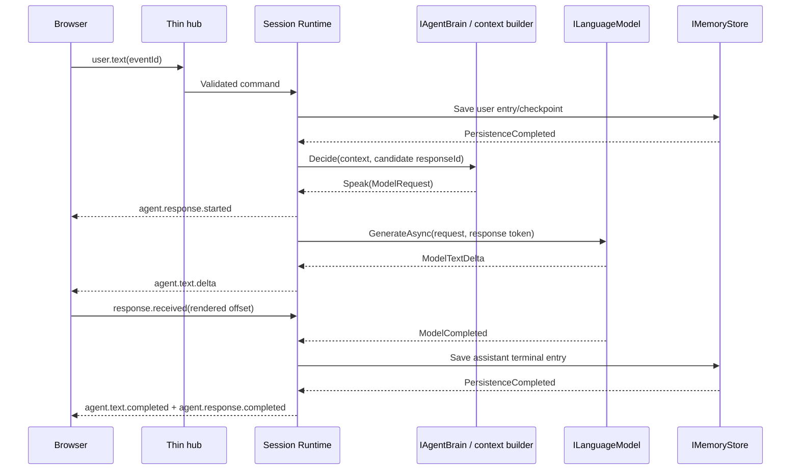
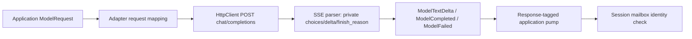

# Backend Implementation Specification

Canonical tenant text execution reuses `AgentRunHostedService`, `AgentRunCoordinator` and `SessionRuntime`. `TenantSessionRuntimeHost` reserves shared capacity, verifies current authority, loads an owned claim-bound snapshot and supervises the Runtime to settlement/disposal. Its registry and private output sink cannot be reached by legacy Hub connections. The factory supplies only tenant storage/Run adapters, current Run authority and the restricted tool executor; legacy Profile, credential, workspace, memory, Experience, browser and attachment services are absent. Trusted execution references reach initial and rebuilt `AgentContext` and tool admission. Only IAM inspection tools are offered; compaction, proactive admissions and unsupported continuations remain fenced pending their tenant paths. [Runtime verification](reports/tenant-runtime-execution-verification-2026-10-17.md) records the bounded behavior and remaining live ingress/output work.

## Tenant operation eligibility and shared tool boundary

Approved local persona execution uses `TenantApprovedOperationService`, `TenantPersonaEffectRules` and the specialized exact-effect store port. The service loads saved request/decision/grant and current actual Run/Instance; callers cannot submit replacement persona fields, select the human grantor or change the target. Current IAM/policy and pinned/live Settings management eligibility remain independent gates. Both stores atomically update the actual persona and revisions, save a completed receipt, consume the exact exceptional grant when present, record the Run side effect and advance tenant security/audit. Denial writes a stable receipt and revokes the available exact grant without changing the persona or failing unrelated Run work. The transaction checks current lease, expiry, target and global human Account status after service preparation; tenant/Run/target CAS fences other changes. SQLite explicitly tracks the actual Instance row before changing it. Exact receipts suppress replay after restart and simultaneous calls. A completed local effect is never reauthorized from a missing receipt or uncertain side-effect state. Read/list projections expose decision attribution and safe operation result separately from approval status, with fresh human authorization after metadata I/O. Production tenant execution/tool wiring and external-effect reconciliation remain pending. See [approved persona effect verification](reports/tenant-approved-persona-effect-verification-2026-10-17.md).

The typed durable successor uses `TenantApprovalService`, `TenantApprovalRules` and `ITenantApprovalStore` for Instance persona operations. Core canonicalization fixes operation name, permission, actual executing Instance, persona fields and Instance/persona revisions before computing SHA-256; the stable operation ID is separate from the same-root dedupe fingerprint. Both stores commit actual Run wait plus request and security/audit atomically. Running admissions require the live generation and unexpired claim; queued pre-execution preparation holds no fabricated worker lease. Canonical Runs reference first-class requests and reject embedded legacy approvals. Human approval/rejection/cancellation writes a terminal request, immutable human decision, exact exceptional grant only for approved ExceptionalGrant, safe audit and processed signal in one transaction. CAS, current human session, current authority, material witnesses and commit-time expiry fence delayed decisions. Cancellation can release a stale wait with its own exact request permission. Core expiry produces a durable terminal signal without inventing a human decision. The existing `AgentRunHostedService` drains expiry/signals before its normal coordinator pass; signal acknowledgement and requeue commit together. Tenant Runs remain excluded from legacy execution. Full tenant effect dispatch, remaining grant/continuation integration, external reconciliation and other operation families are still pending; the local persona successor above completes one transactional effect path. See [durable approval verification](reports/tenant-durable-approval-verification-2026-10-17.md).

Current operation eligibility derives identity from persisted tenant Run context and owning Session, rechecks active executor/Instance and original requester Session-read/chat, then uses the single IAM evaluator for exact target permission. Human-only and nondelegatable missing authority deny. Agent action authority plus the requester/policy selects ordinary review; missing delegatable agent authority selects exceptional eligibility only when a qualifying active human has underlying action, approve and grant-exception authority. Review requires underlying action plus approve. Independent review excludes the original requester; requester rights never replace executor rights. Results perform no effect or approval creation.

Core minimum policy is None for read permissions, WhenRequesterLacksPermission for other ordinary mutations, and Always for delete/send/execute and non-read Credential/Browser/Sandbox permissions. These permission-level minimums do not replace ToolPolicy or action-specific safety gates. Human-only remains a hard deny. Tenant governance can strengthen mode/independence or return to the Core minimum under current human/security/policy witnesses; no model input changes this policy. Current policies are loaded with tenant security on every check.

`SessionToolExecutor` checks `TenantToolAuthorization` before legacy isolation, management or provider service calls in both async policy evaluation and actual execution. Owning roots remain discoverable after logical deletion so a missing frame cannot trigger a global fallback. Narrow IAM inspection uses the saved Run and only safe decision/key/ref projections, with bounded strict arguments and output. Effective-permission results include only currently granted actions, with ordinary review where applicable. Other tenant effects remain unavailable until typed target/witness/approval enforcement is integrated. Registry offers are conditional on trusted matching tenant execution context; tenant Runtime dispatch/context wiring remains pending. [Executed evidence](reports/tenant-operation-authorization-verification-2026-10-17.md).

Legacy approval preparation is a protected boundary before execution: the common dispatcher and direct Email, Drive, Instance management and identity-maintenance preparation methods fence tenant Sessions before reading previews or provider data. Automation preparation applies the same ownership fence before registration reads or semantic verification. Actual retained Session ownership applies even without an admission frame; an explicit tenant frame also denies when no tenant service is configured. Generic legacy previews do not create tenant approval requests. Pure argument normalization and hashing remain data transformations, never authority.

## Canonical tenant text and Run admission

`TenantRunService` derives the per-message requester from the authenticated Account session and tenant User, independently of immutable Session creator attribution. Current exact Session read and agent chat admit a message; this communication path does not require manual-job `agent-runs.create` or merge requester roles into the executor. `TenantRunConfigurationResolver` reads actual owned publication/Instance/Skills/resources/bindings, reusing the existing inherited resource catalog only for shipped definitions. It pins effective configuration, persona/model and budgets with the security/Instance witness. No GUID-owned source falls back to a global Definition.

The owning transaction derives the new Session revision, stores the text entry and one queued Activation/Run, and appends safe audit. A client message ID is correlation only: fresh-witness identical replay returns the original graph; changed text conflicts. A new message gets a new root. Canonical metadata requires Run/Session read; queued cancellation also requires cancel and current chat, rejects attached/ending Sessions or nonqueued Runs, and commits a saved Domain cancellation. Session deletion retires direct Run grants and redacts retained input. Tenant Runs have explicit immutable execution context and no global profile; legacy execution/recovery cannot adopt them. Tenant worker/mailbox integration, trusted background/autonomous admissions, sandbox/browser admission, runtime secret use and typed effects remain pending. [Executed evidence](reports/tenant-run-admission-verification-2026-10-17.md).

## Execution-root propagation

Every independent accepted user batch, manual invocation, scheduled occurrence or external/Core event starts a new Activation root. Immediate background children, verified configuration continuations and completion reports carry the authoritative source root and parent Activation; retries keep their original admission. Runtime completion batching selects only children with a common root, while stores reject mixed-root batches atomically. Prompt text and evidence cannot supply these references. Tenant-owned Sessions remain excluded from legacy Run admission. Canonical human admission is implemented above; trusted tenant worker and live execution integration remain required. [Executed lineage evidence](reports/activation-root-lineage-verification-2026-10-17.md).

## Canonical tenant Session ownership

Quiescent Session management now supports typed rename, archive/restore, pause/resume, complete/cancel and logical delete. The Application service checks independent exact read/manage or delete authority and never accepts a replacement snapshot or caller-selected lifecycle source. Resume also requires exact agent chat and current active Instance/executor. Stored completion/cancellation policy remains authoritative; terminal Sessions cannot resume and archive restoration does not resurrect them. Safe metadata reports transport status, lifecycle status and archive time separately.

Both stores derive the mutation under original human/session liveness, security/Session CAS and audit. Attached/ending Sessions, pending input and nonterminal Runs reject mutation with `session_in_use`; future live coordination must use the Runtime mailbox. Logical delete removes direct Session grants, marks the row unavailable and redacts entry bodies, structured parts, envelopes, failure/attachment references and content-related provenance into retained entry identities. Activation/source-entry foreign keys remain valid; the root still prevents ID adoption or legacy access. This does not delete external workspace/artifact/attachment bytes or implement automatic recovery. [Verified scope](reports/tenant-session-lifecycle-verification-2026-10-17.md).

Interactive Session creation derives the tenant User from the authenticated Account/session and resolves the actual owned Instance. Tenant-wide `sessions.create/read` and independent `agents.chat` at that Instance are required; neither creation nor binding delegates the human's roles to the executor. Active Instance and active SystemIdentity/Principal are separate gates. The owned pinned publication or shipped template, effective settings, persona revision and resolved model initialize the existing Session/snapshot rows. Canonical Session snapshots have no global ProfileId. The creating User is immutable attribution; future turn admission must resolve its own trusted requester.

`ITenantSessionStore` atomically commits the Session, owning references, tenant security revision and safe audit. Original human/session/stamp, expected security/Instance generation and exact owner/executor/source identity are checked at commit. Scope reads and assignments resolve the actual Session root; foreign, fabricated and unowned IDs cannot be granted. Scoped filtering precedes totals and paging. Read APIs expose safe metadata, never the stored Definition, prompt or conversation body.

Global Session inventory, metadata/history, crash recovery and legacy writes/admission exclude tenant-owned rows; a fabricated global Session for an owned Instance also fails closed. InMemory uses the actual shared Session/Instance backing and immutable ownership markers; SQLite reuses the existing Session record mapping inside the security transaction. Session Instance identity cannot be reparented through either store. [Local evidence](reports/tenant-session-ownership-verification-2026-10-17.md) covers this management boundary; tenant-aware runtime persistence/recovery, Hub messaging, Run requester/root lineage, tools and durable approvals remain pending.

## Canonical tenant Credential management

The canonical Google connection check uses fresh human Account/session authority and separate read/manage/use permissions. It serializes same-Credential checks before refresh, rejects overlapping calls, and bounds provider work to 30 seconds, including a post-I/O deadline fence for uncooperative completion. The provider requires the shared client stamp, matching Synthetic mode, narrow purpose scopes, a valid bounded token response and the saved account email; bearer tokens never leave Infrastructure. Only explicit permanent grant rejection, missing required scopes or mismatched account identity marks reconnect required. Temporary/invalid responses retain the saved grant. Rotation and rejection commit under current security/logical/secret witnesses and audit, with no legacy fallback or schema addition. [Connection-check evidence](reports/tenant-oauth-check-verification-2026-10-17.md) does not establish tenant-aware runtime use.

OAuth persistence now supports one-use correlated attempts and atomic protected connection/disconnection under the existing security transaction. Ordinary create/update/value APIs cannot forge verified profiles or grant payloads. Ordinary status changes preserve the grant and advance AuthEpoch; connect/disconnect advance logical, secret and authorization generations together. Reconnect failure preserves an earlier grant. Both stores reject an inactive original human/session, mixed ownership, replay, stale witnesses, expiry and superseded exchange commits. Connection validates purpose-specific closed scopes, stable subject identity and unchanged ordinary configuration. External identity uniqueness is per Tenant and purpose; legacy unowned rows have a separate index. [Persistence evidence](reports/tenant-oauth-store-verification-2026-10-17.md) is supplemented by [backend flow evidence](reports/tenant-oauth-flow-verification-2026-10-17.md): shared-client Google exchange, separate private proof protection, live scoped-IAM/original-session orchestration, purpose-specific callbacks and bounded expiry scheduling are now wired. Runtime use and live Google acceptance remain pending; the [canonical Credential UI](reports/tenant-credential-ui-verification-2026-10-17.md) has separate Synthetic browser evidence.

`TenantCredentialService` resolves actual ownership before item IAM, checks permissions before stale witnesses or secret preparation and returns safe metadata only. General, Custom email and registry values use the existing credential-ID/version-bound protector; Gmail/Drive starts disconnected and rejects ordinary value replacement. Profile/kind/authentication method validation precedes protection. `credentials.read/manage` remain independent from binding/use and browser/email/Drive/Sandbox gates. The exact-resource access snapshot returns safe current permission keys and the security revision after ownership/read checks; it exposes no protected value and does not replace write-time authorization.

InMemory IAM composes the same registered `InMemoryCredentialStore` and Instance lock as legacy credential bindings; missing explicit backing fails closed rather than constructing another inventory. SQLite uses the same Credential/profile tables and per-operation transaction as tenant/security/audit changes. Both compare security, logical and secret revisions, enforce current actor/Account status, freeze snapshots, reject global-row adoption and retain retired ownership IDs. Legacy reads/OAuth rotation/bindings cannot consume owned values. This is management API progress; binding configuration is implemented below, while secret use and runtime integration remain pending; browser management evidence is recorded above. [Verification](reports/tenant-credential-lifecycle-verification-2026-10-17.md).

## Canonical tenant Credential binding configuration

`TenantCredentialBindingService` resolves both real owners and current IAM. Parent read/update and Credential read/bind are separate gates; hidden associations are omitted before counts/pages. Unlink can remove an already-known binding with bind permission while withholding unreadable metadata. Active Instance/Credential, normalized reference, unique reference/credential, revisions and current Connections policy/freeze remain independent constraints. Registry authority is never bindable. Disconnected OAuth may be configured but cannot be consumed through a legacy sink.

InMemory prepares the association change under the same Instance lock and applies it with the existing Instance revision owner, tenant security and audit. SQLite uses the existing binding row with Tenant/composite owner foreign keys, tracked Instance mutation and one security transaction. Removal preserves the Credential and its independent grants; bound Credential deletion remains blocked. Legacy list/mutation/cleanup paths exclude tenant bindings and owned Credential targets. Shared malformed HTTP request handling preserves client 4xx status and emits a generic safe problem without logging/echoing the rejected value or adding a server diagnostic ID. [Verification](reports/tenant-credential-binding-verification-2026-10-17.md) leaves runtime use and Instance binding UI delivery open; Credential management UI and backend OAuth flow evidence are recorded separately above.

## Canonical tenant Instance configuration

Canonical settings now support `set`/`clear` patches over the existing allowlisted sections, execution-budget overrides/reset, unattended-model selection/reset and self-management overrides/freeze. Read/update authority remains at the owned Instance; security and Instance revisions serialize every write with audit. Existing Definition ceilings, model/provider choices, secret-token checks, browser host restrictions and sparse inheritance rules are reused. Unknown/conflicting fields and attempts to expand Definition authority fail without saved changes. Settings changes carry observed Automation policy witnesses and reconcile them in the same transaction. Management update derives agent status from the security aggregate: agents cannot enable/unfreeze management, and their policy edits additionally require the current management area; freeze retains the independent authorized stop path. Freeze and policy changes cancel unpublished preparation/pending decisions while preserving saved independent choices. InMemory copies nested management collections at storage/read boundaries. Sandbox patches remain denied because its tenant catalog has not been converted. [Observed settings evidence](reports/tenant-instance-settings-verification-2026-10-16.md) records the implemented slice and remaining paths.

`TenantAgentConfigurationService` reads the actual owned Instance plus coherent Skill/resource state, resolves its pinned owned publication/resources (or immutable shipped builtin) and reuses effective configuration/Skill/resource projection. It never substitutes the global durable publication catalog. Scoped Instance read authority permits configuration inspection; it does not grant tool execution or resource download authority. Current read is rechecked after dependent reads.

Persona changes require current Instance read/update, security and Instance revisions and the exact persona revision. Missing/null/blank identity fields return validation failure rather than an internal error. Version adoption also requires read on the owned Definition, an exact active version, compatible existing overrides/model/Skills/resources, and an observed Automation reconciliation plan. Store commit rechecks owned publication metadata/status and all revisions, revalidates Account status, initializes new inherited Skill states and atomically updates observed Automation policy with security/audit. Persona and Definition identity remain independent. Archived Instances stay inspectable and reject mutation. Existing Runs are not repinned by these configuration writes.

Global parent-revision, direct active-version, persona/version-history and child writes reject owned Instances; global find/list/maintenance and child reads exclude or reject their data. Tenant Sandbox selection, other resource IAM, decommission, runtime admission, protected effects and the final global-route removal remain pending; this is not full tenant execution acceptance. [Verification](reports/tenant-agent-configuration-verification-2026-10-16.md) records observed HTTP, both-store, rollback and restart checks.

Canonical child reads require current parent read and separate item-scoped or inherited tenant `skills.read`/`resources.read`. Child writes use `skills.manage`, `resources.manage` or `resources.delete`, not parent update permission. Server principal kind additionally gates agent writers on their current Skills/Resources self-management area. Shared Skill/resource preparation preserves inheritance, independent copies/provenance, bounded content, immutable Built-ins and dependency validation. Byte uploads bind real verified bytes, metadata-only local edits preserve omitted enabled choices, and downloads recheck authority after I/O. Effective configuration exposes explicit child-access flags and redacts denied procedures/manifests/knowledge sources. Existing store transactions commit child/parent/security revisions and audit together; malformed/stale/cancelled changes leave no partial graph. Existing-item writes accept their exact typed scope; creating a sibling/customized copy still requires tenant-wide destination read/manage. Item filtering precedes counts/pages, dependency projections omit unreadable Skills and effective configuration distinguishes item subsets from full access. Both stores resolve source existence from current publication/approved shipped catalogs, not dormant enabled-state rows. Delete/adoption removes unavailable child assignments with the same security CAS/audit and refuses raw writes that retain them. Other resource IAM and runtime tool integration remain pending. [Item-scope evidence](reports/tenant-instance-child-iam-verification-2026-10-17.md). [Child evidence](reports/tenant-instance-children-verification-2026-10-16.md).

Definition draft/publication file operations now require parent Definition read and independent typed resource read/manage/delete on the actual binding or inherited tenant scope. Existing-file editors can act without Definition configuration update; parent update alone cannot act on files. New bindings, publication/fork copies and approved-template file copies require tenant-wide destination read/manage. Resource views/mutation projections filter unreadable rows and return explicit per-item/current-operation eligibility. The shared authorizer projection also owns Instance child filtering. Exact typed permission checks precede stale-witness checks and byte preparation; authorized stale attempts still return conflicts. Evaluation requires every captured file to be readable. Protected download rechecks exact permission and current draft revision after byte I/O.

Both stores resolve Definition/context/binding ownership and require removal of consumed/deleted binding grants in the same security/draft/audit write. Fork and publication addresses are distinct, so no direct draft/file grant propagates. Template catalog and publication fork eligibility drive current UI affordances, without granting lasting authority. [Definition resource IAM evidence](reports/tenant-definition-resource-iam-verification-2026-10-17.md) records the implemented scope and remaining full resource/runtime cutover.

## Account / tenant access foundation

The accepted replacement uses `IdentityService` for bootstrap/login/session validation/password rotation and invitation-bound Account registration. Every Account has a global human Principal for Account/system attribution, with **no system roles by default**. Tenant membership has a separate User and Principal per tenant. Only explicit System-scoped role assignments confer platform authority; neither a global login nor a tenant Owner role grants it. `TenantAccessService` derives builtin roles, custom roles, member invitations/status and scoped assignments through one tenant revision. `AccountAdministrationService` requires explicit system account-management authority.

`IamAuthorizer` resolves current Account, tenant, principal and assignments for each check. System permissions cannot target tenant data. Agent principals cannot exercise human-only permissions or receive human-only roles, including custom roles containing reserved permissions. Agent creation grants no roles automatically. Tenant roles inherit to owned resources; resource assignments match exact type/id. Owners are explicit tenant-wide builtin assignments. Store transactions reject changes that leave no active human Owner, including the race between global Account suspension and tenant membership changes. Password rotation changes the security stamp and invalidates all previous sessions.

Resource-scoped checks and assignments require a real target in the same tenant: member, role or registered agent identity in security state, or a definition/current Instance child in its actual owning/source store. Permission catalog resource types prevent an ordinary operation grant from authorizing another resource family; scoped access inspection/assignment and approval qualification govern the target itself. Unknown, nonexistent and foreign targets deny with `resource_unavailable`; a known target with an incompatible operation permission denies with `resource_type_mismatch`. Direct service/store writes obey the same ownership rule. One Agent Instance ID cannot acquire registered identities in two tenants. Other store families, tool admission and Hub resource access are still pending; this slice does not claim their cutover.

`TenantAgentService` now creates an actual tenant-owned Instance from an exact immutable shipped template, with no default agent roles. Instance, initial Skill state, identity, security revision and audit commit atomically. Tenant inventory applies resource permission filtering before pagination and totals; unauthorized resource IDs never appear in that inventory. Archive suspends both agent identity and Principal in the same transaction as the Instance lifecycle update; restore retains their IDs and saved grants. Both security and Instance revisions must match. The store rechecks active actor/global Account status at commit, so a suspended creator cannot complete a prepared write. Existing identity backing/tenant ownership cannot change or disappear through security updates.

The canonical lifecycle service uses existing Instance lifecycle exclusion, then existing Automation policy reconciliation and Sandbox enforcement after commit. Cleanup failures can surface after the durable lifecycle/status change; they do not roll back or authorize the old identity. This does not establish tenant-aware Session/Run admission. Old unscoped Instance lifecycle writes reject owned roots, and backing deletion is restricted. Canonical parent/settings/Skill/resource paths now reject old unscoped access to owned Instances; other owner/resource/execution paths remain unfinished and prevent a full isolation/deployment claim. Delete/decommission, resource/evaluation management and tombstone UX still require conversion.

`TenantDefinitionService` provides canonical create/edit/publish/fork/read/deprecate/delete operations on tenant-owned definitions. Opaque generated IDs establish root ownership; user names remain ordinary Definition identity content. The server starter and candidate/publish validators are reused. Scoped root inventory filters before count/page; direct draft/publication access resolves the tenant-owned root. Security and draft/metadata witnesses fence mutations, and Account suspension is rechecked at commit. Publication validates current resource requirements, actual immutable content bytes and required revision/fingerprint/scenario evidence; it consumes draft state atomically with audit. Earlier payloads remain unchanged and fork copies resource bindings. Resource/evaluation authoring APIs now preserve those gates; their tenant-aware UI remains pending.

Shipped-template discovery/fork uses Definition create authority at tenant scope. `ForkTemplateAsync` selects an exact builtin ID/version, never the global durable publication store, and generates a new canonical owning ID. It snapshots approved knowledge and workspace-template bytes, applies ordinary resource policies/dependency validation, stages immutable content privately, then atomically commits root/draft/manifest/security/audit. No source files are rewritten and template configuration grants no runtime roles. Missing/linked/invalid/oversized content fails before creating owned rows; stale security, Account suspension or cancellation during preparation prevents commit. Lost CAS may retain private unbound blobs under the existing conservative retention policy. Draft provenance records `SourceDefinitionId`/version/kind and cannot be edited through later saves. Publication binds the captured bytes rather than rereading mutable shipped files. This authoring flow does not implement tenant runtime asset resolution.

Definition deletion uses current read plus delete authority and a security CAS. Draft deletion also matches the exact draft revision; whole-definition deletion compares every reviewed draft and publication metadata revision. The last unpublished draft retires its root automatically. Retirement removes only target Definition resource grants and content/evidence bindings, preserves a non-readable ownership marker, and appends one audit with the security revision. A live or archived Instance, a live Session or retained Run/Activation prevents logical deletion (`definition_in_use`). Stale/foreign/suspended/cancelled changes leave the stored graph intact. Content-addressed bytes remain retained because other owners or admitted work may reference them. This does not authorize Instance decommission or implement the tenant editor's deletion UI.

Unscoped authoring stores exclude owned definition/draft/publication/resource/evaluation records. InMemory performs equivalent guards and canonical operations use the same underlying records. The new Instance creation-from-publication path requires both `agents.create` and exact definition read access, rejects foreign/deprecated versions, and pins the selected tenant publication. Existing Session/Run/tool code has not yet acquired tenant-aware definition resolution; this authoring/creation evidence is not execution acceptance.

Definition resource batch writes accept bytes or a resource already bound to that owned draft. A supplied hash never authorizes borrowing another tenant's staged content. File/path/media/secret policy, 8 MiB per item, 64 items / 64 MiB per draft and 16 MiB incoming-byte batches remain server enforced. New resource IDs are generated by Core. Metadata-only rename/reclassification revalidates owned immutable content. Batches, removals and scenario edits update draft revision and commit with security CAS/audit; path swaps are atomic in SQLite and InMemory. Failed or stale writes leave the saved manifest unchanged. Private unbound content staged before a losing CAS is not readable through a hash API.

Evaluation scenarios are bounded to 100 per draft. The existing Synthetic offline evaluator uses only the captured candidate/owned resources and executes no real tools or hosted provider calls. It runs outside persistence locks. Changed configuration/scenario/authority, Account suspension or cancellation prevents accepting its completion. Current results carry a store-assigned tenant commit revision; newer failed evidence supersedes an older pass even at the same timestamp. Scenario/result views are bounded to saved scenarios and their latest results. Publication errors distinguish missing, stale, failed evidence and invalid resource requirements.

Saved-content mutations require explicit read permission as well as their write permission. This closes publication/update/deprecation and Instance lifecycle responses as alternative read paths for mutation-only roles. Child downloads recheck read authority after verifying content bytes. Canonical HTTP applies endpoint body limits before binding, including a 24 MiB encoded batch request limit. Complete tenant child UI/access/preview panels, other resource IAM families and runtime resource resolution remain unfinished.

This section describes the implemented identity/access foundation and its canonical new HTTP namespaces. Existing resource/tool/Hub integration and durable approval replacement remain pending in the [delivery ledger](reports/multitenant-iam-delivery-2026-10-16.md). Do not interpret foundation tests as full tenant isolation or approval acceptance.


Automation admission freezes the bounded owner-authored task in `AgentRunAdmission.TaskIntent` with Automation identity/revision. Immediate/manual background admission pins its accepted objective with AgentRun provenance. The builder consumes this typed pin as Runtime `RunTask`; it never parses trigger display text into instructions. Raw event/trigger JSON remains Evidence. Native events without an authored Automation do not fabricate a Runtime task.

`ILanguageModel.PrepareRequest` exposes selected platform semantic-output context before SessionRuntime records the manifest. The semantic adapter selects the same Core section by identity during forwarding, so retries cannot duplicate it or append it after tool receipts.

Recovered conversation dispatch now admits into the same SessionHost runtime registry used by foreground attachment. Creation checks disposal, termination, ownership and runtime capacity under the existing admission gates. Dispatch itself goes through the SessionRuntime mailbox and acknowledges ownership before model completion. Attaching shares that running response; detached finalization holds the same admission gate while marking transport detached, so it cannot detach a newly attached owner. Production uses the canonical AgentRun record. Cleanup rechecks accepted work through the Session mailbox while holding admission exclusion, so an earlier settled attempt cannot revoke a newly dispatched retry.

## Capability authorization, projection and discovery

New-mode environment stores `capabilities: {mode,resolvedCapabilities,authorizationFingerprint}` and `projection: {alwaysCapabilities}`. The legacy `toolAllowlist` cannot simultaneously carry grants. Domain validates exact syntax/duplicates and projection subset; Application validates registration and context-only projection restrictions with structured findings. All draft/publication resolution is trusted, deterministic and snapshot-based. New-mode configuration absence is eligibility, not invalid authority. Persisted candidate documents are bounded to 1 MiB; this document-size guard does not impose a capability count limit.

`ToolCatalog.For` delegates projection to `ToolProjectionService` using the existing ToolPolicy-checked eligibility catalog. Legacy definitions keep their broad historical offers; capability-aware definitions project bootstrap + always + trusted context + active Skill required + execution-loaded tools, deduped by exact name. Browser start guidance and response-specific narrowing still apply. Unlike the legacy immutable initial request tool upper bound, new-mode continuations rebuild from pinned authority and current trusted context after a load or Skill activation.

`capabilities.load` ranks exact registered names even when embedded in a longer query (case-insensitive, ignoring surrounding sentence periods), then category/tag/name/summary matches with deterministic ordinal ties. It searches only authorized, discoverable, currently eligible names.

`capabilities.load` returns compact metadata and updates fenced execution state before real schemas appear on the next generation. It never executes a matched capability, changes authority, bypasses approval or reveals unauthorized/unconfigured tools. Loaded interfaces reset each AgentRun and survive retry/reclaim of that same execution. Both user and background turns persist explicit loaded IDs/count in their AgentRun checkpoint payload. Ordinary execution still rechecks registry, authority, configuration, scope, owner, lifecycle, occurrence/trust, approval and replay policy even for an unprojected or previously loaded name.

Initialize empty response/epoch-owned load state for each accepted live occurrence. Recheck the current connection before admitting its load, preserve IDs/count through continuation, and never read a completed user turn's load state for another response. Accepted live receipts remain non-replayable; see [Persistence and Configuration](15-persistence-and-configuration.md).


## Agent Workspace v2 tools and policy

Every Session belongs to a real active Agent Instance at creation. Each Agent Instance owns durable `/home`; each Session owns temporary `/working`. New Sessions and reconstructed runtimes start with cwd `/home`. Definition identity is configuration, never an alternative Session owner. Unsupported historical built-ins remain in Git history, outside the runtime catalog. `environment.workspace` may name a template only. General Assistant v20 retains the workspace tools, including `workspace.cwd`, alongside native Browser capabilities and explicitly authorized `background.start`. The canonical registry supplies identical workspace descriptions for discovery, projection and execution.

`workspace.cwd({operation:"get"})` returns `{cwd:"/home"}` initially. Set accepts `{operation:"set",path:"/home/projects/a"}` or an existing `/working` directory. A target must exist, be a directory and remain authorized. Relative read/list/search/write/patch/structure/artifact paths resolve from the current cwd. Omitted list/search path means cwd. The retired adapter prefix is rejected rather than becoming a public alias. Paths cannot escape a root, select another Session/owner or expose host/blob paths. Move/delete/batch affecting cwd or an ancestor fails Conflict.

Ordinary write replaces present file bytes without file CAS. Patch applies strict UTF-8 edits with exactly one occurrence of each oldText. List/read/search are bounded observations. Individual copy streams current files/trees across `/home` and `/working`, preserving empty directories, modes and safe links without merging an existing directory. Move/batch remain single-scope. Batches validate their complete syntax/scope before effects, then report ordered partial execution. No file revision, hash or tree token is accepted.

Publish user downloads with `artifacts.create_from_workspace` from either root. Normal model guidance describes durable work directly in home and explicit scratch processing/copy for sandbox. Tool policy and execution both check the pinned policy and actual managed eligibility; background work does not receive Session cwd.

Canonical legacy allowlist validation distinguishes `duplicate_tool` and `invalid_tool_name`; candidate validation retains unregistered_tool and unconfigured_tool. Findings name `environment.toolAllowlist`; authoring Problem Details retains `code:ValidationError` and adds `field`/`validationCode` plus useful detail. The former 32 limit has been removed by the capability enhancement above.


[Interfaces](04-backend-interfaces.md) owns ports, [Architecture](03-system-architecture.md) owns concurrency, and [Controller](05-interaction-controller.md) owns turn-taking. This document owns Agent Definition, text-first context construction and the initial HTTP model adapter. The canonical MVP composes STT → Interaction Controller → text Agent Runtime / LLM → Speech Segmenter → TTS; it requires no multimodal audio-reasoning model.

## Agent Definition

JSON only, UTF-8, files loaded through IAgentDefinitionStore from a configured agents directory. A file contains one definition; shipped names include `agents/examiner.json`, `agents/customer-support.json`, `agents/compliance.json`, versioned `general-assistant` files, and `agents/secretary-v1.json`. Approved knowledge bodies live beside them under `agents/knowledge/{identity}.md` and are not copied into session workspaces. Store published older versions in version subdirectories if needed; recursively index by (id, version), fail startup on duplicate keys. Versions are immutable positive integers. schemaVersion=2 identifies the current format; version identifies that agent's revision. Optional `skills` remain omitted when null, with an empty effective Skill set. Retained schema-1 files/snapshots require the explicit one-way context conversion. Reject unknown schema versions and unknown fields to catch spelling mistakes. A session pins and persists the validated definition so editing files cannot alter an existing identity. `FileAgentDefinitionStore` validates field rules and that `ProviderPreferences` aliases resolve (`primary-llm`, and when Voice.Enabled `primary-stt` / `primary-tts` in Synthetic). Missing versions return null from `GetAsync`.

Concrete Domain records (camelCase JSON via System.Text.Json):

```csharp
public sealed record AgentDefinition(int SchemaVersion, string Id, int Version,
    AgentIdentity Identity, IReadOnlyList<string> Goals, string AgentInstructions,
    BehaviorPolicy BehaviorPolicy, ConversationPolicy ConversationPolicy,
    InitiativePolicy InitiativePolicy, VoiceConfiguration Voice,
    ProviderPreferences ProviderPreferences, IReadOnlyDictionary<string, string> Metadata);
public sealed record AgentIdentity(string Name, string Role, string Description,
    string Tone);
public sealed record BehaviorPolicy(string InterruptionStyle, bool AcknowledgeInterruption,
    bool AvoidUnsupportedClaims);
public sealed record ConversationPolicy(string ResponseLength, bool AskOneQuestionAtATime,
    string Language, int MaxOutputTokens);
public sealed record InitiativePolicy(bool Enabled, int SilenceThresholdMs,
    int CooldownMs, int MaxPerSilencePeriod, IReadOnlyList<string> Triggers,
    int? MaxConsecutiveProactiveTurns = null, int? MaxSilentEvaluations = null,
    int? MaxInactivityMs = null);
public sealed record VoiceConfiguration(bool Enabled, string VoiceId, double SpeakingRate);
public sealed record ProviderPreferences(string LanguageModel, string? SpeechRecognizer,
    string? SpeechSynthesizer, string InterruptionClassifier = "heuristic");
public sealed record RoleEnvironment(
    IReadOnlyList<string>? Harness = null,
    IReadOnlyList<KnowledgeSourceRef>? KnowledgeSources = null,
    IReadOnlyList<string>? ToolAllowlist = null,
    WorkspaceTemplatePolicy? Workspace = null,
    AttachmentStorePolicy? Attachments = null);
```

Optional `environment` (default empty harness/knowledge/tools, empty workspace template, `allowUnreadUnsupportedTypes=false` retained only for compatibility; HTTP upload accepts every format) is omitted from historical MVP examples below; shipped fixtures include it. `process`/`shell` remain denied even if listed. Physical template application copies `agents/templates/{templateId}` into `/working` only (no harness/knowledge corpora). Shipped initiative pins: examiner `maxConsecutiveProactiveTurns=1`, customer-support `2` (`maxPerSilencePeriod=2`, 60s silence / 120s cooldown in JSON; text runtime floors still apply), compliance `0`.

All fields above required except speech provider aliases, the three optional initiative bounds, and `environment`. id: lowercase `[a-z0-9-]`, 1..64; version positive; identity strings 1..256 except description up to 1,024; goals 1..10 nonempty strings <=500; agentInstructions <=8,000. InterruptionStyle=`acknowledgeThenContinue|answerNewTurn`; ResponseLength=`concise|balanced`; `conversationPolicy.language` is `auto` (match the user's conversational language unless they request otherwise) or a fixed BCP-47-like tag for specialized agents; maxOutputTokens 1..4,096; silenceThresholdMs 1,000..120,000; cooldownMs 5,000..600,000; maxPerSilencePeriod 1..8 (shipped examiner/compliance 1, customer-support 2). When omitted, `MaxConsecutiveProactiveTurns` defaults to 1, `MaxSilentEvaluations` to 8, `MaxInactivityMs` to 900000. Triggers are unique values `longSilence|environmentUpdate|unfinishedInteraction`. speakingRate=0.5..2.0. `LanguageModel` is always required and must resolve. When `Voice.Enabled`, `SpeechRecognizer` and `SpeechSynthesizer` are required and must resolve to configured adapters. When `Voice.Enabled` is false, those aliases must be null/omitted; a text-only process must start without STT/TTS. `InterruptionClassifier` defaults to `heuristic` if omitted. Metadata <=16 string pairs, values <=256, never secrets. Every other nullable or optional policy alternative has been removed from this initial schema; startup validation surfaces missing required values.

Examiner:

```json
{
  "schemaVersion": 2,
  "id": "examiner",
  "version": 1,
  "identity": {"name": "Alex", "role": "Speaking examiner", "description": "Practice a speaking examination.", "tone": "Calm, formal and patient"},
  "goals": ["Conduct a realistic practice speaking examination", "Keep the candidate talking", "Offer feedback only when requested"],
  "agentInstructions": "You are Alex, a practice examiner. Ask one question at a time and wait for the answer. Do not claim to issue an official score or certification. If interrupted, attend to the candidate's new request.",
  "behaviorPolicy": {"interruptionStyle": "acknowledgeThenContinue", "acknowledgeInterruption": true, "avoidUnsupportedClaims": true},
  "conversationPolicy": {"responseLength": "concise", "askOneQuestionAtATime": true, "language": "en", "maxOutputTokens": 256},
  "initiativePolicy": {"enabled": true, "silenceThresholdMs": 8000, "cooldownMs": 30000, "maxPerSilencePeriod": 1, "maxConsecutiveProactiveTurns": 1, "triggers": ["longSilence", "unfinishedInteraction"]},
  "voice": {"enabled": true, "voiceId": "default", "speakingRate": 1.0},
  "providerPreferences": {"languageModel": "primary-llm", "speechRecognizer": "primary-stt", "speechSynthesizer": "primary-tts", "interruptionClassifier": "heuristic"},
  "metadata": {"scenario": "practice-exam", "owner": "demo"}
}
```

Customer Support Representative:

```json
{
  "schemaVersion": 2,
  "id": "customer-support",
  "version": 1,
  "identity": {"name": "Sam", "role": "Customer support representative", "description": "Resolve a simulated support issue.", "tone": "Warm, practical and clear"},
  "goals": ["Understand the customer's issue", "Explain available simulated order updates", "Summarize useful next steps"],
  "agentInstructions": "You are Sam in a support demonstration. Ask for missing context. Treat order updates as supplied simulation data. Never claim that you actually issued a refund, changed an order or accessed a live customer account.",
  "behaviorPolicy": {"interruptionStyle": "answerNewTurn", "acknowledgeInterruption": true, "avoidUnsupportedClaims": true},
  "conversationPolicy": {"responseLength": "balanced", "askOneQuestionAtATime": true, "language": "en", "maxOutputTokens": 2048},
  "initiativePolicy": {"enabled": true, "silenceThresholdMs": 60000, "cooldownMs": 120000, "maxPerSilencePeriod": 2, "maxConsecutiveProactiveTurns": 2, "triggers": ["longSilence", "environmentUpdate", "unfinishedInteraction"]},
  "voice": {"enabled": true, "voiceId": "default", "speakingRate": 1.0},
  "providerPreferences": {"languageModel": "primary-llm", "speechRecognizer": "primary-stt", "speechSynthesizer": "primary-tts", "interruptionClassifier": "heuristic"},
  "metadata": {"scenario": "support", "owner": "demo"}
}
```

The same provider aliases resolve to synthetic or real implementations by profile. VoiceId is an application alias mapped by TTS configuration, not a vendor object. Static definition is distinct from mutable Agent Runtime State: active response, history, current utterance, heard estimate, summary and initiative counters belong to the session.

## Agent Runtime and prompt/context builder

Voice generation receives the resolved effective speech locale in `AgentContext`. Its mode section instructs the model to write spoken wording in that locale, since selecting a TTS voice does not translate text. The conversation-language policy continues to govern display text; a different speech language uses a separate spoken projection. Text-mode prompts omit this speech-language instruction. Locale changes apply to the next generation, including clearing the override back to Agent default.

Implement a concrete PromptContextBuilder invoked by the default IAgentBrain. Keep named, independently testable sections in Application, not scattered concatenation inside endpoints or adapters. Order:

1. Core sections: the platform-owned operating contract and only applicable built-in, voice-output and attachment-reading procedures. Only Core projects to `system`; authored content cannot construct Core clauses.
2. Runtime sections: effective persona/goals, `agentInstructions`, policies, Session mode/locale, current tool facts, enabled/loaded Skills and authorized persisted task intent. Runtime projects to `developer` with frozen Definition/Instance field provenance. Mode and locale remain trusted facts; fixed voice/delivery/security and Office-reading rules belong to Core. Unavailable attachment reread never injects its tool-specific procedure.
3. Evidence sections: remembered summary/profile/memory, Experience/Continuity, resources, attachments and trigger payloads, framed as data. Selected chronological history and the current user batch retain native user/assistant roles; tool continuations retain assistant/tool roles and call IDs.

`ContextAssembler` orders and validates this single representation for conversations, initiative, completion, compaction, schedule classification and Synthetic draft evaluation. Core and Runtime have separate hard budgets; optional Evidence is omitted deterministically with manifest coverage. Existing SummaryBoundary, delivered/heard-prefix, history and Office/attachment selectors remain the content owners. The current task is never duplicated or silently truncated.

Agent-execution context requires effective Runtime identity and instructions. Platform-only auxiliaries explicitly select their purpose. The tool loop applies Skill, environment and recovery section updates before materializing its request, then prepares the selected semantic protocol. Repeated semantic preparation reuses an unchanged prepared request. Immutable image bytes and their cached content hashes are shared across section updates/projections; fingerprinting includes multipart content without serializing image bodies. Newly generated tool batches are validated before persistence/effects, rejecting every reused call ID while preserving existing pending-call recovery.

History includes the just-committed user turn exactly once. Do not send partial transcripts as completed turns. Do not grant environment/profile/summary text system instruction authority: wrap as quoted data with a fixed application instruction explaining its status. Adapters receive fully formed ModelRequest and only translate it. No adapter constructs identity prompts.

For authored Automation occurrences (Schedule, Event, Core Event and manual, with conversation or background output), selected conversation turns are serialized as one User-role historical-evidence JSON block rather than replayed as native user/assistant instructions. The same summary boundary, newest-20 selection and delivered/heard prefixes apply. Serialization and its label fit within the existing 24,000-character history budget by dropping older complete entries. A selected Core clause keeps those turns contextual: intervening requests cannot replace or suppress the admitted task. The persisted Automation instructions are pinned Runtime task intent; trigger JSON and historical content remain Evidence. Historical chat cannot edit or cancel an Automation; legitimate owner changes use the existing authorized commands and affect future admissions. Current tool permissions and approvals remain independent. Conversation-output occurrences match the persisted task scope, format and length; they do not answer earlier Chat requests or append unsolicited administration or past-action commentary. Current execution blockers must still be reported honestly. Ordinary UserTurn and native initiative histories retain their conversation roles.

Context budget baseline: retain newest 20 entries, maximum 24,000 UTF-16 characters of history, summary <=2,000 characters and profile <=2,000 characters. Drop oldest complete entries first and retain the current user turn; reject an over-budget current turn rather than silently changing meaning. Definition `agentInstructions` retains its existing 8,000-character validation. The assembler separately rejects Core above 65,536 and Runtime above 131,072 characters; it omits optional Evidence sections above a combined 65,536-character budget with coverage metadata, while the selected native transcript retains its existing bounds. These conservative character limits are not universal model token counts: the configured model must support at least a 16k-token context, and provider contract tests must validate the chosen model/limits. A provider with a smaller limit requires lower configured context budgets, not truncation inside the adapter.

A persisted session summary is remembered data, not a system instruction. It excludes ordinary raw history only when `SummarizedThroughEntrySequence` is a valid boundary: summary text is non-empty, the sequence is positive and no greater than the durable last entry sequence, and it does not reach into the current trailing user batch. Raw entries at or below that sequence are omitted before the newest-20 / 24,000-character history budget. The current trailing user batch still appears exactly once. An invalid or overlapping boundary fails open to raw history, records the content-free `summary_boundary_rejected` diagnostic, and does not rewrite persistence during prompt construction. Initiative and completion evaluation requests use that same boundary: recent turns stay strictly after it, and the persisted summary is included in those payloads as labeled remembered data. An invalid boundary leaves those requests on raw history. Assistant history uses the received prefix for text and the heard prefix for voice. The runtime does not refresh a rolling excerpt summary when a user turn is admitted. `ConversationCompactor` proposes a format-1 summary from the previous summary plus a bounded durable prefix strictly after the committed boundary. It reads at most 41 history rows, keeps at least 20 raw entries, sends no tools or response envelope, and returns a candidate without writing the store. Empty, oversized, malformed, unsafe, or failed model output leaves the prior summary unchanged. Legacy summaries stay format 0 until a candidate replaces them. After a durable completed assistant turn, the session runtime may run that service outside the mailbox when at least 40 eligible rows remain, no approval is pending, and no response or queued user batch is active. The candidate returns through the mailbox. The mailbox commits it only when the operation generation, base summary, and source boundary still match, then persists the summary without rewriting raw rows. Detach and reattach reuse one in-flight operation. Finalization cancels it, and a late result cannot replace a newer summary. A history read that throws, or a result the mailbox cannot accept, releases that operation without changing the summary so a later completed turn can compact. A reopened snapshot loads the newest restore window, so an early raw row can be absent from that window while the committed summary still carries its content. Content-free diagnostics are `compaction_rejected`, `compaction_cancelled`, and `compaction_stale`. No embeddings or vector database. When `MemoryPolicy.SessionMemory` is set, active session memories are added as a separate learned-data Evidence section labeled remembered data, not instructions. When `MemoryPolicy.IdentityUserRetrieval` is set and the session has an agent instance plus a trusted profile, active IdentityUser memories for that instance and profile join the same block. The block states that identity and trusted profile values outrank learned memory on a conflict, and each subject and content stay on one line. Voice unheard suffixes come from speech text, the same string assistant history uses. The block stays apart from the trusted profile and persona lines. It omits another session, instance, or profile. It stays empty when neither gate is enabled, and a missing instance id does not retrieve IdentityUser items. When `MemoryPolicy.UserRetrieval` is set, active User memories for that trusted profile join the same block. A definition that leaves `UserRetrieval` off does not receive them. `UserPromotion` is a separate gate and does not by itself inject the items.

IAgentBrain checks initiative eligibility and contextual usefulness. UserTurn returns Speak without initiative evaluation. For LongSilence, EnvironmentUpdate, and UnfinishedInteraction, `DefaultAgentBrain` first applies hard gates (caps, completed assistant turn for idle, allowlisted environment, pending topic). Ineligible gates return `StaySilent` with `CountsTowardSilentCap=false` so proactive caps do not advance silent-evaluation pause. When eligible and `ILanguageModel` is configured, a compact JSON initiative evaluation (`speak|staySilent|deactivate`) decides whether generation is worthwhile; only `speak` builds the normal ModelRequest. Optional `nextWaitMs` applies to `staySilent` and proactive `speak` only: the runtime clamps it (text sessions use higher minimum silence/cooldown floors than voice) and treats null/unusable values as the existing deterministic StaySilent backoff or the normal post-Speak silence threshold. `deactivate`/`RequestDeactivate` pauses without arming a next wait. Reaching proactive caps denies further LongSilence evaluation without pausing the session; silent-evaluation and inactivity bounds still pause via `ApplyDeactivate` with durable `pauseReason`. UserTurn normally returns Speak. The controller rechecks eligibility after asynchronous decisions return and enforces hard runtime caps even when the brain returns Speak.

## Text sequence



MVP waits for user entry persistence before generating a reply, while mailbox processing continues. In-memory store satisfies this boundary in early milestones. agent.text.completed is queued at model terminal behind preceding text; agent.response.completed follows successful terminal persistence (and voice playback if applicable). No provider request executes inside a DbContext transaction.

## OpenAI-compatible HTTP adapter

Decision: Infrastructure/OpenAICompatibleLanguageModel implements ILanguageModel using IHttpClientFactory, System.Text.Json and direct HTTP, no vendor SDK. The preferred hosted configuration targets OpenRouter, while direct OpenAI or local compatible inference use the same adapter. Named configuration supplies BaseUrl, ApiKey, DefaultModel, optional ReasoningEffort (OpenAI-compatible `reasoning_effort` on chat completions), AdditionalHeaders, Timeouts and capabilities. For the initial hosted **adapter smoke** configuration only, DefaultModel may be `openrouter/free`. The Real/demo **default** must be a **fixed** operator-selected OpenRouter model ID; do not use the random free-model router as `DefaultKey`. The shipped Real catalog offers fixed `openai/gpt-6-luna`, `anthropic/claude-haiku-5.5` and `openai/gpt-6.1-sol` choices. The variable `openrouter/free` route is ineligible for three-layer execution. Bind ApiKey from `OPENROUTER_API_KEY` or equivalent backend configuration; never from the browser. BaseUrl is the API root ending in `/v1/`; append `chat/completions` without resetting an existing path prefix. Reject non-http(s) URLs and embedded userinfo; allow local HTTP only for explicitly configured demo/self-hosted endpoints. Values come from trusted backend operator configuration, never browser requests.

Map normalized System/User/Assistant messages to endpoint roles, MaxOutputTokens to `max_tokens`, optional Temperature to `temperature`, and the adapter configuration's DefaultModel to `model`. A tool-offered conversational turn sends `max_tokens` 8192. `finish_reason=length` with a partial tool-call draft fails as `toolCallTruncated` and does not emit a tool call. `LengthLimit` before a parseable semantic envelope fails as `outputLimit` rather than `missingDisplayText`. Session-scoped reasoning effort on `ModelRequest` overrides configured `LanguageModelProviderOptions.ReasoningEffort` for that request; do not mutate the singleton options object. When `ReasoningObjectWire` is enabled (OpenRouter Real profile), map effort to a `reasoning` object. Exclude visible reasoning when no tools are offered; request reasoning details for tool rounds so adapter-owned continuation can be replayed without exposing it in display text. Stream `delta.reasoning` / `reasoning_details` into `ModelReasoningDelta` only; never concatenate them into `ModelTextDelta` or assistant display. Require `stream=true`. Send Authorization Bearer only when ApiKey is nonempty; forbid AdditionalHeaders overriding Authorization, Host or content framing headers. Tool schemas, tool choice and semantic response schemas follow the current catalog capabilities and response contract; catalog-selected Responses uses the equivalent Responses wire fields.

Use ResponseHeadersRead. Parse UTF-8 SSE incrementally across arbitrary network/line/JSON boundaries, tolerate CRLF and comments, combine multiline data fields, bound each SSE event to 1 MiB, process `[DONE]`. Normalize only text from the first supported choice; multiple choices are an InvalidRequest/UnsupportedCapability, never multiple application responses. Ignore known role-only/usage-only chunks; preserve whitespace text exactly. Map finish_reason stop→Completed, length→LengthLimit, content_filter→ContentFiltered; tool/function calls→UnsupportedCapability. Delay ModelCompleted until stream terminator so trailing usage can be included. EOF after a valid finish marker is accepted; EOF without finish marker or `[DONE]` is Unavailable. `[DONE]` without finish marker means Completed if at least a valid choice was observed; otherwise malformed stream. Malformed JSON is normalized failure, not silently skipped.



## Timeouts and retry policy

Initial background Runs reserve up to 30 seconds (at most one quarter of the pinned duration), one final tool step and 4,096 output tokens for completion. Normal prose completion checkpoints `completionRequired` and offers only `work.complete` with no semantic response envelope or substantive tools. The model must summarize existing verified receipts in 1–2,000 characters and use NeedsAttention for incomplete work. Invalid completion arguments receive field-specific feedback and at most one corrected envelope within remaining time, tool-step, output and checkpoint bounds. The typed `CompletionCorrectionAttempted` checkpoint flag prevents the allowance from resetting after provider retry or restart. A second invalid envelope, or prose after that correction, fails as `completion-invalid`; an absent completion still fails as `completion-required`; a substantive tool during finalization fails closed. Timer/step/capacity cutoffs keep this completion tool available within the original hard deadline. Genuine provider failures retain the normal bounded same-Run retry policy below; a deadline remains `run-deadline`, and ordinary prose cannot manufacture success. A resumed completion phase restores its marker and receipts without reopening work.

Scheduling clarification serializes `scheduleDraft.instructions` and the original argument object as untrusted evidence for the immediately following eligible user turn. The agent interprets that evidence and supplies a complete new structured proposal. Core never merges draft arguments, recognizes confirmation words, corrects intervals from user text or bypasses verification for particular wording. Schedule completeness is checked independently before verification: a weekly request missing weekday/time returns a structural schedule error, not an authorization failure.

`TriggerScheduleCommands.PrepareAsync` loads the owned current target, checks its expected revision, resolves structured schedule fields and configured timezone, and produces the exact action fingerprint. `ITriggerCommandAuthorizer` receives `AutomationAuthorizationRequest`: current user text, typed operation, tool, full proposed action/fingerprint and optional referent/draft and prior-conversation evidence. The runtime supplies at most eight prior nonstreaming turns within 12,000 serialized characters, excluding the current source turn; assistant text uses delivered/heard prefixes. Those turns may explain a current timezone clarification but never independently grant authority. The independent verifier checks alignment of every mutation field, including target, schedule, task, execution destination, delivery and enabled state. No language-specific production recognizer remains. Occurrence, initiative, environment, historical and missing provenance cannot authorize mutations. List/inspect reads never grant write authority.

Real verification resolves the operator catalog default through `ILanguageModelResolver` with purpose `TriggerAuthorization`, preserving declared transport/developer-role support and selecting its least supported recognized reasoning effort (otherwise its validated default). Synthetic uses an explicit typed decision fixture independent of text. The verifier starts with 512 output tokens and retries once at 1024 only on confirmed LengthLimit, within one shared 30-second deadline and caller cancellation. It discards all partial output and accepts only a completed stream with exactly one JSON decision. Deny, Ambiguous, malformed/oversized output, tools, filtering, incomplete streams and unrelated provider failures do not retry.

Allow applies to the exact prepared action within the current user execution. Deny/Ambiguous return clarification without effects. Unavailable/invalid verification retains that action in the existing durable AgentRun approval workflow and offers exact owner UI approval, without asking the user to rephrase or repeatedly calling classification. Approval binds the full fingerprint and current response; preparation reloads owner/revision/policy before dispatch. Changed actions, target revisions, Session/response scope or provenance invalidate approval. Reject, expiry, cancellation and supersession produce no mutation. Reconnection restores the same preview. Neither semantic Allow nor creation grants future memory modifications or other execution effects.

Interactive browser Runs reserve 60 seconds for requested cleanup before the final 30-second reply reserve. At 210 seconds of the unchanged 300-second active budget, Core cancels the substantive model call and checkpoints a cleanup phase. Only already-authorized semantic find/snapshot, dialog, click, tab and close operations are projected/admitted; new substantive calls in a pending batch receive `finish_required/cleanup_reserve` without execution. Dialog decisions remain model-guided and must be justified by the user’s requested action. Core does not infer authentication from filling, clicking or closure. Cleanup recovery retains the same Run, response, durable receipts and generation fences.

Interactive browser Runs reserve the final 30 seconds of their admission-pinned active execution budget (300 seconds by default) for a tool-free reply (maximum 2,048 output tokens). Core stops admitting another tool batch or another tool in a batch when the remaining budget cannot cover both its 30-second per-tool bound and the reply reserve. A work-phase model call is cancelled at the reserve boundary; the hard deadline and caller cancellation remain independent. Approval waiting pauses work, cleanup and hard-deadline clocks. Already committed receipts remain durable; unexecuted pending calls receive `finish_required` before the phase checkpoint, so crash recovery cannot replay them. A Core-only System checkpoint marker preserves the finalization phase and remaining budget. Standard and unattended admission budgets remain unchanged; initial background completion uses the reserves described above.

After successful recorded browser work, a provider timeout may start one bounded finalization phase within that remaining budget, with no browser/application tools, new effects or visible-prefix stitching. User stop/steer/disconnect never starts this recovery. Existing protocol repair stays bounded inside finalization; a requested tool fails closed as `finalizationToolCall`. Hard Run expiry is `Timeout/runDeadline`; provider deadlines retain setup/idle/total reasons; an unexpected provider cancellation is `providerCancelled`, and a per-tool timeout is `toolTimeout`. An explicit terminal `DeadlineExceeded` command may settle an expired but still-current claim only with exact revision/generation fencing; it cannot renew, retry, admit output/effects or settle a reclaimed/cancelled generation. Failed finalization preserves successful action receipts and the safe diagnostic. Closing a browser never establishes sign-out, and filling/clicking never establishes authenticated state.

Trusted prior-Run facts include only allowlisted failure code/reason, diagnostic identity, finalization reason, interruption and bounded registered tool outcomes. They omit failure-summary prose, arguments, page content, private URLs and protected values. Current and prior facts remain separate. The Chat reply outcome and recorded browser actions are presented independently, including when the reply fails.

SessionRuntime and its factory require the canonical `IAgentRunStore`. An admitted user Run paused before its first assistant entry resumes under the same Run and response while its claim remains valid; a superseding user turn cancels that unstarted Run. A durable terminal conversation save settles its Run even when its continuation callback is suppressed by pause or epoch changes.

Infrastructure disables automatic HTTP retries/hedging for generation POSTs. Session Runtime schedules a durable retry on the same AgentRun for Unavailable, RateLimited, or a Timeout classified as `setupTimeout` or `streamIdle`, only before visible output, without an uncertain in-flight effect, while attempts remain and cancellation has not been requested. The claim is released into WaitingToRetry; the coordinator claims the next attempt with the same Activation, Run and response identities and retained checkpoint/effect receipts. Safe RetryAfter determines a 1–300 second delay, defaulting to two seconds. Completed tool effects are not replayed. Authentication, invalid requests, caller cancellation and unsupported capabilities remain terminal. Total/unclassified provider timeouts and provider cancellation remain terminal except for the bounded tool-free interactive-browser finalization phase described above. A setup/idle timeout cannot prove that upstream billable work was not accepted; the bounded retry trades that possibility for recovery from transient stalls. Never stitch a retry onto visible partial text.

Separate default budgets: headers/connect 10 seconds, stream idle 60 seconds reset on any transport read (including SSE comment/heartbeat lines), total response 120 seconds per provider call. The native Real `http-openrouter` profile and Real Compose overlay override setup to 30 seconds, retaining idle 60 and total 120. HttpClient.Timeout is infinite so explicit linked deadlines own cancellation. FailureReason distinguishes `setupTimeout` (no response headers received), `streamIdle`, and `totalTimeout`; the total deadline wins when it expires during setup. Caller cancellation remains Cancelled. Setup failure messages include the configured seconds without provider bodies or host paths. Existing logs, realtime errors, persisted failure references and UI diagnostic copy carry the bounded reason. Circuit breaker defaults: 50% transport/5xx failures, minimum 5 requests over 30 seconds, break 15 seconds. It rejects quickly as Unavailable; it does not replay requests. API keys and provider bodies are excluded from logs.

Map 401/403 Authentication, 429 RateLimited (safe RetryAfter), 400/422 InvalidRequest, 5xx/network disconnect Unavailable, local deadline Timeout, caller token Cancelled, requested unsupported feature UnsupportedCapability, others Unknown. Malformed or unusable assistant output after the request was accepted is `InvalidResponse`, not `InvalidRequest`. An Infrastructure `SemanticResponseLanguageModel` decorator around resolved language models normalizes the assistant response into `ModelSemanticResponseReady` and never logs raw JSON, function arguments, or marker payloads. When display and action are otherwise valid, omitted speech normalizes to `same` and malformed speech normalizes to `none` so the Chat answer is still delivered; `llm.speech.normalized` records `speechOmitted` or `speechMalformed` without the envelope. The strict schema and `agent_core_respond` require `disposition` and `action` (`chat.respond` or null) for general activations. Direct `UserTurn` requests carry `ModelResponseContract.RequireChatResponse`, tightening structured output and `agent_core_respond` to `Continue` or `Complete` with required `chat.respond` and non-empty `displayText`; runtime admission (`InvalidAgentStep`) remains the fail-closed guard if a provider ignores that schema. Text turns (`SpeechWillBeUsed` false) canonicalize a missing or unusable speech object to `same` with null text and keep a well-formed `none` or `custom` projection. Voice turns ignore text on `same` and `none`. Omitted speech normalizes to `same`, and an unknown mode or empty `custom` text normalizes to `none` without failing the answer. The parser does not log response arguments. Application `AgentStepNormalizer` maps that provider-neutral envelope to one Agent Step. Omitted disposition and action, including the plain-text compatibility channel, become `Complete` and one `chat.respond`. An explicit null action stays empty. Memory proposals stay beside the action. `AgentStepController` decides the effect without mutating Session, AgentRun, approval, trigger, or memory. `Complete` or `Continue` with one Chat action delivers that action once. `Continue` does not start another generation. `Wait`, and `Complete` or `Continue` with no Chat action, return control without a Chat effect, memory admission, or successful assistant completion. Session Runtime removes the streaming assistant placeholder for those paths instead of marking it `Interrupted`, and live `ResponseCompletedOutput` does not set `interruptReason`. User-turn execution still commits as cancelled after persistence reconciles the removed row. Direct user-turn no-chat steps (`Wait`, `Complete`, or `Continue` without `chat.respond`) fail as `InvalidAgentStep` rather than returned control. Terminal assistant `Failed` rows always persist a `FailureReference` and publish a matching live `error` event with the same diagnostic id. `app.message.send` is not offered on the initial model generation of a direct user turn; it becomes available only after substantive non-message work (for example workspace, web, email, sandbox, or HTTP tools) in the same execution completes and only on a later generation within that turn. Tool calls from one generation share a pinned intermediate-messaging admission snapshot; unlocking does not apply mid-batch. `PumpModelAsync` treats the brain `Speak` request tool list as an upper bound and may narrow it or append only `app.message.send` after admission; it does not widen other brain-selected tools. `skills.load` alone does not unlock it. `ApplicationMessagePolicy` (defaults: twelve admitted messages per execution, 2000 characters per message, 8000 aggregate admitted characters) is enforced authoritatively in Session Runtime admission; recovered durable `ApplicationMessage` rows for the same `responseId` reduce the remaining budget. When `app.message.send` is offered, its tool description states the remaining message and aggregate character budget and the offered JSON schema `text.maxLength` is `min(2000, remainingCharacters)` for that generation; successful or duplicate tool results return `remainingMessages` and `remainingCharacters`. An exhausted budget omits the tool on the next generation and returns `over_budget` for hallucinated calls without failing the user turn. `Blocked` uses the existing diagnostic failure path. A following model completion for that response is ignored. Invalid disposition, action, payload, or a model-supplied session, destination, profile, tenant, or recipient is `InvalidResponse` with a low-cardinality failure reason and no effect. The native parser rejects those destination fields and an unknown `action` or `disposition` instead of stripping them. Hidden reasoning is not part of the step. Chat delivery maps the admitted `ChatRespondAction` through `SemanticResponseMapper`. `ChatActionAdmission` allows ordinary same-session Chat without a new approval and denies detached Session Chat. A later semantic result refreshes the same assistant entry. A terminal response ignores a duplicate observation. Native `response_format` / `json_schema` is used only when `ModelRequest.ResponseContract` is present and trusted `ModelCapabilities.StructuredOutput` is true. When structured output is absent and `ModelCapabilities.Tools` is true, the same decorator adds the adapter-only function `agent_core_respond` and reads that call as the structured response. That function is not a session tool and does not write memory. `[[memory:...]]` remains a best-effort parser for models with neither channel. `OpenAICompatibleLanguageModel` does not log native structured response bodies. A midstream failure yields ModelFailed, cancels downstream TTS and leaves the partial response failed. A future user retry creates a new response ID. [Tests](16-testing-strategy.md) specifies chunk-boundary and partial-failure tests.

`AssistantResponseSchema` separates response-function and marker-compatibility instructions. Function-capable models without native structured output receive terminal `agent_core_respond` guidance with typed blocks and structured speech/memory, forbidding compatibility controls in display text. Marker-only models retain their marker grammar and artifact provenance guidance. `SemanticResponseLanguageModel` resolves these provider protocols before the UI; the parsers and UI rendering stay unchanged.

When conversational protocol repair exhausts on an unusable or incomplete plain-text result, its terminal failure retains the original bounded reason and response channel. Output-limit failures retain their specific safe cutoff message alongside the failed repair outcome.

Speech adapters independently advertise **effective** capabilities and formats. Observed selectable hosted speech is `OpenAiSpeechSynthesizer` and `OpenAICompatibleBatchSpeechRecognizer`, selected independently of the OpenRouter text configuration. `OpenAiSpeechRecognizer` remains a registered realtime transcription adapter class but is not a selectable runtime path while its live session is a no-op. It is speech-to-text only; it is not native speech-to-speech reasoning and must not be treated as an INativeRealtimeProvider. Bind hosted speech secrets from `OPENAI_API_KEY` or equivalent backend configuration when the operator supplies it. Implement the adapters on the existing milestone schedule; default tests and Synthetic DI must not resolve or call hosted speech adapters, and missing OpenAI credentials must not fail normal build/test. Selecting Synthesis Adapter=`OpenAI` with a backend API key registers `OpenAiSpeechSynthesizer` without an outbound call until `SynthesizeAsync`. Selecting Recognition Adapter=`OpenAICompatibleBatch` with a backend API key registers `OpenAICompatibleBatchSpeechRecognizer` without an outbound call until utterance-end transcription. The primary real demo uses OpenAI TTS plus the supported hosted STT path (`OpenAICompatibleBatch` until realtime transcription is selectable) with configurable model (recommended realtime default `gpt-live-transcribe`). Batch STT is a separate degraded adapter (`OpenAICompatibleBatch`) with `speechAndFinal` / `speechActivity` barge-in and **no partials**. Recognition Adapter=`OpenAI` must not resolve the no-op `OpenAiSpeechRecognizer`. Provider replacement is governed by the [port rule](04-backend-interfaces.md#speech-provider-replacement-rule) and [configuration/DI mapping](15-persistence-and-configuration.md#provider-selection-and-di), with no vendor branches in runtime/controller code.


## OpenAI realtime transcription adapter

The shipped `OpenAiSpeechRecognizer` live session is a no-op `DeferredSession`; `SpeechFactory` does not select Recognition Adapter=`OpenAI`. The remainder of this section is the **deferred/unshipped** streaming contract, not current runtime behavior. Selectable hosted STT today is `OpenAICompatibleBatch`.

When implemented, `OpenAiSpeechRecognizer` opens an OpenAI Realtime **transcription** session (`session.type = transcription`). Recommended configuration:

```text
OpenAiSpeechRecognizer
    → OpenAI realtime transcription session
    → configurable realtime transcription model
    default recommendation: gpt-live-transcribe
```

Model IDs stay in Infrastructure options (`DefaultModel`); Application never embeds them. The adapter opens a **backend** WebSocket to the current OpenAI Realtime transcription endpoint using the configured API key; the browser never receives that key. Optional vendor fields such as `audio.input.transcription.delay` are **adapter-local**: send them only when the selected API/model version documents support for that field; contract-test both omit and include paths. Do not treat `delay=low` (or any delay value) as a required or default Agent Core setting. Canonical audio is PCM16 mono 24 kHz (`audio/pcm` rate 24000), matching the session format. Continuously forward admitted PCM (`input_audio_buffer.append`). Map `conversation.item.input_audio_transcription.delta` to `SpeechPartial` and `conversation.item.input_audio_transcription.completed` to `SpeechFinal` for the `utteranceId` bound to that provider `item_id`. Map transport/auth/rate-limit/session errors to `RecognitionFailed`/`ProviderFailure`. Cancel and dispose the provider session on voice stream end, mode exit to text, detach, disconnect or recognition cancel. Provider reconnect creates a **new** transcription session and application streamId; do not splice PCM or reuse item bindings.

Prefer `turn_detection: null` and commit with `input_audio_buffer.commit` from `ObserveBoundaryAsync(Ended)` so Agent Core owns turns. If a concrete API revision requires provider turn detection, treat its speech-started/stopped events as evidence only: they may refine activity timing but must not authorize `Speak`, allocate a response, or split/merge browser `utteranceId`s. Browser VAD and the Interaction Controller remain authoritative.

Utterance mapping and races are specified on [ISpeechRecognizer](04-backend-interfaces.md#independent-speech-ports). Advertise effective `StreamingAudio=true`, `PartialTranscripts=true`, `SpeechBoundaryEvents` according to whether provider VAD events are consumed as evidence, and `Cancellation=true` for local session disposal. Do not claim timing/confidence fields `gpt-live-transcribe` does not return.

## Compatible batch STT (degraded)

`OpenAICompatibleBatch` is a **separate** adapter. Do not configure `OpenAiSpeechRecognizer` as batch and pretend it streams. It appends `audio/transcriptions` to its own BaseUrl and posts multipart form data: model=DefaultModel, language=RecognitionOptions.Language, response_format=json, and file=a WAV-wrapped canonical utterance. Require a JSON text string, normalize it to one SpeechFinal for the captured utteranceId, then release the buffered WAV. Effective capabilities: StreamingAudio=false, PartialTranscripts=false, SpeechBoundaryEvents=false. Barge-in policy is `speechAndFinal` (default) or configured `speechActivity`. The 20-second final-transcript application deadline cancels an outstanding batch request even when the general provider total timeout is longer. No automatic POST retries.

## Compatible speech HTTP mappings (TTS)

The speech HTTP implementation (OpenAiSpeechSynthesizer for the initial OpenAI configuration; OpenAICompatibleSpeech for another compatible endpoint) appends `audio/speech` to its own BaseUrl and posts JSON model=DefaultModel, input=segment text, voice=resolved alias, speed=SpeakingRate, response_format=pcm. Its initial supported provider response is raw PCM16 little endian mono 24 kHz; reframe into canonical frames while reading. Require configured support for that response format before enabling voice. If another endpoint returns only compressed media or a different rate, a separately tested adapter conversion is required; do not silently interpret compressed bytes as PCM. The initial HTTP speech adapter has StreamingAudio=true for streamed response bytes, TimingMarks=false, Cancellation=true for local stream cancellation; discovery must lower streaming capability if the endpoint buffers the whole response. Normalize HTTP failures using the LLM error taxonomy. Synthetic implementations implement the same ports without HTTP.

## Session ready projection

Application builds `SessionReadyProjection` / `ReadyOutput` ([Event Model](07-event-model.md)). It contains only data the API may map to `session.ready`: public agent descriptor, mode, pendingMode, status, streamId, audioFormat, **effective** capabilities, public history, pagination metadata (`hasOlderHistory`, `historyBeforeSequence`), and lastEntrySequence. The ready transcript window is the newest durable history page (`ReadHistoryPageAsync`, limit 50), overlaid with current runtime rows by entry identity so live streaming rows keep the published display prefix; it is not derived from the bounded `HistoryRestoreWindow` runtime snapshot used for prompt context. HTTP history and non-live rows use the ordinary received-clamped projection. During reattach, the one active Streaming assistant row may include the already-published display prefix through the runtime's last emitted `textStart + text.length`; this makes its text length contiguous with the next `agent.text.delta` without changing durable `receivedTextEndExclusive` or exposing a generated-but-never-published tail. It must not include session summary, agent instructions, provider configuration, credentials, unpublished generated assistant tails, mailbox/queue/timer/provider handles or other internal runtime state. Persistence `SessionSnapshot` stays on IMemoryStore and is never sent to Contracts. The rolling session summary remains server-only prompt/context data.

Environment trigger Text contains a serialized, validated data-only representation of the allowlisted payload, including orderReference/status or pending topic. AgentContext supplies Mode, PendingTopic and HelpOfferedDuringSilence explicitly; the brain never reads mutable Session Runtime fields. The runtime sets PendingTopic from an unfinished_interaction fixture via `IEnvironmentEventIngress` and clears it after a delivered intervention or an explicit fixture clear (empty topic); it does not infer a workflow or autonomous task from arbitrary user text.


## Portable protocol versus provider differences

OpenAICompatibleLanguageModel is the architectural HTTP protocol adapter; OpenRouter is the preferred hosted deployment configuration, not an Application dependency. Resolve per-identity aliases to adapter instances with their own DefaultModel. Keep stream variants, usage events, optional reasoning fields, parameter names and error payload quirks within Infrastructure parsing/configuration. For example, a recognized provider error inside an SSE data event must become ModelFailed even if the initial HTTP status was 200. Never concatenate hidden reasoning fields into spoken text or expose provider-specific deltas/model IDs through normalized events.

Only text messages and streamed text output are required for the composed voice path. Tool calling is observed on the OpenAI-compatible adapter: when `ModelRequest.Tools` is nonempty it maps canonical dotted tool names to provider-safe wire names (underscores), maps `tools`/`tool_calls` into `ModelToolCallEvent` and `ModelStopReason.ToolCalls`, and reverse-maps returned calls back to canonical names; unexpected tool output without offered tools still produces UnsupportedCapability. Image-bearing logical tool results flatten through `MapMessages` one tool-call round at a time: every textual `role=tool` message (JSON metadata only, no base64) is emitted together, then multipart `role=user` wire continuation(s) framed as untrusted tool data with existing `image_url` mapping; those wire-only user messages never enter Session history, triggers, or browser output. Non-2xx responses read a bounded error body and log status, model, phase, and a sanitized provider `code`/`type`/`message`; the public failure stays normalized, for example `Provider rejected follow-up request (400)`. Request telemetry (`llm.request`) records model, provider, call number, message count, tool-result count, image presence and byte size, structured-output flag, and HTTP status, without prompt or image content. `HasImageParts` includes tool `Parts`; non-vision adapters fail before HTTP. Session Runtime owns the bounded tool loop. Application `ToolResultAdmission` strips image `Parts` for non-vision models and surfaces `vision_required` JSON in tool text. Do not expand ModelRequest into every vendor option. If a chosen model needs a parameter variant, implement a bounded adapter-local configuration mapping and contract test it. The default mapping remains documented above; compatibility does not promise identical behavior across every model family.

OpenRouter uses the configured API root `/api/v1/`; joining `chat/completions` must preserve `/api/`. Keep the existing no-replay rule for partially observed streams, including gateway errors. The default hosted test model is the Free Models Router; model-specific quality tuning is a later operator configuration change, not controller/agent reasoning logic. Speech segmentation remains exclusively the application concern specified in [Voice](06-realtime-voice.md#speech-segmentation). [Tests](16-testing-strategy.md#default-versus-live-provider-verification) owns offline fixtures versus opt-in OpenRouter smoke skips.

## P5 triggers (observed)

`TriggerSchedulerHostedService` scans due registrations and then routes once. Agent tools are `automation.create`, `automation.list`, `automation.inspect`, `automation.update`, `automation.enable`, `automation.disable`, `automation.delete`, and `automation.run`. Owned inspection is read-only; future-behavior mutations require current-turn authority. Inspection includes the full trigger, optional model and immutable provenance. The host passes `IAutomationService` into `SessionToolExecutor`. The model cannot set owner, provenance, or authorization origin. Occurrence evidence is clipped user-role data. Meter `AgentCore.Runtime` records `trigger_scheduler_events`, `trigger_registration_events`, and `trigger_due_lag_ms` without intent or evidence text. See [Persistence](15-persistence-and-configuration.md#p5-trigger-store-observed).

## P6 durable work (observed)

`AgentRunToolCallCheckpoint` and SessionRuntime bound the complete serialized model/tool checkpoint to 256 KiB independently of the shared 8 MiB tool-output ceiling. Before dispatch it includes the next tool-message envelope in remaining checkpoint headroom and supplies adapters a conservative text budget accounting for JSON escaping. Result admission verifies the exact serialized document; oversized results become explicitly truncated, bounded prefixes. Every checkpoint is size-checked before construction. An oversized initial prompt, tool batch or exhausted result capacity returns terminal `checkpoint-capacity`, not an exception/retry loop. New checkpoints reserve space for the blocked-action hash needed by browser recovery. A legacy full checkpoint that cannot hold its recovery flag/hash fails closed without replaying the uncertain effect. Succeeded dispatch fences clear only after a tool-result checkpoint commits; capacity failure or restart cannot reexecute a completed write.

Ordinary batches/results additionally preserve one maximum valid `work.complete` and its serialized envelope, derived from the trigger's actual completion contract, plus browser recovery metadata and one bounded Core capacity notice. Valid terminal arguments use compact UTF-16 base64 storage so every permitted summary character has a fixed bound; the resumed arguments undergo normal completion/authority validation. Ordinary tool arguments and completed-effect identity remain unchanged. Before approval or external dispatch, insufficient result space returns `finish_required` and asks the model to finish from collected evidence. One bounded refusal can be checkpointed and followed by completion; further ordinary calls may fail `checkpoint-capacity`. The tested system ceiling is 256 KiB; it is not an Agent setting. Superseded read-only observations are re-compacted before result and checkpoint admission. Requested cleanup preserves 8 KiB of result/checkpoint headroom plus existing completion and recovery envelopes. Budget exhaustion with durable evidence enters finalization with `stepLimit`, `runDeadline`, `checkpointCapacity`, or `outputLimit`: conversational replies are tool-free; initial background Runs offer only `work.complete`.

After routing, `BackgroundOccurrenceIntakeHostedService` atomically admits child Session graphs. `AgentRunHostedService` reconciles pending Experience/input intent and dispatches runnable claims through `AgentRunCoordinator`. Scheduling/routing remains separate from shared Session execution; waiting and terminal Runs hold no claim. Lifecycle counters carry bounded outcomes only.

A headless Running claim retains runtime ownership while its brain decision is pending, including a retry whose preceding response is already terminal. Cleanup consults mailbox-owned work state under the SessionHost admission gate; WaitingToRetry may release the runtime after its durable transition.


Observed execution-model pin: `ExecutionModelPolicy` runs before live-versus-durable routing. Precedence is the registration's `ModelOverrideCatalogKey`, then the Agent Instance `UnattendedModelCatalogKey`, then `SessionModelBinder.PinDefault`. The pin (catalog key, provider alias, model id, reasoning effort, and source) is immutable on the occurrence after it is stored. Later default edits apply only to occurrences admitted afterward. Live occurrence turns resolve that pin with `ModelPurpose.Conversation`. A catalog mismatch retries as `model-unavailable` on a durable item until attempts are exhausted, still naming the original pin. See [Architecture](03-system-architecture.md) and [Persistence](15-persistence-and-configuration.md).

## P7B definition lifecycle (observed)

`AgentDefinitionLifecycleService` owns fork/create, exact-revision draft update/delete, validated publish, publication list, and metadata-only deprecate. Draft delete removes only unpublished draft state (including draft resource bindings and evaluation evidence), records `DraftDeleted` history atomically, and never removes immutable publications. `IAgentDefinitionAdminStore` persists drafts and publications (InMemory for tests, SQLite `AgentDefinitionDrafts` / `AgentDefinitionPublications` in production paths). `CompositeAgentDefinitionStore` implements `IAgentDefinitionStore` by overlaying durable publications on `FileAgentDefinitionStore` without changing Session Runtime call sites. Owner Admin lifecycle HTTP maps in `AgentCore.Api/AdminEndpoints.cs`: draft create/fork/list/read/update/delete/publish under `/api/v2/admin/definition-drafts` (including `DELETE .../{draftId}?expectedRevision=` and `POST .../{draftId}/publish`), and publication list/deprecate under `/api/v2/admin/definitions/{definitionId}/publications` (including `POST .../{version}/deprecate`). All routes share the owner-protected `/api/v2/admin` group. Provider DTOs and raw persistence records do not cross into Application or Domain. Candidate validation stays in Application with a pure Domain structural pass. See [Interfaces](04-backend-interfaces.md#p7b-definition-lifecycle-observed), [Persistence](15-persistence-and-configuration.md#p7b-definition-lifecycle-store-observed), and [P7B report](reports/p7b-definition-lifecycle.md).

## P7C harness resources (observed)

`AgentDefinitionResourceService` and `IAgentDefinitionResourceAdminStore` manage draft resource bindings with expected draft revision, immutable publication snapshots, and `IDefinitionResourceContentStore` blobs. `DefinitionPublicationResourceReader` feeds `FileSessionWorkspace` read-only `/agent/resources` paths; template-kind resources copy into `/working` on first `EnsureAsync` when `WorkspacePolicy.TemplateId` matches. Admin resource HTTP (list/upload/bind/remove/content, publication list) and `GET /api/v2/admin/tools` live in `AdminEndpoints.cs`. Admin UI draft tabs cover Instructions, Capabilities (`RoleEnvironment`), and Resources. See [Interfaces](04-backend-interfaces.md#p7c-definition-resources-observed), [Persistence](15-persistence-and-configuration.md#p7c-definition-resource-store-observed), and [P7C report](reports/p7c-harness-resources-workspace.md).

## P7D managed instances (observed)

`AgentInstanceService` implements managed create, persona update, lifecycle archive/unarchive, archived hard delete when the instance has no durable references, and version reassociation with optimistic `Revision` / `PersonaRevision` checks. `AdminEndpoints.cs` maps `POST /api/v2/admin/agent-instances` and `PATCH .../persona`, `PATCH .../lifecycle`, and `PATCH .../active-version` with strict JSON contracts (`AdminAgentInstancePersonaHttp`, lifecycle and version DTOs). v2 `SessionCreateHttp` routes mutually exclusive `agentInstanceId` (managed pin path) or legacy `agentId` (compatibility). `SessionRuntime` `BuildReady` and `PublicHistory.FromSnapshot` project pinned persona into `session.ready` and public history for reopened managed chats. Trigger admission paths reject archived managed owners at schedule create and due execution. See [Interfaces](04-backend-interfaces.md#p7d-managed-instances-observed), [Persistence](15-persistence-and-configuration.md#p7d-managed-instance-store-observed), [Protocol](14-api-and-realtime-protocol.md), and [P7D report](reports/p7d-managed-instance-identity.md).

## P7E memory and automation Admin (observed)

`AdminMemoryService` and `AdminAutomationService` expose owner-protected list/delete/reset and trigger registration cancel through existing P4/P5 stores with scope confirmation and revision checks. `TriggerInstancePolicyReconciliationService` suspends ineligible future registrations on managed version downgrade or archive without cancelling accepted P6 work. HTTP routes under `/api/v2/admin/agent-instances/{instanceId}/learned-memory` and `.../automations` map in `AdminEndpoints.cs`. See [Interfaces](04-backend-interfaces.md#p7e-memory-and-automation-admin-observed) and [P7E report](reports/p7e-memory-automation-admin.md).

## P7F validate, evaluate, diff, publish (observed)

`AgentDefinitionDraftValidationService`, evaluation scenario store/runner, `AgentDefinitionDraftDiffService`, and `AgentDefinitionDraftPublishService` implement the exact-revision publish gate with `configurationFingerprint`, `scenarioVersion`, and required Synthetic evidence checks. Admin HTTP covers validate, evaluation CRUD/run/results, diff, and publish on `/api/v2/admin/definition-drafts/{draftId}/...`. See [Interfaces](04-backend-interfaces.md#p7f-validation-evaluation-and-publish-gate-observed) and [P7F report](reports/p7f-validation-evals-publish-gate.md).

## P7G Admin history (observed)

`IAdminEventStore` append-only persists allowlisted lifecycle events with `OperationId` idempotency; mutators record events in the same transaction as durable Admin mutations at the store boundary. `GET /api/v2/admin/events` lists safe projections only. Docker Compose persists SQLite and `Persistence__DefinitionResourceRoot=/data/definition-resources` on the same volume so Admin publication resource bytes survive container recreate (`scripts/compose-sqlite-volume.sh`). See [Persistence](15-persistence-and-configuration.md#p7g-admin-events-observed), [Operations](17-observability-and-operations.md#docker-compose-integration-and-demo), and [P7G report](reports/p7g-history-rollback-final-gate.md).

## Post-MVP

Observed: owner-capability filter; catalog/lifecycle in the revision stream; `IAttachmentStore` HTTP streamed pending→bound uploads with opaque blobs outside SQLite and outside `local/`; bind after durable user entry; speech-staged pending files; TTL and durable-delete cleanup. DOCX/XLSX attachments reuse `IOfficeProcessor` for bounded excerpts within its 10 MiB/32 MiB-expanded package guards. Corrupt or unsupported content yields an unsupported result while original bytes remain available. Observed `IAttachmentProcessor` runs off the mailbox with 256 KiB / 10 s / 256 MiB / 32 MP fail-closed limits, AttachmentId+version cache, no remote fetch, and typed unsupported results. Stale off-mailbox `AttachmentsProcessed` completions for superseded turns do not launch brain work; idle accounting pairs the extraction `BeginWork()` with a single dispatch `EndWork()`; `processingAttachments` output clears on stale completion only when that response still owns attachment progress. Production OpenAI-compatible adapters report `Vision` honestly and map normalized image parts or return `UnsupportedCapability`. Observed rich envelope persistence: `ConversationEntries.EnvelopeJson` stores display/speech/blocks and delivery flags atomically with status and heard/received offsets. TTS waits for a validated semantic speech projection (`speech.mode`): `custom` uses authored `speech.text`; `same` uses completed display after `SpokenOutput.ForPlayback` deterministic cleanup; `none` synthesizes nothing. Compatibility `[[speech:]]` markers exist only inside Infrastructure unstructured parsing and never in Application prompting or SessionRuntime generation; the first `[[speech:…]]` marker in stream order wins (including `[[speech:none]]`) so early compatibility speech publication cannot be revised by a later marker. Completion fallback never invents runtime-authored spoken prose; dump-like display yields no speakable fallback. Public history projects the received display prefix for Streaming/Interrupted entries, full terminal display text for Completed/Failed entries, and display-delivered blocks. Attachment refs authorize ids bound on conversation entries plus `fixture-attachment-1`; artifact refs authorize stored ArtifactIds plus `fixture-artifact-1`. Observed `ISessionWorkspace`: lazy provision, logical execution view, 250 MiB aggregate application-tool `/working` writes, template copy without secret/corpus injection, durable-delete cleanup. Observed `IArtifactStore`: binaries under `data/artifacts`, 50 MiB each / 250 MiB per session, explicit attachment materialize with hash/provenance. Observed typed tools: Application `SessionToolExecutor` scoped capabilities (knowledge, AttachmentId reads, logical workspace read/list/write/patch, artifacts including `artifacts.create_from_workspace`, explicitly authorized `sandbox.exec`, bounded `web.search`/`web.fetch`, and `email.*`); standard 24 / 30 s / 180 s / 8 MiB caps, with the larger browser profiles in [Technology Decisions](10-technology-decisions.md#planned-resource-limits); `runningTools` initiative hold; late/stale results rejected; OpenAI-compatible tool_calls mapping with offline adapter tests. `ToolRegistry`/`ToolEffect` and execution-time allowlist rechecks gate every call before integration access; `RequireApproval` sensitive writes pause the per-tool and overall execution clocks until `agent.approval.respond` on the owning response, then start a fresh per-tool timer. `FileSessionWorkspace.PatchTextAsync` applies edits in memory then commits via atomic replace. Public web uses Infrastructure `PublicWebFetcher`/`SocketsPublicWebTransport` with per-connect DNS validation and SSRF denials; Synthetic/Brave search providers register by profile. Email uses account-scoped Synthetic, Gmail OAuth/REST or Custom verified-TLS IMAP/SMTP providers, protected Instance-bound credentials, Core drafts and durable exact-approved dispatch (see Email execution and durable dispatch below). Web tool text is ephemeral to the current request and is not written into `ConversationEntries`. Scripted Support/Compliance workflows emit concise text plus Markdown and artifact refs. Uploads are never executed. No process tool by default. **Historical Phase I remained not-applicable.** Current detached execution uses the real Session/AgentRun path; no WorkItem engine remains. The future Phase I trigger remains in [Technology Decisions](10-technology-decisions.md#post-mvp-planned-until-verified).

Current container execution uses [OpenSandbox command/recovery behavior](#opensandbox-command-and-recovery-behavior), `ISandboxService` and the Infrastructure SDK adapter. The former direct Docker executor and its isolation tests are retired after real SDK/resource/Workspace equivalents; no automatic host fallback or canonical writable bind remains.

## Native Playwright browser implementation

`BrowserToolCatalog` owns focused schema/feature/effect declarations. `BrowserToolArguments.TryRequest` is the single strict model-to-typed-request validator. `SessionToolExecutor` performs current authorization, owner binding, host destination checks, feature support, protected sink/approved resource resolution and bounded result/Artifact presentation. `IBrowser.ExecuteAsync` is the only ordinary port entry. `NativePlaywrightBrowser.Commands` delegates to the native SDK through the same lifecycle/gate; `Observation` performs native ARIA capture and independent semantic Locator search. Optional bounded literal `hasText` composes native filtering with the primary query so a row/group can be uniquely scoped before descendant controls are found. Tab selection delegates to native BringToFront through tracked action fencing on the selected owned page. Denied initial popup navigation tracks the native Page event and closure before releasing the Session gate; an existing blank tab is preserved. `Environment` and `State` retain guarded native configuration/storage/network actions. No duplicate Navigate/Snapshot/Interact port route, parser/index, custom caption discovery or legacy registration remains. Fixed scripts are limited to target-local classification, protected masking/collection, generic drop payloads and the existing bounded quiet-page signal. Native actionability, waits and rerender resolution remain SDK-owned. Text waits filter native matches by visibility before waiting: any visible match satisfies text, and no visible match satisfies textGone. Form fill preflights all fields and revalidates each live target before its effect; multi-step typing revalidates before sequential keys and Enter submission. Input-triggered protection or ambiguity stops the next effect while retaining prior completed inputs.

General Assistant v18 and Secretary v6 originally published native semantic guidance and scroll/config authorization. General Assistant v20 and Secretary v7 publish the required by/value search contract. Versionless lookup chooses v20/v7; v17/v18 and v5/v6 remain retrievable for pinned Definition continuity. General Assistant v19 is not a built-in publication, avoiding collision with an existing owner-authored version. Older published files retain their exact bytes; fresh instances can select the new versions, and existing owners require explicit version adoption. Retention does not enable retired browser tools, schemas, replay translation or an older provider. Bootstrap projection offers authorized/supported navigate, snapshot, find, click, type, wait and close regardless of older always lists. Advanced loads remain AgentRun-scoped. Network/storage mutations retain exact approval and effect fences; availability never grants authority.

The provider reuses its snapshot protected-field taxonomy for execution-time typed/native actions, focused keyboard and coordinate targets, including labels and drag destinations. Storage serialization masks decoded values before applying output limits; cookie metadata uses the same ordering. Cookie operations enumerate all paths for the current host and applicable parent domains, then clear only exact native domain/name matches. Cookie context mutations use the context cancellation fence; local/session storage mutations use the existing tracked page-action fence. No capability, grant or provider-neutral port is added by these consistency fixes. These inherited boundaries were verified in [the historical consistency review](reports/browser-v2-consistency-review.md); [native cutover verification](reports/native-playwright-wrapper-verification.md) owns current evidence.

The final bounded review applies the shared safe URL projection to snapshots/tabs, with secret collection across permitted pages and origin-only output for disallowed tabs. Native modal messages are fully masked because page JS cannot collect live secrets while the modal is open. Tab creation uses context fencing; its navigation closes the pending new tab on failure/cancellation while retaining the previous active page. Resize uses tracked page fencing. Geolocation projection matches direct-turn execution; initial/same-origin grants preserve unrelated overrides, while explicit clear/origin switch reports the unavoidable native all-override reset. [Historical final review](reports/browser-v2-final-review.md) records the earlier operational evidence and permission limitation; [native cutover verification](reports/native-playwright-wrapper-verification.md) owns current results.

### Historical P9 milestones

P9, P9.5 and P9.6 retain their original freeze SHAs and reports. Their narrow browser schemas and flat discovery mechanics are superseded by the native wrapper; no persisted-data translator or dual runtime is shipped. Default loop profiles remain 24/180 seconds ordinarily, 48/300 for authorized interactive browser turns, and 32/240 for authorized background browser work. Definition defaults and independent Instance class overrides resolve into immutable Run admission pins; only resource defaults refresh for the next Run of an existing Session. P10/P11 remain unopened.

## Follow-on P1 observed and frozen

Observed `LoadMetadataAsync` / bounded `LoadAsync` restore windows; `LastEntrySequence` is durable; HTTP newest/`before`/`after` paging is observed; additive purpose/policy/`lifecycleStatus` persist beside protocol-v1 `status`. Observed: Application `LifecycleTransition` with explicit Paused/Active/terminal routing (Active never terminalizes), first-party lifecycle always `User`, trusted-host `/api/v2/host/sessions` purpose/policy create, RequestComplete, first-party terminal UI, and Application `SpeechLocale` (BCP-47-like validation, persisted override, public effective locale). Observed: Browser STT/TTS locale selection, hosted batch STT language hints, and hosted TTS locale/voice maps in adapters. SessionRuntime still has no provider DTOs and no Browser/OpenAI locale branches. See [Technology Decisions](10-technology-decisions.md#decision-provider-neutral-effective-speech-locale).

## P9.7 Authoring implementation

`HarnessChatTools` integrates fixed semantic functions through `ToolRegistry`, `ToolCatalog` and contextual `ToolPolicy`. The normal `SessionRuntime` worker loads live instance context, retains receipts from successful normal source tools and invokes `SessionToolExecutor` with current owner-turn provenance. Execution reloads authority after any approval wait. Model tools support, attached UserTurn, instance lifecycle, mode/frozen state, scope, expectedVersion and policyRevision gate mutations. No Definition allowlist grants authoring; no background execution receives it.

Each Harness authoring function exposes its own required fields and bounded schema. Knowledge, instructions and tool proposals keep their existing receipts, approvals and verification owners. Instance Skill administration uses registered capabilities plus the unified self-management Skills grant, with strict object schemas and no model owner argument; these capabilities do not create Definition candidates or publications.

`HarnessManagementService` coordinates the existing lifecycle/resource/validation/evaluation/diff/publish/adoption services under the instance gate. Managed knowledge auto-promotes after actual Core readback checks. All Assisted mutations, instructions and tool selection/configuration require exact runtime Chat grants. Safe candidate checks never perform destructive external actions. Automatic publication/adoption history uses Agent actor attribution. The legacy `HarnessPreparationExecution` and `/continue` were removed; advanced owner candidate lifecycle endpoints remain available.

Failed evidence revokes Ready; stale approvals/versions/policy and concurrent draft mutations fail without active adoption. Published results are terminal for cancellation. Knowledge resource/reference writes require exact successive revisions. Failures retain candidate state and safe diagnostic references; unexpected private exceptions stay in server logs. New requests fork from active state after failure. Existing Session snapshots remain untouched. [Architecture](03-system-architecture.md#p97-authoring-ownership), [HTTP/tool contracts](14-api-and-realtime-protocol.md#p97-owner-http-surface), [gates](16-testing-strategy.md#p97-preparation-gates) own details.

## Unified Automation backend behavior

Chat schedule continuation restores the latest active Schedule Automation on attach; Event Automations cannot become schedule referents. Automation tool results require a valid schedule kind before updating that context. Changing the referenced Automation into an Event clears its schedule referent; results for other Event Automations retain the existing schedule referent. Fixed-interval referents use UTC consistently in tool results and attach recovery.

AdminAutomationAuthoringService is the configuration owner for Name/Instructions and Schedule/Event triggers. CAS, immutable creation provenance, model availability/tool support, source ownership and current policy are checked before transactional save/admission. Current-turn agent tools delegate here; untrusted evidence cannot authorize management. Schedule policy and finite bounds remain shared with Chat. Disabling an unchanged record remains available after its model/policy disappears; re-enabling and Run now require current eligibility.

Scheduler and webhook ingress freeze configured Instructions, revision, execution target and delivery before routing. Shared intake admits BackgroundOutcome into a new child or ConversationResponse into the exact existing Session. Existing-target output is normal chat, with no fabricated user entry and no work.complete offer; background output validates outcome/summary/attention and rejects NoAction after an accepted mutation. Both reuse checkpoints, leases, budgets, exact approvals and effect fences. Edits affect future snapshots; accepted execution stays stable.

ExperienceService projects owned observable Session history/terminal substantive work, excludes streaming or unheard tails, redacts secrets before clipping, and returns a stable cursor. experience.source and experience.record are ordinary semantic tools with bounded content and current policy/settings. Explicit source recording requires the inspected unchanged cursor; same checkpoint deduplicates. Manual review admits a generic ManualInvocation run; deterministic reconciliation repairs missing admissions only. Source outcomes are untouched by failed review. There are no automatic lifecycle synthesis hooks or hosted semantic review cadence.

ContinuityService keeps bounded lexical ranking and ownership/visibility checks over separate Memory, Experience and Session stores. Search/get remain read-only; active-source review uses ordinary Automation instructions. Same-instance provenance and context limits remain enforced, without vector infrastructure or hidden reasoning persistence.

## P9.10 semantic identity maintenance

Core offers `memory.consolidate`, `experience.consolidate` and `memory.forget` through the existing bounded tool loop. Consolidation accepts two to eight unique exact source IDs and a bounded proposed replacement. Memory preserves owner/scope/kind and applies ordinary subject, profile-conflict, forbidden-content and sensitive-content admission checks. Experience preserves exceptions, corrections, failed attempts and temporal/project qualifiers; its existing structured content bounds remain. Search and exact inspection precede semantic judgement. Contradictory or insufficient evidence should complete NoAction or seek current user clarification. Historical text cannot authorize actions.

Execution requires an active Agent Instance, a tools-capable model, current unfrozen policy and the relevant current and pinned retrieval gates. Ownership/profile/origin come from Core admission, never arguments. Safe autonomous Automation consolidation requires the current Allow agent consolidation setting. Inferred IdentityUser Memory can consolidate without approval; User scope and user-explicit sources require the existing exact approval path. Live UserTurn maintenance conservatively requires exact approval for the proposed action even when the toggle is off. Session Memory remains confined to its attached live Session. Reminder/idle/external origins cannot gain this authority.

`memory.forget` requires exact approval and is not offered to unattended runs. It tombstones one learned-memory item and explains that source conversations and other retained continuity are not deleted. It cannot reset Experience, profiles, definitions, files or source history. Consolidation retains source history as Superseded and excludes it from normal learned-state retrieval. A combined memory is independently owned and does not inherit single-parent Session deletion semantics.

Both storage adapters validate the whole operation before mutation and commit sources/result atomically. Memory uses immutable source content/status checks; Experience checks source revisions/visibility. An overlapping consolidation, late delete/suppress/reset or unrelated subject collision aborts without partial supersession. Exact retries, including durable recovery, reuse the result ID. Policy, owner, setting and visibility are rechecked after approval waits; revoked permission does not become authority merely because an action was prepared. Existing replay-safe local-effect checkpoints and receipts carry these semantic tools.

Maintenance approval preparation resolves learned-memory sources through the same Core-owned current/pinned retrieval gates before constructing the preview. Both live and durable approvals show scope, affected kind, source IDs/subjects and the complete bounded replacement. User scope explicitly warns that other Agent Instances for the trusted profile may retrieve the memory. Scope remains absent from model arguments and exact action hashing is unchanged. Durable approval previews permit up to 12,000 characters so the eight-source preview is retained without truncation.

Memory operation identity hashes the semantic owner (Session ID; Agent Instance plus profile for IdentityUser; profile alone for User), sorted immediate parents, kind and canonical subject/content. Shared User exact replay across instances returns the same established result; changing the canonical payload after supersession conflicts. Exact legacy retries by their initiating Agent Instance reuse the earlier deterministic operation hash, with ownership and payload still enforced by the atomic store. Replay preserves the first initiator's provenance. Maintenance Session/AgentRun provenance does not acquire promotion's source-deletion semantics.

## Bounded durable home execution

The service and physical adapter derive Instance and Session ownership on every operation; no model argument overrides it. File writes are atomic ordinary replacements and exact-once text patches inspect current content. Tool reads/writes retain 50 MiB per-file and 250 MiB Instance-home budgets. Lists cap at 256 entries and path components at 255 UTF-8 bytes, with 4095-byte logical paths. Scans have explicit work budgets; larger trees are not invalid merely because a page is truncated.

Archive preserves home inspection. Session cleanup removes only its private working root after IO cancellation and confirmed process retirement. Instance deletion commits owner removal and its durable receipt before descriptor-relative purge; retries skip live owners.

Terminal Sessions retain read access to existing working files. Reading a never-allocated terminal workspace returns NotFound without provisioning a directory or applying a template; writes remain blocked.

## Native workspace filesystem tools

Attachment materialization stages complete bytes under the trusted parent descriptor, then uses Linux `renameat2(RENAME_NOREPLACE)` or macOS `renameatx_np(RENAME_EXCL)` to publish without replacing an existing leaf. It resolves only parent links, retries occupied sanitized names up to 128 times, and preserves ordinary workspace.write replacement behavior. Search follows lexical directory pages with at most 200 files, 4096 entries, depth 8 and 50 results; default result limit remains 20. Budget exhaustion or observed list/read failure reports `truncated=true`, including concurrent deletions.

List/read/write/patch/search/mkdir/copy/move/delete/batch operate on present paths. Normal dotfiles, Git trees, deep directories, modes, safe symlinks and within-root hardlinks are supported. Linked ancestor/root substitutions, escaping links and cross-root inode aliases fail closed. Special entries can be listed; bounded file reads/exports reject unsupported kinds without deleting them.

Copy streams addressed trees with partial failure semantics and no global snapshot. Move uses atomic no-overwrite rename within one scope. Delete unlinks links and requires explicit recursive intent for nonempty directories. Batches contain at most 16 structural operations/16 KiB, validate syntax/scopes/protected roots before effects, execute in order and stop after failure. Exact approval binds the arguments; changed files under a path are not frozen by approval. Inspect current files before retrying.

## Credential implementation boundary

Implement the lifecycle through `CredentialService`, `ICredentialStore`, `IAgentCredentialBindingStore` and `ICredentialProtector`; keep resolver values internal to `IBrowserPasswordSink`. Do not deserialize provider secrets into model context. Owner lifecycle and revision checks precede mutations; SQLite uniqueness/foreign keys and in-memory owner locking enforce shared-grant semantics. Browser capability projection remains independent of credentials; active owner profile binding and host policy apply to interactive/occurrence browser operations. `credentials.list` is contextual Core authority, not a Definition capability. Generic owner deletion purges grants/profile without deleting shared Credentials. See [interfaces](04-backend-interfaces.md#system-credentials-and-browser-profiles) for exact behavior.

Definition authorization resolution uses `ToolDescriptor.DefinitionAuthorizable`, independently of registration and discoverability. Only ordinary role/configuration grants and contextually projected attachment reads enter All/Selected grant snapshots and fingerprints. Context-owned tools retain their dedicated runtime checks. Protected browser redaction state deduplicates raw, URL-escaped and HTML-encoded variants under the browser gate, with limits of 256 variants and 1 MiB of UTF-8 content per live browser context. Registration is atomic before any fill effect. Capacity exhaustion returns `user_intervention_required`; prior values remain protected, and repeated use of known values remains eligible. Confirmed profile reset creates fresh redaction state. No eviction may re-expose an earlier injected value.


## Instance Skills implementation

The shared service validates names (1–80), descriptions (1–240), procedures (1–4000), explicit projection/enabled and up to eight unique valid capability requirements. Definition `DefaultEnabled` is initialization only. Current authority is checked on local create/update/customize; lost authority is surfaced as a warning and never re-granted. Effective resolution and admitted Always procedures share the 8000-character aggregate limit. Dynamic load retains four keys/call and two calls/execution, independent of active Skill count. The mailbox persists live Skill admission; durable execution checkpoints its catalog/active keys/load count before generation. SQLite owner and row revisions serialize writes with lifecycle/version transitions. Copy-and-disable is one transaction; stale revision, history failure and cancellation leave no partial copy or state change.

## Target admission, serialization and report recovery

`AutomationDestinationPolicy` validates exact same-instance/profile active metadata, excluding archived/deleted/terminal/ending and explicit user pause. Detached transport pause is resumable. Existing targets retain Session.ModelSelection; conflicting overrides fail, missing pins resolve once through SessionModelBinder, and Tools/Vision requirements are checked against the trusted catalog. Background targets keep unattended model selection and tool-capable execution.

Stores atomically preserve the current existing snapshot while admitting zero-entry input, Activation, queued Run and receipt. Existing-target queue admission caps at 100 nonterminal Runs. A unique active per-Session index and parity claim checks prevent competing Running/WaitingApproval work. Runnable selection takes the oldest eligible Run per Session before bounding the batch. Mailbox refusal before checkpoint/effects defers five seconds, retaining IDs without consuming an inference attempt; uncertain dispatch retains its lease.

Unavailable one-shot occurrences retain a visible reason; recurring Automations become SuspendedPolicy and require an eligible explicit edit. No implicit fallback or recovery of target suspension occurs. Immediate and Automation children share initial-outcome reporting; source and exact parent authority are checked again. NoAction skips, unavailable policy/model/lifecycle skips, and transport/capacity refusal remains pending. Parent reporting carries CompletionReport, bounded structured evidence and no tools, regardless of Initiative. Receipt admission is unique; Delivered requires its successful assistant entry. Continue in chat never repeats the initial report.


## Durable completion consumption and wait execution

The existing IAgentRunStore transaction owns child terminal publication, Pending-to-Claimed take, provisional acknowledgment and successful parent answer accounting. CommitOutcomeAsync atomically persists the final assistant entry, completed Run and Handled links when an acknowledgment exists. CompletionReport outcomes use the same atomic commit. Ordinary answers without acknowledgment retain the existing persistence hooks. Failed, cancelled, recovered or expired claims return to Pending; reads never mark a result handled. Exact result lookup does not depend on the first inbox page.

Automatic reporting filters busy parents and pending user input before selecting a bounded delivery page. Admission checks those guards again and reserves one or two deterministic sources with the report Activation in one transaction. Requested delivery remains independent of spontaneous Initiative. Report failure remains inspectable through its reserved report Run; bounded existing Run retry applies where replay is safe, and final failure does not create duplicate history. Transport detach and capacity defer delivery.

execution.wait stores a typed condition, original suspended generation, deadline, pending tool checkpoint and cumulative budgets. WaitingForSignal retains exclusive Session execution ownership without a claim lease. Coordinator wake creates a fresh generation, preserves logical attempt and appends one result containing reason, ready/pending child IDs and statuses. Duration completion and background timeout are normal results. Initial-child ownership rejects self, foreign parents and cycles. Claims can expire during a wait; wake never consumes a completion.

## Native browser discovery and output

Native semantic discovery is independent of observation size. The dense fixture can locate and activate Entry 1999 while a capture hook rejects any snapshot attempt during find. Snapshot depth/scoping delegates directly to the native subtree; no full-page index is parsed or retained. Delegated role-less captions use native text Locators, and duplicate captions require one unique semantic within scope. Current page/frame ownership, origin and live uniqueness checks prevent foreign, missing, newly ambiguous or protected targets from producing effects.

`BrowserResultProjection` fits one native content/target/find representation to the remaining serialized UTF-8 budget and preserves outcome/identity before trimming evidence. Native snapshot content uses an exact serialized-size search over UTF-8-safe prefixes, so available headroom retains table values instead of applying a second conservative per-byte expansion reserve. `BrowserSnapshotCompaction` bounds older model history without storing executable target authority. It retains the eight most recent successful discovery results across read-only snapshots, including semantic targets and observed state. Older successful discoveries become bounded outcome/count receipts with rediscovery guidance. Failed and ambiguous discoveries retain their original diagnostic/evidence; they are never replaced by an empty page receipt. Page observations retain the existing one-full-observation bound. Diagnostics record feature, outcome, durations and bounded structural counts; private URLs, target names/refs, page text, credentials and storage values are omitted. Cancellation binds stop-loading to the original page, fences pending native effects before gate release and uses a new call generation for replacement-page recovery. [Current verification](reports/browser-semantic-redesign-verification.md) owns the capability/coverage matrix and gate evidence. Historical Browser v2 reports remain evidence of the implementation they originally tested.

## Model tool recovery and run-scoped evidence

The shared tool pump bounds repeated malformed calls per accepted AgentRun. The first equivalent invalid call retains its precise error/example; the second adds a bounded correction warning; the third blocks that invalid strategy. Exhaustion remains scoped to that equivalent strategy: corrected valid calls and unrelated offered tools remain eligible, including independently requested authorized browser cleanup. Offered zero-property object schemas and `browser.close` with its optional fixed `operation=close` selector normalize absent/blank transport payloads to `{}` for execution and strategy comparison; other optional-parameter schemas do not. Explicit argument values and durable call identity remain unchanged. Browser close advertises `{"operation":"close"}` and retains `{}` compatibility; unknown fields, request wrappers, non-close operations and duplicate selectors are rejected before native dispatch. Chat Completions and Responses require provider argument fields to be strings. Present non-string types become a content-free, nonblank invalid JSON fragment for Core rejection, never executable raw JSON or an absent zero-parameter payload. Mixed-type Chat fragments remain invalid even if later fragments are strings. Valid string bytes, call identity and continuation remain unchanged. The guard derives restored counts from durable tool-call/results, so checkpoint/restart does not grant an unlimited fresh retry budget. Policy denials retain their existing stop rules and are never converted to automatic retries.

Core supplies bounded trusted execution facts to model prompts from run identity/status, execution-loaded capabilities and normalized tool outcomes. Current and previous execution facts are labeled separately, including cancellation/interruption where recorded. Facts expose registered tool names and safe outcome codes, not arguments, refs, page text, credential metadata/values, tokens or private authentication URLs. A successful protected fill confirms field entry only; successful navigation/click does not establish authentication. Authenticated state requires independently observed evidence. These summaries use the existing owner-scoped Run store/checkpoint and response fences, not a parallel execution engine or model-authored authority.

## Capability discovery reliability

Each tool-capable prompt explains direct use, on-demand discovery and failure scope independently of Skill activation. `CapabilityUsageGuidance` derives short descriptions from `ToolRegistry` and eligible families from `ToolCatalog.Eligible`, bounded to 8192 characters; it does not project every schema or activate procedures. The initial prompt and each owned capability-aware continuation distinguish Definition authorization from the current schemas. Refresh occurs after current phase filtering so loaded tools cease to be described as unloaded and blocked browser/dialog/cleanup interfaces are not advertised as currently loadable. Exact names or concrete goals still use the existing matcher and mailbox admission.

Protected fill's non-password target failure is `credential_target_invalid`, with a supported-capability fact and safe observation/retargeting guidance. The sink rejects this before resolving protected material. The model must not turn target/argument errors or a missing schema into a global unsupported-capability claim; true policy/provider restrictions and uncertain effects retain their existing stop rules. [Tool-awareness verification](reports/capability-tool-awareness-verification.md) records the skill-free discovery and credential recovery journey.

`CapabilityDiscoveryMatcher` is the single registry-based matching owner; `ToolCatalog.Eligible` and `ToolProjectionService` retain current authorization/configuration/context gates. Exact registered names narrow discovery, feature-owned synonyms supply relevant intents, and one combined limit bounds newly loaded, already offered and safely unavailable entries. `SessionRuntime.CapabilityLoad` admits IDs/count only through the mailbox and current Run revision/generation. Invalid, stale and cancelled admissions are distinct from no-match. Existing durable IDs and receipts survive same-Run continuation/recovery; independent Runs start fresh.

`InvalidToolCallRecovery` also tracks ineffective capability discovery using Core-generated receipt metadata in existing checkpoints. No new store, migration, retry engine, automatic Skill activation or authorization path is introduced. Compact receipts preserve the shared recovery counters and discovery outcome when remaining output is small. The model receives concise next-step guidance and next-request tool schemas; there is no discover/inspect/load protocol. [Discovery verification](reports/capability-discovery-reliability-verification.md) records local runtime evidence and deferred hosted acceptance.

## Native blocked-dialog recovery

`BrowserEvidenceProgress` derives pending-dialog state and bounded equivalent-failure counts from existing tool receipts, including same-Run checkpoint restoration. A pending modal removes ordinary browser tools from projection and refuses valid ordinary calls before provider dispatch. Authorized dialog/close/configuration operations remain eligible; no automatic acceptance or permission expansion occurs. Continued equivalent failure uses the existing `RunFinalization` checkpoint marker (`browserBlocked`), answers unexecuted pending calls without replay and requests a truthful partial reply within the unchanged reserves. A transition clears the old failure counts. This policy does not count unrelated unsuccessful searches.

The native adapter includes dialog resolution and its pending originating action in existing cancellation fencing. A closed dialog page invalidates the retained modal; an already-handled native resolution returns `dialog_missing`. Resolution preserves a newly raised dialog and races the originating pending action against the next dialog signal, avoiding a timeout/deadlock while keeping the next decision explicit. Native Playwright exceptions and objects remain inside Infrastructure.


### Catalog-selected Responses transport

OpenAICompatibleLanguageModel supports trusted catalog `Transport=Responses` within the existing direct HTTP/SSE pipeline. Responses requests use flat function schemas, `input` items, exact `call_id`/`function_call_output`, `max_output_tokens`, encrypted reasoning inclusion and `text.format` for the semantic schema. Completed output provides validated tool calls; argument deltas never execute partial effects. Missing/malformed/failed/incomplete terminal streams fail through normalized provider errors. Chat Completions preserves returned reasoning_details for tool continuation and requests usage chunks. Both transports retain setup/idle/total deadlines, cancellation, disposal and no automatic POST retry. OpenRouter `provider.require_parameters` prevents silent parameter dropping. Nullable type arrays are normalized to equivalent anyOf branches so Anthropic accepts enum-bearing nullable schemas; this does not weaken final response validation.

The catalog can explicitly prefer the existing semantic response-function channel while retaining native structured-output capability (`PreferResponseFunction`). The wrapper forwards the schema as a function rather than sending both native final-envelope and function schemas simultaneously. DeepSeek uses this setting to preserve its established execution behavior; the three new fixed models use native structured final responses.

Cleanup intent recognition uses bounded non-backtracking matching on frozen input, with independent logout/closure flags and negative/conditional/conflicting wording excluded. Admission retains the reservation boolean plus optional structured intent. Budget diagnostics replay ordered receipts, clear recovered operational failures and retain history; generic applicationOutcomeVerified is not trusted authentication proof. Close-only confirmation can complete, while logout-and-close remains partial without sign-out-specific proof.

## Core Event matching and preset authoring

Each nonempty admitted filter evaluation owns a fresh, deterministically disposed Jint engine and engine-owned JSON values. The four-worker limit bounds simultaneous evaluations; prepared expressions remain local to each call. The engine's 4 MiB JavaScript allocation budget does not cap the complete CLR object graph or process heap. Disposal follows Jint's lifecycle contract; it does not by itself establish or fix a permanent memory leak.

The admitted engine scope records untagged managed allocation bytes and elapsed milliseconds in the existing Runtime Meter, including setup, failure and disposal. Pre-admission validation/worker rejection is excluded; duration counts establish actual engine-attempt rates alongside durable-recovery outcome counters. The [operator runbook](17-observability-and-operations.md#observing-event-recovery-pressure) defines collection boundaries and storage-growth snapshots. An internal options callback supports deterministic constraint tests only; production DI retains the public parameterless evaluator and all existing limits.

Both event triggers accept a nullable expression and `everyMatch` (default) or explicit `coalesceLatest` with a 60–3600 second window. Blank filters match every authorized signal. The restricted language allows primitive literals, parentheses, `event` static member paths (including optional dot access and literal string brackets), `!`, `&&`, `||`, `??`, `===`, `!==`, `<`, `<=`, `>` and `>=`. String escapes, arithmetic, coercive equality, calls and statements are rejected. Save validates syntax; delivery errors/non-Booleans/unsafe numbers/budgets fail closed per subscriber. Test filter is read-only. Run now bypasses Event filters and remains a parent-owned manual invocation with enabled/current Instance, model/target, overlap and actual capability requirements. Structurally valid disabled Schedule and Event configurations may be saved or edited despite unmet source policy or revoked existing Webhooks; enabling requires at least one eligible enabled child. Event admission still requires current child/source authorization.

Freeze webhook subscribers and their filter/revision/dispatch at authenticated receipt; freeze Core subscriptions on first fan-out, except monitored Email which freezes them with the source commit. Current owner/Definition policy, disable and webhook revoke remain live. Persist each decision before occurrence admission; dedupe admission independently so restart after either commit cannot duplicate work. A false or permanent error result creates neither occurrence nor Run. Worker contention and infrastructure execution timeouts leave the frozen delivery pending for up to five attempts, with 1/2/4/8-second backoff. Retry state survives restart and compare-and-swap prevents late attempts replacing a newer result. Exhaustion reports `filter-retry-exhausted`. Each subscription, receipt fan-out and due bucket isolates unexpected failures while retaining retryable state; scheduler phases continue after an unrelated failure and propagate shutdown cancellation. Depth >=4 and repeated visited Automation IDs skip Core admission. Evidence-budget failures isolate subscribers.

Coalescing starts from trusted first receipt time and retains up to 24 sources per bounded bucket; capacity spills to additional deterministic buckets. Flush through ordinary occurrence admission, deduped by bucket ID. Every represented source ID remains durable. `automation.inspect` includes bounded `coverage` pages and accepts `coverageCursor`; inspection through `experience.source` marks only validated owned references and preserves pending coverage when the output budget cannot deliver the bounded evidence. Uninspected sources survive a later pass and restart. No latest-only pointer substitutes for source validation.

The templates are `review-recent-work@1` (run.completed/UserTurn/non-NoAction, 15-minute coalescing), `consolidate-continuity@1` (weekly), and `improve-harness@1` (weekly). All are disabled by default. Consolidation requires Allow agent consolidation and eligible continuity; Harness requires enabled unfrozen scopes. Preset options explain current Experience/maintenance/Harness prerequisites and tool-capable model availability. Preset ID/version remain creation provenance only: later edits, manual runs, scheduled/event admission and durable intake validate the actual Automation policy, requirements and model. The ordinary Experience/maintenance/Harness tools enforce their own current authority when invoked. Current-user Chat authoring accepts preset/core key/filter/dispatch fields through the same authoring service and immutable provenance; occurrence-origin instructions do not authorize writes.

Each Event child has at most 32 pending coalescing buckets; each bucket retains at most 24 references within a 5,500-byte serialized source-reference budget, including UTF-8 data, owner pins and full causation. Oversized individual sources retain flushed pending coverage with evidence-budget; capacity overflow uses bucket-capacity. Neither admits a Run. The [persistence contract](15-persistence-and-configuration.md#core-event-outbox-and-filter-snapshots) owns the shared packing and framing rules. Coverage items include safe completion codes for budget/model/policy failures. Terminal and coverage history follows the Instance lifetime; Instance deletion reclaims both stores. Scheduled admission and durable intake recheck current Automation authority, independently of preset provenance.

### Bounded event recovery fairness

Core receipt, due-bucket and webhook recovery scans advance through deterministic keyset pages rather than repeatedly selecting the first pending page. Each lane retains only its last scan cursor in the single hosted service and wraps on exhaustion. Failed work remains pending and is revisited on subsequent scan cycles; healthy work after a full failing page can be selected on the next pass. Webhook recovery retains the selected subscriber slice instead of reloading the first 32 subscribers of each receipt. Existing policy/model/dedupe checks, frozen subscription data and filter backoff remain authoritative. The 32-item scan bound is unchanged; this guarantees progress across a finite backlog, not bounded latency under unlimited ingress.

### Native browser hardening

Screenshot dispatch checks structured errors before consuming image properties and accepts only nonempty PNG/JPEG/WebP payloads. Capture has one linked operation deadline; cleanup removes masks independently of caller cancellation and closes a context if cleanup cannot be confirmed. In Protected mode, DOM masking also covers canvas/SVG regions, known generated text and whole child frames. The host may opt exact HTTP(S) origins into `Browser:TrustedVisualCaptureOrigins` to retain Canvas/SVG graphics there; the default empty list keeps them masked. This accepts the confidentiality risk of opaque graphics on that origin. Protected retains sensitive DOM masking. The owner-administered exact-origin Unmasked exception and deployment ceilings follow [screenshot privacy administration](15-persistence-and-configuration.md#browser-screenshot-privacy-administration); every child iframe remains masked in every mode, and navigation/interaction authority is unchanged. Capture fails closed when a closed shadow root prevents the whole-frame mask from reaching its embedding element. This is best-effort visual protection, not proof that every raster, CSS background, shadow-root or dynamically rendered secret is masked. `Browser:ScreenshotPrivacy=Disabled` is the host setting for stronger confidentiality requirements; agents cannot override it.

`browser.verify` condition `text` requires non-whitespace expected text, independently at typed dispatch and schema admission. `value` requires a target and explicit value; empty value intentionally verifies a cleared field. Click/form SDK completion and context closure remain effect evidence, not business success or logout. Truncated results retain status/error and the three independent outcome flags whenever the remaining envelope budget can represent them; otherwise `output_limit` is not success evidence.

Restricted response inspection uses one bounded streamed request for either page content or an attachment, preserving the native request method, body, cookie/authentication headers and response headers. No speculative attachment probe or attachment refetch remains. Attachment responses are bounded while reading, share the initiating operation deadline/cancellation and are fenced by the call identity before publication. Native pending downloads are bounded and canceled/deleted on cancellation or expired operations. Each request owns a fresh connection pool and disables redirects; it never probes or replays an uncertain request. Encoded ordinary responses and request bodies have a 16 MiB Infrastructure memory ceiling. Delayed page reads and child frames retain a bounded response lifetime without inheriting a completed operation’s cancellation token.

All browser contexts and routed fetches use the Infrastructure destination transport guard. It resolves DNS once, rejects forbidden answers (including mixed safe/forbidden answers), then connects to that exact IP. Chromium loopback proxy bypass and QUIC are disabled. HTTPS stays encrypted end to end. The guard applies to documents, resources, popups, redirects, downloads and WebSockets; native origin/interaction policy remains independently authoritative. Metadata, link-local, unspecified and multicast destinations are denied in both host modes, including mapped IPv6 and known vendor metadata addresses. Other private networks and loopback remain eligible under host authorization. No page or model can add an exception. Deterministic tests inject DNS answers without contacting metadata services.

Context initialization owns its driver/context/lock through each setup stage and publishes only after routes are installed. Partial failures close the unpublished context and preserve the original error. Late context/driver creation after cancellation is disposed. Session release removes binding metadata even after explicit/runtime close; context closure retains a live Session's owner binding for subsequent persistent-profile recreation. Persistent profiles survive Session release until explicit context close, reset or host shutdown.

Unattended leases distinguish host-policy inheritance (`null` origins), exact additional restriction (nonempty origins) and unavailable authority (empty origins). Additional origins intersect host policy. Both attached operations and leases acquire the same Agent Instance use gate before context setup/use; adoption is bound to the actual lease identity so expired flow state cannot adopt a replacement lease implicitly. Definition/capability and active Instance admission still precede every tool dispatch. Background work inherits these grants and the host's OpenWeb/Restricted choice without acquiring new authority.

## Adaptive visual browser assistance

The existing native provider, semantic targeting, capability projection, artifact store, provider serializers and Session/AgentRun tool loop own this enhancement. `PromptContextBuilder` adds concise browser strategy only when eligible browser tools exist. Effective host screenshot availability suppresses proactive capture/coordinate guidance when `ScreenshotPrivacy=Disabled`. Screenshots are recommended when authorized model vision can materially clarify unfamiliar layouts, weak labels, dashboards or unexpected overlays, without requiring repeated failed searches. Routine labeled forms and navigation use semantics. Do not automatically capture after actions, recapture unchanged states or alternate observations indefinitely. Capture failures and quota exhaustion direct the model back to semantic observation within existing execution limits.

Screenshot capture attempts a redacted semantic observation inside the same native gate before masking pixels. Optional semantic collection has a sub-budget of at most one second (or one quarter of the operation budget); the existing overall deadline is unchanged. Semantic timeout/provider failure yields `observationUnavailable=true`, empty semantic URL/title/content and a fresh snapshot/tab identity. Independent secret inspection and masking must still succeed; their failure returns no image. Caller cancellation and the overall deadline still abort capture. The receipt links image and observation through existing snapshot/tab IDs and actual encoded dimensions. The visual-state check spans semantic reads and pixel capture; changes during that interval mark the observation `settled=false` and withhold coordinate evidence. Image parts remain request-local; text-only models receive the artifact and semantics without image parts. Existing Chat Completions maps images into framed user continuations after textual tool receipts; Responses uses `input_image`. Checkpoints persist artifact references, never image bytes; rehydration validates Session ownership, length and hash and respects the active model's Vision flag. Provider selection, cancellation, authorization and accounting remain unchanged.

Viewport coordinate fallback requires a screenshot `snapshotId`, successful automatic settlement, independently unchanged visual state and existing vision/interaction authority. Semantic unavailability alone does not remove coordinate authority when these independent checks pass. Unchanged pixels after unsuccessful settlement provide context only. The existing settle observer also tracks visual changes, ignoring temporary Core and SDK capture masks. Native validation checks Session identity, page identity/generation, DOM changes, scroll and viewport dimensions before mouse dispatch. Active CSS animations or pending fonts withhold coordinate evidence. An interaction consumes the evidence; navigation, resize, tab changes and relevant layout changes invalidate it. A semantic refresh preserves unchanged evidence. Full-page and element captures never authorize viewport coordinates. Observation freshness is an operational guard, not proof against arbitrary hostile/dynamic rendering; independent outcome verification remains mandatory.

Masking and semantic redaction both honor explicit `data-sensitive` values, including short protected strings. Core hides carets through a removable masking stylesheet so SDK input-style changes cannot invalidate its own capture. Conservative Canvas/SVG masking remains the default; exact host-trusted origins may retain graphics while sensitive-region and iframe masking, privacy-disable policy and byte/count limits remain active. Charts masked by the effective host policy require permitted semantic alternatives; adaptive guidance cannot widen privacy policy. No new provider, JavaScript tool, combined observe tool, capture scheduler or Admin strategy selector is introduced.

## Scoped Instance services and execution cutover

Application owns `InstanceSettingsResolver`, `AgentInstanceSettingsService`, `AgentInstanceResourceService`, `AgentRunConfigurationResolver` and `InstanceAutomationPolicy`. Domain owns typed presence, local resource metadata, nullable inherited state and immutable `AgentRunConfiguration`; Infrastructure owns content/store transactions and EF mapping. Contracts expose bounded metadata, never binary bodies in catalogs or Run details.

Settings reads disclose field constraints from the same resolver rules used to validate saves: required Boolean values and numeric minimum/maximum restrictions, each with a field-specific reason. Initiative, Voice, memory permissions, unsupported attachment handling and Trigger permissions cannot be enabled beyond the selected Definition; Avoid unsupported claims cannot be disabled when the Definition requires it. Other permitted toggles remain independently editable, including disabling and re-enabling Voice within published permission. Invalid direct writes retain the owner revision and return the disclosed reason.

Each resource write validates normalized relative path, the common resource format allowlist (below), 8 MiB item size, 64 item/64 MiB local collection limit, secret rejection for text, owner/item CAS and active lifecycle. Knowledge is textual; binary references retain exact bytes. Content is immutable by hash and verified on read. Disable/delete cannot leave an enabled Definition Skill with missing required content. Inherited content is read-only; copy records its source and becomes independent.

Fresh user, initiative, occurrence, background and repair admissions resolve current Instance data. Runtime execution reads the bound Run configuration and captured model/persona, with live revocation checks. A consistent owner revision is checked again at store admission; concurrent owner changes cause fresh-generation retry, not mixed configuration. Session creation pins are retained only as provenance. HTTP human knowledge lookup resolves the current owner catalog; model retrieval uses the admitted Run manifest.

Common durable Definition fork copies resource IDs, paths and hashes. Explicit shared promotion copies only selected local content into `instance-promoted/<path>` and selected overrides into the draft. Verification accepts owner proposal evidence together with required Core structure/resource checks and Synthetic evaluation. Publication remains immutable and only the initiating Instance is explicitly adopted.

### Common Definition and Instance resource formats

Definition and Instance resource authoring supports plain text/Markdown, CSV/TSV, JSON/JSONL, YAML, TOML, XML, logs/INI, PDF/RTF, Word/Excel/PowerPoint and OpenDocument, PNG/JPEG/WebP/GIF/BMP/TIFF/AVIF, MP3/WAV/OGG/FLAC/M4A and MP4/WebM/MOV. CSV/TSV and the structured text formats are eligible for Knowledge and receive the existing secret-content checks. Office documents and other binary formats remain exact-byte Reference/Template/StaticAsset resources (Definitions additionally support EvalFixture); support does not imply text extraction or model parsing.

Known executables, installers, shell/JavaScript/VB scripts, HTML/SVG active documents, shortcuts and macro-enabled Office extensions are rejected even when a caller supplies an allowed MIME type. Instance multipart uploads check both the original filename and the target logical path; Definition raw content uploads have no filename and validate the path when binding. Unknown MIME types remain rejected. Files are stored as inert bytes, never executed; format validation is not malware scanning. Existing 8 MiB/item, 64-item/64 MiB collection, path, revision and immutable-content rules remain unchanged.


### Semantic recovery and independent cleanup

The existing `BrowserEvidenceProgress` reconstructs repeated missing-target/empty-find evidence and capture exhaustion from durable receipts. After two semantic misses, bounded advisory guidance discourages equivalent guesses and recommends visual inspection only with authorized vision, effective capture availability and remaining allowance. Eligible but unloaded capture tools use the existing capability-load path; phase-filtered unavailable tools are never fabricated. Successful actions/navigation/new evidence reset the miss streak. No auto-capture, retry loop or non-idempotent replay is introduced. `target_missing` is not native-dialog evidence; only observed `dialog_pending` enables dialog recovery.

Explicit logout and context closure remain independent requests. Guidance attempts and verifies logout, then attempts an independently authorized close even if logout fails. Conditional verified-logout closure, negation, ambiguous instructions, preserving the Session, cancellation and expiry remain authoritative. Cleanup reservation recognition treats “close even if logout fails” as unconditional closure; it does not authorize effects. The native close receipt proves context closure only. Generic Core cleanup diagnostics retain uncertain logout without a sign-out-specific proof; fixture `browser.verify` predicates and reported application outcomes are separate from native effect confirmation.

## Child-trigger authoring and admission

The shared authoring service validates the complete canonical collection, bounds Event children at 32, rejects mixed Schedule/Events and duplicate sources, preserves retained IDs and checks parent plus submitted child revisions in one atomic write. Changing source requires replacing the child with a new ID. Disabled authoring does not invoke execution authority. Enabled configuration requires a currently eligible enabled child; blocked siblings remain editable with explicit reasons.

Both ingress paths enumerate matching children. Frozen snapshots and retry decisions use exact child identity and retain their accepted filter/dispatch. Parent disable, child disable/removal, current policy, unavailable source/model/target and causal guards prevent new work before admission. Store admission rechecks parent/child enablement atomically. Later configuration edits do not reinterpret earlier receipts. Manual invocation produces Manual provenance with no selected child. Chat create/update/inspect use the same collection and authoring service; single conversational timing input is translated into a Schedule child rather than another execution engine.


## Dynamic-page screenshot evidence diagnostics

Native capture uses the same bounded settle and before/after freshness checks while returning content-free diagnostics through `BrowserResult.DataJson`. DOM-change counts are polling samples; request counters cover instrumented fetch/XHR, not every browser resource. Font/animation conditions and page/viewport/layout changes explain context-only images without weakening coordinate authority. Screenshot admission also requires `settlement.ObservationAvailable`: later quiet reads do not erase a failed poll within that capture. The recovered quiet interval remains visible in diagnostics, while the matching observation and coordinate authority stay false until a new complete capture. Application projects these diagnostics alongside the matching snapshot and image receipt. Detailed counters may be omitted before capture identity/reason codes when output is constrained.

`BrowserEvidenceProgress` reconstructs unusable screenshot IDs from checkpoint receipts, suppresses mouse against explicitly unavailable coordinate evidence, and supplies recovery guidance even without repeated semantic misses. Native validation remains authoritative for other IDs. An independently requested close remains available; a partial logout outcome must be reported separately. The implementation and verification are described by [Backend Interfaces](04-backend-interfaces.md) and [Testing Strategy](16-testing-strategy.md).

## Semantic structured user content

A valid Skill invocation alone satisfies `UserMessageContent.HasTask()` and admits a normal user turn. Admission, canonical-key deduplication, fresh eligibility/authorization, aggregate procedure budgets and immutable AgentRun pins use the existing composer path. Invalid, disabled or retired Skills still fail closed before generation.

`UserMessageProjection` derives current model text, historical/compaction text and initial titles from the same validated `UserMessagePart` values. Current user content preserves invocation order, canonical identity and server-resolved names; historical content explicitly records a past invocation without activating it. Reference locators remain available in model context, while compaction uses readable names without opaque IDs. Procedures remain solely in Core's active-Skill projection. History selection accounts for semantic projected characters under its existing budget. Compaction checks both canonical and projected bodies for existing secret/binary exclusions. Title generation preserves the existing first-user/default-title guard and 200-character limit; manual titles and canonical durable text are unchanged.

## Self-management execution and remediation

`ManagementTools` intersects live effective policy, admitted policy, existing tool authorization, configured host and trusted execution origin at both projection and execution. Off/Frozen removes administrative tools and discovery metadata, Harness guidance and Built-in management procedures. Enabled unrelated turns retain generic discovery without management exposition. The existing Skill resolver pins `builtin:configuration-assistance.v1` and `builtin:harness-authoring.v1`; Core content is immutable, OnDemand and permission-free.

`ConfigurationTools` supplies bounded recursive provider-neutral schemas. `configuration.inspect` without a goal returns granted effective/source views. A goal or exact registered target restricts inspection to relevant settings and connection metadata, classifies Definition denial, Instance capability restriction, unavailable provider/host setup and missing credential bindings, and returns only supported exact remedies. Unsupported goals return owner guidance without inventories. `configuration.propose` requires the returned target, goal, section, set, clear and expected revision; tokens bind the Instance, Instance/policy revisions and exact proposed values, and both preview and commit recompute them. No section-wide mutation token is issued. Core auto-applies only explicitly predelegated conversation fields (`responseLength`, `language`, `askOneQuestionAtATime`), new text resources or Skill create/update/enable operations. Skill deletion and customization retain exact approval even with SkillChanges delegation. Memory/capability/trigger/model/credential/management changes retain exact approval floors. `automation.preferences.inspect/patch` belongs to AutomationPreferences and uses the existing unattended-model owner/catalog validation, exact approval, expected Instance revision and safe field-name audit. Ordinary Automation task authority remains independent. Typed owner validation and dependencies always apply.

Settings approval preparation and commit share owner revision, Definition ceiling, model catalog and configured provider validation. Invalid changes are rejected before confirmation; commit repeats validation against current state. Changing one Built-in choice preserves all unrelated sparse overrides. Freezing a fresh inheriting Instance retains an empty override set, so later Definition adoption still resolves each field from its defaults.

Receipts distinguish applied/unchanged/conflict/denied and nextRun timing. Freeze and authority removals revoke immediately; a policy update reports `changesApplyTo: nextRun` for new grants and `revocationsApplyTo: immediate` for removals. A committed diagnosed remedy retains a `ConfigurationPendingTask` receipt in the existing durable tool checkpoint. After the source user Run completes, the attached Session mailbox may admit one `ConfigurationContinuation` Run using fresh owner configuration and a dedupe key tied to the source Run. The new Activation references its source Run without claiming the original input entries again. It offers ordinary reads and only the diagnosed task tool; any write requires a new exact approval. Completed unrelated writes, uncertain effects, pending calls, cancellation, newer user input, stale owner revisions or Off/Frozen policy prevent handoff. Existing admission stores validate the completed owned receipt atomically; checkpoint and approval recovery use existing infrastructure. Unsafe or unsupported cases require a deliberate next owner turn.

Admin Freeze/Unfreeze submits the last persisted policy with only the lock changed, preserving unsaved form edits. Creation approvals show absent prior content, the target, source and resulting Skill/resource content rather than the management policy.

## Email execution and durable dispatch

EmailAccountService resolves active admitted bindings and usable account profiles. Gmail owner authorization uses a bounded five-minute, single-use transaction with account/owner/revision/epoch, random state, browser correlation cookie, PKCE and nonce. Conflicting attempts supersede earlier attempts. Restarts discard pending transactions safely; owners start again. Code exchange verifies Google signature/issuer/audience/lifetime/nonce and verified email, then cross-checks Gmail profile. Duplicate Google subjects fail atomically; reconnect requires the original subject (legacy addresses are expected hints).

Refresh is single-flight per account. A protected refresh-token replacement uses secret generation and logical revision CAS without mutating Instance/account authority. Invalid grants clear usable material and advance epoch into ReconnectRequired; temporary failures retain authorization and return safe recovery guidance. Disconnect commits local unusability and clears material before best-effort provider revocation. Stale callbacks, refreshes and approvals cannot restore authority. Disabled credentials remain unavailable.

Core drafts pin account ID/alias, verified sender, draft/account/binding revisions, authorization epoch and normalized To/Cc/Bcc/subject/body. Approval previews include complete bounded content. Gmail sends RFC MIME via users.messages.send with To/Cc/Bcc headers and verified From; Custom SMTP carries Bcc only in its envelope. Gmail accepted IDs mean provider acceptance, not recipient delivery. Search without a query lists recent inbox messages; message IDs are account-scoped and bodies remain untrusted plain text.

Gmail send authorization is refreshed before the durable claim. A unique draft claim fences every Run/worker/approval and survives restart. Definitive rejection is Failed; success with provider evidence is Sent; timeout, cancellation, dropped response, server uncertainty or unfinished claim is Indeterminate. No uncertain resend is automatic. Host policy, live bindings and exact approvals remain independent of connect consent. Safe receipt inspection survives revocation. No Google provider Draft operation or global refresh-token fallback remains.

Custom IMAP uses INBOX read-only access, partial BODY.PEEK fetch, a recent 500-UID window, at most 25 results, 512 KiB transfer and 32,000-character body bounds. IDs include account, UIDVALIDITY and UID. Typed endpoints require verified implicit TLS/STARTTLS, public DNS/allowlist checks and address pinning; sanitized errors omit server challenges.

## Chat activation of existing Automations

The agent resolves a current user's reference using owned list/inspect results and proposes an exact ID and expected revision. The same independent semantic verifier handles create, update, delete, enable, disable and Run now; an activation request cannot authorize replacement creation or unrelated content edits. Core does not match names, words, cadence phrases or confirmation language. Ambiguous target selection is resolved by the agent or denied/clarified by the verifier; explicit target ownership and stale revisions remain deterministic checks.

`automation.enable` is symmetric with `automation.disable`; existing `automation.update` grants support enabled-only updates. New tool names still require explicit capability authorization. The shared authoring service preserves unchanged cadence, instructions, destinations and child settings and refuses activation of cancelled, completed, expired or exhausted Automations. Live policy, model and destination validation applies again after any approval wait. See [semantic authorization architecture](03-system-architecture.md#semantic-automation-authorization-cutover-2026-10-16).

## Email monitoring worker

One `EmailWatchHostedService` wakes every 15 seconds outside the TriggerScheduler and calls `EmailMonitoringService`. Each pass claims up to three due accounts, ordered by due time/account ID, and polls at most three concurrently with 60-second account deadlines and 90-second persisted leases. This avoids leased accounts waiting behind network work. Lease/runtime CAS and configuration generations protect crash recovery and obsolete results. No polling operation invokes a model, sends email, writes Session text, binds an account or approves effects.

First enable/re-enable establishes a from-now baseline with no Events. Gmail uses current profile historyId and paginated messageAdded history; a persisted page token/offset keeps the 25-message/25-metadata-request budget from advancing past unstaged changes. Minimal label metadata verifies current INBOX membership. Expired history records a gap and baselines again. IMAP reuses the read tool's pinned public DNS, allowlisted verified TLS, authentication, timeout and four-connection ceiling; it EXAMINEs INBOX and reads only UID identity. UID windows cover up to 500 UID values and commit at most 25 ascending refs. Without UIDNEXT, at most 500 sequence UID summaries must cover the previous position; otherwise disclose a gap. UIDVALIDITY rollover also rebaselines visibly.

Cursor progress, email Core Event staging and enabled child subscription snapshots are atomic; deterministic dedupe keys survive repeated batches and restart. Logical account revisions fence scans and queued Events (including disable/re-enable); routine OAuth secret rotation preserves the logical revision/cursor. Temporary failures retain the cursor with 60/120/300/900-second backoff. Permanent access failures pause delivery until a successful recovery scan. Check now queues an independent recovery request; neither queuing nor claiming clears the pause, and failed recovery retains it. Unavailable accounts remain configured but do not poll. The dispatcher rechecks source authority before filtering/admission; occurrence stores also validate hidden Email authority inside their transaction/gate. Coalesced email buckets filter revoked sources before evidence construction; count/causation use retained sources, and the atomic admission fence checks that retained evidence against bucket membership and live authority. Existing trigger filters, policy, coalescing and normal owned Session/Run routing apply.


## Bounded Office processing

Six closed Office tools use the existing executor and current owned home/working paths. Existing read-only `attachments.read` additionally accepts XLSX sheet/cursor (sparse by default), explicit sheet/range or DOCX offset/limit against owned originals, without copying into Workspace. Office reads and prompt projections preserve complete document elements, sparse spreadsheet cells or explicit rectangular rows and their continuation metadata. XLSX initial excerpts use the same sparse projection with a 16 KiB UTF-8 ceiling; later prompt fitting regenerates the cursor after the last retained cell, preserving valid JSON. Older rectangular excerpts remain readable without migrating stored tool results. Prompts advertise direct continuation only when the read capability is actually available; tool-less or unauthorized runs explicitly limit their coverage claim. Targeted reads reject unavailable processors or parameters for the wrong format instead of silently returning the initial excerpt. A 64,000-character inspection budget ends at a complete row and allows continued reads; a single oversized row requires a narrower column range. UI preview keeps its independent structural-limit rejection. Creates refuse replacement; edits require the inspected SHA and commit a fully validated copy with CAS. Document selectors combine element index and text hash; unsupported complex paragraphs/cells and ambiguous/duplicate selectors reject without a commit. Spreadsheet operations require explicit concrete bounded ranges; cached formula values are read without evaluating formulas, external/data-exfiltration formulas are rejected, and complex chart/pivot/drawing workbooks refuse edits that would silently discard features.

Limits: 10 MiB compressed package, 32 MiB expanded total, 512 ZIP entries, XML 4 MiB/depth 64/250,000 nodes, 50 sheets/50,000 existing cells, Word 2,000 paragraphs/10,000 table cells/200 explicit page breaks/50 sections/32 images/40 million cumulative image pixels, 200 rows × 64 columns per excerpt, 20 edit operations and a cooperative 10-second processor deadline. Entry traversal, duplicate/symlink entries, macros, embedded objects/fonts/SVG, alternate HTML chunks, active/external relationships other than the inert DOCX hyperlink exception below, DTD/entities and unsafe image dimensions reject before vendor parsing. Package structure limits return `office_processing_limit`; recognized unsupported features (including external relationships) return `office_feature_unsupported`. Neither establishes corruption. Invalid ZIP/XML/type/unsafe paths retain `invalid_office_package`; extraction preserves the actual reason rather than relabeling every rejected read as corrupt. Synchronous vendor phases are not hard-preempted; bounds and cancellation checks surround those phases. No formula evaluation, full layout fidelity or preservation of unsupported complex edit features is promised.

DOCX external hyperlinks have a narrow inert exception: a standard OPC `Relationships` root and direct `Relationship` child in the package relationships namespace, a nonempty relationship ID, exact standard Transitional/Strict `hyperlink` relationship type, explicit `TargetMode="External"`, and an existing Word content XML owner (document/header/footer/footnotes/endnotes/comments root in a standard Word namespace). Ownership follows the relationship-part path and actual owner root rather than a guessed document filename; validation is cached only within the current package scan. Targets must be absolute and well-formed, at most 2,048 characters, use HTTP/HTTPS with a host and no userinfo or single-recipient mailto, and contain no raw whitespace, backslashes, controls or percent-encoded controls. Relative, protocol-relative, file/data/javascript/FTP targets, malformed or broader mailto forms, remote templates/images, OLE and other external relationship types remain `office_feature_unsupported`. Owner XML retains the existing part/node/cancellation bounds and DTD prohibition. The exception applies only to DOCX; strict and sparse XLSX guards still block all external relationships. No network client, URI navigation or remote part loading is introduced. Hyperlink paragraphs/cells remain complex edit targets and are rejected before a guarded storage commit; unrelated simple edits preserve the link XML, relationship identity/URI and existing styles.

Sparse XLSX validation is a separate profile, never a global relaxation of the strict guard above. It scans at most 250,000 stored `<c>` records, which include formatting, and counts actual stored content/formula representations against 50,000 populated cells. A string type attribute alone is not content: style-only `s`, `str` and `inlineStr` records are excluded. An explicit `str` value element or inline-string representation preserves intentional empty text; shared strings require a stored index, including an index referring to empty text. Empty numeric/shared-index value elements do not count. Conservative aggregate formula-reference area shares that populated/materialization budget, preventing small XML from causing huge array expansion. Shared strings have a separate 50,000-entry cap. Worksheet parts permit 16 MiB/1,500,000 XML nodes; other parts keep 4 MiB/250,000 nodes, with 3,000,000 nodes across the package. Package byte/entry/sheet/depth and security restrictions remain. Text-cell address hints preserve empty inline/shared strings and inferred coordinates; formula-cache presence hints distinguish an absent `<v>` from a valid empty cached string. ClosedXML still extracts/interprets values; the scan is not a second content engine. Enumeration uses content-only cells and deterministic row/column order, never the rectangular used range. One worksheet is returned per call, including empty sheets; an optional exact sheet fixes traversal to that sheet. The stateless Application cursor binds SHA/mode/selection/sheet identity/coordinate; every call rereads authorized bytes. Output fitting continues after the last emitted whole cell, or advances to the next sheet. A sparse deadline returns `office_processing_limit`; output exhaustion without a complete cell returns `office_output_limit` and no cursor. `range` and a non-null `cursor` are incompatible. No database/cache/background lifecycle changes occur.

Office preview Workspace reads use the existing bounded inspection API after metadata preflight, then recheck returned metadata and actual bytes. Resource previews check freshly resolved metadata before reading one immutable content-hash snapshot and enforce the effective byte ceiling on returned bytes. Draft Resource previews likewise bind bounded reads to one authorized metadata/hash snapshot. Original download APIs remain independent of preview limits.

## Bounded Google Drive execution

Drive defaults enabled; explicit host disable remains available. Live binding and active Credential/Instance, compatible Synthetic/Real profile and authEpoch are checked at resolution and around reads/writes. Tools retain admitted binding ID/revision. Search is limited to app-authorized items under drive.file, with pages 1–100, query 200 characters, cursor 2,048 and 50 MiB binary transfers. Folders and Google-native content cannot be downloaded as binary. No broad scope, Shared Drives, native export/edit, overwrite or remote-to-remote account move.

Remote creates claim a pre-generated ID and semantic snapshot before dispatch. A matching pending effect coalesces; reusing an operation ID for different arguments conflicts. Resumable session URLs must use the official HTTPS upload host, no alternate port/userinfo/fragment, and are encrypted in the receipt. No blind write retransmission after network failure/timeout. Read retries are bounded; a known 401 rejection refreshes once. Successful writes re-read metadata and verify ID/name/parent/binary media type/size/MD5 before reporting success. MIME comparison ignores case and transport parameters such as charset while retaining the immutable original snapshot; metadata creation sends the base media type. Exact bytes still require matching size and MD5, and Google-native conversion remains excluded. Unknown completion is Indeterminate and reconciles the known ID under the recovery rules below; an absent file does not authorize another create. Move requires different concrete folder IDs; root-alias moves and recursive folder trash are deferred. Rename/move/trash version checks are best effort against independent clients, without atomic remote conditional-write claims.

The recovery follow-up permits status-checked continuation of that same upload session, retaining its generated file ID, operation ID, source SHA/MD5/length, destination and authorization epoch. Content PUTs are at most 1 MiB; an empty PUT with `Content-Range: bytes */total` inspects accepted bytes after transport loss or adapter restart. Only validated `308 Range` offsets authorize continuation; 200/201 releases the completed protected upload-session authority with CAS and still requires metadata reconciliation. Per call, recovery probes are capped at three and content requests at `max(1, ceil(total / 1 MiB)) + 4`; regressing, invalid or stalled progress stops safely. A known expired session loses its local continuation authority while remaining Indeterminate; no new session is created. Fixed bounded service gates serialize same-owner/account effects and inspection on the existing single host, alongside durable revision CAS. Explicit initial rejection or cancellation before any effect request can become terminal Failed with non-execution proof. A missing file, elapsed time, reconnection or expired session cannot supply that proof. A verified known upload target in Trash may instead become terminal Failed with current same-ID Trash evidence, clearing continuation authority and releasing its pending claim; the old operation never resumes, and a new upload still requires an explicit new operation. Verification mismatches report bounded field names and recoveryAction; completed checksum-bearing mismatches never offer blind continuation. Cleanup of an active mismatched target uses inspected current metadata and the existing exact Trash approval, with no automatic deletion or new cleanup endpoint. No startup upload worker or remote scan is introduced.

Trash and rename require target metadata/version but never an independent parent-folder read. Move validates current source membership from target parents and reads only the destination folder; create/upload validate their selected non-root destination. Safe structured diagnostics record OperationId, tool, stage (`target_metadata`, `parent_metadata`, `preflight_version`, `dispatch`, `reconciliation`) and normalized code, excluding names, content, identities, tokens and raw provider bodies.

Batch Trash uses an immutable ordered manifest of 1–20 distinct IDs/current versions, required alias/epoch and one exact destructive approval. All new targets preflight before the first mutation; each single effect rechecks immediately before dispatch. Per-item IDs derive from the approved call identity, manifest hash/order, index and file ID. Existing completed/uncertain receipts are inspected first, without repeating PATCH. The batch has a cooperative 60-second deadline, stops on the first known failure or uncertain effect, marks remaining items NotAttempted, and reports truthful requested/trashed/failed/uncertain/notAttempted counts with bounded per-file receipts. It is non-atomic, offers no rollback, never trashes folders and never permanently deletes. Reinspect remaining files and obtain fresh exact approval for a subsequent attempt.


## Public file download execution

`SessionToolExecutor.WebDownload` accepts only url and optional path, requires an owned writable Session and resolves paths from its trusted cwd. An explicitly selected existing file is an ordinary replacement. Omitted paths use `/home/downloads/`, or `/working/downloads/` when home is not writable, with a sanitized response leaf. Uncertain effects are inspected, never replayed. SSRF, bounded transfer, format checks, current policy and exact effect fences remain independent of file metadata.

`PublicWebFetcher.DownloadAsync` validates each URL/redirect and reuses connection-bound public DNS/IP checks, cookie-free GET, identity encoding, bounded streaming reads and cancellation. It requires HTTP 200; partial/error/encoded responses return a precise error without committing. Content-Length and chunked transfers share the configured bound. It does not retry network requests. The transport buffers only bounded bytes, never a decoded/base64 model body. Before commit, obvious HTML pages for binary filenames and basic DOC/DOCX/XLSX/PDF/image/ZIP signature or container mismatches fail closed. Successful metadata explicitly says this is basic validation, not proof of full format validity or editing support. Recognized valid extensions receive their conventional MIME type even when servers omit or misdeclare it; `declaredContentType` retains the original declaration.

The existing non-replayable effect fence surrounds download plus Workspace commit. A saved result survives provider retry/checkpoint reconstruction without another download. An in-flight/uncertain commit must be inspected rather than blindly repeated; cancellation and adapter commit failures retain existing cleanup and durable recovery semantics. No downloaded content executes automatically. Office edits operate on the original DOCX/XLSX bytes, preserve supported package/paragraph properties and return existing normalization/unsupported-feature warnings; legacy DOC download does not imply DOC editing. Publish explicitly with `artifacts.create_from_workspace` to return the completed file through existing protected surfaces.

## OpenSandbox command and recovery behavior

Lazy provisioning persists generation intent before the provider create. Trusted Instance/Session/Run authority resolves exact owner mounts and effective HomeAccess. Readiness verifies the same backing bytes in both directions, execution UID/GID, HOME/cd, ordinary links, chmod, rename/delete, Git init/add/commit/branch/clone and rejected cross-root hardlinks. Incompatible topology or identity fails visibly. Reuse requires identical trusted root identities and home mode; policy reduction, revoked authority or changed root identity retires the prior generation before further dispatch.

Profile initialization followed by optional Instance initialization runs once per generation on these mounts with one bounded deadline and retained output. Failure can leave partial canonical files. Reconnect never reruns setup; uncertain initialization requires explicit recovery/reset. Commands use the mailbox cwd unless a call specifies its own cwd. HOME points to `/home`, or `/working` when home is disabled. Shell and argv commands, Profile setup, Instance setup and disposable verification use literal positional arguments with a private `umask 077` default. The verified matching Core/workload UID owns new nodes; no cross-UID staging permission workaround is used. Explicit command chmod/umask retains ordinary Unix semantics.

Receipts preserve exact Run/tool-call dedupe, dispatch status, bounded streams, exit and uncertain effects. File effects happen immediately. Completed/nonzero/cancelled/timed-out processes do not trigger collection, import, rollback or file finalization. Reset destroys processes/container-only state and retains canonical files, Artifacts and Attachments. Background status is observed by the supervisor; GET/status is read-only. Unknown commands are never replayed.

## Preview-specific Office projection

Api applies the validated [host policy](15-persistence-and-configuration.md#file-preview-host-policy) before source-specific preview processing, checking metadata and independently checking actual bytes. Attachment/Artifact streams stop at the effective byte ceiling; home/resource/draft metadata is checked before their guarded existing content read. Drive rechecks binding/authEpoch/version and metadata, supplies the effective byte ceiling to its bounded provider download, independently enforces Content-Length/stream limits, and validates actual transferred bytes before projection. Original content/download endpoints retain their separate authorization and transfer/storage limits.

`PreviewWorkbook` retains the Office package guard, cooperative deadline, cached values and immutable range limits. Normalized style colors resolve RGB/indexed/theme+tint to hex using OOXML HLS luminance tint; custom fonts are only plain names, never CSS/URLs. Built-in date/number/percentage formats use cached values, never `Value` or formula evaluation. Preview marks an available cache stale when explicit workbook recalculation flags require it; tool inspection remains a separate semantic read projection. The API maps port records into Contracts DTOs; spreadsheet libraries do not cross Infrastructure. Per-request configured dimensions/cell/text budgets may reduce the immutable Office window. Structural failure returns `preview_structure_limit` with smaller-range/download recovery.

### Profile then Instance initialization

After direct-mount readiness and baseline process capture, run the pinned Profile script followed by the optional Instance script under one command allowance. Each stream retains at most 32 KiB UTF-8 output. Setup evidence advances Pending/Running/Succeeded/Failed. Only successful setup, quiescence, current authority and sampled budget checks admit Ready. Failure retains diagnostics and files and attempts exact generation termination; lost termination acknowledgment preserves the process fence. Setup is never automatically replayed.

Commands reserve their deadline plus bounded process cleanup time within the immutable maximum lifetime and renew idle expiry after completion. Background supervision rechecks owner, admitted Run, source, policy, mount identity and sampled usage. Written bytes remain after any enforcement action; read-only inspection does not settle or alter files.

### OCI admission and source checks

Both reusable Run resolution and tool-admission resolution use `ISandboxImageAuthority`: all effective authorized IDs resolve exact immutable configuration/source observations; only profiles eligible at admission acquire executable authority. Later verification/catalog changes require a new Run. Owner inspection retains ineligible configuration for repair and Verify. Definition publication checks every stored profile ID; Instance selection rejects unavailable choices. There is no implicit default profile. SDK provisioning rechecks current source, ownership and Run claim after remote manifest authorization and before dispatch. Existing generation commands and process commits also fence revoked source authority. Credential identity/revision/secret-epoch changes require a fresh generation even when the Profile revision is unchanged; reconciliation retires the old epoch without replaying effects.

### Ordinary-image mount implementation

`CanonicalSandboxMountResolver` derives exact bind directories from trusted owners and canonical/daemon roots. Creation and one idempotent root-mode preparation use no-follow descriptors: only roots already owned by Core’s effective UID/GID converge on 0700; descendants, contents, Git metadata and unrelated ancestors are retained. Foreign ownership or unsupported access fails explicitly without chown. The trusted server’s pinned Docker creation hook selects that deployment identity before execd starts, preserving the selected image and security limits. Authenticated attestation compares exact generation/image, Docker bind sources and RO flags before Core tests bytes, modes, links and real Git operations in unique disposable paths. Strict Linux ownership remains; positively identified Desktop may report translated `0:0` metadata. Only successful observed translation enables exact command-local Git trust for the authorized roots and discovered repositories (bounded 8,192-entry/128-depth inspection, never broader trust on exhaustion). Initialization and user dispatch follow successful checks. Persisted generation authority carries the compatibility contract; older generations are retired before reuse under the new contract. Failure cleans only owned disposable resources and retains canonical files; identical reset is not a remedy and no command is replayed.

### Sandbox recovery convergence and sampled storage

After main exit, persist actual exit/processInspection. Generic bounded PID/start-time observation determines quiescence. Residual or uncertain processes cause exact whole-generation retirement, with retirementRequested persisted first. Confirmed absence permits process-only terminal evidence and generationRecycled. Nonzero exit is Completed evidence, independent of files. Failed/uncertain initialization keeps its explicit retry fence.

Working and aggregate home usage are separate sampled observations. Foreground/setup/verification sampling runs every 250 ms; the hosted supervisor checks background work. Scan failure is unknown and stops execution safely. Normal Git trees may exceed the old snapshot entry ceiling; finite scan budgets bound observation work. Fast bursts, open unlinked files and image-layer writes are not hard-quota controlled. Explicit strict-quota configuration fails closed.

### Generic retirement recovery

Recovery holds the existing Session gate, confirms owned process/container termination, and settles the original receipt. It never reads a saved filesystem snapshot, imports files or replays shell/setup. Uncertain termination blocks new execution/profile switching and reports cleanup pending. Saved restrictive policy has a derived EnforcementPending state until retirement is confirmed; new dispatch is denied immediately. A later independently authorized command reuses the current canonical directories in a fresh generation. Existing selected profile, source epochs, lease CAS and Run claim fences retain their owners.

## State and isolation execution boundaries

Admin presets remain draft recipes over existing owners. `Persistent` requests Session context, ReadWrite Home, OnSessionDeletion cleanup, HostDefault browser, InstanceSummary visibility and enabled continuity eligibility, restores Definition Memory defaults, and preserves saved Voice and independent opt-ins; ordinary Definition ceilings can block that request. The separate `DefinitionDefaults` recipe clears State/Memory overrides and only Voice enablement, preserving other Voice fields and independent Experience/maintenance flags. Both use the same preview fingerprint, validation and atomic apply. Preset preparation rejects a change to any owner revision between its recipe read and exact preview, preventing old derived values from acquiring newer revisions. Definition authoring coordinates its candidate fields, including a visibility default and optional maximum, without adding a persisted preset or Definition-owned Experience/maintenance enablement. Instance visibility choices are bounded by the explicit maximum; an omitted maximum retains the legacy default ceiling. Persistent Definition authoring sets both visibility values to InstanceSummary. This grants no inspection capability and does not broaden admitted Runs.

Request-isolated completion waits for terminal Runs, resolved effects, terminal children, accounted completion receipts and safely retired resources. One coalesced one-second mailbox recheck retains accepted request ownership while those existing owners settle; it is cancelled with the runtime and stops on pause/terminal lifecycle. It never dispatches new model/tool work. Trusted configuration continuations and atomically fenced child-completion reports continue the same request; fresh user input still requires New chat.

User admission and both atomic Run stores enforce the Session's request-isolated boundary as well as the proposed Run policy. Relaxing the Instance cannot admit another request into an already-used strict Session while its children are settling; same-admission retry and validated continuations remain permitted.

State collection is a bounded read operation over existing owners. Unavailable/busy Browser handles and uncertain Sandbox reconciliation produce partial observations with null counts; retained profile files do not prove a live context or login. Current-Session collection validates local profile, Instance and Session ownership before querying any contributor.

Workspace admission resolves relative paths against the effective cwd and enforces Home Disabled/ReadOnly on reads, lists, search, writes, patches, structural batches, cross-root copies, Office, public downloads, Drive transfers and artifact creation. Home Disabled reconstructs a Home cwd as `/working`. Owner Admin inspection remains available. Sandbox mounts only its private generation's `/working` transfer tree; canonical Home is never mounted. Existing workspace CAS and Run/effect fences remain in force.

Browser per-Session views share profile authentication only when authorized PersistentAgent is resolved. Tab references and popup ownership remain Session-specific, including delayed popups. Closing one view does not close sibling pages. Tightening to EphemeralSession closes only the safely owned view, retains profile bytes, and creates a separate context on subsequent authorized use. In-flight/uncertain context changes fence their owning Session and users of the same shared context until safely reconciled; unrelated ephemeral views remain independent. A transient native pending-mutation record retains the originating Session even before view publication. Native operations acquire the shared owner gate before the Session gate; metadata transitions acquire the Session gate and only attempt the shared gate without waiting. A waiter cannot retain the Session gate needed by an already admitted unattended owner.

`SessionWorkingCleanupService` removes only scratch data for terminal Sessions whose admitted policy requests AfterTerminal. It requires terminal Runs, no prepared/in-flight/indeterminate effects, no active children and no live or uncertain Sandbox lease. Ordinary Run completion, pause and disconnect do not qualify. Existing cleanup recovery retries deferred terminal eligibility; historical artifacts, transcripts and receipts remain in their original stores.

State inspection uses its ordinary Definition-authorizable read-only catalog descriptor and Session resource scope. Existing publications, including resolved All publications, gain no implicit grant. Inspection accepts only `scope=currentSession|instanceSummary`, never supplied authority IDs. It validates actual active Run ownership and live visibility before and after collection, limits refresh to one second per Run, and fits the result within 4096 bytes. Context sampling is separate from tool receipts: the existing tool loop replaces its typed Runtime `ExecutionFacts` with freshly sampled safe counts, while `agent.state.inspect` responses remain Tool Evidence in the interaction/checkpoint transcript. Only the applicable fixed `CoreStateObservation` procedure is added; sampled strings never enter Core.

Profile evidence eligibility removes stored personalization while explicit speech locale remains in Runtime. Before initial projection and each later model call, live restrictive policy intersects the admitted pin. Profile/Experience/Continuity sections are removed when revoked; changed Memory retrieval scopes reload through `SessionMemoryPrompt`. No prior state observation is restored as a live fact from a checkpoint.

## Bounded semantic response recovery

`SessionRuntime` omits `ModelResponseContract` throughout initial `BackgroundOutcome` Work and Cleanup. The semantic decorator forwards such requests unchanged, without `agent_core_respond` or a native response schema. Cleanup retains authorized `work.complete`; existing completion validation, one validation correction and finalization reserves remain in force. Ordinary background prose enters completion-only finalization and cannot complete the Run itself.

`ProtocolFailures` classifies only presentation/format defects as repairable: `missingDisplayText`, `invalidBlocks`, `invalidJson`, `responseFunctionArgumentsInvalid`, `invalidMarkerEnvelope`, and `outputLimit`. New format reasons require an identified semantic channel; the two historical presentation reasons remain compatible with legacy channel-less normalized failures. Complete JSON code fences normalize deterministically before ordinary full-object validation. No partial JSON/action is salvaged. Policy stops retain `contentFiltered` and cannot become output-format repairs.

Before any corrective generation, save the allowance and original failure. Conversational repair offers no tools or semantic schema and accepts only bounded non-JSON text with a normal Completed stop. Background repair enters finalization with only named `work.complete`, no substantive tools and a 4,096-token ceiling; accepted completion becomes `NeedsAttention`, preserving verified findings and uncertainty. Repeated invalid output is terminal. Ordinary `work.complete` field validation retains its single correction, persisted in `CompletionCorrectionAttempted`. After a semantic corrective generation, invalid completion is terminal; validation cannot obtain another generation.

Authorization is rechecked before every provider request. Cancellation, a hard deadline, visible output, pending calls, unauthorized destinations/actions, invalid Memory, policy stops and InFlight/Indeterminate effects cannot start semantic recovery. `ScheduleAgentRunRetry` still accepts only the existing transient provider failures; it never retries InvalidResponse. A known transient transport failure can resume the same restricted correction with its allowance already consumed. An interrupted reserved generation cannot earn another format correction after restart; an already-checkpointed completion call can settle deterministically without another generation. Run/Response IDs, tool receipts, active execution accounting, remaining budget and effect fences remain unchanged.
