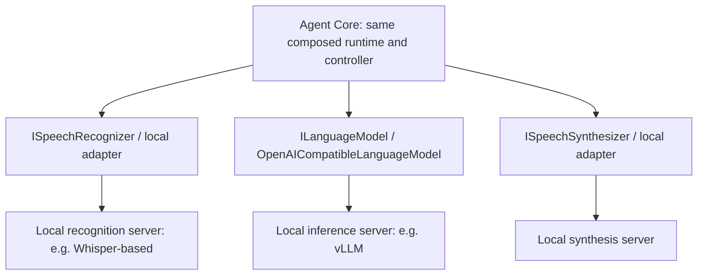

# Observability and Operations

## Canonical host shutdown and worker cutover

`SessionShutdownHostedService` stops the same canonical tenant runtime singleton used for execution/control. Its cached drain closes shared capacity admission, cancels supervised Runs and retires Voice and recipient output. Repeated stop/dispose does not start another drain. Cancellation of a stop caller's wait does not reopen capacity or abandon the underlying cleanup. Pending durable work retains its canonical recovery rules; shutdown is not permission to replay effects.

Only canonical tenant Run recovery, Automation/event admission and email watches execute on hosted passes. Old owner occurrence intake, Run dispatch, Experience reconciliation, event fanout and duplicate owner cleanup loops are removed. Existing diagnostic IDs, phase isolation, cadences and Synthetic/no-provider behavior remain. `AgentCore:MaxActiveSessions` now feeds the dedicated capacity owner. The browser removes only its obsolete owner-token local-storage key on startup; blocked storage cannot prevent app entry.

[Focused evidence](reports/runtime-registry-cutover-verification-2026-10-21.md) separates shutdown, native runtime/browser, store recovery and unrun production/physical-device/CI claims.


## Tenant Agent decommission recovery

Canonical backend decommission requires an archived, unreferenced Agent and a current original human with `agents.read` and `agents.delete`. Inspect the exact [HTTP preflight](14-api-and-realtime-protocol.md#tenant-agent-decommission-http); do not convert retained-history blockers into cascaded deletion. A committed result reports physical cleanup separately. The existing supervised resource sweep retries only exact retired owner roots; logout/restart does not revoke that technical mandate. Live or uncertain Sandbox mounts keep workspace bytes, and uncertain Browser closure keeps profile cleanup pending. Inspect current retained facts rather than replaying logical deletion with a new operation. Never delete a user profile/workspace manually to make a check pass. This qualification used disposable roots only and did not restart any user host.

## Tenant Browser persistent-profile reset operations

Open the actual Agent’s Connections page and use its independently authorized **Browser state** section for current profile facts and explicit named reset. Every request outcome requires deliberate **Reload Browser state** before another reset; a lost reply is never repeated automatically. The [UI qualification](reports/tenant-browser-profile-reset-ui-verification-2026-10-20.md) records local evidence.

Use the canonical human [profile preflight/reset API](14-api-and-realtime-protocol.md#tenant-browser-profile-reset-http) only for the explicitly selected actual Agent. Preflight reads bounded existing metadata without launching a Browser or creating a directory. Reset may close all of that Agent's persistent views and remove its saved Browser state; it retains the reusable exclusive `.lock` inode and never deletes sibling Agent/tenant profiles or ephemeral Sessions. No operator should infer deletion from a request acknowledgement, closed page or audit start. Only stored `reset` confirms verified absence; unknown/pending need deliberate factual readback and, if desired, a newly authorized reset.

Host loss cannot replay reset. The next independently authorized GET settles an abandoned pending operation from available same-operation native facts or records unknown; persistent use remains blocked until a new confirmed reset. Do not clear the Instance reset column, remove its audit IDs or bypass a live profile lock to recover. The existing automatic lifecycle sweep still retires native resources without deleting persistent bytes. Focused tests use disposable roots only; no development verification authorizes resetting a user's live profile. [Schema and rollback](15-persistence-and-configuration.md#tenant-browser-profile-reset-state), [evidence](reports/tenant-browser-profile-reset-verification-2026-10-20.md).

The existing resource cleanup hosted service also reconciles already owned tenant Browser resources at startup and on its five-minute sweep, in bounded pages of 100 and five-second TimeProvider budgets. A timed-out Browser owner advances the retry cursor so later owners and file cleanup can proceed. Lifecycle mutations attempt reconciliation immediately after metadata commit. Busy/unconfirmed native closure remains pending and logs use normalized Browser cleanup reasons with resource identity, never URLs, page contents or profile paths. It does not launch a profile or delete its retained bytes. [Browser retirement evidence](reports/tenant-browser-retirement-verification-2026-10-20.md).

## Tenant Sandbox retirement adapter deployment

The trusted server bootstrap also installs `retirement.py` from its read-only source mount. Both local runner and Compose keep its negative fence SQLite file in the existing private `/var/lib/opensandbox` metadata volume. Preserve that volume when explicitly recreating an owned server. New tenant provisioning and disposable verification check the authenticated capability endpoint first; unsupported servers fail before filesystem/SDK effects. Never clear Core operation or provider retirement fences to retry an uncertain create. Disposable verification additionally requires `verificationFencing`; its tenant/attempt fence shares the existing provider metadata file and volume. Pending cleanup retains disposable files until the exact original host confirms retirement.

Existing running servers were not restarted for this change. An older owned runner missing the retirement module requires an explicit workload reconciliation/recreation with its state retained; ordinary start does not silently replace it. [Pinned-image proof command](../scripts/tests/README.sandbox-retirement.md) runs without network, a Docker socket, host ports or user data. Its controlled Docker peer is separate from live tenant workload qualification.

Tenant governance approval policy is current security configuration and cannot weaken Core minimums. A saved `requiresApproval` inspection result is not an approval request or execution grant. Unsupported tenant tool paths report `tenant_effect_unavailable` before legacy service access; do not enable tenant worker dispatch around this gate. Original requester membership/chat/read revocation stops request-bound inspection, while no human login cookie is copied into Run context. Governance writes recheck the original login session at commit and append safe permission-key audit. No provider call, reset, deployment or host restart is performed by this prerequisite. [Evidence](reports/tenant-operation-authorization-verification-2026-10-17.md).

Canonical tenant text submission accepts durable queued work and returns correlation/revision metadata. This checkpoint does not run that work through legacy workers: trusted tenant dispatch/recovery is still required. An authorized human can cancel a queued Run under current witnesses, then logically delete a quiescent Session; no direct cancellation bypasses an attached Runtime. `agent-runs.admit/cancel` audit excludes text and config. The tenant execution-identity migration extends existing tables and references; it does not adopt unscoped history, reset data, restart a host or deploy. Follow the existing separately authorized backup/reset procedure for incomplete installed schemas. [Verification](reports/tenant-run-admission-verification-2026-10-17.md).

The execution-root schema requires explicit reset/export planning for existing execution data: historical Activation roots are not guessed or converted. Normal startup refuses an incomplete installed schema; direct EF migration also refuses nonempty historical Activations/Runs. Back up the configured SQLite database and data roots together before a separately authorized cutover. This change performs no reset, host restart or deployment. Fresh disposable fixtures exercise the migration and preserve refused historical rows. [Lineage verification](reports/activation-root-lineage-verification-2026-10-17.md).

Canonical tenant Session metadata creation requires the authenticated human session, current tenant Session create/read and exact Instance chat authority. It saves a new owned Session without starting a runtime, creating a global profile or mounting a workspace. Legacy owner routes and recovery do not adopt these Sessions. [Verification and remaining runtime gates](reports/tenant-session-ownership-verification-2026-10-17.md). Canonical lifecycle writes require current human authority and both security/Session witnesses. Attached/ending Sessions, pending input and nonterminal Runs return `session_in_use`; this endpoint does not stop a live Runtime. DELETE logically retires the Session and redacts conversation records while retaining causal identities; it does not run global filesystem cleanup. Automatic tenant recovery and external byte cleanup remain pending. [Lifecycle evidence](reports/tenant-session-lifecycle-verification-2026-10-17.md). Existing installations still require the explicit reviewed final cutover/reset procedure; no application data is reset by this checkpoint.

## Explicit identity bootstrap foundation

The multi-tenant cutover is in progress; the [delivery ledger](reports/multitenant-iam-delivery-2026-10-16.md) records remaining resource/Hub/UI integration. These commands initialize the new identity foundation only. Do not deploy intermediate source or reset an existing user database to make it start. No live-data deletion is authorized. The current schema guard refuses an incomplete/older populated baseline rather than migrating its unscoped records into a tenant.

For a **new, explicitly selected SQLite database and data roots**, set `Persistence:Provider=Sqlite`, its ConnectionString and attachment/workspace/artifact/definition-resource/credential-key roots through the existing configuration mechanism. Run the one-use command with five operator-supplied environment values: `AGENTCORE_BOOTSTRAP_LOGIN`, `AGENTCORE_BOOTSTRAP_DISPLAY_NAME`, `AGENTCORE_BOOTSTRAP_PASSWORD`, `AGENTCORE_BOOTSTRAP_TENANT_NAME`, `AGENTCORE_BOOTSTRAP_TENANT_SLUG`. No default credentials are shipped; missing values fail before identity creation. Database creation uses the tracked migrations. Bootstrap creates Account, explicit platform role assignment, initial Tenant and human Owner atomically, records audit, then exits without starting hosted workers or listening for traffic. The persistent singleton marker permanently disables repeat bootstrap.

In a private zsh terminal, a password can be supplied without entering it into shell history:

```zsh
read -rs 'AGENTCORE_BOOTSTRAP_PASSWORD?New account password: '
print
export AGENTCORE_BOOTSTRAP_PASSWORD
# Set the other non-secret AGENTCORE_BOOTSTRAP_* values and exact persistence roots first.
# Persistence__Provider and Persistence__ConnectionString must select the intended new database.
dotnet run --project src/AgentCore.Api -- bootstrap-identity
unset AGENTCORE_BOOTSTRAP_PASSWORD
```

Use at least 12 characters (maximum 256). Never pass a password as a command argument, commit it, print it or copy it into a report. After successful bootstrap, start normally with the same configured storage/key roots. SQLite startup fails clearly if identity has not been initialized; it never supplies an implicit local Owner or accepts an owner header in the new identity namespaces. Authentication cookies are session references validated against current server session, Account status and security stamp. Sign out revokes one device session; password rotation invalidates all previous device sessions. Keep Account cookie keys in `Persistence:CredentialProtectionKeyRoot/account-sessions`; they are purpose-separated from credential protection. Back up the database and private key/file roots together when preserving this deployment.

An intentionally ephemeral InMemory host instead requires explicit `Security:EphemeralBootstrap:Login`, `DisplayName`, `Password`, `TenantName` and `TenantSlug` configuration on each start. Supply its password through private environment/secret configuration (`Security__EphemeralBootstrap__Password`), never a committed default. `bootstrap-identity` refuses InMemory because its initialized state would disappear on command exit. Provider profile and store selection remain independent; Synthetic makes no provider requests.

Human authentication defaults to HTTPS with Secure/HttpOnly/SameSite Strict cookies. For native loopback-only development, explicitly set `Security:Http:AllowInsecureLocalHttp=true`; non-loopback cleartext requests still fail. Future cross-origin realtime entry points use exact configured `Security:Http:AllowedOrigins`; no wildcard or generic CORS authority is granted. The UI/API resource route cutover and launcher fixture updates must be completed before claiming the complete application startup journey.


## Three-layer context maintenance

This is an explicit offline one-way conversion. First drain/complete or deliberately cancel nonterminal old Runs using the previous application, then stop writers and back up workspace/resource/artifact/credential roots together. Do not restart or reset a user's active host as verification.

```bash
dotnet run --project src/AgentCore.Api --no-launch-profile -- migrate-context /absolute/path/agent-core.db /absolute/path/new-context-backup.db
```

The backup destination must be new and distinct. The command uses SQLite's backup API, preflights incompatible Runs, converts retained configuration transactionally, recomputes hashes with canonical application algorithms and validates before commit. A refusal rolls back conversion and preserves the backup/receipts. Normal startup fails with this command and drain/cancel guidance when conversion is needed; it never resets data or resumes retired checkpoints. Restore the previous application and complete data backup for rollback. Historical completed checkpoints remain audit-only.

Custom provider/model catalog routes must explicitly declare `DeveloperRoleSupport=true` only for a verified separate system/developer contract on the selected transport. Undeclared/unsupported routes are ineligible; `openrouter/free` cannot be selected for this hierarchy because its random routes do not provide a fixed verified contract. There is no downgrade or fallback. Run normal Synthetic checks without live keys. Live models need separate opt-in verification.

Context diagnostics contain only section IDs, source kinds/revisions, bounded field-source metadata, size/omission estimates and a fingerprint. Never log or export prompt bodies, learned/user content, results, arguments, keys or screenshots through this manifest. IDs belong in protected diagnostics, never high-cardinality metric labels. Token figures are UTF-8-based estimates.

## Capability projection measurements

`AgentCore.Runtime` records `capability_projection` histograms by low-cardinality `kind`, configured provider and catalog model key: authorizedCapabilityCount, eligibleCapabilityCount, projectedCapabilityCount, projectedToolSchemaBytes (normalized definitions including names/descriptions/schemas), coreBootstrapCount, definitionAlwaysCount, contextProjectedCount, skillProjectedCount, loadedProjectedCount and capabilityLoadInvocationCount. `capability_loads` counts safe outcomes load_matched, load_no_match, load_already_projected, load_over_budget and load_stale. capabilityLoadMatchCount measures each invocation's matches. Raw discovery queries and schemas are not default log or metric tags. Counts from overlapping projection sources are informational and need not sum to the deduped total.


## Latency model

Treat perceived voice latency as independent stages: speech detection + STT partial/final latency + Interaction Controller latency + LLM first-token latency + speech-segmentation delay + TTS first-audio latency + transport/buffering + browser playback. Streaming overlaps parts of this chain; the measured critical path, not a naive sum of overlapping spans, explains the user's wait. Capture each stage to find the bottleneck instead of reporting voice latency as one number.

## Latency instrumentation

Conversation latency is a product feature. Use Application ActivitySource `AgentCore.Runtime` and Meter `AgentCore.Runtime`, ASP.NET Core/HttpClient OpenTelemetry instrumentation, structured Microsoft.Extensions.Logging, and optional OTLP export. Capture server DateTimeOffset for correlation and TimeProvider monotonic timestamps for local durations. Browser uses performance.now() for durations and UTC timestamps only for approximate cross-device correlation. Never subtract unsynchronized browser/server wall clocks and report the result as precise network latency.

| Milestone/event | Capture location | Useful measurement |
| --- | --- | --- |
| speech detected | Browser VAD, plus server ingress receipt | Local speech→duck, ingress→candidate |
| first STT partial transcript | STT pump before mailbox admission | Speech boundary→partial (server observed) |
| final transcript | STT pump and mailbox processing | Final→model request / mailbox delay |
| interruption candidate / confirmed decision | Controller transition | Candidate→decision |
| model request start / first token | Adapter send and first normalized delta | Request→first token |
| first speakable segment | Application SpeechSegmenter release with responseId/segmentIndex | First buffered text→segment release; separate from provider latency |
| TTS start / first TTS audio | Adapter segment request / first PCM | Speakable text→first audio |
| audio sent | Binary output sender at actual send | First TTS audio→send; send→playback ack upper bound |
| client playback start | Worklet consumed first sample, reported ack | Local audio receipt→playback; server first-send→ack is an upper bound including RTT |
| cancel requested | Runtime after supersession mark | Decision→cancellation request |
| playback stopped | Worklet flush acknowledgement | Browser stop receipt→actual stop |
| response completed | Runtime terminal after delivery/save | End-to-end server-observed response lifetime |

Trace spans: session attach, user turn, brain decision, model generation, each TTS segment, interruption, persistence write. Long voice calls should not require one unbounded trace; link per-turn activities by correlation ID. Metrics: histograms for the durations above, mailbox wait, input/output queue depth, active sessions, discarded stale chunks, interruptions by decision, normalized failures, reconnect count and underruns. Pause counters `session.auto_paused` and `session.pause_reason` use only the canonical pause-reason enum (`manual|inactivity|silentEvaluation|initiative|disconnected|recovered|persistence|other`) as a `reason` tag. Speech counters `speech.partial.count` and `speech.playback.complete` have no content tags. Histograms `speech.final.latency`, `speech.segment.latency`, and `speech.playback.start.latency` are untagged milliseconds. Counter `speech.cancel.reason` uses only `reason=userStop|userBargeIn|newText|userSteer|disconnected|modeChange|ended|deactivated|other`. Counter `speech.error.code` uses a bounded error-code tag (no transcript, PCM, secrets, or vendor bodies). Counter `agent.progress.event` tags only `kind` (`preparing|readingAttachments|runningTool|waitingExternal|finalizing|other`) and `state` (`started|updated|completed|failed|other`). Histogram `agent.progress.active_ms` is milliseconds tagged only with `kind`. Progress instruments never tag message text, operation IDs, tool arguments, reasoning, or attachment content. Do not log native structured JSON, compatibility marker payloads, or speech text. User-text counters `user_text.behavior` and `user_text.queued` use only `behavior=queue|interrupt`. Histogram `user_text.pending_batch_size` records the clamped suffix length `1..8` with no labels when a pending batch starts; counter `user_text.pending_batch_started` has no tags. Response-stop counters `response.cancel.requested` and `response.cancel.stale` have no high-cardinality tags. Use provider alias, decision and error code as low-cardinality metric tags; sessionId/eventId/responseId belong in traces/logs, not metric labels.

Application code records those histograms on `ActivitySource`/`Meter` `AgentCore.Runtime`. Observed synthetic 20-turn numbers live in [Milestone 12 demo verification](reports/m12-demo-verification.md); they are measurements, not SLAs. Compose SQLite volume survival and the owner-capability path are covered by `scripts/compose-sqlite-volume.sh` (also run on Ubuntu in [GitHub Actions](../.github/workflows/synthetic.yml)) and [MVP handoff](reports/m12-mvp-handoff.md).

The existing Synthetic workflow also supports manual branch verification: `gh workflow run synthetic.yml --ref BRANCH` (replace `BRANCH` with the desired branch), then inspect the run's exact `headSha` and all five job results. This uses the same key-free gates when pull-request conflicts prevent automatic scheduling. Passing a branch run verifies its source; resolving conflicts with the target branch remains a separate merge prerequisite.

## Admin lifecycle observability (observed, P7)

Admin routes under `/api/v2/admin` require the same trusted-local **owner capability** as other destructive catalog operations (`X-AgentCore-Owner-Capability` from `POST /api/v1/local/owner-capability` in Synthetic/Compose). Denied or missing capability fails closed with 401; trusted-local restrictions apply before any durable Admin mutation.

Logging and projections for Admin must stay redacted: never log owner-capability tokens, webhook bearer tokens, webhook token hashes, draft or resource bytes, persona JSON payloads, learned-memory content, evaluation prompts or results, provider secrets, or raw `PreparedActionJson`/evidence from durable work. Append-only `AdminEvents` and HTTP list/detail responses carry only allowlisted summary metadata (definition/instance/version/revision identifiers, bounded section names, fingerprints). See [P7G report](reports/p7g-history-rollback-final-gate.md) and [Testing Strategy](16-testing-strategy.md).

There is no separate Admin metrics namespace yet; treat Admin like other HTTP surfaces (ASP.NET request logging, bounded error codes). If Admin-specific **counters or histograms** are added later, tag only bounded low-cardinality values such as `operation`, `outcome`, and resource **kind** (never instance/definition UUIDs, operation ids, or summary JSON bodies). **Traces and structured logs** may include safe resource ids for correlation, consistent with the latency-instrumentation rule that session/event/response ids belong in traces/logs, not metric labels. **Spans** follow the same split: bounded tags on metrics; richer attributes on trace activities only.

**Compose and browser verification:** default Synthetic Compose smoke (`scripts/compose-sqlite-volume.sh`) proves SQLite volume survival for instance-owned Sessions, catalog, redacted Background Work APIs, and an owner-protected Admin fork/publish/managed-instance/managed-session path with safe `AdminEvents` list redaction across container recreate. The P7 whole-phase Admin journey (resources, evaluations, full §8 steps) still runs in Playwright with a **disposable** SQLite file (`PLAYWRIGHT_SQLITE_PATH`, isolated `admin-lifecycle` project in CI). The later Admin authoring journey uses a separate `p76-admin` project and `data/playwright/p76-admin.db`, also deleted before that CI step. Compose also uploads/binds a draft knowledge resource, publishes, and verifies publication resource metadata survives recreate; managed-session `/agent` resource read is checked before recreate ([P7G report](reports/p7g-history-rollback-final-gate.md)).

`DiagnosticId` names one failure occurrence and may be shown or copied. `CorrelationId` remains the logical operation or turn. `TraceId` is copied only from a real `Activity.Current` and is omitted when none exists. Unexpected catches log the exception object with a `DiagnosticLog` record. Present allowlisted fields sit on that record: `DiagnosticId`, `CorrelationId`, `TraceId`, `SessionId`, `ResponseId`, `AgentInstanceId`, `AutomationId`, `TriggerOccurrenceId`, `AgentRunId`, `ErrorCategory`, `ErrorCode`, `ProviderAlias`, `FailureReason`, `ProviderResponseChannel`, `Operation`, and `CredentialId`. Absent fields are omitted. Conversation and model failures include `AgentInstanceId` and `ProviderAlias` when the pinned session already has them. Provider `InvalidResponse` failures may also include bounded `FailureReason` and `ProviderResponseChannel` on the same `DiagnosticLog` line. Those values name the violated contract, not raw model output. `outputLimit` and `toolCallTruncated` are part of that allowlist. The same tokens may appear on the history failure reference. Those identifiers are not metric labels. A terminal session-end persistence failure publishes `Session` / `SessionPersistenceUnavailable` / `Persistent save failed.` and keeps the exception object on that log line. Expired-claim recovery assigns a safe `DiagnosticId` inside the AgentRun transition. `AgentRunCoordinator` fences recovery and dispatch through the shared Session mailbox; no legacy worker or second execution store is registered. `Observability:OtlpEnabled` still does not attach an exporter.

Scheduling stays domain-owned for registration, schedule semantics, admission, work, approval, and execution. Infrastructure owns waking, persistence, and dispatch through `BackgroundService`, SQLite, one process, and a 1-second cadence. Missed recurrence still coalesces to the latest due occurrence. `CoalesceLatest`, `SkipMissed`, `CatchUp`, Hangfire, and Quartz stay deferred.

Structured log fields where relevant: sessionId, eventId, responseId, provider (logical alias), durationMs, decision, attachmentId, errorCode. Do not log raw audio, API keys, AdditionalHeaders or complete conversations by default. Debug transcript/content logging is explicit local opt-in with a bounded timeline, never an accidental production default. Redact provider URL query strings and failure bodies. OpenAI-compatible non-2xx responses log status, model, phase, and a bounded sanitized provider error code, type, and message; `llm.request` records model, provider, call number, message and tool-result counts, image presence and byte size, structured output, and HTTP status without prompt or image bytes. Browser receives user-safe messages only. Content-free compaction counters on `dropped_items` are `compaction_rejected`, `compaction_cancelled`, and `compaction_stale`. Structured-memory admission, conflict, capacity, and cross-session policy denials use `memory_rejected`. Successful session-memory prompt loads record `memory_retrieval` with result `included` or `empty`. These counters carry no summary, memory, or conversation text. `SessionRuntime` records counter `agent_steps` when a terminal Agent Step is accepted or rejected. Tags are `outcome` (`accepted` or `rejected`), `disposition` (the disposition name or `none`), `action` (`chat.respond` or `none`), `rejection` (`none`, `unknownDisposition`, `unknownAction`, `malformedPayload`, or `modelSuppliedDestination`), and `executed` (`chat` or `none`). The matching log line carries session id, response id, disposition, action, and rejection category. It does not include display text, speech, reasoning, or a diagnostic id as a metric label. Observed `stage_duration_ms` stages also include `extraction`, `workspace`, `tools`, `sandbox`, `initiative`, `initiative_eval`, `initiative_disposition`, `cleanup`, `speech.partial.count`, `speech.final.latency`, `speech.segment.latency`, `speech.playback.start.latency`, `speech.playback.complete`, `speech.cancel.reason`, `speech.error.code`, `agent.progress.event`, `agent.progress.active_ms`, and `agent.step.terminal`. `agent.step.terminal` is the time from accepting the Chat action to successful response completion. It carries no display text. Timeline details for progress are `kind:state` or `kind` only. `speech.input.transport` / `speech.output.transport` and compact capability flags remain metadata only. `initiative_eval` and `initiative_disposition` timeline entries always carry compact JSON (`triggerEventId`, evaluated/reasonCode, admitted/blockReason, silence/counters; no planner note or transcript text). Optional `reasonDetail` appears only when debug content logging is enabled. Other tool/sandbox details are names only and are omitted from the default timeline unless debug content logging is enabled.

## Automation authorization classifier diagnostics

Each model-classification attempt emits an `Automation authorization classifier` structured information record and an `AgentCore.Runtime` activity `automation.authorization.classifier`. Metadata includes action, selected catalog key/provider alias/model ID/transport, supported reasoning effort, max-output-token budget, attempt/max-attempt count, elapsed milliseconds, typed terminal/failure, reported output tokens, valid-decision flag and available trace ID. Configured route fields are bounded to 128 characters with controls removed. User/task text, schedule evidence, draft arguments, model text/reasoning, provider bodies and credentials are excluded. Route identity stays out of metric labels. A missing usage field stays unknown.

The private classifier budget is 512 tokens, with one 1024-token attempt only after a confirmed output limit. Both attempts share 30 seconds and the caller's earlier cancellation/deadline. Repeated truncation is a platform output-budget failure, not a provider outage or unclear user intent. Ordinary Chat/provider budgets are unchanged. Apply updated backend code with an intentional host restart; verification does not restart the user's existing host or mutate its Automations. Offline fixtures establish transport behavior, not the running provider's token distribution; a live diagnostic remains explicit opt-in and must log metadata only.

The semantic cutover verifies every current-user mutation's exact prepared action; language wording has no bypass. Unavailable/invalid verification offers the retained exact owner UI approval. Deny/Ambiguous ask for clarification. Do not log prepared JSON or user/task text. The credential-free Synthetic failure scenario sets `Synthetic__AutomationAuthorizationDecision=ClassifierUnavailable` and sends `[test:automation-approval]` through Chat; this setting is ignored in Real. Verification uses disposable data/listeners and never restarts the user's host.

## Handled-operation failure diagnostics

Handled failures must remain diagnosable even when Core safely returns a tool error, retries cleanup, stays silent, or preserves an uncertain dispatch receipt. `HandledFailureLog` emits a Warning with `DiagnosticId`, safe `Operation` and `ErrorCode`, a real trace ID when present, and relevant Session/Response/Run/Instance or `CredentialId` identifiers. Credential IDs identify account records; account names, addresses and protected credentials are excluded. SMTP rejection adds the status enum as `FailureReason`. The compatibility Gmail adapter logs rejected/uncertain HTTP status and retains a safe exception snapshot for cancellation after dispatch.

`HandledFailureLog` and `DiagnosticLog` deliberately remain stateless static façades, consistent with ordinary logging helpers. Exception snapshotting and field formatting own no Session state, and no logger, service provider or mutable cache is stored globally. Production services/factories pass the existing singleton `IDiagnosticIdSource`; the established fallback is only for direct construction in isolated fixtures. This uses the existing dependency boundary and adds no logging service/interface or second logging pipeline.

The existing process-wide `RuntimeTelemetry` Meter/ActivitySource and local caches also remain static. They own operational observations rather than mutable conversation state. Local `SnapshotStats` retains only the newest 1,024 duration samples per named stage under a stage lock; its Count, P50, P95 and Max describe that recent window. Both ordinary and diagnostic recording share the same bounded path. The lifetime Meter still receives every measurement. The separately bounded timeline retains its existing configuration and content policy.

Warning enablement is checked once in the shared helper. When warnings are disabled or no logger exists, it returns no diagnostic ID, allocates no ID and does not traverse exception stacks. Trace failure status remains independent of log filtering. Callers propagate the nullable result through existing optional failure references; tool error JSON omits a missing reference. An explicitly supplied nonempty diagnostic ID is reused without consuming the generator.

The exception object on these records is a safe diagnostic snapshot: original exception types, HResult, stack frames, bounded inner causes, and HTTP/socket machine codes survive. Aggregate siblings are retained within limits of eight children per aggregate, eight nested levels and 32 snapshot nodes overall. Untrusted exception messages and `Data` are omitted because they may contain passwords, private URLs, provider bodies, DOM text or email content. No raw protocol logging is enabled. Safe user/tool errors remain separate from this server-only exception detail. IMAP search/read errors return the same diagnostic ID; the tool-step record includes that reference when present. Diagnosed model and TTS failures carry the exception-log ID into normalized failure events and conversation history; the category/code match the normalized provider failure. Model scopes retain the pinned safe provider alias. An adapter without an enabled warning logger leaves the ID unset so the runtime still logs its own failure reference.

Coverage includes account IMAP search/read, SMTP rejection and uncertain dispatch, account connection tests, durable email send fallback, public web fetch/HTTP transport and deadlines, model setup/stream/continuation failures, TTS transport, browser capture/interaction/launch/profile reset, sandbox wait/inspect/cleanup, voice startup, Skill/message admission, completion/initiative/compaction fallbacks, Session command dispatch and workspace cleanup supervision. Expected cancellation stays quiet except when dispatch may already have occurred and its outcome is uncertain. Validation/policy tool results still retain their safe reason codes; an exception is attached only when one exists.

`tool.step` uses Warning for error receipts, unsuccessful sandbox results, uncertain email sends and HTTP error responses; successful operations and ordinary pending/queued lifecycle states use Information. Inspecting an existing child Run failure is still a successful inspection. Explicit errors whose codes resemble lifecycle states (such as `Failed` or `ok`) use an `error.` prefix and remain Warning records. Failed steps never log arguments or result bodies. Each executing tool carries formatted log scopes for Tool, SessionId, ResponseId, CorrelationId, AgentInstanceId and AgentRunId. Console UTC timestamps and formatter scopes are enabled by default through `Logging:Console:FormatterOptions:IncludeScopes`; structured sinks can index those same fields. IDs remain excluded from metric tags.

For Compose investigation, `docker compose logs --since 30m` includes these warnings and their safe exception stacks. Filter by `Operation=email`, `mail_read_failed`, `smtp_rejected`, `dispatch_unconfirmed`, a Session/Run ID, or a copied `DiagnosticId`. Keep the exception lines following the matching record when collecting evidence. This adds no log-storage service or OTLP exporter; `Observability:OtlpEnabled` retains its documented limitation.

## Third-party HTTP error responses

`Observability:HttpErrorResponses:Enabled` defaults to `true` in appsettings and Infrastructure options. Set `Observability__HttpErrorResponses__Enabled=false` to disable shared error-body reads, parsing and warnings. Changes apply on process restart. Successful responses and redirects are untouched. Warning-disabled sinks also skip diagnostic reads.

The shared Infrastructure HTTP handler covers the named LLM, batch STT, TTS, Brave search, Gmail and Google OAuth clients. The public-web transport uses the same parser for already-bounded HTTP tool/fetch response bytes. Each failed HTTP response emits `Operation=http.upstream.error`, `DiagnosticId`, `TraceId`, `Integration`, `HttpStatus`, `ProviderCode`, `ProviderType`, `FailureReason` and `ParseState`; existing execution log scopes retain Run/Session correlation. The parser recognizes OpenAI-style errors, Google RPC/Gmail envelopes and OAuth string errors. It logs only allowlisted codes/types/reasons and fixed classifications derived from selected message phrases. Unknown provider values are omitted, never copied into logs. URLs, query strings, headers, raw bodies, free-form messages and provider details are excluded from these default warnings.

Inspection reads at most 16 KiB plus one overflow byte, with a one-second diagnostic deadline that counts toward the existing request deadline. Empty, malformed, deeply nested, oversized, timed-out or unreadable responses retain a safe parse state. Every consumed byte is replayed to the adapter; status, content headers, retry hints, normalized failures and retry policy remain adapter-owned. Caller cancellation is propagated and responses are disposed. HTTP tools retain their existing body limits; diagnostics add no unbounded reads. SMTP/IMAP, browser page content and in-band successful SSE error events retain their existing diagnostics.

The LLM reuses the handler’s bounded snapshot and read outcome rather than reading an inspected error stream again, including after diagnostic timeout. The existing LLM `LogProviderErrorMessages` local opt-in remains default-off: it can include redacted free-form text that echoes private user content. The shared switch also suppresses that legacy parser on registered clients when disabled. Direct manually constructed adapters outside the registered HTTP pipeline retain their explicit legacy setting.

## P7.5 observability audit (observed)

The add rows are recorded by `OperationalDiagnostics`. Metric tags stay bounded (`phase`, `reason`, `state`, `outcome`, `scope`, `result`, `operation`). Definition ids, instance ids, catalog keys, and provider aliases stay in the diagnostic timeline, not on metric labels. Those records do not include tool arguments, approval grants, memory text, summary text, or payload bytes. `IncludesConversationContent` stays opt-in. `GET /health` is the readiness response: it returns `status`, `profile`, `protocolVersion`, and optional `buildVersion` only after persistence initialization. Instruments are the BCL `ActivitySource` and `Meter` named `AgentCore.Runtime`. No OpenTelemetry package is referenced. `Observability:OtlpEnabled` defaults to false; when true, startup requires an absolute `OtlpEndpoint`, and the flag still does not attach an exporter. A later host can listen to the existing meter and activity source without changing call sites, and local or Synthetic runs do not require a collector.

| Area | Decision | Evidence |
| --- | --- | --- |
| Model and provider calls | Keep and add | `PumpModelAsync` starts an activity span named `model`. It records stage `llm` and a presence-only `llm.reasoning.delta`. `agent_run_events` records retry on the same durable AgentRun; attempt count and bounded failure classification remain inspectable without logging prompt/model text. `llm.response.repair` records a repairable presentation/format reason (the closed `ProtocolFailures` allowlist) with phase `initial` or `follow-up`. Every `started` repair records exactly one later outcome: `succeeded` when the repaired semantic response is accepted, `failed` when the repair ends without one, or `cancelled` when the response is cancelled. A successful repair does not mark the activity as an error. Neither counter includes prompt or model text. Nothing calls `RuntimeTelemetry.Record("model")`. The activity span is the model-duration evidence, so this row does not add a `stage_duration_ms` sample named `model`. `OpenAICompatibleLanguageModel.RecordRequest` records `llm.request` with default model, adapter, call number, response id, counts, and HTTP status. `HandleModelSelectionAsync` records `model.selection` with result `selected`. The timeline detail carries the catalog key and provider alias after `SafeLogRedactor`. The method does not write those values to the application log. `HandleSemanticReadyAsync` records `agent_steps` with bounded outcome, disposition, action, rejection, and executed tags. Active Skill procedures record `active_skills` with a count tag of 0–4 and do not log procedure text. `skill_loads` and `application_messages` record an `outcome` tag only (`admitted`, `denied`, `duplicate`, `stale`, `over_budget`, and the other small admission outcomes). They do not label message text, procedure text, or raw Skill ids. |
| Session, response, and conversation execution | Keep | Attach records stage `attach`. The controller and persist paths record `controller` and `persist`. `TerminalizeActiveResponseAsync` logs session id, response id, and reason. The coordinator and `AgentRunHostedService` dispatch claimed AgentRuns through SessionHost. Activation/Run/background lifecycle telemetry uses bounded operation and outcome labels. |
| Queue | Keep | `UserTextQueueTelemetry.Record` covers queued and immediate user text. `RecordPendingBatchStarted` covers a pending batch. |
| Steer and interrupt | Keep | Text steer calls `TerminalizeActiveResponseAsync` with `userSteer`. `SpeechTelemetry.RecordCancel` keeps `userSteer` as its own reason. Voice barge-in uses `userBargeIn`. |
| Detach | Add | `HandleDetachAsync` records `SessionPauseTelemetry` `"disconnected"` only when it applies a new pause. The ended-or-ending return, the transport-only return (including auto when accepted conversation work exists), and the already-paused return record `session.detach` with a phase and reason. |
| Reattach | Add | A successful attach records stage `attach` with elapsed time only, including a paused session that does not require explicit resume. A deadline expiry and an explicit-resume refusal return before that record. The success record adds `session.attach` phase `cold` or `resumed`. Those two refusals record phase `refused` with reason `deadline` or `explicitResume`. |
| Tool calls | Keep and add | Stage `tools` records the tool name. `SafeExecutionTrace` also records `tool.step` with session id, response id, sequential step number, canonical tool name, normalized outcome, duration, and bounded browser metadata (`feature`, `settled`, `truncated` and `returnedCount` when available). It does not log tool arguments, direct target queries, fill values, upload bytes, artifact ids, or page text. `generation.terminal` records structural completion metadata (channel, stop reason, disposition, action kind, display-text presence, failure category/code) without assistant text, reasoning, or model JSON. Web, email, and sandbox handlers record their own stages. |
| Approvals | Add | `SessionRuntime.Approval.cs` records `approval.outcome` and `approval.wait_ms` with state and reason. It does not log the grant or argument payload. |
| Sandbox | Keep | `SessionToolExecutor` records stage `sandbox` with the verb. |
| Compaction | Keep and add | Rejected, cancelled, and stale compaction call `RecordDropped`. `HandleCompactionReturned` records `compaction.outcome` `accepted` before persist. The detail is the word `accepted` and does not include summary text. |
| Memory mutation | Keep and add | `SessionMemoryPrompt` records `memory_retrieval` as `included` or `empty`. `StructuredMemoryService` records only `memory_rejected` on admission failure. A mutation that passes admission records `memory.mutation` with scope and result. It does not log memory text. |
| Definition, version, and instance resolution | Add | `AdminReadService.GetEffectiveConfigurationAsync` records `admin.operation` `resolve`. The timeline detail carries definition id, version, instance id, and state. Those ids are not metric labels. |
| Draft, publish, rollback, and deprecation | Add | `AgentDefinitionLifecycleService`, `AgentDefinitionDraftPublishService`, and `AdminAgentInstanceService` record `admin.operation` and `admin.operation_ms` with operation, outcome, and reason. The timeline detail carries ids and state. It does not include draft bytes, persona JSON, or memory text. |
| Trigger registration, occurrence, and scheduler lag | Keep | `RecordAutomation`, `RecordTriggerScheduler`, and `RecordTriggerDueLag` already cover this area. |
| AgentRun lifecycle | Keep | Shared stores record committed admission, claim, attempt, retry, approval and terminal transitions; the coordinator records lease recovery through those transitions. |
| Policy denials | Keep and add | Trigger registration records `authorization_denied`, `forbidden`, and `policy`. The interactive `ToolPolicyDecision.Deny` branch records `tool.denial` reason `forbidden` and the tool name. It does not log arguments. |
| Bounded resource failures | Keep and add | Mailbox pressure records `mailbox`. Cancelled tool execution records `tools`. Audio overflow records `audio`. `AttachmentStreamIntake` records `resource.limit` `attachmentItem` or `attachmentSession` before the 25 MiB and 250 MiB throws. `WorkspaceEndpoints` records `workspaceContentLength` or `workspaceStream` before `WorkspaceQuotaExceeded`, ahead of `WriteWorkspaceAsync`. `FileSessionWorkspace` records `workspaceStore` before the same error. `SqliteArtifactStore` and `InMemoryArtifactStore` record `artifactItem` or `artifactSession` before `ArtifactQuotaExceeded`. `InMemoryArtifactStore` is the artifact store when the persistence provider is not Sqlite. Those reason codes do not include payload bytes. |
| Health and readiness | Keep | `GET /health` returns `status`, `profile`, `protocolVersion`, optional `buildVersion`, and separate scheduler pass readiness after persistence initialization. That is the readiness response for native, Compose, and CI. Do not add a second health service or an exported collector. |

## MVP optimization targets (not SLAs)

- Local speech detection→gain duck: <=50 ms on a reference desktop browser.
- Server receipt of speech evidence→interruption candidate: <=100 ms; browser speech detection→server candidate aim <=250 ms on local/demo networking, measured with clock uncertainty disclosed.
- Controller explicit-stop decision→stop command queued: <=25 ms.
- Browser receipt of stop→worklet stopped: <=50 ms.
- Browser receipt of first PCM→playback: approximately 60–120 ms with the default prebuffer.
- Final transcript→first model delta and speakable text→first TTS audio: record p50/p95 per provider/profile; initial demo aims below 1 second each, explicitly provider-dependent.

Collect a reproducible 20-turn demo run, report sample size, provider/profile, device, browser, network conditions and percentile values. Do not claim universal guarantees. Optimize queueing/cancellation before increasing model complexity.

## Running after implementation

The preferred fast developer loop requires no Docker: ASP.NET backend on localhost:5080 and Vite on localhost:5173 with HTTP/WebSocket proxy. Run native .NET and Vite processes for fast startup, direct debugging, hot reload and no container rebuilds. Milestone 1 uses in-memory persistence (`Persistence:Provider=InMemory`); select SQLite when Milestone 11 exists. Provider profile and storage selection are independent.

```text
dotnet run --project src/AgentCore.Api --launch-profile http
cd web
pnpm install --frozen-lockfile
pnpm run dev
```

MessagePack stays the realtime default. To inspect JSON frames in DevTools, configure the diagnostic transport for the **Vite** process, not the ASP.NET API. Vite reads `VITE_AGENTCORE_REALTIME_PROTOCOL` from `web/` env files or the shell that starts `pnpm dev`. The repo-root `.env` used for Compose interpolation and optional `source .env` for native .NET does **not** configure native Vite. Restart the Vite dev server after changing the variable; a browser refresh alone is not enough if Vite was already running. Changing it on the API process or a running container after the SPA is built does not switch the browser.

```bash
cd web
VITE_AGENTCORE_REALTIME_PROTOCOL=json pnpm dev
```

The same assignment can live in gitignored `web/.env.local` (see `web/.env.example`). Default `docker compose build` leaves the variable unset, so the image stays MessagePack. A JSON diagnostic image passes it during the frontend build, then runs the container:

```bash
docker compose build --build-arg VITE_AGENTCORE_REALTIME_PROTOCOL=json
docker compose up
```

Durable trigger telemetry on meter `AgentCore.Runtime` is `trigger_scheduler_events`, `trigger_registration_events`, and `trigger_due_lag_ms`. Canonical execution adds `activation_events`, `agent_run_events` and `background_session_events` with bounded outcome tags described below. Do not log schedule intent, occurrence evidence, result text, prepared action JSON, or secrets. `GET /health` confirms Synthetic boot (`{"status":"healthy","profile":"Synthetic","protocolVersion":1,"buildVersion":"1.0.0+<source-revision>"}`). Open http://127.0.0.1:5173, start a conversation, and send text over `/hubs/session`. Voice click preflights capture, then streams PCM after Mode=voice. In voice mode, streamed assistant text is segmented and played through the output AudioWorklet (not an HTML audio element); microphone capture remains active during playback. Mute stops PCM only; End or disconnect releases capture, recognition and synthesis. Saying Wait (or sending a new turn) supersedes live playback after a worklet flush. Idle and environment initiative stay in-process (`IEnvironmentEventIngress`); there is no public arbitrary-event inject endpoint. Playwright: `cd web && CI=1 pnpm exec playwright test` (text pending-voice, fake-device capture, playback while capture stays active, duplex mute/disconnect, voice interrupt). Kestrel JavaScript protocol fixtures run under `dotnet test`. The synthetic STT/TTS scripts emit deterministic transcripts and PCM; use Real with independently configured streaming STT/TTS and OpenRouter text with a **fixed** `DefaultModel` for actual microphone transcription and speech. `openrouter/free` is for opt-in adapter smoke only. Supply `OPENROUTER_API_KEY` and, when live speech is wanted, `OPENAI_API_KEY` from environment or `dotnet user-secrets`. Opt-in OpenAI TTS uses `AGENTCORE_LIVE_OPENAI_TTS=1`. [Configuration](15-persistence-and-configuration.md) defines all profile overrides. Default test commands remain Synthetic and must not require these keys.

```text
dotnet test
cd web
pnpm install --frozen-lockfile
pnpm run test --run
pnpm run build
pnpm exec playwright test
```

Use Node.js 22 for frontend verification, matching the Synthetic CI workflow, and check `node --version` from `web/` before running these commands. The [2026-10-12 review](reports/current-changes-review-2026-10-12.md) records a local Node 26/Vitest 3 jsdom storage incompatibility and the explicit Node 22 recheck.

Demo/production-like packaging: Vite builds static SPA into web/dist; the Dockerfile publish stage copies it to Api wwwroot; ASP.NET serves SPA/static assets, REST and SignalR in one process. Route SPA fallback only for browser paths, never swallow /api, /hubs, /health or OpenAPI errors. Compose mounts a persistent SQLite volume at `/data`. Kubernetes is unnecessary.

Bind loopback for local demos. For shared demo hosting use HTTPS with WebSocket upgrade forwarding, a single backend instance and a persistent SQLite volume. Do not horizontally replicate SessionManager against the same SQLite file. During shutdown the host stops admitting new sessions, interrupts live responses, detaches runtimes, and waits up to five seconds for mailbox drain. If process termination prevents a clean save, crash recovery semantics apply.

Back up SQLite using `SqliteMemoryStore.BackupToAsync` (SQLite backup API) or a copy taken while the process is stopped. Copying only the main file while WAL/`-wal`/`-shm` companions are active is not a reliable backup. Apply schema at startup (`EnsureCreated` for this MVP initial schema; treat it as the first migration) before serving traffic; fail startup on schema error. Test a restore before a demo that needs durable history. Native development can keep `Persistence__Provider=InMemory` or set `Persistence__Provider=Sqlite` with `Persistence__ConnectionString=Data Source=data/agent-core.db`.

## Serviced .NET runtime and safe redeployment

Deploy Agent Core with both **Microsoft.NETCore.App and Microsoft.AspNetCore.App 10.0.13 or a later serviced 10.0 patch**. Package auditing is independent: the patched NuGet graph does not update a running shared runtime. Microsoft's [ASP.NET advisory](https://github.com/dotnet/aspnetcore/security/advisories/GHSA-86xp-94pg-8r6r) and [.NET advisory](https://github.com/dotnet/runtime/security/advisories/GHSA-2fmv-rv2c-59x7) require installing the update and restarting applications. This floor is the operational owner; use the latest supported compatible servicing release instead of repeating exact runtime pins across project files. `global.json` selects the shared SDK feature-band floor with `latestFeature` roll-forward, not the deployed ASP.NET runtime. Docker copies it into the publish stage and keeps maintained `sdk:10.0` / `aspnet:10.0` tags; `--pull` is required to refresh cached base images.

For a native deployment, schedule an owner-controlled restart after finishing or cancelling active work. Install the current .NET 10 SDK (which includes ASP.NET Core) or both required runtimes for the host OS/architecture from the [official .NET 10 downloads](https://dotnet.microsoft.com/en-us/download/dotnet/10.0). Verify the same `dotnet` executable/environment used by the service:

```sh
dotnet --version
dotnet --list-runtimes
```

Both 10.0 runtime entries must meet the floor above. Preserve the existing launch profile, provider configuration, secrets, database and binary-store paths. Take a SQLite backup using the existing backup API or a controlled stopped-host copy as described above; retain attachment/Artifact/workspace and credential-protection data. For the managed native Real stack, the operator can then run `./scripts/dev-real.sh restart` (reuses OpenSandbox and leaves unselected nopCommerce running) and `./scripts/dev-real.sh status`. For an independently managed process/service, restart only its known owner instead; the script does not discover untracked hosts. Verify readiness and an ordinary owned Office read after the restart. Self-contained publishes must be rebuilt/redeployed with the patched SDK, not just restarted.

For an existing Real Compose deployment, use its same overlay and environment on every command. These are **operator instructions**, not an automatic restart performed by the stabilization task:

```sh
docker compose -f docker-compose.yml -f docker-compose.real.yml build --pull agent-core
docker compose -f docker-compose.yml -f docker-compose.real.yml run --rm --no-deps --entrypoint dotnet agent-core --list-runtimes
docker compose -f docker-compose.yml -f docker-compose.real.yml up -d --no-deps --force-recreate agent-core
```

Check both runtime versions before replacing the application container. Synthetic uses the same commands without the Real overlay. Preserve the existing named volumes and backup; do not remove volumes as part of this update. A fresh image/runtime check does not replace application readiness checks or real-file fidelity verification. [The local ledger](reports/office-small-stabilization-verification-2026-10-14.md) records the images actually inspected and the native-runtime gap left for the owner.

## Docker Compose integration and demo

Docker Compose is the supported reproducible local integration/demo environment, while Docker remains optional for ordinary development. Native `dotnet run` + Vite remains the fast loop. `docker compose up --build` starts one Synthetic application container (built SPA, SQLite and definition resource blobs on volume `agent-core-data` via `Persistence__DefinitionResourceRoot=/data/definition-resources`, no provider keys) on http://127.0.0.1:5080. The image runs as the Microsoft runtime `app` user (`USER $APP_UID`); `/data` and `/app/data` are owned by that user. A volume created by an older root image needs ownership `1654:1654` (or a one-time `docker compose down -v`) before SQLite can open. Building/pulling container dependencies may require network even though synthetic runtime behavior does not. `docker compose down` keeps the volume; `docker compose down -v` destroys it. Volume survival plus the frontend owner-capability path (`POST /api/v1/local/owner-capability` → `X-AgentCore-Owner-Capability` → `POST /api/v2/sessions` → catalog GET) is `scripts/compose-sqlite-volume.sh`. Keep host publish on `127.0.0.1`; Compose sets `Hosting__TrustPublishedPortGateway=true` so Docker published-port NAT (the container default gateway) is trusted without opening private IP ranges.

```text
docker compose up --build
curl -sS http://127.0.0.1:5080/health
./scripts/compose-sqlite-volume.sh
```

Real/hosted Compose is the same `agent-core` service and image with `docker-compose.real.yml` overlaid. It does not replace the default file: `docker compose up` stays Synthetic and key-free so CI and local smoke need no credentials. Use two `-f` flags so Compose does not also load an unrelated override file:

```text
# once: cp .env.example .env  && edit OPENROUTER_API_KEY (optional: BRAVE_SEARCH_API_KEY for Real web; Email accounts use Admin)
docker compose -f docker-compose.yml -f docker-compose.real.yml up --build
curl -sS http://127.0.0.1:5080/health
```

`/health` reports `"profile":"Real"`. Compose interpolates a gitignored root `.env` (copy from `.env.example`) or the same variables from the host environment. Do not commit `.env`. Never put secrets in the Compose files. `OPENROUTER_API_KEY` is required to start the Real overlay. `AGENTCORE_LLM_MODEL` defaults to `deepseek/deepseek-v4.1-flash` as a **local development and demo** default (text + tools + reasoning; not a production recommendation). The Real model catalog offers fixed `openai/gpt-6-luna`, `anthropic/claude-haiku-5.5` and `openai/gpt-6.1-sol` session choices; `openrouter/free` is ineligible for three-layer execution. When `AGENTCORE_LLM_MODEL` matches a catalog `ModelId`, the factory retargets `DefaultKey` to that entry; it does not rewrite the DeepSeek catalog identity. Add a catalog entry for ModelIds that are not listed. Do not set `AGENTCORE_LLM_MODEL` to `openrouter/free`. OpenRouter free and low-cost endpoints are rate-limited. Optional `AGENTCORE_LLM_REASONING_EFFORT` (default `low`) maps to the adapter `reasoning_effort` field when the selected model supports it. Pair capability overrides with the model: `AGENTCORE_LLM_TOOLS` defaults to `true`; `AGENTCORE_LLM_VISION` defaults to `true` (set `true` only with a vision-capable override such as `deepseek/deepseek-v4.1-flash` or `deepseek/deepseek-v4-flash-vision-exp`). Stop with the same files: `docker compose -f docker-compose.yml -f docker-compose.real.yml down`. Synthetic and Real share volume `agent-core-data`. `.env` is not an application `IConfiguration` source; native `dotnet run` does not load it unless you export those variables into the process environment.

The overlay matches the native `http-openrouter` launch profile (language-model setup 30 seconds, stream idle 60 seconds, total 120 seconds): hosted OpenRouter text and tools (`Adapter=OpenAICompatible`, `Vision=false`, `Tools=true` for the pinned model), with `Persistence__Provider=Sqlite` and `Persistence__ConnectionString=Data Source=data/agent-core.db` so local Real runs survive process restarts like Compose Real. Compose reads `AGENTCORE_LLM_VISION` and `AGENTCORE_LLM_TOOLS` alongside `AGENTCORE_LLM_MODEL`. Default Compose `Providers.Speech` remains Synthetic, so voice-enabled agents stay `voiceAvailable` from structurally resolvable Synthetic paths. Native or overlay env can select OpenAI TTS or `OpenAICompatibleBatch` when a backend `OPENAI_API_KEY` is present; Recognition Adapter=`OpenAI` stays unselectable. Selecting those hosted names without a key advertises `voiceAvailable: false`. Real Compose does not by itself opt into live HTTP speech tests. Native processes can pass the same text environment without Compose:

```text
AgentCore__Profile=Real
Providers__LanguageModels__primary-llm__Adapter=OpenAICompatible
Providers__LanguageModels__primary-llm__BaseUrl=https://openrouter.ai/api/v1/
Providers__LanguageModels__primary-llm__DefaultModel=deepseek/deepseek-v4.1-flash
Providers__LanguageModels__primary-llm__ReasoningEffort=low
Providers__LanguageModels__primary-llm__ReasoningObjectWire=true
Providers__LanguageModels__primary-llm__ExcludeVisibleReasoning=true
Providers__LanguageModels__primary-llm__Vision=false
Providers__LanguageModels__primary-llm__Tools=true
OPENROUTER_API_KEY=<backend-secret>
```

Speech adapter overrides remain in [Configuration](15-persistence-and-configuration.md#hosted-and-on-prem-provider-configurations); they do not change Real Compose until DI selects them.

The native Real stack can be managed with `scripts/dev-real.sh start`, `restart`, `stop` and `status`; the default starts OpenSandbox plus the native Real app, with nopCommerce selected only by `--with-store`/`--full`. Use `restart --api-only` for native-only startup with OpenSandbox explicitly disabled after loading `.env`; existing Docker services remain running. Add `--with-sandbox` when Sandbox is required. It requires Python 3, `lsof`, .NET and pnpm on PATH, plus the configured Real environment. API/Vite launch in separate process sessions and remain running when the initiating terminal command exits. nopCommerce Compose progress updates in place on interactive stderr terminals; captured output (or `TERM=dumb`) shows a single startup message without repeated Docker status lines, while errors remain visible. PID files and logs live in `local/dev`; shutdown targets only recorded processes belonging to this workspace, waits for the launched process group (including children after the launcher exits), and preserves SQLite/store volumes. If process inspection or signaling is denied, shutdown fails and retains the PID file; rerun from a terminal with process access. Failed startup reports the exited service and cleans up the partial API/web stack. `stop` returns success when no tracked services are running. Missing PID files do not discover independently launched or previously untracked processes. Plain `stop` leaves nopCommerce running; use `stop --with-store` to stop it too. Launcher regressions run with `python3 -m unittest discover -s scripts/tests -v` without Docker, credentials or provider calls.

The nopCommerce demo is a second Compose project, not an overlay on `docker-compose.yml`. It does not mount `agent-core-data`, does not change Agent Core's SQLite file, and does not install Chromium in the Agent Core image. Synthetic CI does not start it. Copy the `NOPCOMMERCE_*` placeholders from `.env.example` into the gitignored root `.env`. `NOPCOMMERCE_DB_PASSWORD` is required. Leave `NOPCOMMERCE_ADMIN_PASSWORD` empty to generate it once; the script prints a new password on the operator terminal and does not write it into agent definitions, model context, or ordinary log files.

```text
scripts/nopcommerce-demo.sh start
scripts/nopcommerce-demo.sh start --refresh
scripts/nopcommerce-demo.sh stop
scripts/nopcommerce-demo.sh reset
```

`start` first checks the owned running containers, SQL health, installed-site redirect, deployed OrderEvents plugin/catalog and storefront/admin origin responses. A healthy initialized demo is reused without Compose startup, container restarts, seed writes, plugin rebuilding or `.env` changes. This also applies when `dev-real.sh restart --full` or `restart --with-store` calls it. Current low-stock/order demo conditions are deliberately not readiness checks: completing a demo should not trigger reseeding on the next native restart.

When initialization is required, Compose waits for SQL health, then restarts the web container before its first HTTP readiness check. This recovers a previously running nopCommerce process that cached a SQL/DNS failure during a database restart, without resetting installed configuration or database volumes. Use `start --refresh` to deliberately repeat initialization, reapply demo seed data, rebuild/reinstall the plugin or apply changed webhook environment settings to an already healthy demo. `reset` still explicitly removes only this project's volumes and initializes again.

`start` and `stop` use project name `nopcommerce-demo` only. `reset` runs `docker compose -p nopcommerce-demo -f docker-compose.nopcommerce.yml down -v`, starts again, installs sample data, and applies `deploy/nopcommerce/seed/demo-conditions.sql` (one low-stock product and one pending order). It must not delete Agent Core volumes. Pinned images, with RepoDigests recorded after pull on 2026-10-02, are `nopcommerceteam/nopcommerce:4.90.8` (`sha256:a4043d78041cdf4aa7c2a68dea613212ba5841cf3a05b23ac0240ae258906a79`) and `mcr.microsoft.com/mssql/server:2022-CU22-ubuntu-22.04` (`sha256:db9a8fe3098b7e8bbde41106bdc7caee942e97124e5fdb71b872ca208de3092d`). The SQL Server image is linux/amd64. The store is published only on `http://127.0.0.1:5088`. After start and after reset, the storefront and `/admin` responses, including every redirect, stay on that origin. `localhost`, another host, `https`, or another port fails the script. Admin sign-in uses `NOPCOMMERCE_ADMIN_EMAIL` (default `demo-owner@example.com`). `start` installs `deploy/nopcommerce/plugin/AgentCore.OrderEvents`. Set `AGENTCORE_WEBHOOK_URL` and `AGENTCORE_WEBHOOK_TOKEN` before `start` when the plugin should emit `order.placed`. An agent that investigates the store needs `http://127.0.0.1:5088` in `Browser:NavigationOrigins` and `Browser:InteractionOrigins`. The product image for a later publish journey is `deploy/nopcommerce/assets/ac-keyboard.png`.

Default `docker compose` smoke stays Synthetic/scripted and key-free. Hybrid/on-prem keeps the same `agent-core` service and points STT/LLM/TTS BaseUrl values at local inference processes.

```text
Docker Compose
└── agent-core (one application container)
    ├── ASP.NET Core API + SignalR
    ├── built React SPA served as static assets
    └── SQLite file in a mounted persistent volume

Hosted services outside Compose:
OpenRouter text (selected by docker-compose.real.yml)
OpenAI STT · OpenAI TTS (optional; OpenAI TTS is selectable when Synthesis Adapter=`OpenAI` and a backend key is present; hosted STT is `OpenAICompatibleBatch` with no interims; OpenAI realtime STT remains deferred and unselectable. Live HTTP stays opt-in.)
```

Do not split frontend and backend into separate production runtime containers. Vite is a build stage in this artifact, not a production server. The SQLite volume must survive application container recreation; the container's writable layer is not durable storage. Compose should expose the application locally, pass backend configuration/secrets, and use /health for readiness. No additional reverse proxy, Redis, broker, service mesh or Kubernetes is required.

Future Compose topologies may add `local-stt`, `local-llm` and `local-tts` services beside `agent-core`. Hybrid mode enables only the desired local capabilities; fully on-prem mode uses all three local services. These are inference services at the Infrastructure boundary, not a redesign into Agent Core microservices. SQLite may later be replaced by PostgreSQL through the existing persistence boundary without changing the one-application-container philosophy.

**Invariants:** Provider location is an infrastructure concern. Hosted, hybrid and on-prem provider topologies must not change core Agent Runtime semantics. Docker is an orchestration/deployment tool, not an architectural dependency of Agent Core. Day-to-day source control is the local `git` CLI. Optional repository CI is the manual-only GitHub Actions Synthetic workflow. Dispatch, rerun or wait for it only on explicit user request; ordinary work uses focused local checks under [Testing Strategy](16-testing-strategy.md#verification-scope-and-optional-ci).

## Hosted, hybrid and on-prem deployment

The same composed Session Runtime and Interaction Controller support all three topologies:

| Deployment | Speech Recognizer / STT | Text Language Model via compatible adapter | Speech Synthesizer / TTS |
| --- | --- | --- | --- |
| Hosted (observed selectable) | `OpenAICompatibleBatch` (no partials); OpenAI realtime STT still unselectable | OpenRouter hosted gateway | OpenAI TTS when Adapter=`OpenAI` plus key |
| Hybrid | Local STT | OpenRouter or other hosted endpoint | Local TTS |
| Future fully on-prem | Local STT | Local OpenAI-compatible inference server | Local TTS |



Specific local projects are examples, not mandatory dependencies. Inference processes may live on the same machine or private network; that does not split Agent Core into application microservices. Replace the text endpoint/model configuration and independently select local speech adapters. No Agent Runtime/Interaction Controller rewrite is required. OpenRouter is not on-prem; a fully local deployment must avoid hosted provider calls and disable external telemetry export, while using locally available model assets. Validate model licenses, hardware capacity, streaming support and latency when choosing actual local providers; no GPU provisioning or inference-server implementation is part of this docs task.

[Configuration](15-persistence-and-configuration.md#hosted-and-on-prem-provider-configurations) owns concrete endpoint overrides. Native speech-to-speech is not required to achieve hosted, hybrid or fully on-prem deployment.

## P9 visible browser (observed)

Browser CI runners prepare APT with `scripts/prepare-ci-apt.py` before installing Playwright dependencies. It replaces the hosted image's Azure Ubuntu mirror with Ubuntu's official HTTPS archive in direct sources and file-based mirror lists, preserves other repositories, and sets 30-second HTTP/HTTPS timeouts with two retries. This bounds package-network stalls without changing browser test coverage or application configuration.

CI sets `Browser__Headless=true` and does not set one shared `FixturePort` on the job. It builds the Infrastructure test project and runs `pwsh tests/AgentCore.Infrastructure.Tests/bin/Debug/net10.0/playwright.ps1 install --with-deps chromium` before infrastructure tests that launch Chromium. The JavaScript Playwright install does not satisfy the .NET driver. The Compose image does not install Chromium, and both the image and Compose set `Browser__Enabled` false so `browser.*` is not offered there. A native host with `Browser:Enabled` true still probes the configured launch target at startup (Playwright Chromium when `Channel` is unset, or a headless launch probe of the configured `Channel`) and withholds the tools when that probe fails. Diagnostics do not log argument values, page text, cookies, storage, profile directories, or raw Playwright errors. An operation failure logs `browser.operation.failure` with `operation` (`navigate`, `observe`, or `act`), `stage` (`launch`, `interaction`, `capture`, or `lifecycle`), and `reason` (`staleElement`, `actionNotOffered`, `providerUnsupportedOperation`, `timeout`, `pageChanged`, `pageClosed`, `contextClosed`, or `browserDisconnected`). Application records `browser.operation.duration_ms` with canonical `browser.provider`, `browser.feature`, `browser.operation` and closed `browser.outcome` tags. Tool-step details retain settled state, counts, roles and HTTP origins; accessible names, URL user information, paths and queries are omitted. A missing browser binary logs the static line `Browser provider is unavailable.` A locked or unreadable persistent profile logs `Browser profile is unavailable.` and returns `profile_busy` or `profile_unavailable` without a filesystem path.

## Shared Event webhook operations

Global Admin Connections → Events creates a validated immutable Event key and a one-time bearer secret. Operators can edit the display name, rotate or revoke. Revoke clears the hash immediately and keeps historical receipts and Runs. The public Event key is an address, independently authenticated by the secret. `POST /api/v1/hooks/{eventKey}` checks the bearer, admits bounded generic JSON evidence, and returns. It does not run the agent or the browser. The admission log records the outcome, Event key, receipt id, and how many new subscriber occurrences were created. Pending deliveries are the subscribers snapshotted when the event was admitted. The scheduler pass finishes those rows after a restart, and a duplicate delivery finishes the same rows. A subscriber who joins later is not added. The nopCommerce plugin retries a failed delivery three times, waiting 0.5s, then 1s, then 2s, and stops immediately on 401 or 403. A delivery failure does not fail the store order. It does not record the token, the hash, the raw body, or subscriber identities. `deploy/nopcommerce/plugin/AgentCore.OrderEvents` emits that envelope from a nopCommerce order. `deploy/nopcommerce/emit-order-placed.sh` only POSTs the same JSON.

When upgrading existing webhook resources, back up SQLite and deploy the data-preserving [Shared Event migration](15-persistence-and-configuration.md#shared-event-resource-upgrade). Read assigned keys from global Events, then update producer URLs and remove the retired `type` field. Existing hashed secrets remain valid for the assigned key; secret rotation still requires updating every client. The nopCommerce plugin and helper emit the generic envelope with `data.orderReference`; `order.placed` is a possible resource key, not a hardcoded event type. Event details shows actual subscribers and bounded admission status; use the owning Automation’s Runs for execution outcomes. Do not reset a non-demo database.

## Security and public-service boundary

Authentication is deferred. Session IDs are high-entropy local/demo bearer references; possession allows viewing/ending that session. Keep them out of public links and frontend analytics. Provider secrets exist only on the backend. Same-origin production serving is preferred; development uses a Vite proxy or narrowly allowed origins.

**Planned until verified:** trusted-local owner capability ([R1](10-technology-decisions.md#decision-trusted-local-owner-capability-r1)) is still not public multi-user authentication. Do not log raw attachment content, secrets, or full conversation unless explicit development content logging is enabled. Attachment/workspace/artifact bytes are application data, not `local/` scratch. Workspace files live under `data/workspaces/` (never `local/tdp-workspace`).

Before exposing a production multi-user service, add authenticated identity, explicit per-user session authorization on every HTTP/hub/audio operation, session-token handling/rotation, origin validation, abuse/rate limits, storage retention/deletion policy and operational secret management. These are deployment prerequisites for that future scope, not an OAuth implementation in this MVP. CORS is not authentication.

Recoverable provider failures leave a safe partial conversation entry and permit an explicit new turn. Connection loss stops playback immediately and follows the reconnect snapshot flow. Storage corruption or repeated concurrency conflict is a fatal session error and should require operator review, not a misleading automatic retry loop. [Protocol](14-api-and-realtime-protocol.md#error-policy) owns browser error taxonomy.

## P9.7 preparation operations

Teaching runs through attached trusted-local owner Chat with a tools-capable selected model and the instance's enabled scopes. Ordinary generation/tool budgets, cancellation, source capability policy and runtime exact approvals apply. No Prepare/Continue model run or required secondary source list exists. Source material is untrusted; only successful content-bearing normal results or current owner-provided material may be retained.

Admin controls mode/scopes/freeze and reads recent changes/evidence. Reload after conflict/failure reads durable state without replay. Freeze revokes execution-time authority, including stale offers; ordinary Chat continues on its pinned version. Automatic Authoring audit uses Agent attribution and records safe operation/revision/policy/evidence outcomes rather than source bodies, procedures, credentials or reasoning. Unexpected failures retain server-owned DiagnosticId and safe Chat/Admin projections. An unused immutable publication may remain after failed adoption; active instance state remains unchanged and a fresh operation recovers.

Run `dotnet test tests/AgentCore.Api.Tests --filter 'FullyQualifiedName~Harness'`. From `web/`, run `PLAYWRIGHT_SQLITE_PATH=../data/playwright/p97-harness.db PLAYWRIGHT_FAITHFUL_MANUAL=1 pnpm exec playwright test --project=p97-harness` against a fresh disposable Synthetic database. [New report](reports/p9.7-chat-first-freeze-candidate.md) owns required local/hosted closure evidence; [old report](reports/p9.7-freeze-candidate.md) remains historical.

## Operating unified Automation and Continuity

Enable Experience under Continuity when retained observations are useful. Configure any recurring review under Automation with a normal Schedule trigger, or react to a shared Event from global Connections by its stable ID. Run now admits ordinary bounded work. Disable/Delete prevents future activations; cancel an accepted Run through its existing work control. Experience reset/suppression changes only derived context, preserving source history and separately owned Memory/harness/workspace.

Run/result/approval diagnostics retain bounded lifecycle and safe metadata. Automation history logs operation, IDs, revisions and hashes; it excludes configured instructions, payloads and credentials. Work telemetry does not create a separate “thinking” category. Event dedupe is per source event and matching Automation. Paired rootAgentRunId/triggerDepth preserves correlation and rejects depths above four; producers must propagate correlation when an action emits a new event.

Use standard Synthetic tests and isolated ports/data. The current acceptance status is in [unified Automation verification](reports/unified-automation-model-verification.md). Historical freeze reports remain unchanged.

## Operating P9.10 identity maintenance

In instance Admin → Continuity, enable **Allow agent consolidation** only when autonomous safe consolidation is desired. Configure/run an ordinary Automation independently; changing permission schedules no work. Turning it off prevents later autonomous mutation, including approval resumption. Explicit live owner maintenance remains available through exact approval. Use narrow search/inspection and conservative consolidation; contradictory state is a valid quiet NoAction. Consolidation reduces active retrieval/capacity while retained source records remain inspectable.

The `identity_maintenance_events` Runtime meter has bounded outcomes attempted, completed, conflict, rejected_by_policy, forget_completed and forget_rejected. Semantic execution records attempted and a terminal success/conflict/bounded-rejection outcome (exact successful retries count as completed); cancellation retains the ordinary runtime/work telemetry semantics. admission/approval validation can record rejection before execution. Mutation outcome mapping lives in IdentityMaintenanceService, while tool admission denials remain in the executor. Generic Automation NoAction stays in ordinary work telemetry; consolidation permission alone does not identify a maintenance evaluation. It records no content, IDs, secrets, parent arrays or summaries. Existing work progress/outcome/approval/receipt and Admin audit paths provide ownership-scoped inspection. No new endpoint dumps identity context or hidden reasoning.

Local acceptance commands are the standard full .NET and frontend gates plus `CI=1 pnpm --dir web exec playwright test --project=p910-continuity-maintenance`. Use isolated Synthetic ports/data and do not clear user catalogs. Hosted Synthetic includes this explicit project. The bounded opt-in Real semantic gate is `AGENTCORE_LIVE_IDENTITY_MAINTENANCE=1 dotnet test tests/AgentCore.Api.Tests --filter FullyQualifiedName~LiveIdentityMaintenanceTests`; credentials come from the existing environment/user-secrets path, never logs or committed fixtures. [Verification report](reports/p9.10-final-verification.md) records actual gate results.

### Unified Automation demo reset

Migration 20261007072939_UnifiedAutomation intentionally clears pre-release Automation-related executions/events/Experience and creates the final schema. It preserves independent owners. Stop the known demo API first; then `python3 scripts/reset-automation-demo.py --demo-data /absolute/path/to/disposable.db` removes that explicitly selected database and SQLite sidecars. Restart the same Synthetic host to migrate/reseed its catalog. This is a full database reset for disposable fixtures only; use the migration to preserve independent owners. Existing blob directories are left intact and may be removed separately only when they belong to the disposable fixture.

No ContinuityMaintenance operator options or per-instance cadence endpoint remains. Ordinary scheduler polling and deterministic request repair continue under their existing host owners.

## Agent Workspace deletion cleanup

Run only one authoritative writable Agent Core host per database and `Persistence:WorkspaceRoot`; writable replicas sharing these roots are unsupported. Back up/restore both together as described in [workspace persistence](15-persistence-and-configuration.md#agent-instance-home-persistence).

`WorkspaceCleanupHostedService` retries committed instance-deletion receipts at startup and every five minutes. Failed cleanup logs a bounded warning and retries later without restoring the deleted owner. Physical leftovers remain inaccessible; do not remove the Admin receipts needed for recovery. An exact repeated internal deletion command can also finish cleanup; the HTTP delete endpoint generates its own operation id. Logical-commit failure leaves the archived instance and its workspace intact.

The same worker independently runs a bounded tenant Artifact deletion scan at startup and every five minutes. Committed Session tombstones are its retry authority; it removes only that exact tenant/Session blob namespace and retains metadata, operation receipts and tombstones. Active, archived and merely terminal Sessions are retained. `artifact_cleanup_failed` identifies a per-owner failure and `artifact_cleanup_scan_failed` a scan/setup failure through the existing safe diagnostic logger; no filename, physical path or file body is logged. A substituted directory/root requires operator inspection before a later retry can converge. Do not clear tombstones or receipts to force progress, and do not run broad directory deletion commands. Normal cleanup is not an application-data reset or a reason to restart a live host during development verification.

## Instance Skills local data reset

The Instance Skills cutover requires explicit `projection` and `defaultEnabled` in stored Definition Skills and complete execution catalog/key JSON. Startup rejects incompatible Session/publication/draft Skill JSON or executions without pins with **Legacy Skill data reset required**, before crash recovery. A schema migration does not rewrite existing JSON or initialize legacy ownership state. No development script silently resets or converts this data.

If `scripts/dev-real.sh` fails with this reset message (or the older missing `projection`/`defaultEnabled` JSON exception), stop the API and preserve its configured SQLite database, WAL/SHM and data roots together. For the default native paths:

```bash
scripts/dev-real.sh stop
mkdir -p local/dev/backups
mv src/AgentCore.Api/data "local/dev/backups/before-instance-skills-$(date +%Y%m%d-%H%M%S)"
scripts/dev-real.sh start --api-only
```

This starts a fresh local installation; recreate owners in Admin. Keep the backup for inspection, and do not restore its old JSON into the new installation. If persistence paths were overridden, back up those actual paths together instead. Startup itself makes no provider generation request; Real text/voice checks remain explicit opt-in.

## Unified workspace reset and isolated verification

The canonical filesystem cutover is a fresh installation boundary. Startup refuses legacy/untracked SQLite schemas and populated unmarked workspace roots with data_reset_required, before conversion or deletion. Never mix an old database with fresh file roots. Historical migrations/reports do not authorize upgrades. Existing applications and workloads must be left running during unrelated verification; select separate ports, data paths and Compose project names.

## Canonical workspace backup and reset

Only the operator explicitly resets selected configured paths. First stop the known Core host and confirm every referenced workload has terminated, retaining any unresolved lease/receipt for recovery. Back up the configured SQLite file plus WAL/SHM and all workspace, Attachment, Artifact, Definition resource and credential-protection roots together. Keep the matching old build with the backup; restoring old schema requires that build. No launcher or startup path converts/deletes the old layout.

`python3 scripts/reset-canonical-workspace.py --database <absolute-db> --root <absolute-workspaces> --root <absolute-attachments> --root <absolute-artifacts> --root <absolute-resources> --root <absolute-keys> --backup-directory <new-absolute-backup>` prints an exact dry-run plan and confirmation fingerprint. It changes nothing. Review the actual configured paths, then repeat the same arguments with `--apply --confirm-stopped --confirm-set <fingerprint>` to rename only those paths into the private backup. It refuses links, overlaps, existing backups and cross-filesystem moves; unexpected partial failure retains its manifest and completed renames for inspection. It never restarts a provider, app or container. Start the new build separately to create fresh data and recreate owners/profiles in Admin. Reverify exact profile revisions under the current verification contract (4). Do not execute this on user data merely to make a test pass.

For isolated verification, use disposable roots/ports and the same fresh baseline. Native Core and Docker must address the same backing canonical root. Packaged deployment uses the dedicated host bind in docker-compose.app-sandbox.yml, separate from the /data database/credential volume. Old volume ownership is not automatically repaired; preserve/reset it explicitly if incompatible with the selected runtime UID/GID.

## Credential key-ring operations

Keep `Persistence:CredentialProtectionKeyRoot` alongside the SQLite database in durable storage; Compose uses `/data/credential-protection-keys`. Back up and restore both together under restricted filesystem access. A missing/corrupt/unwritable key provider returns safe `credential_unavailable` and never falls back to plaintext. Do not log create/replace bodies, protector exceptions, protected values, browser cookies or key paths. Safe metadata is operator-authored non-secret data. Rotation replaces one resource for all grants. Disabling/unbinding prevents future secure resolution and does not log a website out; use the confirmed instance Browser profile reset when sign-out is intended. Instance deletion clears its grants/profile while shared Credentials remain. System Credentials do not include Event hashed bearer tokens or host/provider keys. Upgrade drops legacy connection rows without deleting profiles or importing `.env` material.

## AgentRun cutover operations

The fresh canonical baseline supersedes the former AgentRun migration chain. Its current model retains independent Run revisions, immutable admitted configuration and durable effect receipts; old databases are never stamped or incrementally adopted. Use the [canonical backup/reset procedure](#canonical-workspace-backup-and-reset) for an explicitly selected old installation. Historical reset/conversion helpers apply only with their matching prior build and cannot qualify data for the current baseline.

`activation_events` tags only `outcome=admitted|duplicate`. `agent_run_events` tags only `outcome=created|claimed|attempt|retry|approval|completed|failed|cancelled|recovered|unconfirmed-effect`. `background_session_events` tags only `outcome=admitted|foregrounded|completion-emitted|completion-deduped|completion-skipped`. Store events are recorded after committed changes; duplicate receipts retain their original execution identity. These counters carry no UUIDs, instructions, evidence, checkpoint JSON, approval bodies or result text. Existing `work_events` now records occurrence coalescing only.

Background Work lists owned Sessions. Each Session exposes its ordered AgentRun history and bounded artifacts. Admin Runs inspects the same executions and links to their Automation or Experience source. Continue in chat adds the ChatList surface to the same Session; it retains provenance and does not admit a new turn. Follow-up input admits a new normal user Run.

For simultaneous isolated Playwright runs, set `PLAYWRIGHT_FIXTURE_PORT`, `PLAYWRIGHT_BROWSER_STT_FIXTURE_PORT` and `PLAYWRIGHT_BROWSER_BROWSER_FIXTURE_PORT` as well as the six API/web ports and SQLite path. Their defaults are 5091/5092/5093. Sharing a fixture port lets one run depend on another host's lifetime; it does not establish isolation. `PLAYWRIGHT_FAITHFUL_MANUAL=1` limits a focused primary-host run to its API/Vite pair.

## Native browser provider diagnostics

Effective configuration exposes safe provider id/display name and engine, readiness, advertised feature names and bounded limits. It omits profile directories, secret values, storage contents and browser handles. Unsupported features stay out of configuration-aware tool discovery. Browser status reports provider support independently of role/context authority; it never grants tool access. Native concurrent development uses CLI/environment port and profile/storage overrides with disposable directories; do not edit tracked defaults or reuse another running checkout's persistent browser profile for tests.

### Isolated browser environment checks

Use process overrides, for example `Browser__Environment__Device="Pixel 5"`, `Browser__Environment__Locale=fr-FR` and `Browser__Environment__TimezoneId=Europe/Paris`, with a fresh disposable profile/storage root and separate API/Vite ports. No UserSecretsId, tracked appsettings or original-checkout paths need changing. These apply on new context creation; close existing browser state explicitly before expecting changed host defaults. Do not reuse a user's profile for tests. `browser.get_config` can inspect disabled/unavailable engines without starting them and exposes current native viewport and safe environment/media/permission summaries once a context exists. Definition grants remain independent of provider support and must be published explicitly for new tools.

Service workers are blocked because their requests evade HTTP routes. WebSocket destinations follow the HTTP(S) resource-origin policy; frames are not logged or returned. Chromium may additionally require its native local-network permission for loopback traffic. Core does not silently grant that permission or override other browser permission prompts. [The audit](reports/browser-v2-completeness-and-polish.md) records the isolated test-only grant used to verify WebSocket policy independently.

## Automation target and report-back operations

Admin Activity → Runs shows scheduler readiness and its last completed pass. Run details retain the pinned model, attempt count, budget/finalization phase and final outcome, and add safe `executionDiagnostic` metadata: `remainingBudgetMs` at the last checkpoint, `lastTool`, `recordedToolResults`, and bounded `failedAttempts` (`attempt`, normalized provider `code`, allowlisted `reason`/`channel`). These are checkpoint observations, not a live budget countdown or a guarantee that all historical failures were recorded. Raw prompts, tool arguments, task text and provider response bodies are excluded. Missing completion uses execution/CompletionRequired with reason `backgroundCompletionRequired`; exhausted invalid-envelope recovery uses execution/CompletionInvalid with reason `backgroundCompletionInvalid` and Run code `completion-invalid`. Both use channel `backgroundCompletion`; incomplete provider arguments use `tool-call-invalid`, semantic validation uses `semantic-response-invalid`, and transport/budget causes remain distinct. Persisted terminal Run and conversation diagnostics share the same log diagnostic ID when available.

`automation_scheduler_passes` counts ready/failed passes; `agent_run_outcomes` counts completed/failed/cancelled outcomes with bounded failure reason and `retry_recovered` labels. `background_completion_delivery_lag_ms` records terminal-child-to-report-admission (`phase=admission`) and report-admission-to-durable-delivery (`phase=delivery`) latency. Existing `trigger_due_lag_ms`, occurrence admission and completion receipt telemetry remain available. These metrics contain no owner/run identifiers or task content and use the existing Runtime meter.

Inspect Automation executionTarget, completionDelivery, suspensionReason and latest Run separately from immutable authorship provenance. Background Work exposes requested delivery state and its bound conversation. Pending/admitted is not Delivered; failed/skipped results stay in the child. Diagnostic reasons include target-unavailable, target-queue-overflow, policy-revoked, target-model-unavailable, parent-unavailable and quiet-outcome. No raw task payload, credential or private child context enters logs or report instructions.

Apply the additive AutomationDestinations migration through normal stopped-host deployment/startup; old authored rows become BackgroundSession/None. Back up the database and durable roots before upgrade. Do not reset user data. Exact EnsureCreated validation remains strict. If conflicting active Session claims prevent the new uniqueness constraint, inspect/recover them under the existing lease policy; migration does not erase them. An eligible explicit Automation edit restores a suspended destination. Do not replace an unavailable conversation with a background child.

Verification uses isolated temporary SQLite paths and ports. Compose smoke proves retained Automation destination/delivery alongside Sessions, Runs, Skills, workspace, resources and credential protection. [Verification ledger](reports/automation-targets-background-reportback-verification.md) records local commands and exact hosted closure; historical reset commands apply only to their explicitly approved old demo cutover.


## Completion inbox and wait operations

Continue using the existing SessionRuntime, coordinator and BackgroundCompletionReporter. No additional worker service or broker is required. Recover initial terminal completions idempotently from immutable Runs; claim expiry/failure/cancel releases uncommitted consumption. Busy parents, ordinary restart, transport detach and capacity retain results; unavailable or revoked parents persist an inspectable skip reason.

AgentRun telemetry adds waiting-signal, wait-wake, wait-timeout and wait-cancelled. Background Session telemetry adds inbox pending/claim/ack-intent/handled/released/delivery-queued/delivered/skipped/expiry events with low-cardinality operation labels. Tokens, usage text, identifiers and result contents are not metric labels. Timeout metrics inspect the latest wait tool result, avoiding a timeout from an older checkpoint. Apply the forward migration through normal startup and retain populated-upgrade/restore tests; never use a demo reset to validate this enhancement.

## Focused native browser verification

Use the key-free embedded dense fixture; do not substitute an external application's selectors or credentials. Run `dotnet test tests/AgentCore.Application.Tests --filter FullyQualifiedName~BrowserReliability` and `dotnet test tests/AgentCore.Infrastructure.Tests --filter FullyQualifiedName~BrowserReliabilityJourneyTests`, then both complete affected suites. On hosts where MSBuild worker IPC is blocked, single-process `-m:1 -nr:false -p:UseSharedCompilation=false` avoids that worker dependency; native Chromium/local test-host execution still needs working local process/socket permissions. Preserve concurrent work and user databases. Snapshot metadata exposes presentation bounds and recovery guidance; raw secrets, page scripts and provider filesystem paths are never diagnostic evidence. Final evidence and hosted status live in [the native verification ledger](reports/native-playwright-wrapper-verification.md).

## Historical native browser definition adoption

The native wrapper replaces the browser implementation for all executions; there is no engine switch or legacy schema translator. That historical follow-up published General Assistant v20 / Secretary v7 and retained v18/v6 pins. The semantic rollout below retires these executable catalog versions. Those pins identify historical proof instances; use v21/v8 and the current Admin adoption workflow for new executions. In-flight semantic refs/checkpoints should be completed or canceled before deploying the changed schemas; restart the host after normal backup and upgrade. Browser profiles and System Credentials remain independent, owner-bound data.

This cutover uses temporary test databases/profiles only and resets no user/demo database, credential store or authenticated owner profile. Any later clean demo reset requires an explicit inventory and scope approval. Native output and diagnostics may be stale evidence after restart; use fresh semantic discovery rather than translating persisted refs.

The live generic-fixture proof is opt-in: `AGENTCORE_NATIVE_BROWSER_LIVE=1 dotnet test tests/AgentCore.Application.Tests --filter FullyQualifiedName~NativeBrowserLiveJourneyTests`. Supply the backend OpenRouter key and configured model through process environment only, and obtain explicit provider/destination/payload authorization before running it. Default tests skip live inference. The payload contains the generic local SPA, schema and synthetic form values; no external application is encoded in browser fixtures. Historical nopCommerce browser probes were removed; the event plugin has its own independent tests.

## Browser semantic rollout

Before switching an existing host, inventory and finish/cancel old browser Runs through normal owner APIs. Preserve databases, credentials, profile roots and workspaces. Current built-in pins are General Assistant v21 and Secretary v8. Retired instructions and historical browser checkpoint versions fail closed; publish/adopt current instructions and start a new Session rather than replaying old effects. No dual provider or compatibility flag exists. Use disposable ports/data for Synthetic verification and explicit opt-in for paid-model benchmarks. [Cutover storage policy](15-persistence-and-configuration.md#browser-semantic-contract-cutover) and [verification ledger](reports/browser-semantic-redesign-verification.md) own migration scope and actual results.

## Execution budget operations

Host ceilings are enforced system policy: 144 steps, 900 active seconds, 30 seconds per tool; checkpoint ceiling 256 KiB. Definition/Instance resource settings cannot raise these or widen authorization, origins, credential bindings, approvals or model capability. Standard defaults remain 24/180, interactive browser 48/300, background browser 32/240; each class has independent presets and bounded custom values. Run Activity exposes safe budget source/counters, work/cleanup/finalization, `stepLimit`, `runDeadline`, `checkpointCapacity`, `outputLimit`, `cleanupBlocked`, and separate closure confirmation. A Completed generation is not proof that the requested application outcome was verified. Browser cleanup remains model-guided; failed or uncertain sign-out needs an honest partial result and follow-up rather than automatic continuation.

For budget troubleshooting, inspect requested closure, confirmed closure, requested logout and current operational blockers independently. A historical missing request pin is unknown, not false. Generic native predicate verification and model narratives are not Core authentication proof; logout remains unverified, and confirmed closure can yield partial cleanup. Earlier recovered failures remain in evidence without forcing a final blocked status. Intent negation changes reservations only, never tool authority. If Admin cannot load host ceilings, retry the protected limits read; do not raise client limits or substitute a cached elevated ceiling. Reset a Definition class, publish through existing revision gates and explicitly adopt the new version; active Run pins and Instance overrides do not change.

## Operating Core Event subscriptions

Built-in definitions require no resource or secret and are discoverable read-only beside Webhooks in global Connections → Events. Private deliveries/occurrences remain owned by an Instance. Templates and custom drafts start disabled; configuration can be prepared before Definition permission is enabled, but activation/admission rechecks current authority. Catalog examples are illustrative. Diagnostics identify exact child TriggerId/revision and safe status/code. `automation_event_filters` uses bounded source/outcome labels; expressions, samples, webhook data, transcripts and raw engine errors never enter logs/metrics.

A filtered/permanent-error/policy/loop outcome creates no work. Worker contention and execution timeouts retain the frozen receipt and subscription, retry at 1/2/4/8-second backoff up to five attempts, and then report `filter-retry-exhausted`. Earlier persisted worker/timeout errors are recovered with their original snapshot; permanent errors are not replayed. Correct an expression for future snapshots; do not reevaluate historical decisions with an edited predicate. An explicit Run now is a manual bypass of matching, retaining current safety checks. Revoked webhook resources cannot flush pending batches. Review unfinished owned coverage with the stable continuation cursor and exact Experience source validation. Back up SQLite plus durable roots before additive upgrade; never use old disposable cutover reset scripts for this feature. Use separate Synthetic ports/data and an isolated Compose project when verifying alongside a user's Real host.

The bounded automation_event_delivery_attempts counter records core/webhook emitted, matched, filtered, filter_error, retry_pending, coalesced, duplicate, policy_denied, loop_skipped, budget_skipped, admitted and recovered attempts. Labels contain no Instance/event IDs, resource keys, expression text or payload. Delivery ledgers establish logical exactly-once outcomes; attempt counters can increase on repair/replay.

## Observing event recovery pressure

Collect from the existing BCL `AgentCore.Runtime` Meter. For a running process, use [Microsoft's dotnet-counters tool](https://learn.microsoft.com/en-us/dotnet/core/diagnostics/dotnet-counters):

```bash
dotnet-counters monitor --process-id PID --counters AgentCore.Runtime
dotnet-counters collect --process-id PID --counters AgentCore.Runtime --format json --duration 00:05:00 --output event-recovery
```

Attach as the same OS user with diagnostics enabled. Select the actual deployed host PID; collection observes metrics and does not issue provider calls. `Observability:OtlpEnabled` remains a validated option without an attached exporter, as described above; enabling it alone does not collect these instruments. An independently configured collector can listen to the same meter. Available instruments:

| Instrument | Meaning | Bounded labels |
| --- | --- | --- |
| `automation_event_filter_evaluations` | Completed evaluations through durable filter recovery, including transient failures and exhaustion. Cached decisions and backoff polling do not add samples. | `source`: core/webhook; `outcome`: matched/filtered/retry_pending/retry_exhausted/permanent_error/other; `cause`: worker_budget/timeout/none/other. |
| `automation_event_filter_allocated_bytes` | Managed bytes allocated on the synchronous evaluator thread for each admitted nonempty filter, from worker admission through engine disposal. Includes engine setup and failures; excludes preceding grammar/envelope checks and rejected worker admission. | None. |
| `automation_event_filter_duration_ms` | Elapsed duration over the same admitted engine scope, including setup and disposal; count gives actual engine-attempt rate, including read-only filter previews. | None. |
| `automation_event_recovery_page_size` | Selected unfinished items per scan, including zero for an empty lane; maximum 32. | `lane`: core/webhook/bucket/other. |
| `automation_event_recovery_oldest_age_ms` | Oldest selected receipt age, or due-bucket lateness, per nonempty page; clamped nonnegative. | Same lane labels. |

These metrics contain no IDs, expressions, resource keys or event data. Evaluation counts measure attempts, not distinct events or durable commits; competing evaluations can each contribute an attempt. Unfiltered webhook deliveries bypass the evaluator. Page samples are **not** total backlog or global-oldest gauges: values vary as the scan advances and wraps. Failure logs and owner-checked delivery diagnostics remain the source of safe per-item investigation.

During representative peak traffic, chart completed evaluation rates by source/outcome/cause, exhaustion relative to completed evaluations, full-page frequency, and upper-percentile selected age/lateness over several scan cycles. Establish a baseline before choosing alert thresholds. Investigate sustained exhaustion or increasing age with consistently full pages: correlate scheduler/dependency failures, worker/timeout pressure and current admission policy. A nonempty page alone is normal; empty-page size samples indicate an idle lane. Repeated backoff observations must not be mistaken for fresh evaluations.

For sustained allocation pressure, collect `AgentCore.Runtime` together with `System.Runtime`. Compare the allocation histogram sum divided by the collection interval (bytes/second), histogram mean/upper percentiles, engine-attempt rate, runtime GC heap size and GC pause/time counters. Allocated bytes are reclaimable traffic, not retained bytes; the per-thread instrument excludes allocations performed by timer/background threads and is not whole-process memory. Whole-process counters include other subsystems. Record storage provider, traffic duration and sampling interval before drawing conclusions. Keep fresh-engine isolation and current limits; optimization or a bounded expression cache requires measured evidence first.

### Observing event history growth

From the repository root, take an aggregate snapshot of the configured existing SQLite database:

```bash
python3 scripts/event-storage-snapshot.py /absolute/path/to/agent-core.db >> event-storage-history.jsonl
```

Run at an operator-chosen low frequency (for example daily and around a traffic experiment), since aggregate counts/JSON-byte sums scan retained tables. The command opens SQLite in read-only/query-only mode with a five-second lock timeout and one read transaction. It reports receipt/delivery/bucket row counts, aggregate UTF-8 JSON bytes, bucket source/reviewed/unreviewed reference counts, pending buckets, allocated/free database pages and main/WAL/SHM file sizes. It exports no IDs, credentials, expressions or event contents and fails on missing databases/schema rather than creating a database or reporting false zero counts. File sizes are sampled after the transaction and can change during traffic; page/file totals cover the whole database, while JSON-byte totals exclude indexes and row overhead. Source references can represent the same source in multiple buckets; they are not distinct event counts.

Compare successive snapshots to estimate daily history growth and disk runway, correlating unreviewed references with coverage/recovery pressure. WAL growth can reflect long-running readers or checkpoint behavior rather than retained event rows. For InMemory storage, use runtime GC heap/process-memory trends over comparable traffic/idle periods and current Instance counts; the SQLite snapshot command does not inspect that provider or give its exact row counts. InMemory history is process-local and is lost on restart; switching providers or restarting is not a compaction policy.

Instance-lifetime history remains the explicit current retention policy. No pruning/checkpoint/vacuum or recurring monitoring task is started by this command. Any future compaction policy must separately define owner scope, an audit horizon, preservation of unreviewed coverage and pending retries, and durable dedupe/tombstone semantics before deleting receipts. See [the durable retention contract](15-persistence-and-configuration.md#core-event-outbox-and-filter-snapshots). Never remove history simply because a filter matched or a bucket flushed.

For an exact local backlog snapshot, open the existing SQLite database read-only and count unfinished rows; do not select payload/decision JSON into logs. For example, using the configured database path with `sqlite3 -readonly PATH`:

```sql
SELECT COUNT(*) AS unfinished_core_receipts
FROM CoreEvents e
WHERE e.Snapshotted = 0 OR EXISTS (
  SELECT 1 FROM CoreEventDeliveries d WHERE d.EventId = e.EventId
  AND (d.Status IN (0, 1) OR (d.Status = 3 AND d.Code IN ('filter-worker-budget', 'filter-timeout')))
);
SELECT COUNT(*) AS unfinished_webhook_deliveries
FROM ExternalEventDeliveries
WHERE Status = 0 OR (Status = 4 AND json_extract(DecisionJson, '$.code') IN ('filter-worker-budget', 'filter-timeout'));
SELECT COUNT(*) AS unfinished_buckets FROM CoreEventBuckets WHERE Flushed = 0;
SELECT Code, COUNT(*) AS exhausted_core_deliveries
FROM CoreEventDeliveries WHERE Code = 'filter-retry-exhausted' GROUP BY Code;
SELECT COUNT(*) AS exhausted_webhook_deliveries
FROM ExternalEventDeliveries WHERE json_extract(DecisionJson, '$.code') = 'filter-retry-exhausted';
```

Core/webhook/bucket scans keep their 32-item per-pass bounds, advance deterministic cursors and wrap to retry earlier failures. This prevents a fixed failing first page from starving a finite healthy backlog; it does not make an overloaded producer sustainable or introduce concurrent Session ownership. Restart discards scan cursors only. Never delete receipt history, alter frozen filters or raise execution limits to conceal pressure. Real workload rates require observation of the deployed service; Synthetic concurrent probes establish the measurement and recovery mechanics only.

### Comparing semantic and adaptive browser workflows

Reuse `browser.operation.duration_ms` counts/durations grouped by provider, feature, operation and outcome: screenshot requests/successes, `capture_limit`/`capture_too_large`, semantic `not_found`/`target_missing`/`ambiguous_target`, and `stale_visual_evidence`. Existing sanitized tool-step/AgentRun receipt order shows whether discovery failures precede a capture and whether a subsequent action and independent verification succeed. Repeated snapshot/screenshot operations with no intervening effect or progress indicate redundant observation; use the existing evidence-progress and execution-budget receipts to inspect bounded recovery. No telemetry stores images, page content, protected values, pixel coordinates or model reasoning.

For effectiveness comparisons, run the same disposable fixture task and budget with a fixed model/transport: semantic-only authority versus authorized screenshots/vision. Record sample count, verified correct outcomes, operation counts/durations, capture failures and repeated-observation counts from existing safe diagnostics. For the accessible form, expect zero captures; for dashboard/weak-label trials, measure whether one useful capture reduces unsuccessful discovery while preserving semantic action preference. Scripted trials establish mechanics only. Live comparisons require explicit configured-model opt-in and credentials, and must report cost/latency and unsuccessful trials as well as successes.


### Screenshot capture stage measurements

Successful native captures log `browser.screenshot.stages` with `semantic_ms`, `masking_ms` and `encoding_ms` only. Masking includes target/privacy reads and installation; encoding includes native pixel capture and optional format conversion. Settlement, cleanup and artifact storage are outside those stage measurements. The dense fixture benchmark times total capture and real SQLite/blob storage separately; initial storage includes cold initialization costs. No stage log contains page text, URLs, protected values or image bytes. Keep the conservative graphics default unless the host explicitly trusts an exact origin using `Browser:TrustedVisualCaptureOrigins`; strict confidentiality still uses `ScreenshotPrivacy=Disabled`.


### Browser privacy activation and recovery diagnostics

Deployment ceilings and durable System edits follow [screenshot privacy administration](15-persistence-and-configuration.md#browser-screenshot-privacy-administration). Default Protected needs no added configuration. To permit a platform human with `system.governance.manage` to authorize an Unmasked exception, explicitly set `Browser__AllowUnmaskedCaptures=true` and exact `Browser__UnmaskedCaptureOrigins__N`; these ceiling values grant neither navigation nor interaction authority. Back up SQLite normally before deployment/migrations. After a save, restart the full host to activate its saved revision and retire in-flight native captures; confirm effective mode/revision in System Browser privacy and `browser.get_config`. Do not claim saved Disabled has already revoked the running effective policy or deleted historical artifacts.

Investigate failed recovery using the pinned model Vision capability, eligible/projected/loaded tools, effective privacy, capture allowance and ordered sanitized receipts. Distinguish absent capabilities, missing projection, policy/budget denial and a model that did not change strategy. `target_missing` alone does not justify a dialog probe. Canonical policy audit records contain only actual global actor, action and safe host/reason facts, and capture receipts contain effective mode/revision. Existing operation telemetry and receipt order suffice; no new page content, screenshots, secrets, coordinates or chain-of-thought logging is added. Measure logout evidence and confirmed native close independently. Opt-in live trials report unsuccessful trials and available usage/cost; scripted fixture success is not enterprise or autonomous-model acceptance.

## Child-trigger deployment and recovery

Follow the [forward upgrade and backup contract](15-persistence-and-configuration.md#automation-child-trigger-upgrade). Deploy the canonical client, API and migration together; do not send retired singular-trigger payloads. Use a separate Synthetic Compose project and port for local survival checks so existing volumes remain intact. After restart verify stable child/source IDs, preserved configuration, pending receipt/bucket recovery and unchanged historical links; repeated producer delivery must not replay work. Parent enablement and child eligibility are separate diagnostics. Resume frozen deliveries against their original filters while respecting current child removal/disable, policy and resource state.


## Verifying the loaded browser host revision

Before an authorized live acceptance run, read `/health` from the exact host used by the Session and record its `buildVersion`. This is captured from the loaded API assembly at process startup; inspecting the checkout HEAD, generated assembly files or DLL timestamps cannot establish what an already-running process loaded. The SDK informational version normally includes the source revision. If the revision is absent, establish the deployment artifact revision independently before claiming exact-source acceptance. A revision alone does not prove a clean build: record the build/deployment provenance as well. This additive health field does not probe providers or reveal local paths/configuration.

For dynamic-page failures, inspect the existing screenshot receipts' `coordinateEvidenceUnavailableReasons` and `captureDiagnostics`, not raw screenshots/page content in default logs. Sampled DOM mutation, instrumented fetch/XHR activity, font/animation state and capture consistency distinguish observed limitations. Older receipts without these fields cannot identify a cause retrospectively. Keep stale-coordinate checks intact; prefer supported semantic recovery or truthful partial outcomes. Respect stopped live-test authorization; disposable fixtures do not authorize enterprise retries.

## Self-management verification and audit operations

Management policy and binding writes reuse append-only Admin history with trusted actor, target, owner revision, operation/outcome, policy revision and changed fields. Credential audit contains safe IDs only; neither protected value nor provider key enters approval, tool receipt, transcript or audit. Diagnostic references preserve existing private-server exception policy.

Run `dotnet test tests/AgentCore.Api.Tests --filter 'FullyQualifiedName~SelfManagement'` for focused credential-free verification. The real-model fixture requires `AGENTCORE_LIVE_SELF_MANAGEMENT=1`, a protected development key, and explicit external-provider authorization; default suites skip it. Never print keys or copy them into test commands/reports. Disposable Synthetic hosts/databases can be isolated under `/private/tmp`; production data reset is neither needed nor authorized. See the [successor report](reports/agent-self-management-verification.md) for browser commands, screenshots and unresolved acceptance.

## Email account setup and recovery

Gmail uses Integrations → Credentials → Add credential → Gmail account → Connect with Google. Configure the deployment client below; each owner consents separately. Sender comes from verified identity. Bind the usable account explicitly; test access never sends, and email.send exact approval is separate. Disconnect fences bound agents locally before revocation. Unbind affects one Instance; reconnect keeps original account identity and requires fresh draft/approval after authority changes.

Custom IMAP/SMTP retains masked protected Password, TLS and explicit public host:port allowlists, incoming/outgoing tests and Replace value. Provider/host failures use safe local retry guidance. Back up SQLite with Persistence:CredentialProtectionKeyRoot and verify restore before replacing a deployment. Preserve encrypted backups according to existing policy; migration does not claim historical WAL/backup erasure. Pending authorization attempts expire or are lost safely on restart; start a new attempt. No autonomous provider health polling is added.

## Gmail Google OAuth operator setup

### Canonical tenant Google OAuth backend

The [tenant backend consent flow](reports/tenant-oauth-flow-verification-2026-10-17.md) uses only shared `GoogleOAuth` / `GOOGLE_OAUTH_*` settings; it never borrows a legacy owner's Gmail/Drive client or unstamped refresh grant. Register `/api/v2/integrations/tenant-google/oauth/callback` exactly on the configured PublicAppUrl origin for this flow. PublicAppUrl must be an HTTPS root origin or explicit loopback HTTP root origin; request Host, forwarded values and caller return URLs never choose it. Enable the Gmail/Drive API for the requested purpose and retain Drive's host enable gate. Synthetic consent ignores real client settings for transport and makes no Google calls.

Start/disconnect use canonical cookie/CSRF endpoints with current Credential read/manage authority and logical/security witnesses. The callback has separate purpose-specific state plus a narrow HttpOnly Lax cookie and revalidates the original server-side Account session, even when its Strict browser cookie is absent. Preserve the entire CredentialProtectionKeyRoot: saved grant protection, `account-sessions` and the separate `credential-oauth` private-proof key ring serve different purposes. Missing proof fails closed and requires a new start; a consumed attempt cannot replay after a crash. Proof expiry runs in bounded batches at startup and each minute; terminal-row retention/final schema consolidation remain pending.

The canonical `POST /api/v2/tenants/{tenantId}/credentials/{credentialId}/oauth/check` requires the signed-in human session, current read/manage/use and security/Credential witnesses. It checks provider access without returning a token or sending mail/changing Drive files. Temporary check failures retain the grant; an explicit permanent rejection records ReconnectRequired. A shared-client stamp mismatch requires restoring configuration or explicit reconnect; legacy clients are never tried. [Check evidence](reports/tenant-oauth-check-verification-2026-10-17.md) remains offline and does not qualify live Google.

Disconnect removes local authority first and reports remote revocation separately. Provider errors retain a previous grant during reconnect, emit safe outcomes and never copy token/error bodies or callback queries into logs. The tenant Credential page and exact redirect destination now have [focused Synthetic browser evidence](reports/tenant-credential-ui-verification-2026-10-17.md). Configure shared Google OAuth and the approved callback UI origin for Real consent; Synthetic consent makes no provider request. This does not establish live Google or runtime secret-use acceptance. No Real host restart, user-data migration/reset or deployment is authorized by this intermediate source.

### Legacy owner setup awaiting full cutover removal

The following owner flow uses its existing distinct callback routes and remains excluded from tenant-owned Credentials. It is not fallback authentication for the canonical tenant flow.

1. Enable Gmail API in one Google Cloud project and create a confidential Web application OAuth client. Configure the permitted audience/test users and exact redirect URI.
2. Supply backend-only `GOOGLE_OAUTH_CLIENT_ID`, `GOOGLE_OAUTH_CLIENT_SECRET` and `GOOGLE_OAUTH_PUBLIC_APP_URL` through process environment; both native and Real Compose consume them. Equivalent .NET section variables are `GoogleOAuth__ClientId`, `GoogleOAuth__ClientSecret`, `GoogleOAuth__PublicAppUrl`; if both naming forms are set, nonblank values must agree. PublicAppUrl is a root HTTPS origin, permitting loopback HTTP for development. For Vite use `http://127.0.0.1:5173/` and register both `/api/v2/integrations/google-email/oauth/callback` and `/api/v2/integrations/google-drive/oauth/callback` exactly on that origin. Enable each API separately. The existing /api proxy handles callback/cookies. Shared Real hosting still requires the existing trusted owner boundary and HTTPS.
3. Request only openid, email, gmail.readonly and gmail.send. Readonly is restricted and send is sensitive; establish applicable Google verification/security assessment requirements for the actual audience. External Testing refresh tokens with Gmail scopes generally expire after seven days and do not prove a persistent production connection. Google can also revoke tokens through owner actions, password changes, inactivity, policy or token limits. See [Google offline OAuth](https://developers.google.com/identity/protocols/oauth2/web-server), [token lifetime constraints](https://developers.google.com/identity/protocols/oauth2), and [Gmail scope classes](https://developers.google.com/workspace/gmail/api/auth/scopes).
4. Real Compose maps the same backend settings from GOOGLE_EMAIL_OAUTH_CLIENT_ID / GOOGLE_EMAIL_OAUTH_CLIENT_SECRET / GOOGLE_EMAIL_OAUTH_PUBLIC_APP_URL. Native .NET does not automatically load root .env. Missing config yields explicit setup guidance without password fallback. Never configure a process-global mailbox refresh token.
5. Set Email__SendEnabled=false to disable all dispatch. When unspecified in Real, it inherits Email__SmtpEnabled (default true); Custom additionally requires SMTP enablement. AGENTCORE_EMAIL_SEND_ENABLED and AGENTCORE_EMAIL_SMTP_ENABLED supply the Compose equivalents. Consent does not override either gate.

Hosting request diagnostics that include raw query strings are suppressed; OAuth/Gmail named HttpClient loggers are removed. Do not enable body/query tracing at a reverse proxy for callback or token traffic. Retain no authorization URL/code/state, protected payload, OAuth response, bearer headers, MIME or personal message content in logs/screenshots. Record only safe opaque account outcome/phase diagnostics. Restore keys/database together; missing protection must fail closed. Rollback requires a pre-upgrade database backup and its key ring; schema rollback alone cannot recover removed legacy Gmail passwords.

Gmail OAuth and REST operations use the shared `HandledFailureLog` snapshot and registered `IDiagnosticIdSource`. Refresh, mailbox read/search, owner checks and unconfirmed remote revocation retain a safe diagnostic reference; nested refresh/check/read boundaries reuse the originating reference without a second warning. A disabled warning sink allocates no reference. Caller-cancelled reads stay quiet; dispatch uncertainty and cancelled remote revocation after a committed local disconnect remain warnings. HTTP rejection preserves its status in the safe exception snapshot. Successful HTTP without a send message ID is still indeterminate, logged as `missing_message_id`, and never retried. Custom IMAP/SMTP keeps its existing diagnostic and dispatch behavior.

The existing `AgentCore.Runtime` meter adds `email.operations` (attempt counter) and `email.operation.duration_ms` (monotonic duration histogram). Labels are bounded `provider`, `operation`, `outcome`, and `profile`; IDs, aliases, email addresses, queries, tokens and message content are excluded. This implementation records Gmail `oauth.start`, `oauth.connect`, `oauth.refresh`, `oauth.check`, `oauth.disconnect`, `search`, `read`, `send.preflight`, and `send`. Outcomes distinguish success, cache hits, throttled checks, owner denial, required reconnection, temporary failure, unconfirmed revocation, cancellation, failure and indeterminate dispatch. Cache/throttle samples count method attempts, not Google HTTP exchanges; send success measures provider acceptance, not delivery. Filter `profile=real` when inspecting provider behavior because Synthetic observations are explicitly labeled. The existing bounded `email` stage/timeline stores only these safe labels. Activities use the same source; opaque credential IDs belong only in traces/logs. Existing OTLP/exporter limitations still apply.

Real Gmail UAT requires explicit opt-in authorization for a dedicated mailbox and recipient: consent, restart/refresh, read/search, exact draft approval, Google accepted ID plus recipient delivery, then disconnect denial. Offline Synthetic/API/MIME success is not live delivery evidence. Current exact acceptance status is in the [OAuth report](reports/gmail-oauth-verification-2026-10-12.md).

## Operating Email monitoring

Connect/configure an account under Connections → Credentials, expand its details, enable New inbox messages, choose 1/5/15 minutes and Save monitoring. The first check baselines from now. Bind the account to an active Instance and configure its existing Built-in Event Automation for `email.message.received`; independently authorize email.read if the instruction needs message content. Instance binding details show account-wide monitoring read-only; their management link opens global Connections → Credentials. Check now may wake subscribed Automations; Test access does not. Monitoring never sends a message or approves a send.

If Paused, review account Active status, Test access and Gmail reconnect or Custom protected value/TLS/endpoint allowlist, then Check now. Paused delivery remains fenced while that scan is queued/in flight and after a failed recovery; only a successful scan releases it. Temporary failures on an otherwise healthy watch retry with bounded backoff. A coverage-gap timestamp means some changes could have been missed: monitoring resumes from a fresh baseline and never replays historical Inbox items. Retain the safe diagnostic reference for operator investigation. Disabling monitoring, disconnecting, disabling the Credential or unbinding fences obsolete scans/deliveries; historical Run/send receipts remain subject to existing retention.

`EmailMonitoring:Enabled=false` stops all monitoring while retaining settings; `Email:Enabled=false` also stops it. Re-enable/reconnect/account changes establish a new from-now generation; ordinary restart retains valid cursors and pending deduplicated Events. Back up SQLite and its protected credential key-ring together before migration/restore. Existing backup/restore rules apply; no user database reset is needed. This observer has no Pub/Sub/webhook URL, SMTP server, additional queue or paid model polling. It observes eventual mailbox state and does not guarantee complete coverage during rapid deletion or expired cursors.

Watch observations use the existing `AgentCore.Runtime` activities and bounded `email.operations`/duration labels `watch.baseline`, `watch.poll`, `watch.commit`, `watch.gap`, plus shared safe failure references. No account/Instance identity in metric labels and no subject/body/snippet/token/password/provider challenge in watch diagnostics. A staged Event is not proof of Agent success or email delivery. Real Gmail/IMAP acceptance remains a separate explicitly authorized UAT gate.

For isolated Synthetic browser verification on alternate ports, pin `GoogleOAuth:PublicAppUrl` to that test UI origin. The runner supplies the shared section for each isolated host. Use disposable SQLite/workspace/artifact/key-ring paths; leave existing hosts/data intact.


## Office preview operational limits

Common preview and Office processing are local/key-free, under stricter independent limits than storage quotas. Large/unsupported/corrupt content offers Download; do not enlarge quotas to make preview succeed. Browser workers time out and temporary URLs are revoked on close/source changes. Source/Office excerpts remain untrusted and never enter diagnostic logs as instructions or secrets.

## Google Drive operator setup

Enable Google Drive API for the same confidential web OAuth client described in Gmail setup. Configure shared GoogleOAuth settings through the uppercase variables above; register the distinct Drive callback exactly. GoogleDrive:Enabled defaults true; `AGENTCORE_DRIVE_ENABLED=false` disables native or Compose Drive explicitly. Connecting each Gmail/Drive account remains separate consent with separate protected tokens/scopes/epochs/bindings. Request openid/email plus drive.file only for Drive. Owners add/connect a Google Drive account in Integrations → Credentials → Add credential, then independently bind its alias and authorize tools. Never paste secrets into Chat or metadata. A connection grants neither tools nor mutations.

Browse explains the app-authorized subset; it never enumerates all personal files. Generic Artifact/home cards provide Preview and Download. Conversational `drive.upload` creates a new binary file from current owned home/working bytes using exact source hash and destination/epoch checks. Selected arbitrary personal folders may be inaccessible under drive.file; Trash/rename do not require an unrelated parent read. Native editing/export, Picker, Shared Drives, broad scopes, overwrite and sync stay deferred. Check connection is read-only; disconnect fences bound Instances and attempts revocation while retaining remote files; reconnect preserves original Google identity.

For Indeterminate uploads, use the known operation/file ID and read-only Check operation or drive.get. Do not issue a fresh upload just because a response was lost or the file is currently absent. Persisted verified receipts survive restart; opaque upload-session URLs remain encrypted and never appear in UI/tool output. Provider failure messages are normalized; named Google HTTP clients disable automatic request logging/redirects. No raw refresh/access token, upload URL, provider body, Office/Drive content or credential identity metric label is logged. Read-only requests have bounded backoff; explicit remote mutations have no general automatic retry.

Continue upload is offered only for a saved session under its original authorization epoch, keeping the exact operation, bytes and destination. It first inspects accepted bytes, then sends bounded remaining chunks. Check operation remains observational. Failed means non-execution was proven; resolve the displayed cause and choose Start new save explicitly, obtaining a new operation ID. An expired session or absent file alone remains Indeterminate and cannot authorize a replacement. Inspect the known file in Google Drive and confirm account permissions; reconnect can restore read access but cannot reauthorize an old-epoch content upload. There is no automatic startup resumption, background scanner or expiry-based release of uncertain effects.

The Synthetic browser runner explicitly enables Drive only on its isolated test hosts and pins the callback UI origin. Use disposable database/workspace/artifact/key paths. Dedicated Real Google UAT is optional and separately recorded: consent, restart/refresh, upload/query/download, revocation/reconnect/disconnect. Missing live credentials never fail default CI.

Official contracts: [scope boundaries](https://developers.google.com/workspace/drive/api/guides/api-specific-auth), [pre-generated IDs and duplicate create behavior](https://developers.google.com/workspace/drive/api/guides/create-file), [resumable upload](https://developers.google.com/workspace/drive/api/guides/manage-uploads).

### Shared Google client staged migration

Retain `GOOGLE_EMAIL_OAUTH_*` / `GOOGLE_DRIVE_OAUTH_*` (or their original .NET sections) while introducing `GOOGLE_OAUTH_*` for new consent. Each old account refreshes only under its own original client; new consent and rotated grants store encrypted client provenance. Reconnect each account explicitly to migrate it, inspect the saved connection/epoch, and reapprove stale actions. Remove legacy inputs only after their dependent grants have been reconnected. Distinct legacy clients are retained with a safe warning; conflicting values for one section/environment alias fail rather than choosing arbitrarily. A missing old client blocks refresh without deleting the saved grant or attempting the new client; restore old settings or reconnect. Do not merge account IDs/scopes or manually transplant tokens.

For the Compose survival gate, install the existing JavaScript protocol fixture with `npm ci --prefix tests/realtime-js`; `scripts/verify-compose-drive-transfer.mjs` exercises admitted conversational upload before recreation instead of removed source-save endpoints. Use a disposable `COMPOSE_PROJECT_NAME` and unused `AGENTCORE_COMPOSE_PORT`. Real Trash UAT requires an explicitly authorized disposable account/file manifest; without that scope record blocked, never use existing user files.


## Public file downloads

Enable `web.download` through normal Definition publication and Instance adoption; General Assistant v29 includes it without rewriting older pins. A public download requires no search-provider key. Use `web.search` or a supplied public link to locate the original file, `web.download` to save it, Office/Workspace inspection and supported edits, then Artifact publication. Report precise HTTP/login/browser-state/CAPTCHA limitations and never ask for manual attachment merely because `web.fetch` only reads text.

Download policy is bounded by [configuration](15-persistence-and-configuration.md#public-file-download-configuration) and existing Workspace quotas. Network failures use safe `web.download` diagnostic warnings and operation timing; raw downloaded bytes, URL queries and headers are excluded from logs. Do not retry an uncertain Workspace commit automatically: inspect destination metadata/content and retain the Run's effect fence. Downloads never execute content. Legacy `.doc` can be downloaded and returned, but Office editing supports `.docx`; complex unsupported structures and paragraph/run normalization retain existing warnings. No external CI wait is required for the authorized local delivery; [verification](reports/public-binary-download-verification-2026-10-14.md) separates local evidence from unrun live-web/desktop-client checks.

## Trusted local OpenSandbox

This optional execution subsystem targets trusted single-user local development/demo. Ordinary Core startup remains Docker-free. Use Node 22, .NET 10, Python 3 and the existing local Docker daemon. One OpenSandbox server per daemon is required; the runner refuses another pinned server because upstream sidecar reconciliation is daemon-wide. It never starts DinD, changes daemon/security settings or removes unrelated containers/networks/images/volumes.

```sh
python3 scripts/opensandbox-local.py up
# Start native Core with the private overrides described below for manual use.
python3 scripts/opensandbox-local.py down
# Acceptance provisions and tears down its own server; run after manual teardown.
python3 scripts/opensandbox-local.py accept --ui --build-workbench --name agent-core-opensandbox-acceptance
```

Use one OpenSandbox server per Docker daemon: upstream sidecar reconciliation is daemon-wide. Reuse its explicit private endpoint and allowlisted backing path, or intentionally stop its owned deployment after reconciling workloads. Never start a competing server to test another app. The launchers pin server/execd/egress, keep generated keys in private 0600 files and optionally build Workbench for the selected non-root UID/GID. Server alone mounts the Docker socket. Workloads receive only exact canonical working and permitted home children; credentials never enter source/browser/Chat.

Docker Desktop uses `host.docker.internal` for server-side egress readiness and workload ports published to workstation loopback. A VM bridge gateway is not bindable on the workstation. Native Linux instead publishes workload ports on the inspected Docker bridge gateway, allowing private server proxy routing. Lifecycle publication remains workstation loopback. A wide upstream port range avoids the observed narrow-range collisions; upstream port reservation is not atomic across server/host namespaces. Keep one server and use the reproducible topology probes.

The shipped Core host enables OpenSandbox by default at `http://127.0.0.1:18080`; use `OpenSandbox__Enabled=false` to disable offering. Without private connection configuration, it reports Unavailable and Core remains usable. Enablement does not start the server. For native Core, pass backend environment overrides `OpenSandbox__ApiKey` from the private env file, register images explicitly in Admin → Platform → Sandboxes; optional `OpenSandbox__AllowLocalImageIds=true` allows exact installed local IDs. `WorkbenchImage` has been removed. Do not print the key or load named local secret files through application configuration. Existing provider/storage overrides stay independent. The runner's acceptance supplies these overrides through a private child-process environment and uses isolated SQLite/files/ports. `accept --ui` requires installed web dependencies and Playwright Chromium; it stops only its own child processes/server in `finally`. Its state volume/image are retained for inspection.

Working StorageBytes is sampled, default 250 MiB and host-bounded at 16 GiB unless configured lower; aggregate home has a separate 250 MiB application budget. Tool-file reads/writes retain their own 50 MiB bound. Foreground/setup sampling and periodic background supervision stop offending generations without deleting files. This is not a hard disk quota and excludes open unlinked files/OCI layer use. Strict-quota configuration fails on this unqualified backend. Own-execd loopback remains a trusted-local limitation; public multi-tenant isolation and attestation remain separate work.

On outage or unknown command outcome, retain the receipt and canonical files, restore private server readiness, inspect the Session sandbox and explicitly reset when required. No automatic shell replay or BusyBox fallback occurs. Cleanup supervision has a bounded pass and retries durable receipts even with disabled profiles/unavailable readiness. Back up SQLite with the existing procedure before migration; migration adds only sandbox tables. Disable sandbox offering for rollback while retaining canonical Workspace/Artifacts.

## Configuring file preview

Use the normal host configuration under `FilePreview`; [configuration](15-persistence-and-configuration.md#file-preview-host-policy) owns the defaults, validated safety bounds and restart behavior. For example `FilePreview__Limits__TextBytes=1048576` lowers text preview to 1 MiB, and `FilePreview__Spreadsheet__RowsPerWindow=100` lowers each sheet window. The owner-protected options endpoint shows effective values, including immutable Office caps. An invalid configuration fails startup instead of widening browser policy. Original downloads retain their existing limits and authorization.

A browser policy failure retains Retry/Download and makes no preview content request. A spreadsheet structure limit should recover through a smaller range; malformed packages or codec failures retain original download. No new content/logging pipeline, secret exposure or storage root is added. Concurrent local Vite verification can set `VITE_CACHE_DIR` to a disposable absolute path to avoid dependency optimizer collisions with another running checkout/frontend.

### Office stabilization dependency verification

The 2026-10-14 stabilization pins SignalR MessagePack/client `10.0.13`, MessagePack `3.1.9`, and Infrastructure's transitive CMS dependency `System.Security.Cryptography.Pkcs` `10.0.13`. Keep NuGet auditing and warnings-as-errors enabled. For an isolated fresh package restore use `dotnet restore AgentCore.sln --force --no-cache --packages /tmp/agent-core-stabilization-nuget`, then build/test with `--no-restore` and inspect `dotnet list AgentCore.sln package --vulnerable --include-transitive --no-restore`. Restore normally again afterward to return project assets to the operator's normal package cache. Native deployments also need the patched .NET/ASP.NET `10.0.13` runtime/SDK and a host restart; a clean NuGet graph does not update an already-running shared framework. The [stabilization report](reports/office-productivity-stabilization-2026-10-14.md) distinguishes the patched-source local gates, retained Real UAT host, measured CSV limits and manual fidelity gaps.

### OpenSandbox reliability recovery

Active reservations cover admitted command time plus bounded process retirement within maximum lifetime, then renew idle expiry. Background supervision settles process receipts independently of polling. Failed/cancelled/timed-out setup or commands can leave partial canonical files. Inspect present files and the original receipt; never replay uncertain shell/setup. Reset retires the container and preserves both canonical roots. Verify runs disposable exact-source environments under all three home modes without changing configuration revision.

### Compose Sandbox and full native Real demo

Compose is the preferred normal local Sandbox deployment; `opensandbox-local.py` remains a focused acceptance utility sharing the same pinned server configuration. `scripts/dev-real.sh start` starts only the standalone OpenSandbox infrastructure (`docker-compose.sandbox.yml`) plus native Real API and Vite. The helper never loads the application Compose file, builds an app image or starts a Docker Agent Core service. Native startup explicitly selects Real and checks the health profile before claiming readiness. Each explicit catalog profile selects a prebuilt workload image; no workload build or profile bootstrap runs on normal startup.

Keep the two infrastructure stacks separate: OpenSandbox for coding/Office tests, and optional `docker-compose.nopcommerce.yml` for store-specific demos. `start --with-store` or `start --full` adds nopCommerce explicitly. `start --api-only` starts native API/Vite with `OpenSandbox__Enabled=false`, overriding inherited environment and `.env` settings even when a server and credentials already exist. Add `--with-sandbox` to explicitly enable and manage Sandbox with that option. These selection flags are order-independent; `--api-only` conflicts with `--with-store` and `--full`. Every ordinary `restart`, including `restart --full` and `restart --with-sandbox`, restarts the native app and reuses healthy selected infrastructure without requesting Session sandbox cleanup. To deliberately reset Session sandboxes and stop/start the owned server, use `restart --recreate-sandbox` (optionally with `--full` or `--with-store`). With `--api-only`, recreation requires `--with-sandbox`. This restart-only option emits a warning before generation-fenced cleanup: container-local packages, processes and unsynchronized files may be lost; canonical files remain preserved. Invalid flag combinations fail before stopping services. Pending cleanup returns failure, retains the server and does not start a replacement native stack. Plain `stop` leaves Docker services running; `stop --with-sandbox` selects server cleanup, `stop --with-store` selects the store, and `stop --full` selects both. Sandbox cleanup through `stop --with-sandbox`/`stop --full` has the same container-local loss boundary. No shutdown removes SQLite, canonical workspaces, images or volumes. Existing unselected Docker services are left untouched. Status reads recorded selections, so an API-only stack does not fail because optional Sandbox or store infrastructure was not started; a selected store that is down does fail status.

Only explicit optional maintainer `--build-workbench` preparation uses permanent input-addressed tags and reuses/rebuilds recorded pinned inputs. Normal startup skips that fixture path. Private automatic native handoff and authenticated server readiness remain unchanged. Only OpenSandbox receives the Docker socket.

`AGENTCORE_SANDBOX_PROJECT` (default `agent-core-sandbox`) and `AGENTCORE_SANDBOX_PORT` (18080) select the owned deployment. Normal process tracking/logs and private `stack.json` component/port tracking stay in `local/dev`. Optional `AGENTCORE_DEV_STATE_DIR`, `AGENTCORE_DEV_API_PORT`, `AGENTCORE_DEV_WEB_PORT`, `AGENTCORE_DEV_ENV_FILE` and absolute `AGENTCORE_DEV_API_DATA_DIR` allow isolated local acceptance without touching the normal database. Keep these overrides consistent for start/status/restart/stop. Occupied untracked ports and unverifiable PID ownership fail safely. A pending/external sandbox workload retains the server and returns failure rather than claiming complete cleanup. Restart after restoring server readiness resumes existing durable reconciliation; no shell is replayed.

Packaged application deployment is separate and explicit. For container Core, prepare once and use the generated private interpolation file:

```bash
python3 scripts/opensandbox-compose.py prepare
# Ordinary key-free Synthetic (no Sandbox dependency):
docker compose -f docker-compose.yml up -d --build
# Real without Sandbox (provider key in private .env):
docker compose -f docker-compose.yml -f docker-compose.real.yml up -d --build
# Explicit Synthetic app with Sandbox (not used by dev-real):
docker compose --project-name agent-core-sandbox --env-file .env \
  --env-file local/opensandbox-compose/agent-core-sandbox/compose.env \
  -f docker-compose.yml -f docker-compose.sandbox.yml \
  -f docker-compose.app-sandbox.yml up -d --build
# Real app with Sandbox: add -f docker-compose.real.yml after docker-compose.yml.
# The Real overlay uses agent-core:real; the key-free overlay uses agent-core:synthetic.
# Infrastructure only (the native helper uses this same standalone file):
docker compose --project-name agent-core-sandbox \
  --env-file local/opensandbox-compose/agent-core-sandbox/compose.env \
  -f docker-compose.sandbox.yml up -d
```

Synthetic needs no provider key: omit `--env-file .env` if that file does not exist. Use one selected Compose project for server and app. `python3 scripts/opensandbox-compose.py up` manages just the server and prepares its native handoff. `status` checks authenticated readiness; `stop --api-url http://127.0.0.1:5080` asks the owned Core to generation-fence its known Sessions before stopping the server. Manual users must supply their owned API, not an unrelated localhost app. Do not use `down -v` for normal shutdown. The trusted server reads the generated 0600 host key through a Docker secret, then atomically projects it into the project-owned `opensandbox-auth` volume as 1654:1654/0400 in a 0500 directory. Core mounts that volume read-only at `/run/secrets` and keeps its non-root UID; no API key enters its environment. This avoids host UID dependence and Compose ownership attributes: file-source ownership is not remapped ([Docker secret semantics](https://docs.docker.com/reference/compose-file/services/#secrets)), and the tested Compose runtime also ignored environment-source ownership attributes. The volume contains only the private key, separate from server metadata. Only the server receives the socket. Authenticated health, `unless-stopped`, pinned server/execd/egress images and persistent metadata use the existing configuration generator. Core opts into the exact authenticated `http://opensandbox:8080` origin; arbitrary private HTTP remains rejected.

On Docker Desktop, the server proxy reaches privately published workload ports through `host.docker.internal`; on native Linux, configuration uses the inspected private default-bridge gateway for host address and published workload ports. The server occupies the Compose network; offline workloads retain upstream default bridge mode because the pinned egress sidecar requires it. Proxy internal resolution is disabled so routing crosses bridges through private published ports. No broad ingress/network-policy exception is added. Native Linux hardware verification for this enhancement must be reported separately from Desktop and portable gateway checks.

One server per daemon remains mandatory. A compatible existing project local runner is reused without claiming shutdown ownership. `up --migrate-local` requires no live sandboxes, preserves its private authentication, stops but retains the old container/metadata, and starts Compose. Foreign or ambiguous servers are left untouched; a second server is rejected. Do not run the acceptance utility's independent server while the normal server is active. Initialization logs are owner-only bounded evidence, not application log text; operators should keep secrets out of setup scripts. Production hardening remains separately deferred under the existing trusted-local threat model.

### OCI image onboarding and private pull operations

Normal `scripts/opensandbox-compose.py up` and `scripts/dev-real.sh start` prepare/start/reuse only trusted pinned server infrastructure. They do not build a workload or seed/select any profile. The optional Compose app overlay likewise needs no Workbench image. Enablement and private server authentication remain backend-only; native API/Vite and packaged app modes remain separate. Workload images may be entered as tags (including `mcr.microsoft.com/dotnet/sdk:10.0`), Docker Hub short names (`ubuntu:24.04`) or immutable digests. Save resolves tags through the registry and stores a fixed digest; omitted tags use `latest` only during this lookup. Public Docker Hub, GHCR, MCR, Quay and ECR Public are allowed by default, subject to host overrides. Resolution does not establish workload compatibility. Saved images are verified, explicitly allowed/defaulted on a Definition, and selected on an Instance. Empty catalog is valid and does not block verification. Existing local fixtures require explicit local-ID policy and registration.

If an earlier Compose invocation left an empty directory at `local/opensandbox-compose/<project>/server.toml`, preparation preserves it as `server.toml.directory-backup-<random suffix>` and generates the private configuration file. A nonempty directory or symbolic link is retained and rejected with an actionable error; inspect and move it aside before retrying. The infrastructure Compose file refuses to create missing config/bootstrap bind sources. Always use the launcher or run `prepare` before invoking Compose directly. Recovery retains Sandbox metadata, credentials and canonical Workspace files. If native API startup is blocked by the stored-Definition context cutover, the launcher reports the maintenance gate without printing private logs or changing the database; follow [three-layer context maintenance](#three-layer-context-maintenance).

Compatible Linux images provide /bin/sh, /proc, Git, stat and ordinary Unix utilities. Core prepares private owned roots automatically. The shipped trusted-server bootstrap selects the deployment’s non-root identity before starting the exact selected image, including images with a different or root default USER. No workload root stage, extra capabilities, package installation or image rebuild is used. Workbench declares the same build-time identity and reuses existing numeric accounts/groups where present. Images requiring inaccessible image-local directories or privileged startup remain unsupported. Verification contract 4 checks exact daemon/image/generation backing paths, bidirectional bytes, RW/RO/disabled Home, private permissions, ordinary links and real Git operations. Linux ownership remains strict; positively identified Docker Desktop can accept translated `0:0` root metadata after behavioral validation. Git trust, when needed, is exact and command-local; shared HOME/global Git config is never written.

For a private registry, create a Container registry System Credential (exact host, username, password/PAT/token, optional narrower repository prefixes) and choose its ID in the saved profile. The pinned Docker backend uses username/password ImageAuth; use the registry's supported token-as-password username convention. Configure exact `AllowedImagePrefixes` host/repository boundaries. HTTPS is default; cross-origin bearer realms require explicit `AllowedRegistryTokenOrigins` HTTPS origins except the exact Docker Hub exception below. `InsecureRegistryHosts` is an empty-by-default, exact loopback-only host test exception. Docker daemon transport/trust must also permit the test registry. Neither option is exposed in profile UI. All remote images require a manifest check, including anonymous public images and cached bytes. A cached private image cannot be re-declared public to bypass authentication. Other registries using a cross-origin token service require that exact HTTPS origin in the host policy for anonymous pulls too. Anonymous/authenticated manifest and token probes disable redirects/cookies, cap token response bytes and duration, and never store auth. Registry credential rotation/scope/disable/delete invalidates verification; repair/reverify before a new Run/generation. Never place registry values in Compose env, browser storage, Workspace or workload mounts. Back up protection keys alongside encrypted credentials using existing backup procedures.

The OCI catalog originally used an additive upgrade; that historical path is superseded by the canonical filesystem fresh baseline. Existing pre-cutover installations require the [selected-path backup/reset](#canonical-workspace-backup-and-reset), matching API/UI/runtime and contract-4 reverification. Current-baseline reopen preserves profiles/immutable publications/Instances/leases/receipts/files. Republish modern capabilities and explicit policy, then adopt on Instances that only had retired `sandbox.run`. A persisted `general-workbench` is an ordinary explicit profile with no special resolution. Already authorized source/profile choices use the Session execution gate for confirmed safe switching; blocked/uncertain generations still require inspection and explicit owner recovery. One server per daemon, own-execd loopback and no hard writable-layer disk quota remain disclosed trusted-local limitations; arbitrary untrusted public/multi-tenant supply requires separate isolation and supply-chain review.

### Automatic filesystem compatibility rollout

Update the API/UI and trusted server together. Reconcile active workloads before `python3 scripts/opensandbox-compose.py up` recreates the owned server with the read-only compatibility module; it retains authentication, metadata and canonical storage. The standalone runner uses the same bootstrap for new servers; an older running runner must be intentionally recreated after cleanup. Never start a second server on the same daemon. Reverify saved profiles under contract 4; the workspace API remains contract 3 and existing canonical files need no conversion/reset. Verification itself never restarts Core or changes Session files.

The private `/agent-core/mounts/{sandboxId}` endpoint inherits server authentication and exposes no host mutation operation. It attests only exact managed owner paths, expected immutable image/generation, actual non-root USER, dropped capabilities/no-new-privileges and inspected bind policy. Core independently proves backing bytes. Unknown topology and missing/old adapters fail closed. Only the server retains the Docker socket; no broader workload or Core mount is added.

Preparation makes at most one idempotent descriptor-based mode repair per root before provisioning, with no recursive chmod/chown and no automatic reprovisioning or image switch. If safe access cannot be proved, inspect the retained diagnostic/failed stage, fix the trusted deployment and reverify. Repeating an identical reset does not repair ownership. Complete or partial canonical files survive failures/reset. Stock SDK and Workbench evidence is bounded to the platforms in the [compatibility report](reports/automatic-sandbox-filesystem-compatibility-2026-10-16.md); arbitrary image/host support is not claimed.

### Docker Hub and OCI expiry recovery

Use `docker.io` credential/repository scopes for Docker Hub. Owner image input also accepts `ubuntu:24.04`, `namespace/repository:tag` and explicit `docker.io/<namespace>/<repository>@sha256:<digest>`; short names are normalized before authorization and tags are resolved before persistence. The probe contacts `https://registry-1.docker.io` and trusts only `https://auth.docker.io/token` with service `registry.docker.io`; no token-origin configuration is required for this exact mapping. Transport mapping does not bypass AllowedImagePrefixes or follow redirects. See Docker's [Registry API](https://docs.docker.com/reference/api/registry/latest/) and [authentication contract](https://docs.docker.com/reference/api/registry/auth/).

Credentials → Edit can renew or clear registry expiry without replacing its secret; protected-value rotation alone preserves expiry. Details distinguish Expired/Not expired/No expiry. Renew the date and reverify dependent Sandbox profiles before starting new work. Sandboxes → Advanced settings edits canonical `/working` storage as a sampled Session budget in MiB (default 250, bounded by the host ceiling, which defaults to 16 GiB), preserving exact API bytes and leaving writable-layer limits unchanged. Correct inline lifetime/UTF-8 script errors before saving; invalid collapsed fields open automatically and retain edits.

### Ordinary-image rollout and mount recovery

Use the updated `scripts/opensandbox-compose.py up` / native launcher so both the server allowlist and private mount root are prepared. Reconcile active environments before recreating a server or changing the root mapping; preserve database, images, metadata and authentication volumes. An older standalone runner without the shared mount cannot be silently reused: reconcile it and use the existing `--migrate-local` path, or recreate its owned server through the updated runner while retaining state. Normal native `dev-real.sh restart` reuses infrastructure and loads the new handoff. Reverify each profile (contract 2) and explicitly reset legacy Session environments; no saved script or command is replayed.

The .NET SDK compatibility fixture uses an explicitly selected identity-compatible image, with /working and policy-governed /home supplied by direct binds. An unchanged root-default SDK image cannot switch to a non-root owner on the shipped drop-ALL server and is correctly rejected. Ordinary Git/build commands run inside their scoped files; network remains deny-by-default. Internal recycling preserves present files and Session selection while discarding container-only state. Setup runs once in each newly authorized generation and never replays an uncertain prior script.

### Sandbox selection readiness and failure recovery

Sandbox Git support is local/offline only. Remote HTTPS/SSH clone, fetch and push are blocked by deny-all egress; there is no current Profile switch to enable them. Do not relax the default network policy to work around this limitation.

Generation/execution identity fences are independent of stop intent. Saved-policy retirement records `policyChanged`, retains the selected Profile and never silently selects a default when that choice is revoked. Explicit owner Reset alone clears selection. Current authority still gates the next generation and every dispatch. Provisioning warnings include the durable diagnostic ID, Session/generation/Profile IDs, failure phase/category, HTTP status and whether the provider was linked, without provider IDs, bodies or credentials. Real integration failures also capture bounded lease, mount identity and latest process-receipt evidence in test output.

Deploy matching API/runtime/UI and launcher handoff. Inspect health build identity, Platform → Sandboxes, workspace contract 3 / verification contract 4, canonical Persistence root, explicit Docker-host mapping and the server allowlist before execution. Readiness rejects unmarked/incompatible roots, linked ancestors and unsupported strict quota requirements. Verify an image through disposable Admin verification. Do not reset user Sessions or restart an app merely to investigate.

The launcher prepares the dedicated canonical root as 0700 owned by the selected runtime UID/GID. Core and trusted-server-selected workload processes use that identity; packaged API build arguments and the private key projection agree. Exact owner children are the only workload binds. No chmod 0777, opaque blob hydration or parent-root mounts are used. Native handoff sets Persistence__WorkspaceRoot and OpenSandbox__WorkspaceDockerHostRoot to the same backing directory; the packaged overlay maps it explicitly at /canonical-workspaces.

Inspect status and process receipts even during server/profile outages. Read-only inspection creates/connects/resets nothing. Check phase/category, cancellation evidence, possible filesystem effects and termination confirmation. Canonical writes are immediate and survive failure; confirmed process termination/cleanup permits a new independent authorized command without replaying the prior command. Pending cleanup or failed/uncertain initialization requires the displayed owner recovery. A blocked generation cannot be escaped by choosing another profile. Reset requires current generation plus active/latest execution identity; a normal background poll alone does not invalidate it.

Remaining child processes after a confirmed command exit trigger generic owned-container recycling. Core has no SDK/compiler recognizers, shutdown commands or language-specific prerequisites. Ordinary `dotnet build`/`dotnet run` need no suppression flags in the verified stock SDK case. Receipt exit and possible filesystem effects remain separate from container lifecycle: Completed + possible filesystem effects + recycled is normal success, including a nonzero exit. Inspect pending cleanup/uncertain process evidence and wait for reconciliation; do not replay shell/setup or bypass the fence through another profile. Stop tracked background work only when authorized. Setup must be quiescent in its original generation; prefer a prebuilt image if initialization launches persistent helpers. [Pinned provider, crash boundaries and platform coverage](reports/generic-linux-sandbox-runtime-verification-2026-10-15.md) supersede the earlier managed-shutdown evidence.

Canonical directory sampling is bounded and advisory. Fast bursts, unlinked open files and writable-layer writes are not strictly quota controlled. Unknown observations stop execution safely and retain bytes. Public/multi-tenant isolation and signed supply-chain attestation remain outside this trusted-local deployment.

The [final Sandbox follow-up](reports/sandbox-final-polish-acceptance-2026-10-15.md) records the intentionally started matching native Real build, stopped-host SQLite backup and disposable real-model write → recycle → fresh-generation readback. Historical Sessions, profiles and canonical files were preserved. This resolves the earlier unperformed Real deployment check for the trusted-local ARM64 scope, without native AMD64/Java or hosted CI claims.

## Observing State and applying isolation

Instance → State separates durable Sessions, hosted runtimes, attached connections and Run status buckets. It polls every ten seconds only while visible/active, supports Refresh, and retains the last observation as Stale after a failed read. Freshness expires fifteen seconds after collection starts. Partial/unavailable resources show Unknown counts, with safe issue codes and Retry. A dashboard read never starts Browser/Sandbox work. MaxActiveSessions continues to bound in-memory runtimes, not all durable open Sessions.

Instance → State & Isolation prepares editable preset drafts and exact previews. Review field sources, Definition/host ceilings and all three owner revisions before Save. A conflict retains the draft for refresh/repreview. Changes apply to the next Run; live restrictive gates protect unsafe new effects in old Runs. Shared external credentials retain their own authority. Switching presets does not purge profile bytes, Home, Memory, Experience or historical work. Use the existing explicit owner reset/deletion actions if separately desired.

Canonical tenant working-file cleanup runs through the existing startup/five-minute workspace worker, scanning at most 100 terminal/deleted owners per pass and wrapping its cursor. It repeats the immutable owner/policy/Session/lease witness before native removal. Default OnSessionDeletion retains files after completion; committed deletion and the admitted AfterTerminal policy authorize their respective removals. AfterTerminal scratch cleanup defers while effects, child work, completion accounting or Sandbox leases are uncertain. Inspect the existing Run/effect/lease diagnostics and reconcile those owners; never clear receipts to force cleanup. State issue codes and aggregate status may be logged through existing conventions; content, cookies, provider IDs and command text must not become metrics. Keep metric tags low-cardinality; Instance/Session/Run IDs are correlation context only. Ordinary deployment needs no state-policy data reset; back up existing SQLite and workspace/profile roots using the established procedures.

Optional agent state reads expose only their authorized scope and safe issue codes. Busy resource transitions are disclosed in the unsaved preset preview; saving updates metadata and does not close an unsafe context or provision a replacement. A live visibility change or claim cancellation during observation prevents the collected snapshot from being returned. Do not treat state visibility, successful reads or aggregate counts as resource authority.

Before adopting the combined release on populated data, follow the existing schema-2 `migrate-context` maintenance procedure with writers stopped and a new backup destination. The State enhancement itself needs no reset or extra migration. The local verification converted only its task-owned Synthetic SQLite file, retained the saved isolation settings/draft and created a backup. Optional live OpenSandbox/model acceptance and deployment remain operator opt-ins.

## Investigating semantic response failures

Start with the diagnostic ID and owner-scoped Run details. Read the precise failed-attempt reason/channel, actual request token ceiling and transport when recorded, recovery eligibility/strategy/outcome, last tool receipt, remaining time and terminal outcome. A generic semantic-response-invalid code alone cannot establish provider truncation, authorization failure or a specific malformed block. Historical Runs may have reason/channel without token/transport metadata; do not invent missing evidence. Generation ceiling is not observed output usage.

Recovery metadata and `llm.response.repair` use closed bounded tokens; never log response bodies, prompts, tool arguments or source contents. A successful background correction completes as NeedsAttention and preserves incomplete work. A failed or interrupted correction requires owner review; it does not schedule another InvalidResponse retry or replay completed tools. Existing transient provider retry policy remains separate. No configuration toggle, new service or storage migration is introduced. See [verification](reports/semantic-response-reliability-verification-2026-10-16.md) for the incident evidence and focused local checks.

### Tenant User Profile source operations

Canonical learned Memory requires the explicit `20261021164125_TenantLearnedMemory` upgrade under the existing backed-up migration procedure. This implementation exercised disposable data only. Do not seed or adopt global structured-memory/Profile rows. Source/value data and private receipt ownership must stay out of logs and telemetry; audit records only the owned Run and outcome metadata. Failed response persistence rolls learning back; recover uncertain acknowledgement through current Run/history facts instead of replaying proposals. Session deletion clears its local learned values; promoted User/Agent-User copies require their own authorized forgetting. Current raw source permission loss fences new output, while accepted Session-authorized free-text history retains the documented residual disclosure risk. The focused browser runner is `playwright.tenant-chat.config.ts`, which includes canonical Chat and Memory scenarios; choose disposable ports/data as described above.

The canonical self-service source stores no default/global seed. Original-human edits commit the private fields with a body-free audit; never log preference values or add them to telemetry. Profiles bind the retained tenant User membership; suspend/remove membership status without deleting or replacing its identity. The explicit `20261021144350_TenantUserProfiles` migration preserves old rows and installed-data safeguards, and populated downgrade refuses to discard canonical private Profile state. Use the established backed-up explicit SQLite upgrade procedure; this implementation exercised only disposable fixtures, never a user database reset/upgrade. For an uncertain save response, read current self-service facts and revisions; do not automatically replay a stale PATCH. Canonical Runtime Profile evidence now uses the actual human root and current executor reads; Review-required passive recall stays withheld. A source change during generation refuses protected output and requires fresh work after reviewing access; it never retries a stale answer or rewrites preferences. Existing Run checkpoints retain only the Profile source metadata witness, with no new schema migration. Canonical learned Memory storage/recall now has [separate qualification](reports/tenant-learned-memory-verification-2026-10-22.md); exact forgetting/consolidation tools, broader continuity and Memory/Profile UI remain open. [Runtime qualification](reports/tenant-run-profile-verification-2026-10-21.md).

## Human Memory/Profile management operations

Canonical human retention management reuses the explicit learned-Memory migration; this module adds no upgrade or data conversion. Never log Profile preferences, learned values or private owner links. A successful human forget/reset records only the existing body-free tenant audit and content-free retained tombstones. Recover lost/stale write responses by deliberate current reads, never automatic command replay. `web/playwright.tenant-chat.config.ts` includes `tenant-memory-management.spec.ts`; use its disposable Synthetic ports/data controls. [Exact executed commands and limits](reports/tenant-memory-management-verification-2026-10-22.md).
