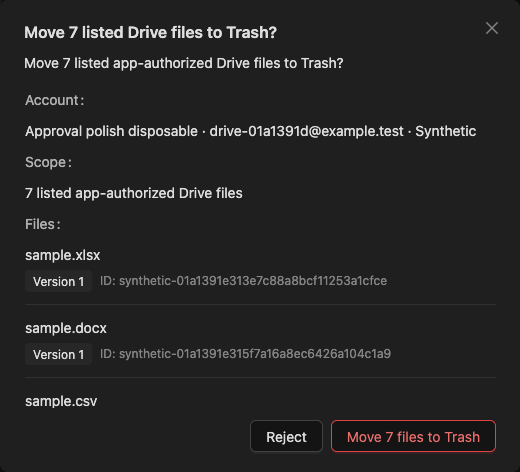
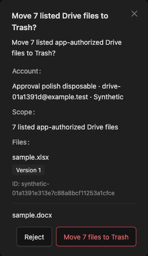

# Drive approval file list polish — 2026-10-14

The Drive approval list now groups each full filename with its exact version and ID. It removes the flex-item line break that created an empty line and extra gaps. Native Ant Design Typography, Tag and Flex retain the existing dark theme. The list owns 4px internal spacing, 12px row padding, quiet separators and normal whitespace; semantic proposals retain their existing layout. The shared approval title reserves space for the close control.

## Local verification

- Playwright MCP ran against a disposable SQLite Synthetic host at API 5086 / web 5186, verified through `/health`. A fresh general-assistant v28 Instance connected and bound a fresh Synthetic Drive account, generated eight fixtures and requested an exact seven-file Trash approval.
- The actual long Unicode targets remained complete at 1440, 768, 390 and 320px. Every list had seven rows, a measured 4px filename/metadata gap and no horizontal dialog overflow. Mobile actions remained 40px tall and within the viewport.
- Escape rejection left all eight files available. A second request confirmed with Enter moved exactly seven files to Trash, returned a truthful 7/0/0/0 receipt, left one file available and restored focus to Message. Browser console errors: zero. The inspected API requests had no failed HTTP responses; navigation-aborted pending reads were not product failures.
- Short-name presentation captures below temporarily substituted only rendered filename text in the browser DOM. Original trusted names were restored before any decision. These illustrate the requested short-file layout; the decisions and file-count readback used actual Synthetic metadata.
- `PATH=/Users/trungtran/.nvm/versions/node/v22.18.0/bin:$PATH NODE_OPTIONS=--no-experimental-webstorage pnpm --dir web exec vitest run src/features/chat/ApprovalModal.test.tsx --maxWorkers=1`: **12 passed**, including semantic/ordinary consumers, inert Drive targets and incomplete-request rejection.
- `pnpm --dir web build`: **passed**, with existing SignalR annotation and bundle-size warnings.
- `CI=1 PLAYWRIGHT_API_PORT=5098 PLAYWRIGHT_WEB_PORT=5198 PLAYWRIGHT_FAITHFUL_MANUAL=1 PLAYWRIGHT_FIXTURE_PORT=5111 PLAYWRIGHT_SQLITE_PATH=/tmp/agent-core-approval-polish/e2e/synthetic.db pnpm exec playwright test e2e/drive-office.spec.ts e2e/approval-flow.spec.ts --project=synthetic --output=/tmp/agent-core-approval-polish/e2e/results` (web directory): **7 passed**. Coverage includes Drive connection/preview/recovery and exact batch decisions, plus shared approval confirmation, rejection, keyboard, refresh and disconnect recovery. The Drive regression now asserts the visible filename/metadata gap.
- Canonical Markdown target/fence checks: **21 files, zero issues**. Design sidecar JSON and `git diff --check`: **passed**.

Hosted CI was not awaited, per the user's preference. Real Google actions and assistive-device testing were not performed; this is a local presentation refinement, not new milestone acceptance.

## Short-name presentation

