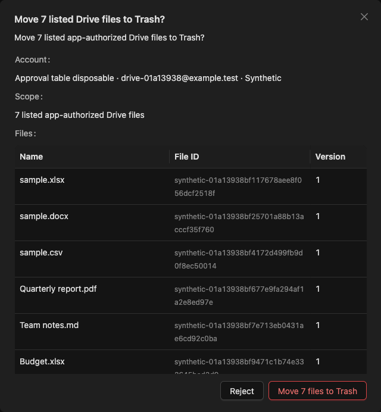
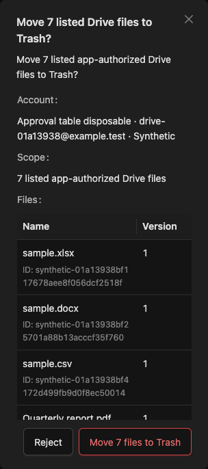

# Drive approval table — 2026-10-14

The requested table replaces the compact list for all four shared Drive mutation approvals: single/batch Trash, Rename and Move. The dialog moves from 520px to the existing 640px tier used by credential dialogs. Drive browsing, workspace inventories and resource import previews supplied the existing native Ant Design small-table pattern; `admin-collection-table` owns compact padding, wrapping and tabular numerals. Other approval types keep their existing layouts and widths.

Desktop uses Name, File ID and Version. Below the native 768px breakpoint, exact IDs appear under filenames while Version keeps its own column. No targets are truncated, paginated, selected or sorted. Full filenames, IDs and 64-character versions remain escaped and wrap completely. The Drive review cap becomes 60vh, shrinking within the existing viewport-bounded Modal with a reachable footer. Single-file cardinality, distinct bounded targets, incomplete-request rejection and server authority checks remain unchanged.

## Local evidence

- Playwright MCP verified the disposable host's Synthetic profile, connected and bound a fresh account to General Assistant v28, generated eight fixtures and requested an actual exact seven-file approval. Rejection with Escape preserved eight available files; a fresh Enter confirmation moved exactly seven, reported 7 succeeded / zero failed, uncertain or unattempted, left one available, and restored focus to Message.
- The same table was inspected at 1440×900, 768×900, 390×844, 320×800 and 768×360. Desktop width was 640px; narrow widths were 374px/304px. Native cells retained 8px padding and top alignment; IDs used the existing 12px label role. Review scroll width matched available width at every size, including a maximum-version presentation fixture. Footer controls stayed within the viewport and were 40px tall on narrow screens. Every actual target remained in the seven-row table.
- Browser console errors were zero. Two requests were canceled with `net::ERR_ABORTED`; the visible workflow and authoritative count readbacks succeeded.
- `PATH=/Users/trungtran/.nvm/versions/node/v22.18.0/bin:$PATH NODE_OPTIONS=--no-experimental-webstorage pnpm exec vitest run src/features/chat/ApprovalModal.test.tsx src/services/realtime.approval.test.ts --maxWorkers=1`: **29 passed** (23 component, six recovery). Tests cover native table headers, mobile ID placement, inert content, twenty maximum-bound targets and invalid projections.
- `pnpm build`: **passed**, with existing SignalR annotation and bundle-size warnings.
- `CI=1 PLAYWRIGHT_FAITHFUL_MANUAL=1 PLAYWRIGHT_SQLITE_PATH=/tmp/agent-core-approval-table/e2e/synthetic.db pnpm exec playwright test --config=/tmp/agent-core-approval-table/review.config.ts e2e/drive-office.spec.ts e2e/approval-flow.spec.ts --project=synthetic --output=/tmp/agent-core-approval-table/e2e/results`: **seven passed**, including actual Drive preview/recovery/batch outcomes and shared approval refresh, disconnect and keyboard behavior.
- A temporary copy of the committed `d2bada99` frontend plus the four affected UI/test files isolated verification from concurrent unfinished backend/preview edits. Repository runtime configuration was not changed. The canonical frontend spec and affected design context/sidecar/brief were synchronized; changed Markdown links/fences, design JSON and staged whitespace checks passed.

The short-name screenshots below temporarily substituted rendered filename text only, restoring the original trusted names before any decision. They illustrate the requested layout. Actual decisions used unchanged Synthetic metadata. No Real Google action or hosted CI wait was performed; broader milestone and assistive-device acceptance are not claimed.

