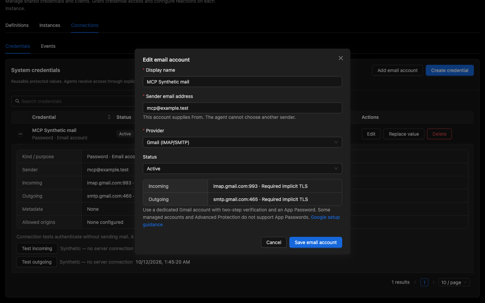
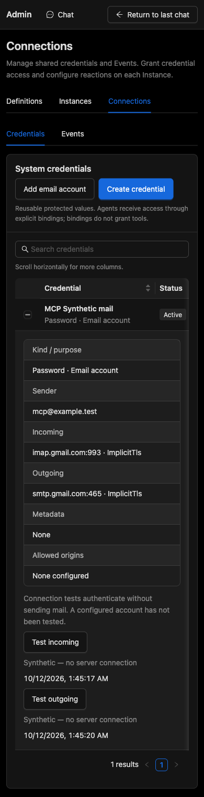
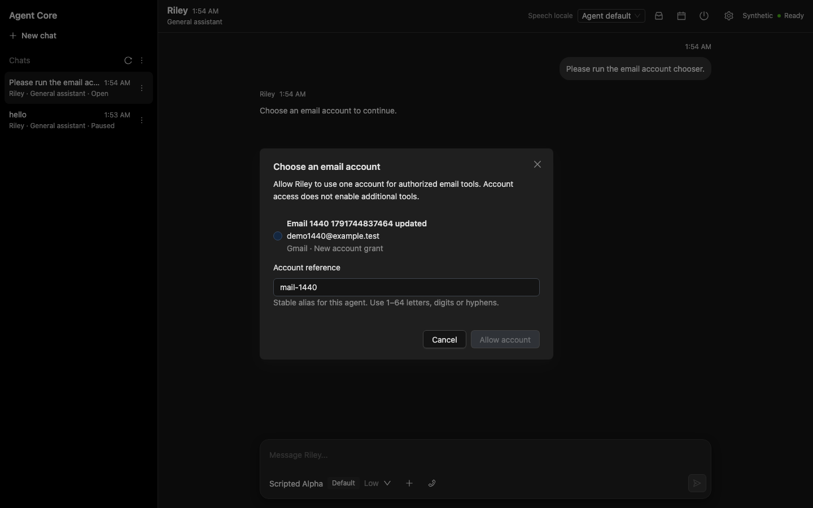
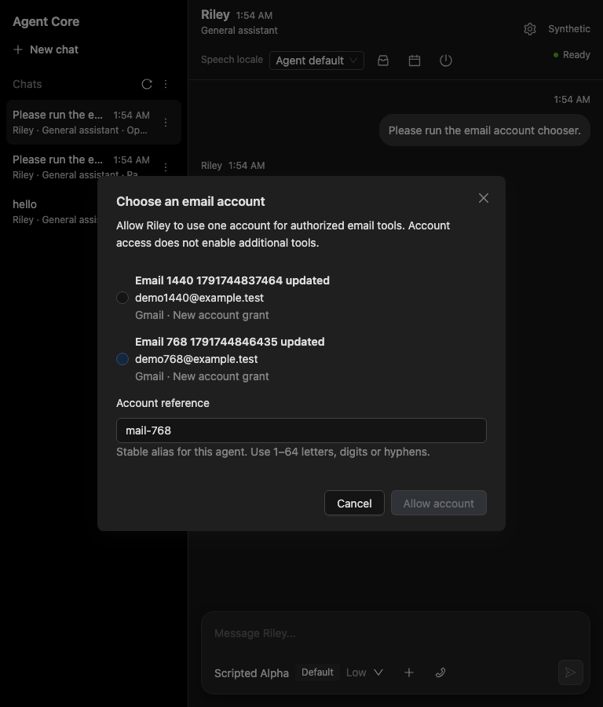
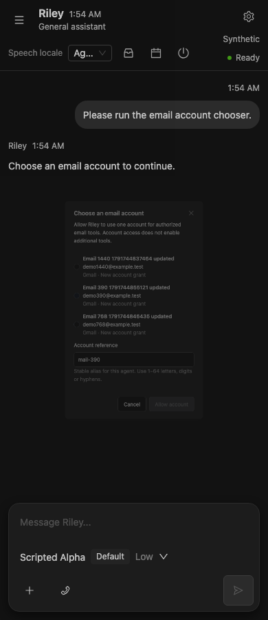

# Account-scoped Email verification — 12 October 2026

Implementation started on `9d664ca6` (`refactor`). The three intervening main commits through `10b156bb` were reviewed and are included in the final candidate; this is follow-on evidence, not a new milestone freeze. The user explicitly deferred Real setup/execution. Existing historical reports and P10/P11 remain unchanged. SMTP defaults disabled. No user database, key ring or browser profile was reset.

## Implemented behavior

One protected Password Credential plus typed EmailAccount purpose/profile; existing Instance bindings; per-account IMAP/SMTP/Synthetic factory; Browser sink separation; required TLS/public DNS-pinned egress; bounded read-only IMAP PEEK/UIDVALIDITY; durable Core drafts; full exact sender/account/To/Cc/Bcc/subject/body/revision approval; immutable-draft at-most-once dispatch and inspectable receipts; owner-only account chooser with CAS binding and one safe fresh same-Session continuation. General-assistant v25 and secretary v10 add account discovery/request. Gmail REST remains contract-tested, testing-only; no global fallback.

## Executed user journeys

- Playwright MCP against isolated Synthetic API :5290 / frontend :5390: create a Gmail fixture account using masked input; inspect safe account details; test incoming/outgoing independently and observe `Synthetic — no server connection`. Inspect desktop email editor and mobile details; request an account, explicitly select and allow it, observe one completed continuation and one original user entry, then cancel another request. Verify focused cancellation receipt and 390×900 document bounds equal the viewport. Form lifecycle/default/ID and receipt-banner overflow issues found during inspection were corrected as a batch.
- Synthetic Playwright at 1440/768/390px: create/edit/rotate/test, request account access, confirm no automatic selection, reload current durable request, explicitly allow account and alias, observe one fresh continuation and exactly one original user entry, then cancel another request and observe the safe receipt. Approved send displays sender, account alias, Bcc and complete expected content. Existing credential binding/CRUD/mobile navigation and SelfManagement approval/continuation regressions pass.
- Backend integration: protected aggregate/API CAS, owner capability, immutable Purpose, Browser rejection, account/Session isolation, two aliases/accounts, SQLite migration and key-ring/reopen, stale rotations/unbinds, long exact preview, concurrent distinct approvals, unfinished-send restart, fake TLS transport PEEK/UIDVALIDITY, envelope-only Bcc, drop-after-DATA uncertainty and invalid certificates.
- Isolated Compose project `email-account-verify-20261012` on :5318: SQLite volume and credential protection key ring survived container recreation; script passed and removed its container/network while preserving its disposable volume.

## Checks

Commands ran with repository Node 22 / pnpm 9 and .NET 10, without hosted-provider keys:

| Check | Command / result |
| --- | --- |
| Backend broad suites | `dotnet test AgentCore.sln --no-restore --nologo -m:1 -nodeReuse:false --blame-hang --blame-hang-timeout 120s`: Domain 195 passed; Application 1,694 passed / 8 opt-in skips; Infrastructure 1,190 passed / 10 opt-in skips. API 527 passed / 3 opt-in skips; deployment plugin 4 passed. Total: 3,610 passed / 21 opt-in skips. This broad local run preceded integration of the three intervening main commits; the integrated candidate is additionally checked below. |
| Latest-main integration | `dotnet test tests/AgentCore.Api.Tests/AgentCore.Api.Tests.csproj --no-restore --nologo -m:1 -nodeReuse:false --filter 'FullyQualifiedName~EmailAccountApiTests\|FullyQualifiedName~EmailSelectionRuntimeTests\|FullyQualifiedName~ReliabilityJourneyTests'`: 41 passed. `dotnet test tests/AgentCore.Application.Tests/AgentCore.Application.Tests.csproj --no-restore --nologo -m:1 -nodeReuse:false --filter 'FullyQualifiedName~ModelTriggerCommandAuthorizerTests'`: 45 passed. Final frontend build passed. |
| Full API separately | `dotnet test tests/AgentCore.Api.Tests/AgentCore.Api.Tests.csproj --no-restore --nologo -m:1 -nodeReuse:false --blame-hang --blame-hang-timeout 120s`: 527 passed / 3 opt-in live skips. |
| Focused mail Infrastructure | `dotnet test tests/AgentCore.Infrastructure.Tests/AgentCore.Infrastructure.Tests.csproj --filter 'FullyQualifiedName~ImapSmtpEmailProviderTests\|FullyQualifiedName~EmailAccountIntegrationTests\|FullyQualifiedName~SystemCredentialTests\|FullyQualifiedName~GmailEmailProviderTests' --nologo -m:1 -nodeReuse:false`: 34 passed. |
| Frontend broad suite | `pnpm --dir web run test --run --maxWorkers=2`: 115 files / 928 passed. Subsequent STARTTLS editor regression and picker refresh fencing: `pnpm --dir web run test --run src/features/admin/EmailAccountDialog.test.tsx src/features/chat/EmailAccountPicker.test.tsx --maxWorkers=1`: 4 passed. The required hosted CI would include the final extra test. |
| Build | `pnpm --dir web run build`: passed; existing SignalR annotation / bundle-size warnings. |
| Synthetic affected journeys | `pnpm --dir web exec playwright test email-accounts.spec.ts email-harness.spec.ts system-credentials.spec.ts credential-bindings-work.spec.ts self-management.spec.ts --project=synthetic`: 9 passed on isolated :5328/:5428. Final keyboard/send recheck: 4 passed on :5338/:5438. Final chooser layout/focus recheck: 3 passed on :5348/:5448, at 1440/768/390px. Runs use `CI=1 PLAYWRIGHT_FAITHFUL_MANUAL=1`, disposable SQLite/workspace/key-ring paths and dedicated fixture ports. |
| Compose / key ring | `AGENTCORE_COMPOSE_PORT=5318 COMPOSE_PROJECT_NAME=email-account-verify-20261012 bash scripts/compose-sqlite-volume.sh`: passed. |
| Migration model | `dotnet ef migrations has-pending-model-changes --project src/AgentCore.Infrastructure --startup-project src/AgentCore.Infrastructure --no-build`: no changes. Additive migration defaults existing Credentials to General and retains encrypted payload/revision; upgrade test passes. |
| Static documentation | `git diff --check` passed; 725 local Markdown links/images/anchors checked successfully before integration; 705 local file/image targets rechecked after integration, none missing. |

Initial stale Definition version expectations were updated; an initial unrestricted frontend run produced seven Admin test timeouts under concurrent heavy checks, retained as failed evidence. Browser fixture/default-field bugs and the durable continuation admission receipt gap were corrected and rechecked. No failure is relabeled as success. A new editor visibility assertion initially ran before the AntD modal animation finished; waiting for actual visibility corrected the assertion, and all four focused component tests passed.

## EA matrix and deferred gates

| Acceptance | Offline evidence |
| --- | --- |
| EA-01–05 | `EmailAccountIntegrationTests` (InMemory/SQLite), `EmailAccountApiTests`, existing Credential/role/projection suites: additive migration, protection/revisions, bound inventory, shared aliases, isolation, deterministic ambiguity and Browser sink rejection. |
| EA-07, 09–13 | `ImapSmtpEmailProviderTests`, `EmailAccountIntegrationTests`, existing `EmailToolTests` and `GmailEmailProviderTests`: PEEK/UIDVALIDITY, reopened Core drafts, full exact approval, acceptance/uncertainty, concurrent distinct approvals and revoked/rotated authority. Owner-only receipt API covers unfinished and immutable completed receipts. |
| EA-14–16 | `EmailSelectionRuntimeTests`, `email-accounts.spec.ts`, picker components and existing continuation/admission suites: same-owner/session access, fresh pins, dedupe, cancel/expiry/newer input/detach/revision fences and unattended NeedsAttention. Read-only checkpoint/effect eligibility is also reviewed at both Runtime and durable admission boundaries. |
| EA-17–19 | Fake TLS transports, public-DNS policy tests, existing header/injection/approval tests and captured model requests: reject downgrade/invalid certificates/private addresses, preserve independent authority and redact protected values. This is bounded adversarial test evidence, not a claim to prove every possible malicious email. |
| EA-20–21 | Responsive interactive Playwright/MCP, keyboard explicit choice and focus receipt, safe Admin create/edit/rotate/test plus existing binding/send/SelfManagement regressions. Full backend/frontend suites retain legacy contracts. |

EA-06 has separate Synthetic Admin observations and fake TLS authentication without dispatch, not live Gmail connectivity. EA-08 preserves Gmail REST contract tests but does not enable that adapter in the production factory until typed OAuth profiles exist. EA-22 live Gmail/delivery remains deliberately deferred. EA-23 canonical owners, setup, README/TODO/plan and DESIGN/PRODUCT context are synchronized. EA-24 local checks are reported precisely; exact behavior-commit hosted CI is unrun and full release acceptance is not claimed.

Behavior candidate: `b456fdada83698d5b0b43bdeda294935800fb5ae` on `develop/branch-1`, with main through `10b156bb49b62f78ea6266109394f825d9c03923` integrated. Automatic approval review rejected pushing this candidate to `https://github.com/trannamtrung1st/agent-core.git`: repository ownership/trust and explicit source-export authorization were not established. That first attempt did not push or dispatch CI. The subsequent user request explicitly authorizes commit/push to the current development branch, resolving the source-export blocker. The follow-up below records its new candidate and hosted results. No PR or merge into main was requested. The final report is a documentation-only descendant of the behavior candidate. Local verification servers were stopped after the journeys. This is an authorization blocker, not a failing CI result.

Impeccable reported that DESIGN.md is newer than its local design sidecar; the skill requires reporting drift without silently regenerating it. Product presentation context itself was synchronized to the observed UI.

Custom DNS rebinding/private-address policy tests exercise the validation and pinned-socket boundary, not a real public DNS server. SMTP Sent evidence means server acceptance, not guaranteed final delivery. Unfinished/Indeterminate receipts never cause automatic retries. General Credentials default to General through the additive migration; retain the existing SQLite/key-ring backup policy.

## Screenshots












## Consistency and behavior review follow-up

The user requested another review, corrections, commit and push to `develop/branch-1`. Main's subsequent `c2dc0512` authorization fix was reviewed and merged into this branch without rewriting the email commits.

Three related findings were corrected:

- Malformed mail aliases raised `ArgumentException` outside the normal tool/approval error boundary. Translate them into a safe Validation response. Two integration regressions first reproduced the exception in InMemory/SQLite and then passed; no provider dispatch occurs.
- Serial polling discarded updated choices/revisions when the request ID was unchanged. Apply every current snapshot, preserve only eligible selected accounts and require an explicit choice after removal. Allow also verifies that the selected account is present. Keep decided-request memory bounded to the current attachment and fence late decisions as well as polling/refresh callbacks after disconnect/Session change.
- Zero eligible accounts may mean disabled accounts exist. The message now says “No active email accounts” and offers add/enable guidance.

Playwright MCP on isolated Synthetic :5292/:5392 created a masked fixture account and opened the owner chooser at 390×900. Disabling the selected account through the owner Admin API removed its radio and disabled Allow. Re-enabling restored the option without selection. Explicit selection/confirmation completed one fresh email continuation and retained exactly one original user entry. Document dimensions remained 390×900; the final journey had no console errors. An initial fixture provisioning request used the wrong version field, returned 400 safely, and was corrected to the existing `version` contract before the journey.

Focused checks: 36 Infrastructure mail/credential integration tests; 47 API email/selection/scheduling journeys; seven editor/picker component tests. The affected Synthetic browser run passed all nine journeys at 1440/768/390px, and the final frontend build passed. Exact candidate hosted CI remains the last non-live gate at this commit. Initial new picker regressions reproduced stale revision/removed-choice behavior; no failing run is counted as passing evidence. Real Gmail remains deferred by the user and SMTP defaults off.


Follow-up commands (local):

```sh
dotnet test tests/AgentCore.Infrastructure.Tests/AgentCore.Infrastructure.Tests.csproj --no-restore --nologo -m:1 -nodeReuse:false --filter 'FullyQualifiedName~EmailAccountIntegrationTests|FullyQualifiedName~ImapSmtpEmailProviderTests|FullyQualifiedName~GmailEmailProviderTests|FullyQualifiedName~SystemCredentialTests'
dotnet test tests/AgentCore.Api.Tests/AgentCore.Api.Tests.csproj --no-restore --nologo -m:1 -nodeReuse:false --filter 'FullyQualifiedName~EmailAccountApiTests|FullyQualifiedName~EmailSelectionRuntimeTests|FullyQualifiedName~ReliabilityJourneyTests'
pnpm --dir web run test --run src/features/chat/EmailAccountPicker.test.tsx src/features/admin/EmailAccountDialog.test.tsx --maxWorkers=1
pnpm --dir web run build
# Isolated ports :5358/:5458, fixture :5359 and disposable persistence roots:
CI=1 PLAYWRIGHT_FAITHFUL_MANUAL=1 PLAYWRIGHT_API_PORT=5358 PLAYWRIGHT_WEB_PORT=5458 PLAYWRIGHT_FIXTURE_PORT=5359 PLAYWRIGHT_SQLITE_PATH=/tmp/email-review-e2e.db pnpm --dir web exec playwright test email-accounts.spec.ts email-harness.spec.ts system-credentials.spec.ts credential-bindings-work.spec.ts self-management.spec.ts --project=synthetic
```

Local broad-suite evidence above is retained for its original candidate. The hosted workflow must verify all backend/frontend/browser/Compose gates on this final reviewed source, including the latest-main integration; focused results alone do not claim that gate.


### Hosted gate reproduction and correction

[First hosted run](https://github.com/trannamtrung1st/agent-core/actions/runs/38167937271) targeted exact source `9ce0079c883725f79b5332d38b6d4aa143b88201`. Its Admin lifecycle acceptance job failed because native cancellation of owner picker GET polls during Chat/Admin navigation was counted as an unexpected transport error. Local reproduction retained the original assertion and added error text: all three entries were `net::ERR_ABORTED` on `/api/v2/sessions/<guid>/email-account-request`.

The shared E2E classifier now recognizes only GET + that exact route + native `net::ERR_ABORTED`. It never ignores connection refusal/reset, decision POSTs, unrelated reads or HTTP error responses. Existing draft-evidence cancellation checks/receipt assertions remain intact. The unit regression verifies these exclusions; all one unit test, one reproduced Admin lifecycle journey and ten representative Chat/Admin/Core Event/Skill/vision journeys passed. TypeScript/Vite build and `git diff --check` passed. This changes verification classification, not production cancellation or mail behavior.

Commands: `pnpm --dir web run test --run src/test/request-failures.test.ts --maxWorkers=1`; isolated Synthetic `pnpm --dir web exec playwright test --project=admin-lifecycle` on :5368/:5468; `pnpm --dir web exec playwright test admin-shell.spec.ts instance-skills.spec.ts p8-skill-journey.spec.ts scripted-vision.spec.ts core-event-presets.spec.ts --project=synthetic` on :5378/:5478. Both browser invocations used fresh disposable SQLite/workspace/key-ring roots and `CI=1 PLAYWRIGHT_FAITHFUL_MANUAL=1`. All unexpected-request, console and response assertions remain required.

The first failed run stays in the ledger. A new exact-source run replaces it after the corrected candidate is pushed; unfinished old gates may be cancelled by the workflow's existing same-branch concurrency rule and are not counted as passing.
